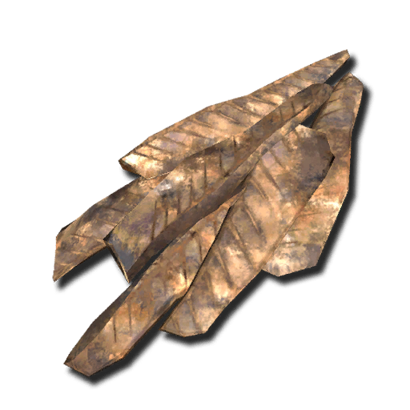

# Cured Fish

<table>
<colgroup>
<col style="width: 33%" />
<col style="width: 33%" />
<col style="width: 33%" />
</colgroup>
<tbody>
<tr>
<td width="40px"><figure>
[Missing image: Ptarmigan_icon.png]
<figcaption>Ptarmigan_icon.png</figcaption>
</figure></td>
<td>
<strong>DLC-Exclusive content.</strong> 

This content requires the <a href="./Tales%20from%20the%20Far%20Territory.md" class="wikilink" title="Tales from the Far Territory">Tales from the Far Territory</a> addon to be installed before it can be seen or used in regular gameplay.

</td>
<td>
|}

<table class="infobox">
<caption>Cured Fish</caption>
<colgroup>
<col style="width: 50%" />
<col style="width: 50%" />
</colgroup>
<tbody>
<tr>
<td colspan="2"><figure>

<figcaption>Cured_Fish_icon.png</figcaption>
</figure></td>
</tr>
<tr>
<td>
Release
</td>
<td>
<a href="./The%20Long%20Dark%20%E2%80%94%20Changelog.md#2.33" class="wikilink" title="2 December 2024">2 December 2024</a>
</td>
</tr>
<tr>
<td>
Wintermute
</td>
<td>
No
</td>
</tr>
<tr>
<td colspan="2" class="section">
<strong>Properties</strong>
</td>
</tr>
<tr>
<td>
Item type
</td>
<td>
<a href="./Food%20And%20Drink.md" class="wikilink" title="Food And Drink">Food And Drink</a>|-
</td>
</tr>
<tr>
<td>
Stackable
</td>
<td>
No
</td>
</tr>
<tr>
<td>
Examine
</td>
<td>
Fish that has been cured and preserved.
</td>
</tr>
<tr>
<td colspan="2" class="section">
<strong>Values</strong>
</td>
</tr>
<tr>
<td>
Calories
</td>
<td>
900 kcal
</td>
</tr>
<tr>
<td>
Hydration
</td>
<td>
-5%
</td>
</tr>
<tr>
<td>
Weight
</td>
<td>
0.20 kg (0.44 lbs)
</td>
</tr>
</tbody>
</table>

<strong>Cured Fish</strong> is a <a href="./Food%20And%20Drink.md" class="wikilink" title="Food And Drink">Food And Drink</a> item in <em><a href="./The%20Long%20Dark.md" class="wikilink" title="The Long Dark">The Long Dark</a></em>.

<h2 id="Overview">Overview</h2>

Cured Fish can only be acquired by placing any type of raw fish with condition higher than 40% inside a <a href="./Meat%20Curing%20Box.md" class="wikilink" title="Meat Curing Box">Meat Curing Box</a> filled with <a href="./Salt.md" class="wikilink" title="Salt">Salt</a> for 7 in-game days. Placing meat inside a Meat Curing Box will instead produce <a href="./Cured%20Meat.md" class="wikilink" title="Cured Meat">Cured Meat</a>.

Cured Fish has no <a href="./Scent.md" class="wikilink" title="Scent">Scent</a> and is completely safe to consume in high (above 75%) condition. Cured Fish in 20%-75% condition has a very low food (1%) poisoning chance. Additionally, cured fish inherits the condition of the meat you insert to the box (Eg, putting in a 86% condition fish will result in a 86% condition cured fish).

On its own, Cured Fish is an amazing food source, having high calories of 900 while weighing only at 0.20 kg, which is much lighter than a cooked fish. Cured Fish also lasts much longer than the typically cooked fish. This makes Cured Fish a very valuable end-game food should the player eventually run out of non-renewable food sources. One downside of curing fish is that all Vitamin C units are lost, regardless of the source fish. Cured Fish has no Vitamin C content which is a factor when considering <a href="./Scurvy%20Risk.md" class="wikilink" title="Scurvy">Scurvy</a> risk.

It doesn't matter the weight or calories of raw fish input, the output is always the same: 1 whole raw fish =&gt; 0.20 kg Cured Fish with 900 kcal. The best strategy is to cure small and low calories fish, with less than 900 kcal/fish, because it will increase the calories when it transforms into Cured Fish.

If the player ate from a raw fish, the leftover fish will cure at a weight ratio of 20/1 (1 kg leftover raw fish =&gt; 0.05 kg Cured Fish). So, in order to obtain maximum calories from curing a raw fish bigger than 4kg, it can be partially eaten until it reaches 4 kg (risking <a href="./Food%20Poisoning.md" class="wikilink" title="Food Poisoning">Food Poisoning</a>), then cure 4kg leftover raw fish into 0.20 kg Cured Fish.

Unlike Cured Meat, Cured Fish cannot be used to cook <a href="./Pemmican%20Bar.md" class="wikilink" title="Pemmican Bar">Pemmican Bar</a>.

<h2 id="Update_history">Update history</h2>

<strong>Template:update historyLua execution error in Module:Navbox function navbox</strong> <a href="ru:%D0%97%D0%B0%D1%81%D0%BE%D0%BB%D0%B5%D0%BD%D0%BD%D0%B0%D1%8F_%D1%80%D1%8B%D0%B1%D0%B0" class="wikilink" title="ru:Засоленная рыба">ru:Засоленная рыба</a>
</td>
</tr>
</tbody>
</table>

