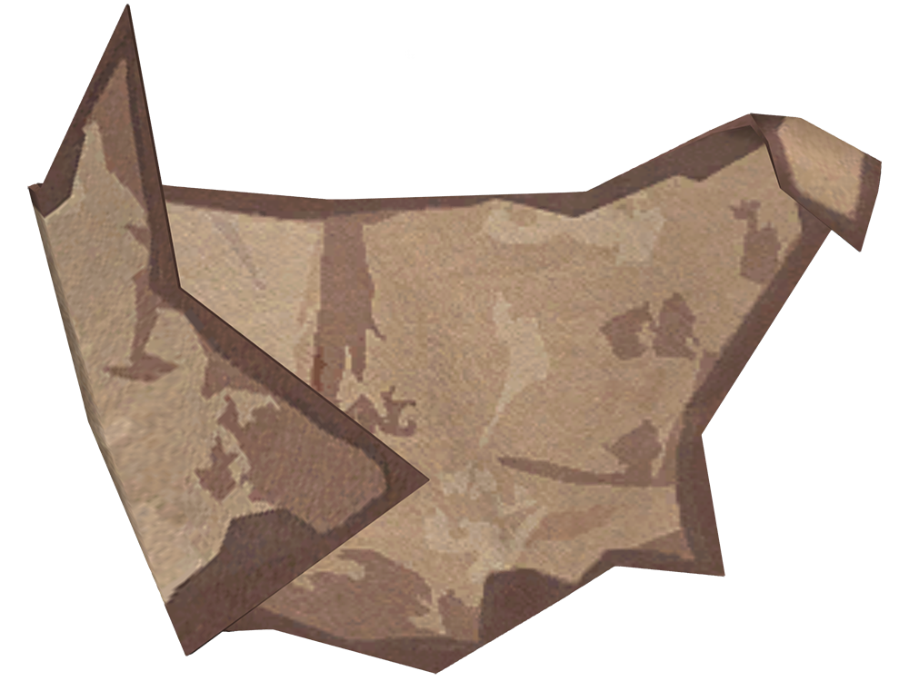
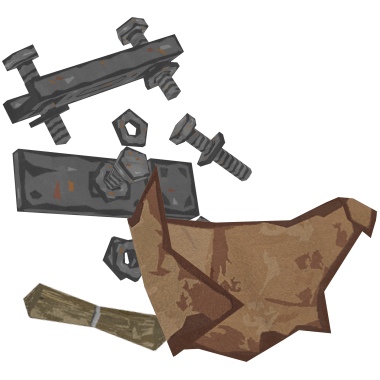

# Cured Leather

**Categories:** Materials, Pages with update history · **Source:** [Fandom](https://thelongdark.fandom.com/wiki/Cured_Leather)

**Contents**

- [Overview](#overview)
- [Footwear](#footwear)
- [Gloves](#gloves)
- [Accessory](#accessory)
- [Products](#products)
- [Trivia](#trivia)
- [Gallery](#gallery)
- [Update history](#update-history)

**Cured Leather**

_Cured\_Leather\_icon.png_

**Release:** [22 May 2015](./The%20Long%20Dark%20%E2%80%94%20Changelog.md#0.233)

**Wintermute:** No

**Renewable:** Yes ([Beachcombing](./Beachcombing.md))

**Properties**

**Item type:** [Materials](./Materials.md)

**Stackable:** No

**Examine:** Leather that can be used for repairs.

**Values**

**Weight:** 0.10 kg (0.22 lbs)

**Cured Leather** is a material in _[The Long Dark](./The%20Long%20Dark.md)_.

## Overview

Cured Leather is a resource for repairing leather footwear, gloves, and accessories. It can be found uncommonly in containers or on the ground, and can be harvested from leather items. It is unrelated to the hides obtained from harvesting animals.

Cured Leather is harvested from and used to repair:

#### Footwear

- [Running Shoes](./Running%20Shoes.md)
- [Leather Shoes](./Leather%20Shoes.md)
- [Trail Boots](./Trail%20Boots.md)
- [Combat Boots](./Combat%20Boots.md)
- [Work Boots](./Work%20Boots.md)
- [Insulated Boots](./Insulated%20Boots.md)
- [Ski Boots](./Ski%20Boots.md)
- [Mukluks](./Mukluks.md)

#### Gloves

- [Driving Gloves](./Driving%20Gloves.md)
- [Work Gloves](./Work%20Gloves.md)
- [Gauntlets](./Gauntlets.md)
- [Tactical Gloves](./Tactical%20Gloves.md)

#### Accessory

- [Moose-Hide Satchel](./Moose-Hide%20Satchel.md)
- [Security Chief's Rifle Holster](./Security%20Chief%27s%20Rifle%20Holster.md)
- [Foreman's Tool Belt](./Foreman%27s%20Tool%20Belt.md)

## Products

| Item | Skills | Materials |
| --- | --- | --- |
| &lt;a href="Cougar Claw Knife"&gt;Cougar Claw Knife&lt;/a&gt; | None | - 1 × &lt;a href="Cougar Claw"&gt;Cougar Claw&lt;/a&gt; / - 3 × &lt;a href="Scrap Metal"&gt;Scrap Metal&lt;/a&gt; / - 1 × &lt;a href="Cured Leather"&gt;Cured Leather&lt;/a&gt; |
| &lt;a href="Improvised Crampons"&gt;Improvised Crampons&lt;/a&gt; | None | - 4 × &lt;a href="Scrap Metal"&gt;Scrap Metal&lt;/a&gt; / - 2 × &lt;a href="Cured Leather"&gt;Cured Leather&lt;/a&gt; |

## Trivia

- In early builds of _The Long Dark_ (alpha), Deer Hides provided "[Fresh Leather](./Fresh%20Leather.md)" when harvested; this item could be converted into "Cured Leather" by curing it, and then used for repairing clothing. Cured Leather is still present in _The Long Dark_, but is only obtainable by Harvesting leather footwear, gloves, the Moose-Hide Satchel, and [Beachcombing](./Beachcombing.md).

## Gallery

_Old model._

_ditto, with old Scrap Metal model_

## Update history

- UPDATE **22 May 2015 ([Update](./The%20Long%20Dark%20%E2%80%94%20Early%20Access%20Changelog.md#0.233)):**
  - Added to game.
