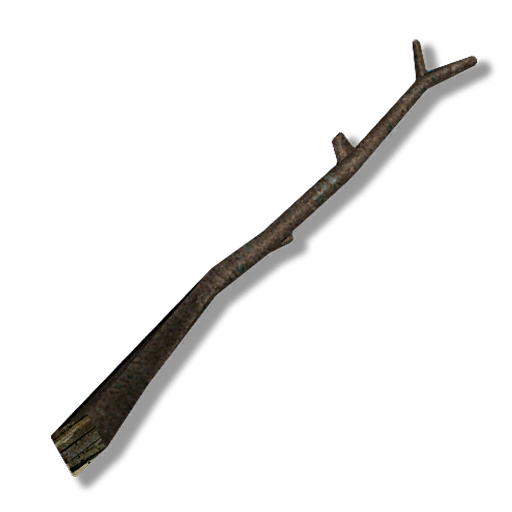
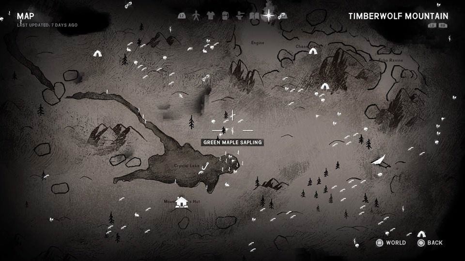
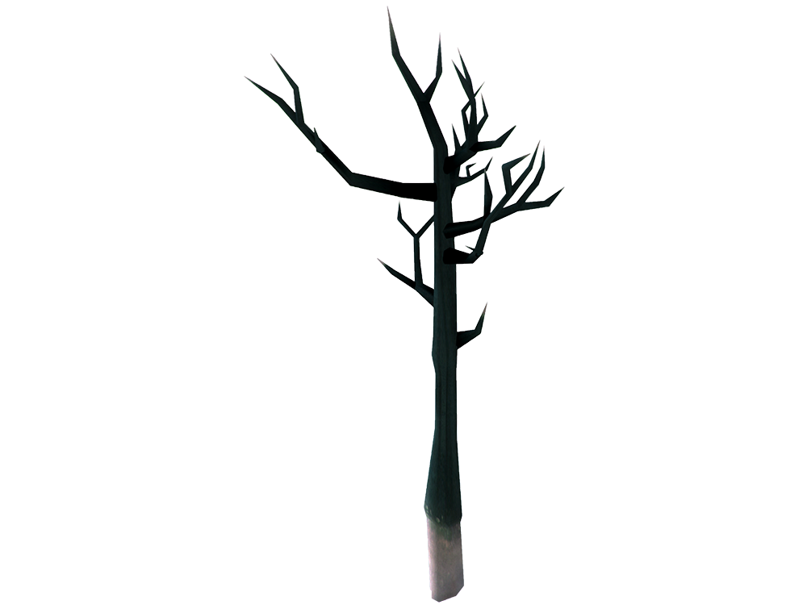

# Cured Maple Sapling

**Categories:** Materials, Pages with update history · **Source:** [Fandom](https://thelongdark.fandom.com/wiki/Cured_Maple_Sapling)

**Cured Maple Sapling**

_Cured\_Maple\_Sapling\_icon.png_

**Release:** [22 May 2015](./The%20Long%20Dark%20%E2%80%94%20Changelog.md#0.233)

**Wintermute:** No

**Renewable:** Yes

**Properties**

**Item type:** [Materials](./Materials.md)

**Stackable:** No

**Examine:** Small maple sapling that has been cured. Can be used for crafting and repair.

**Values**

**Weight:** 0.30 kg (0.66 lbs)

**Actions**

**Backpack:** Take It, Leave It

A **Cured Maple Sapling** is a plant-based Material that can be used to craft a [Survival Bow](./Survival%20Bow.md) or [Travois](./Travois.md) at a [Work Bench](./Work%20Bench.md). Both [Green](./Green%20Maple%20Sapling.md) and Cured Maple Saplings do not [Decay](./Decay.md), and will always be at 100% condition.

Maple Saplings are found out in forested and occasionally open landscapes. They usually come in alone or in pairs, but are normally not found in close proximity to [Green Birch Saplings](./Green%20Birch%20Sapling.md).

Maple Saplings can be harvested with a [Hatchet](./Hatchet.md), [Improvised Hatchet](./Improvised%20Hatchet.md), or a [Hacksaw](./Hacksaw.md), for one Green Maple Sapling.

Saplings do not regrow after harvesting. Tools do not suffer condition loss when harvesting saplings.

Cured Maple Saplings are occasionally found when [Beachcombing](./Beachcombing.md).

## Products

| Item | Skills | Materials |
| --- | --- | --- |
| &lt;a href="Survival Bow"&gt;Survival Bow&lt;/a&gt; | None | - 1 × &lt;a href="Cured Maple Sapling"&gt;Cured Maple Sapling&lt;/a&gt; / - 2 × &lt;a href="Cured Gut"&gt;Cured Gut&lt;/a&gt; |
| &lt;a href="Travois"&gt;Travois&lt;/a&gt; | None | - 1 × &lt;a href="Cured Deer Hide"&gt;Cured Deer Hide&lt;/a&gt; / - 2 × &lt;a href="Cured Gut"&gt;Cured Gut&lt;/a&gt; / - 4 × &lt;a href="Cured Maple Sapling"&gt;Cured Maple Sapling&lt;/a&gt; |

## Gallery

_Maple sapling as it appears on the [map](./Map.md)_

_A growing maple sapling._

## Update history

- UPDATE **22 May 2015 ([Update](./The%20Long%20Dark%20%E2%80%94%20Early%20Access%20Changelog.md#0.223)):**
  - Added to game
