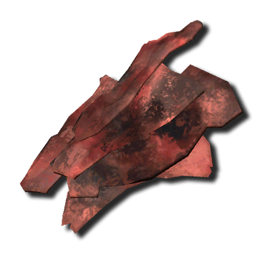

# Cured Meat

| Column 1 | Column 2 | Column 3 |
| --- | --- | --- |
|  / *Ptarmigan\_icon.png* | **DLC-Exclusive content.** / This content requires the [Tales from the Far Territory](./Tales%20from%20the%20Far%20Territory.md) addon to be installed before it can be seen or used in regular gameplay. | \|} / **Cured Meat** / \| Property \| Details \| / \| --- \| --- \| / \|  \|  / *Cured\_Meat\_icon.png* \| / \| Release \| [2 December 2024](./The%20Long%20Dark%20%E2%80%94%20Changelog.md#2.33) \| / \| Wintermute \| No \| / \| **Properties** \|  \| / \| Item type \| [Food And Drink](./Food%20And%20Drink.md)\\|- \| / \| Stackable \| No \| / \| Examine \| Meat that has been cured and preserved. \| / \| **Values** \|  \| / \| Calories \| 900 kcal \| / \| Hydration \| -5% \| / \| Weight \| 0.25 kg (0.55 lbs) \| / **Cured Meat** is a [Food And Drink](./Food%20And%20Drink.md) item in *[The Long Dark](./The%20Long%20Dark.md)*. / ## [Overview](./Meat%20Curing%20Box.md) / Cured Meat can be produced by placing any type of raw meat with condition higher than 40% inside a [Meat Curing Box](./Meat%20Curing%20Box.md) filled with [Salt](./Salt.md) for 5 in-game days. Placing fish inside a Meat Curing Box will instead produce [Cured Fish](./Cured%20Fish.md). / The meat has no [Scent](./Scent.md) and is completely safe to consume in high (above 75%) condition. If a predator meat is cured, there will be no [Risk of Intestinal Parasites](./Risk%20of%20Intestinal%20Parasites.md). Cured Meat in 20%-75% condition has a very low food poisoning risk (only 1%). Additionally, Cured Meat inherits the condition of the meat you insert to the box (Eg, putting in a 86% condition meat will result in a 86% condition cured meat). / On its own, Cured Meat is an amazing food source, having high calories of 900 while weighing only at 0.25 kg (0.20 kg for fish), which is 0.75 kg lighter than a cooked meat. Cured Meat also lasts much longer than the typically cooked meats. This makes the meat a very valuable end-game food should the player eventually run out of non-renewable food sources. / The calories of raw meat put in the curing box don't affect the calories of the cured meat; the output is always the same Cured Meat, using 4/1 or 5/1 weight ratio (eg: 1kg raw meat =&gt; 0.25 kg Cured Meat with 900 kcal or 0.20 kg for fish). The best strategy is to cure raw meat with less than 900 kcal/kg (rabbit, ptarmigan, wolf) because it will increase the calories when it transforms into Cured Meat (TLD version 2.35). / ## Products / ## Update history / **Template:update history****Lua execution error in Module:Navbox function navbox** / [ru:Засоленное мясо](ru:%D0%97%D0%B0%D1%81%D0%BE%D0%BB%D0%B5%D0%BD%D0%BD%D0%BE%D0%B5_%D0%BC%D1%8F%D1%81%D0%BE) |
|  / *Cured\_Meat\_icon.png* |  |  |
| Release | [2 December 2024](./The%20Long%20Dark%20%E2%80%94%20Changelog.md#2.33) |  |
| Wintermute | No |  |
| **Properties** |  |  |
| Item type | [Food And Drink](./Food%20And%20Drink.md)\|- |  |
| Stackable | No |  |
| Examine | Meat that has been cured and preserved. |  |
| **Values** |  |  |
| Calories | 900 kcal |  |
| Hydration | -5% |  |
| Weight | 0.25 kg (0.55 lbs) |  |
