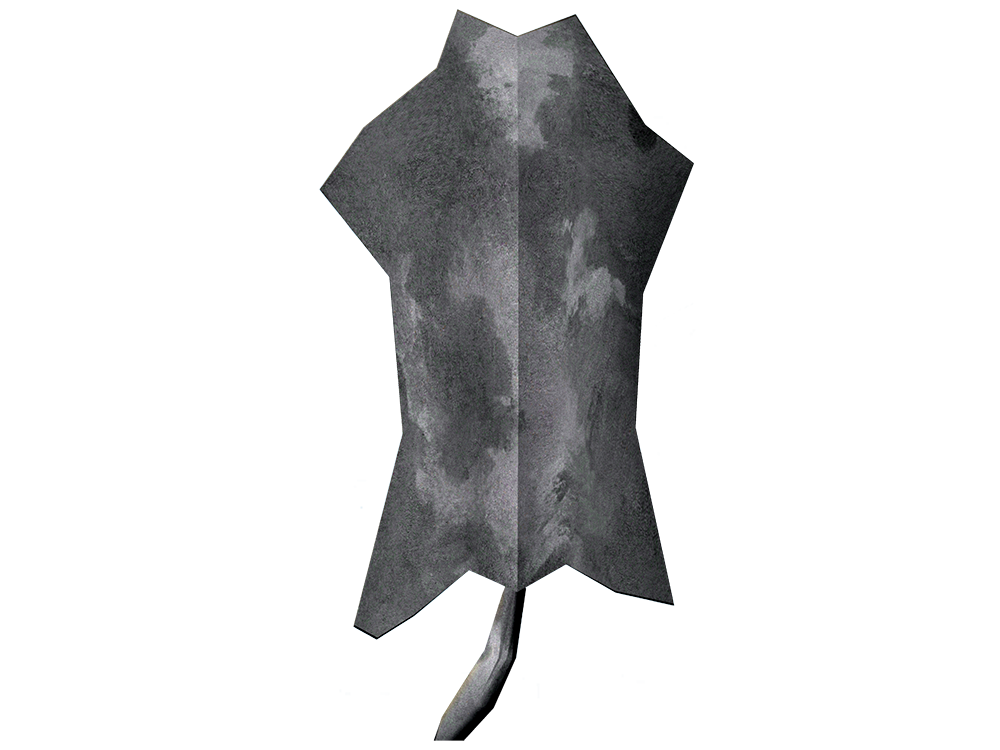

# Cured Wolf Pelt

**Categories:** Materials, Pages with update history · **Source:** [Fandom](https://thelongdark.fandom.com/wiki/Cured_Wolf_Pelt)

**Contents**

- [Overview](#overview)
- [Products](#products)
- [Gallery](#gallery)
- [Update history](#update-history)

**Cured Wolf Pelt**

| Property | Details |
| --- | --- |
|  | [Cured Wolf Pelt icon](../assets/Cured_Wolf_Pelt_icon.png) |
| Release | [22 May 2015](./The%20Long%20Dark%20%E2%80%94%20Early%20Access%20Changelog.md#0.233) |
| Wintermute | No |
| **Properties** |  |
| Item type | [Materials](./Materials.md)\|- |
| Stackable | No |
| Examine | Fur from a Wolf. Warm, and striking to look at. Can be used for crafting and repair. |
| **Values** |  |
| Weight | 0.75 kg (1.65 lbs) |

**Cured Wolf Pelt** is the cured hide of a [Wolf](./Wolf.md), [Timberwolf](./Timberwolf.md), or [Poisoned Wolf](./Poisoned%20Wolf.md). It can be used as a [Material](./Materials.md) for crafting or repairing [Wolfskin Coats](./Wolfskin%20Coat.md).

## Overview

Fresh Wolf Pelts are acquired from harvesting a [Wolf](./Wolf%20Carcass.md), [Timberwolf](./Timberwolf%20Carcass.md), or [Poisoned Wolf Carcass](./Poisoned%20Wolf%20Carcass.md). They can then be cured by leaving them indoors for 7 days (in-game). Cured Wolf Pelts are used for crafting the Wolfskin Coat, or repairing it. Once cured, the hide will take on a darker complexion, and can then be used for crafting.

Wolf Pelts are a relatively dangerous resource obtain, since they requiring killing a Wolf with a [Hunting Rifle](./Hunting%20Rifle.md), [Revolver](./Revolver.md), or [Survival Bow](./Survival%20Bow.md), but are easy to find due to the abundance of Wolves across [Great Bear Island](./Great%20Bear%20Island.md).

An alternative but also very dangerous method of obtaining a pelt involves allowing a Wolf [Struggle](./Struggle.md) to begin, and then using a [Hunting Knife](./Hunting%20Knife.md) or [Improvised Knife](./Improvised%20Knife.md) to puncture a Wolf, then waiting a few hours for the Wolf to bleed out after it runs away. This method is incredibly dangerous if a survivor has very low [Condition](./Condition.md).

If the player is unable or unwilling to kill a wolf, there are also a few [ravaged wolf carcasses](./Wolf%20Carcass.md) that spawn in the world, and they can occasionally be found when [beachcombing](./Beachcombing.md) as well.

Each Wolf Carcass will have one pelt, along with [meat](./Wolf%20Meat%20%28Raw%29.md) and [Fresh Gut](./Cured%20Gut.md). Limited numbers of dead wolves may be found across Great Bear Island.

## Products

| Item | Skills | Materials |
| --- | --- | --- |
| [Wolfskin Coat](./Wolfskin%20Coat.md) | None | - 4 × [Cured Wolf Pelt](./Cured%20Wolf%20Pelt.md); - 4 × [Cured Gut](./Cured%20Gut.md) |

## Gallery

## Update history

- UPDATE **22 May 2015 ([Update](./The%20Long%20Dark%20%E2%80%94%20Early%20Access%20Changelog.md#0.233)):**
  - Added to game.
