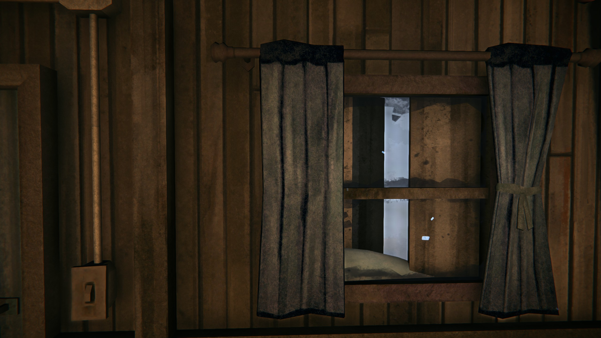

# Curtain

**Categories:** Interactable Objects, Story items · **Source:** [Fandom](https://thelongdark.fandom.com/wiki/Curtain)

**Curtain**

| Property | Details |
| --- | --- |
| \[\[File: /  / _Window_ /  / _Bed_ | 250px\]\] |
|  / _Window_ |  / _Bed_ |
| **General** |  |
| Item Type | Item |

| Cloth | Time / Calories / Condition of Tool |
| 2 | 10 minutes / 31 / -0% by Hand |
| 2 | 6 minutes / 18 / -2% Hunting Knife |
| 2 | 8 minutes / 23 / -3% Improvised Knife |
| Cloth | Time / Calories / Condition of Tool |
| 3 | 15 minutes / 45 / -0% by Hand |
| 3 | 9 minutes / 27 / -2% Hunting Knife |
| 3 | 11 minutes / 34 / -3% Improvised Knife |
