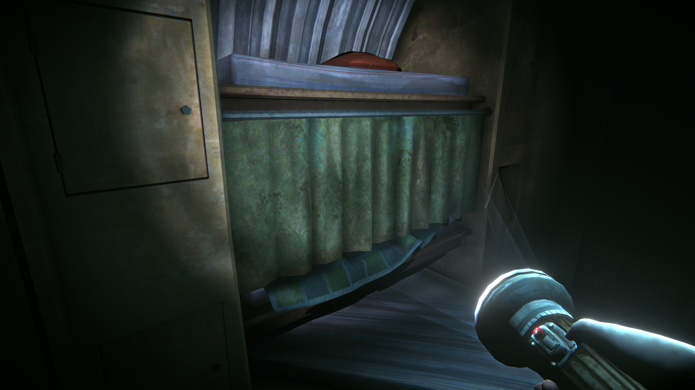

# Curtain

**Curtain**

| Property | Details |
| --- | --- |
| \[\[File: / \|  / *Window* \|  / *Bed* \| / \| --- \| --- \| | 250px\]\] |
|  / *Window* |  / *Bed* |
| **General** |  |
| Item Type | Item |
| Wintermute | Yes\|} **Curtains** are interactable items that are found inside homes, cabins, or industrial buildings and can be harvested for [Cloth](./Cloth.md) either by hand or with a [Hunting Knife](./Hunting%20Knife.md). / ## Curtain / \| Cloth \| Time \| Calories \| Condition of Tool \| / \| --- \| --- \| --- \| --- \| / \| 2 \| 10 minutes \| 31 \| -0% by Hand \| / \| 2 \| 6 minutes \| 18 \| -2% Hunting Knife \| / \| 2 \| 8 minutes \| 23 \| -3% Improvised Knife \| / ## Bed Curtain / \| Cloth \| Time \| Calories \| Condition of Tool \| / \| --- \| --- \| --- \| --- \| / \| 3 \| 15 minutes \| 45 \| -0% by Hand \| / \| 3 \| 9 minutes \| 27 \| -2% Hunting Knife \| / \| 3 \| 11 minutes \| 34 \| -3% Improvised Knife \| / **Lua execution error in Module:Navbox function navbox** |
| Cloth | Time / Calories / Condition of Tool |
| 2 | 10 minutes / 31 / -0% by Hand |
| 2 | 6 minutes / 18 / -2% Hunting Knife |
| 2 | 8 minutes / 23 / -3% Improvised Knife |
| Cloth | Time / Calories / Condition of Tool |
| 3 | 15 minutes / 45 / -0% by Hand |
| 3 | 9 minutes / 27 / -2% Hunting Knife |
| 3 | 11 minutes / 34 / -3% Improvised Knife |
