# Cut/Discontinued Content

**Contents**

- [Cut Tools/Mechanics](#Cut_Tools%2FMechanics)
- [Brand](#Brand)
- [Brandishing](#Brandishing)
- [Shovel](#Shovel)
- [Fire Axe](#Fire_Axe)
- [Compression Bandage](#Compression_Bandage)
- [Charcoal Accelerant](#Charcoal_Accelerant)
- [Flint and Steel](#Flint_and_Steel)
- [Heated Car Seats](#Heated_Car_Seats)
- [Dark Room](#Dark_Room)
- [Carriable Wolf Carcass](#Carriable_Wolf_Carcass)
- [Fresh Leather](#Fresh_Leather)
- [Pumpkin Pie and 2500 Calorie Chocolate Bar](#Pumpkin_Pie_and_2500_Calorie_Chocolate_Bar)
- [Past Events](#Past_Events)
- [Early Survival Mode](#Early_Survival_Mode)
- [Struggle](#Struggle)
- [Running instead of Sprinting](#Running_instead_of_Sprinting)
- [Abstract Foraging for Fuel](#Abstract_Foraging_for_Fuel)
- [Searching Containers](#Searching_Containers)
- [Calorie Store](#Calorie_Store)
- [Drop Decoy](#Drop_Decoy)
- [Item Model/Name Changes](#Item_Model%2FName_Changes)
- [Fire Staring](#Fire_Staring)
- [Clothing](#Clothing)
- [Food and Drink](#Food_and_Drink)
- [First Aid](#First_Aid)
- [Tools](#Tools)
- [Materials](#Materials)
- [Old Survival Menu/UI backgrounds](#Old_Survival_Menu%2FUI_backgrounds)
- [Survival Skills](#Survival_Skills)
- [Clock and Time of day](#Clock_and_Time_of_day)
- [Discontinued Wintermute Content](#Discontinued_Wintermute_Content)
- [The original Wintermute storyline](#The_original_Wintermute_storyline)
- [Hatch in Trapper's Homestead Floorboards](#Hatch_in_Trapper%27s_Homestead_Floorboards)
- [Side Missions](#Side_Missions)
- [Trust](#Trust)
- [Grey Mother's Trust](#Grey_Mother%27s_Trust)
- [Items That Increase Trust](#Items_That_Increase_Trust)
- [Things that lose Trust](#Things_that_lose_Trust)
- [Trust Levels And Unlocks](#Trust_Levels_And_Unlocks)
- [Jeremiah's Trust](#Jeremiah%27s_Trust)
- [Items That Increase Trust](#Items_That_Increase_Trust_2)
- [Things that lose Trust](#Things_that_lose_Trust_2)
- [Trust Levels And Unlocks](#Trust_Levels_And_Unlocks_2)
- [3rd Person Cutscenes](#3rd_Person_Cutscenes)
- [Jeremiah's Bearskin Coat](#Jeremiah%27s_Bearskin_Coat)
- [Cut Tools](#Cut_Tools)
- [Bolt Cutters](#Bolt_Cutters)
- [Jeremiah's Knife](#Jeremiah%27s_Knife)
- [Jeremiah's Broken Rifle and Hunting Lodge Rifle](#Jeremiah%27s_Broken_Rifle_and_Hunting_Lodge_Rifle)
- [Cut Collectibles](#Cut_Collectibles)
- [Early Item Designs](#Early_Item_Designs)
- [Unused Icons/Textures](#Unused_Icons%2FTextures)
- [Cut Achievements/Badges](#Cut_Achievements%2FBadges)
- [Discontinued Icons](#Discontinued_Icons)
- [Afflictions](#Afflictions)
- [Skills](#Skills)
- [Other](#Other)
- [Challenge Portraits](#Challenge_Portraits)
- [Region Portraits](#Region_Portraits)
- [Old Region Maps](#Old_Region_Maps)
- [Title Screens](#Title_Screens)

The following list contains discontinued features that existed in *<a href="./The%20Long%20Dark.md" class="wikilink" title="The Long Dark">The Long Dark</a>* throughout its early access versions but were removed and/or replaced. It also includes content found through the game's life that was cut and never made it into the game. Some icons remain in the game's files to this day, but cannot be spawned in game.

Many items that have been cut here can be re-experienced by using the <a href="./Time%20Capsule.md" class="wikilink" title="Time Capsule">Time Capsule</a>.

## Cut Tools/Mechanics

Several items/mechanics have been cut from the game over the years. Many items found below are still in the game files, but cannot be accessed normally.

### Brand

<table>
<colgroup>
<col style="width: 33%" />
<col style="width: 33%" />
<col style="width: 33%" />
</colgroup>
<tbody>
<tr>
<td style="vertical-align: top; font-size: 3em; color: #5d5980; padding-right: 10px">
“
</td>
<td>
The Brand is a burning stick that serves as a small torch. Provides a bit of light, and might be useful against wildlife.

&#10;

In-game description

</td>
<td style="vertical-align: bottom; font-size: 3em; color: #5d5980; padding-left: 10px">
”
</td>
</tr>
</tbody>
</table>

There was a tool called a <a href="./Brand.md" class="wikilink" title="Brand">Brand</a> in the early Alpha that was just a stick on fire. It could be taken only from active fires (campfires, etc). It was not throwable, but could instead be brandished. This item could not be placed in the player's backpack, weighed 0.30 kg, and would disappear from the game world after it burned out and was picked up.

It was eventually cut in the Faithful Cartographer update and replaced by taking <a href="./Torch.md" class="wikilink" title="Torches">Torches</a> out of fireboxes instead. This item is still in the Wintermute game files.

<table class="gallery">
<colgroup>
<col style="width: 50%" />
<col style="width: 50%" />
</colgroup>
<tbody>
<tr>
<td><figure>

<figcaption>Brand_description.png</figcaption>
</figure></td>
<td><figure>

<figcaption>Brand_light.png</figcaption>
</figure></td>
</tr>
</tbody>
</table>

### Brandishing

There was a cut Mechanic where a player could brandish (swinging sideways) their <a href="./Flare.md" class="wikilink" title="Flares">Flares</a>, <a href="./Torch.md" class="wikilink" title="Torches">Torches</a>, and Brands to scare away wolves. Before the introduction of Brands it was only possible to brandish Torches at the expense of around 12% <a href="./Fatigue.md" class="wikilink" title="Fatigue">Fatigue</a> and 15% of the torch condition per swing, after the introduction of Brands it became possible to swing all three types of light sources at the expense of 5% of <a href="./Stamina.md" class="wikilink" title="Stamina">Stamina</a> and around 10 minutes of fire duration of Torches and Brands. This feature was removed and reverted back to throwing torches and flares at wildlife instead.

### Shovel

A Shovel was originally in the game as seen on the title screen but was never found outside of console commands. It has no item description or gameplay functionality. This item was removed from the title screen menu in 2017 with the release of V1.00 (Wintermute Predux Update). It was most likely either going to be used to build a <a href="./Snow%20Shelter.md" class="wikilink" title="Snow Shelter">Snow Shelter</a>, with earlier in-game art icons showing shovels being used to build them, or was just a simple scenery item for the title screen.

It can be found in the mission <a href="./Memories.md" class="wikilink" title="Memories">Memories</a> in <a href="./Episode%201%20-%20Do%20Not%20Go%20Gentle.md" class="wikilink" title="Episode 1: Do Not Go Gentle">Episode 1: Do Not Go Gentle</a>, next to the bathroom, but cannot be picked up. This item is still in the Wintermute game files but has no description or backpack model.

Raph responded that this item was meant to be used for 'internal purposes' and never meant to be in public game. <a href="https://hinterlandforums.com/forums/topic/47078-april-dev-diary/page/6/#findComment-297548_source" class="wikilink" title="https://hinterlandforums.com/forums/topic/47078-april-dev-diary/page/6/#findComment-297548 source">https://hinterlandforums.com/forums/topic/47078-april-dev-diary/page/6/#findComment-297548 source</a>

<table class="gallery">
<colgroup>
<col style="width: 25%" />
<col style="width: 25%" />
<col style="width: 25%" />
<col style="width: 25%" />
</colgroup>
<tbody>
<tr>
<td><figure>
[Missing image: Shovel.jpg]
<figcaption>Shovel.jpg</figcaption>
</figure></td>
<td><figure>
[Missing image: Alpha_main_menu.jpg]
<figcaption>The Alpha Main menu, with a shovel for the Snow Shelter icon</figcaption>
</figure></td>
<td><figure>
[Missing image: Shovel_Memories.jpg]
<figcaption>The shovel in <a href="./Memories.md" class="wikilink" title="Memories">Memories</a></figcaption>
</figure></td>
<td><figure>
[Missing image: Penitent_Scholar_Title_Screen.jpg]
<figcaption>The shovel on the title screen of Penitent Scholar</figcaption>
</figure></td>
</tr>
<tr>
<td><figure>
[Missing image: The_Long_Dark_Halloween_main_menu_theme.jpg]
<figcaption>In the 4DON main menu</figcaption>
</figure></td>
<td></td>
<td></td>
<td></td>
</tr>
</tbody>
</table>

### Fire Axe

<table>
<colgroup>
<col style="width: 33%" />
<col style="width: 33%" />
<col style="width: 33%" />
</colgroup>
<tbody>
<tr>
<td style="vertical-align: top; font-size: 3em; color: #5d5980; padding-right: 10px">
“
</td>
<td>
A large axe of the kind used to break down doors during fires.

&#10;

In game description

</td>
<td style="vertical-align: bottom; font-size: 3em; color: #5d5980; padding-left: 10px">
”
</td>
</tr>
</tbody>
</table>

A Fire Axe remains in the game files as far back as 2015, but cannot be found outside of console commands. It has an item description but can only be used during <a href="./Carcass%20Harvesting.md" class="wikilink" title="Carcass Harvesting">Carcass Harvesting</a>, and has no other functionality. This item is still in the Wintermute game files, has a model, and can be repaired in 1.5 hours with 1 Scrap Metal and 1 Fir Firewood.

Raphael von Lierop, creative lead of the game, responded that the item was used for prop only. <a href="https://hinterlandforums.com/forums/topic/47078-april-dev-diary/page/6/#findComment-297548_source" class="wikilink" title="https://hinterlandforums.com/forums/topic/47078-april-dev-diary/page/6/#findComment-297548 source">https://hinterlandforums.com/forums/topic/47078-april-dev-diary/page/6/#findComment-297548 source</a>. 2 Fire Axes appear on the <a href="./Fukkatsu%20Maru.md" class="wikilink" title="Fukkatsu Maru">Fukkatsu Maru</a> in <a href="./Episode%205%20-%20The%20Light%20At%20The%20End%20Of%20All%20Things.md" class="wikilink" title="Episode 5">Episode 5</a> (2026), but it is treated as an environmental prop and cannot be used.

<table class="gallery">
<colgroup>
<col style="width: 50%" />
<col style="width: 50%" />
</colgroup>
<tbody>
<tr>
<td><figure>

<figcaption>Fire_axe_icon.png</figcaption>
</figure></td>
<td><figure>
[Missing image: Fire_Axe_Episode_5.jpg]
<figcaption>Fire_Axe_Episode_5.jpg</figcaption>
</figure></td>
</tr>
</tbody>
</table>

### Compression Bandage

<table>
<colgroup>
<col style="width: 33%" />
<col style="width: 33%" />
<col style="width: 33%" />
</colgroup>
<tbody>
<tr>
<td style="vertical-align: top; font-size: 3em; color: #5d5980; padding-right: 10px">
“
</td>
<td>
A compression bandage, used to constrict movement on an injury.

&#10;

In game description

</td>
<td style="vertical-align: bottom; font-size: 3em; color: #5d5980; padding-left: 10px">
”
</td>
</tr>
</tbody>
</table>

There is an item in the Wintermute game files called the Compression Bandage. It has no Backpack model, and can only be dropped. It was likely replaced by the regular <a href="./Bandage.md" class="wikilink" title="Bandage">Bandage</a>, and may have been used to heal Sprains.

<table class="gallery">
<colgroup>
<col style="width: 100%" />
</colgroup>
<tbody>
<tr>
<td><figure>
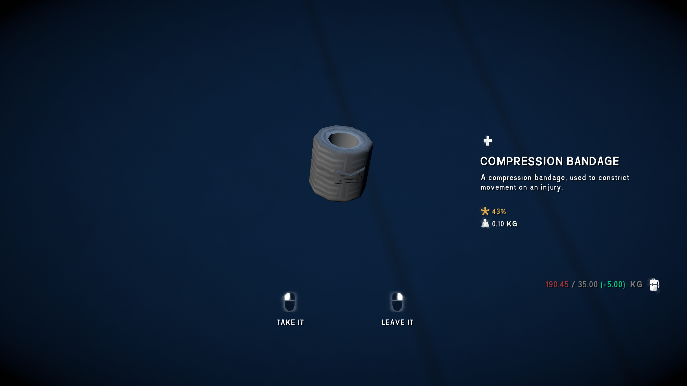
<figcaption>Compression_Bandage.png</figcaption>
</figure></td>
</tr>
</tbody>
</table>

### Charcoal Accelerant

<table>
<colgroup>
<col style="width: 33%" />
<col style="width: 33%" />
<col style="width: 33%" />
</colgroup>
<tbody>
<tr>
<td style="vertical-align: top; font-size: 3em; color: #5d5980; padding-right: 10px">
“
</td>
<td>
Low-volume fuel source designed to help start fires; ex. charcoal fuel.

&#10;

In game description

</td>
<td style="vertical-align: bottom; font-size: 3em; color: #5d5980; padding-left: 10px">
”
</td>
</tr>
</tbody>
</table>

There is an item in the Wintermute game files called the Accelerant, but it is different from the normal <a href="./Accelerant.md" class="wikilink" title="Accelerant">Accelerant</a>. The description of this item suggest that it was originally going to be used to fuel charcoal fires. The item does not have a backpack model, but has a physical model. It weighs 0.10kg.

<table class="gallery">
<colgroup>
<col style="width: 33%" />
<col style="width: 33%" />
<col style="width: 33%" />
</colgroup>
<tbody>
<tr>
<td><figure>
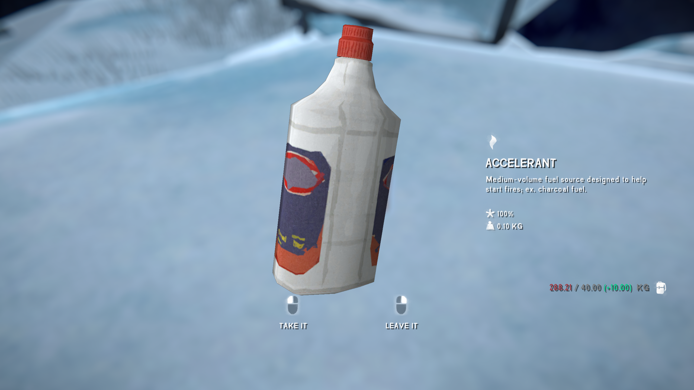
<figcaption>Item description</figcaption>
</figure></td>
<td><figure>
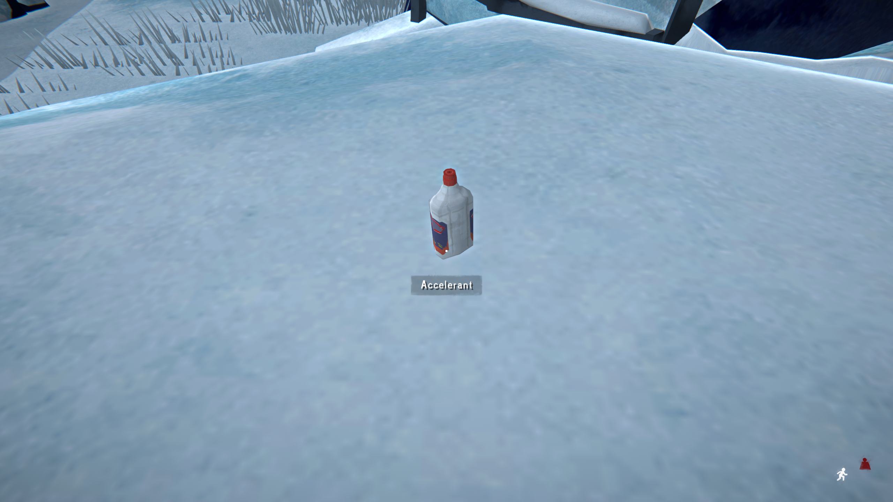
<figcaption>Accelerant_Charcoal.png</figcaption>
</figure></td>
<td><figure>
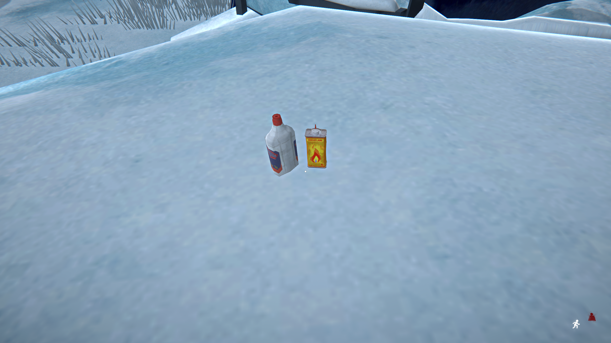
<figcaption>A regular Accelerant compared to the unused one.</figcaption>
</figure></td>
</tr>
</tbody>
</table>

### Flint and Steel

<table>
<colgroup>
<col style="width: 33%" />
<col style="width: 33%" />
<col style="width: 33%" />
</colgroup>
<tbody>
<tr>
<td style="vertical-align: top; font-size: 3em; color: #5d5980; padding-right: 10px">
“
</td>
<td>
Flint and steel striker to create hot sparks and ignite tinder.

&#10;

In game description

</td>
<td style="vertical-align: bottom; font-size: 3em; color: #5d5980; padding-left: 10px">
”
</td>
</tr>
</tbody>
</table>

There is an item in the Wintermute game files called the Flint and Steel. It is a Fire Starting tool that does not have a backpack model, and takes the form of a green plastic first aid box when dropped. Unlike most other items, the Flint and Steel is immediately picked up, and cannot be examined. It was most likely replaced by the <a href="./Firestriker.md" class="wikilink" title="Firestriker">Firestriker</a>.

<table class="gallery">
<colgroup>
<col style="width: 50%" />
<col style="width: 50%" />
</colgroup>
<tbody>
<tr>
<td><figure>
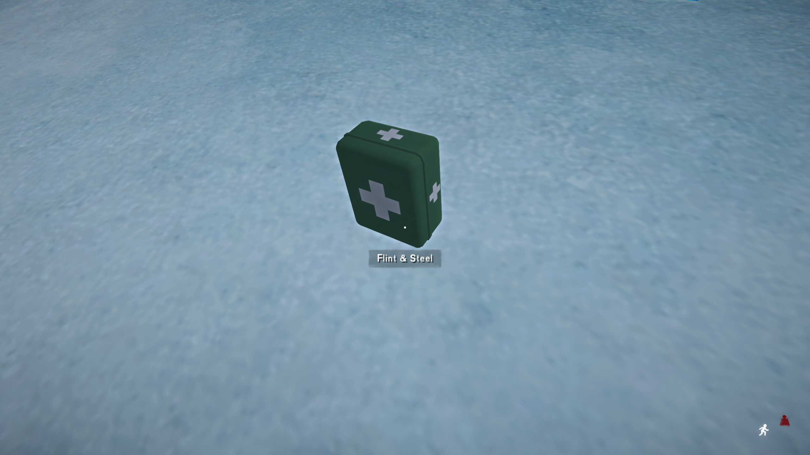
<figcaption>The 3d model</figcaption>
</figure></td>
<td><figure>
[Missing image: Flint_icon.png]
<figcaption>Possible scrapped icon</figcaption>
</figure></td>
</tr>
</tbody>
</table>

### Heated Car Seats

An option for Heated Seats would appear during an Aurora inside several trucks in <a href="./Keeper%27s%20Pass%20South.md" class="wikilink" title="Keeper&#39;s Pass South">Keeper's Pass South</a> following the Perilous Constraint update. Hovering over the dashboard would make the option appear, but ultimately did not raise the player's <a href="./Warmth.md" class="wikilink" title="Warmth">Warmth</a> since the feature was not complete (given the obvious string of gameplay code presented). The option was ultimately removed in a patch, and Heated Seats as a potential mechanic have yet to return.

<table class="gallery">
<colgroup>
<col style="width: 100%" />
</colgroup>
<tbody>
<tr>
<td><figure>

<figcaption>The Heated Seats option</figcaption>
</figure></td>
</tr>
</tbody>
</table>

### Dark Room

The <a href="./Camera.md" class="wikilink" title="Camera">Camera</a> was originally teased as "A Photo Mode for THE LONG DARK, but contextualized with an in-game camera and Dark Room chemicals so that you can process your own film." This meant that the original Camera used a model that required its pictures to be processed first before they could be displayed, which was also shown in the teaser image showing polaroids hanging out to develop.

- An interview by Hinterland later revealed that the Dark Room was cut "because it would have required electrical equipment that we'd only be able to let player use during an active aurora. We came up with a good solution that is true to our lore and also gives players a lot of freedom for self-expression."[^1]

<table class="gallery">
<colgroup>
<col style="width: 100%" />
</colgroup>
<tbody>
<tr>
<td><figure>

<figcaption>The teaser image for the Camera and Dark Room</figcaption>
</figure></td>
</tr>
</tbody>
</table>

### Carriable Wolf Carcass

A unique <a href="./Wolf%20Carcass.md" class="wikilink" title="Ravaged Wolf Carcass">Ravaged Wolf Carcass</a> item exists in the game files for Survival Mode that features <a href="./Carcass%20Harvesting.md" class="wikilink" title="Carcass Harvesting">Carcass Harvesting</a>. Normally only small carcasses of Rabbit or Ptarmigan can be transported, but this one is unique in that it can be transported in the backpack and can be fully harvested at any time, similar to animal Quarters (but meat, gut, and hide can be harvested). This item likely exists for development testing purposes, since it weighs 0.00 KG.

<table class="gallery">
<colgroup>
<col style="width: 100%" />
</colgroup>
<tbody>
<tr>
<td><figure>

<figcaption>Wolf_carcass_icon.png</figcaption>
</figure></td>
</tr>
</tbody>
</table>

### Fresh Leather

An <a href="./Curing.md" class="wikilink" title="uncured">uncured</a> variant of <a href="./Cured%20Leather.md" class="wikilink" title="Cured Leather">Cured Leather</a> was originally present in the earlier builds of the game and was present past the 1.00 launch of the game. <a href="./Fresh%20Leather.md" class="wikilink" title="Fresh Leather">Fresh Leather</a> was originally harvested from animals instead of animal hides, and would cure indoors for 5 days before becoming Cured Leather. Eventually animal hides would replace Fresh Leather, but the item could occasionally be found in the game world, with indoor spawns of the items eventually turning into Cured Leather over time. This item has ultimately been removed from the game's loot tables in Survival Mode, and is impossible to find anywhere without console commands, and only appears in Survival Mode.

<table class="gallery">
<colgroup>
<col style="width: 100%" />
</colgroup>
<tbody>
<tr>
<td><figure>
[Missing image: Fresh_Leather.jpg]
<figcaption>Fresh_Leather.jpg</figcaption>
</figure></td>
</tr>
</tbody>
</table>

### Pumpkin Pie and 2500 Calorie Chocolate Bar

In a previous event that ran for 4 years every October, Hinterland introduced a game mode called the <a href="./4%20Days%20of%20Night%20Event.md" class="wikilink" title="4 Days of Night Event">4 Days of Night Event</a>. 2 items unique to this game mode, <a href="./Pumpkin%20Pie.md" class="wikilink" title="Pumpkin Pie">Pumpkin Pie</a> and a 2500 calorie <a href="./Chocolate%20Bar%20%284%20Days%20of%20Night%29.md" class="wikilink" title="Candy Bar">Candy Bar</a>, have since been removed from the game, and are unable to be found outside of console commands. Several other items, such as <a href="./Jack-o-Lantern.md" class="wikilink" title="Jack-o-Lanterns">Jack-o-Lanterns</a>, have also been cut but are still in the game files.

A second version of the Pumpkin Pie would appear in the 2020 <a href="./Escape%20the%20Darkwalker.md" class="wikilink" title="Escape the Darkwalker">Escape the Darkwalker</a> release, with a new description. Both Pumpkin Pies are still found in the Wintermute game files.

<table class="gallery">
<colgroup>
<col style="width: 25%" />
<col style="width: 25%" />
<col style="width: 25%" />
<col style="width: 25%" />
</colgroup>
<tbody>
<tr>
<td><figure>

<figcaption>Pumpkin Pie</figcaption>
</figure></td>
<td><figure>

<figcaption>4DON version</figcaption>
</figure></td>
<td><figure>

<figcaption>Escape the Darkwalker 2020 event version</figcaption>
</figure></td>
<td><figure>

<figcaption>Jack o Lanterns</figcaption>
</figure></td>
</tr>
<tr>
<td><figure>
[Missing image: CandyBowl.jpg]
<figcaption>The 2500 Candy Bars</figcaption>
</figure></td>
<td><figure>
[Missing image: Nutsnstuff.jpg]
<figcaption>Nutsnstuff.jpg</figcaption>
</figure></td>
<td></td>
<td></td>
</tr>
</tbody>
</table>

## Past Events

3 limited time game modes/events have been discontinued over the course of the game's lifetime. They are currently inaccessible even via the <a href="./Time%20Capsule.md" class="wikilink" title="Time Capsule">Time Capsule</a> (having been patched into and out of the game via their own unique update), and feature unique gameplay modifiers sometimes not found even in Custom Survival Mode experiences. Several limited time event <a href="./Badges.md" class="wikilink" title="Badges">Badges</a> could be earned from playing these game modes, and are still shown in the Badges screen even for players that have never participated in the events.

- <a href="./4%20Days%20of%20Night%20Event.md" class="wikilink" title="4 Days of Night Event">4 Days of Night Event</a>

| Year | Start date          | End date            |
|------|---------------------|---------------------|
| 2016 | 28 October 10AM PST | 1 November 10AM PST |
| 2017 | 27 October 11PM PST | 31 October 11PM PST |
| 2018 | 27 October 11PM PDT | 1 November 10AM PDT |
| 2019 | 27 October 10PM PST | 1 November 10AM PDT |

4 Limited time Badges were available during the 2018 and 2019 versions of the game.

- <a href="./Winter%27s%20Embrace.md" class="wikilink" title="Winter&#39;s Embrace">Winter's Embrace</a>
  - Ran from June 29th to July 31st. Introduced the <a href="./Ketchup%20Chips.md" class="wikilink" title="Ketchup Chips">Ketchup Chips</a> and <a href="./Maple%20Syrup.md" class="wikilink" title="Maple Syrup">Maple Syrup</a> items, as well as 2 unique Badges.
- <a href="./Escape%20the%20Darkwalker.md" class="wikilink" title="Escape the Darkwalker">Escape the Darkwalker</a>
  - Originally a 2 week long event (October 29, 2020 to November 12, 2020), this game mode replaced 4DON since players were upset with how short the Halloween event 4DON was, not being able to find time to play the limited 4 day long event. Escape the Darkwalker is currently the only game mode that was turned into a permanent addition to the game as a Challenge.

<table class="gallery">
<colgroup>
<col style="width: 25%" />
<col style="width: 25%" />
<col style="width: 25%" />
<col style="width: 25%" />
</colgroup>
<tbody>
<tr>
<td><figure>
[Missing image: 4DON_titlecard.jpg]
<figcaption>4 Days of Night</figcaption>
</figure></td>
<td><figure>

<figcaption>The_Long_Dark_--_4_Days_of_Night_2018_(Halloween_Event)</figcaption>
</figure></td>
<td><figure>

<figcaption>The_Long_Dark_-_4_Days_of_Night_(Halloween_Event)</figcaption>
</figure></td>
<td><figure>

<figcaption>Winter's Embrace</figcaption>
</figure></td>
</tr>
<tr>
<td><figure>
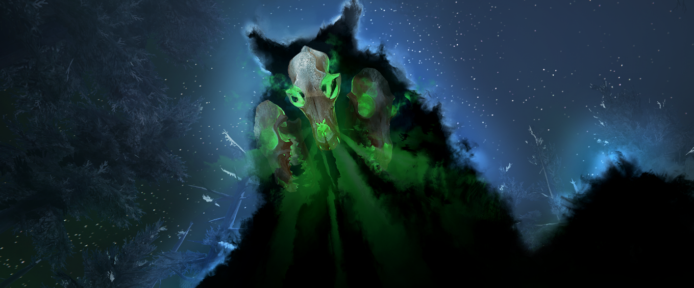
<figcaption>Escape the Darkwalker</figcaption>
</figure></td>
<td></td>
<td></td>
<td></td>
</tr>
</tbody>
</table>

## Early Survival Mode

### Struggle

<table class="gallery">
<colgroup>
<col style="width: 100%" />
</colgroup>
<tbody>
<tr>
<td><figure>
[Missing image: Alpha_Wolf_Struggle.jpg]
<figcaption>The early Struggle menu</figcaption>
</figure></td>
</tr>
</tbody>
</table>

When the Long Dark entered in Early Access, <a href="./Struggle.md" class="wikilink" title="Struggle">Struggle</a> with hostile <a href="./Wildlife.md" class="wikilink" title="Wildlife">Wildlife</a> underwent several changes throughout its development.

Initially, once a Wolf pounced on the player, the player had to click the left button of their mouse to build up strength as indicated in a red progress bar and once it was full, they could click the right button of their mouse and repeat until the process kills the wolf or causes it to flee from the player. This method proved very difficult to players, often proving fatal.

In Early Access update 0.163 (Released November 2014), the struggle system underwent a complete overhaul and behaves similarly the way it behaves in full release version except that there was no weapon choice to fight the wolf. If the player had a knife on them (backpack), the game would automatically choose this weapon to fight the wolf. Also, gone is the build up strength mechanic and introduced the "Fight" button by just clicking the right button of the mouse until the wolf flees.

Finally, in Early Access update 0.423 (June 2017), it introduced weapon choice to select right before the struggle (the game would be slowed down for few seconds to give you enough time to react).

### Running instead of Sprinting

Early Survival Mode gave the player the option to toggle or hold the ability to run, and the player could always run without a cooldown (infinite running) or effecting <a href="./Fatigue.md" class="wikilink" title="Fatigue">Fatigue</a>. Becoming Exhausted however would prevent the player from running. Eventually, this system was replaced in the Deep Forest update, giving the player a <a href="./Stamina.md" class="wikilink" title="Stamina">Stamina</a> meter, and endlessly running was instead replaced by occasional Sprinting that lowers Fatigue quickly.

### Abstract Foraging for Fuel

Early Survival Mode gave players the menu option to spend time and calories searching the area for fuel. This system was eventually replaced in the Deep Forest update, providing a Direct Harvesting and Foraging system that is still in place today, adding Sticks and Harvestable Objects throughout the game world.

### Searching Containers

Originally, searching a container would yield items as the search bar filled up. Multiple items inside a container would appear halfway through the search until the bar was fully filled and could be claimed or left inside. It was eventually changed so that items are only yielded once the search bar reaches 100%.

### Calorie Store

Maximum Calories for the earliest time was capped at 3000 stored calories. It was eventually changed to the current 2500 Calorie Store.

### Drop Decoy

Drop Decoy originally allowed you to drop any food in your inventory as <a href="./Scent.md#Baiting%2FDecoys" class="wikilink" title="Baiting">Baiting</a> for predators. It was eventually changed so that only meat and guts could be dropped.

### Item Model/Name Changes

Several items and their in-game models have been changed throughout the years, mostly from the early Alpha days to the present. Below is a list of name/model changes (items with changed names will have the current name in a hyperlink):

#### Fire Staring

<table class="gallery">
<colgroup>
<col style="width: 25%" />
<col style="width: 25%" />
<col style="width: 25%" />
<col style="width: 25%" />
</colgroup>
<tbody>
<tr>
<td><figure>
[Missing image: Accelerant.png]
<figcaption><a href="./Accelerant.md" class="wikilink" title="Accelerant">Accelerant</a></figcaption>
</figure></td>
<td><figure>
[Missing image: Tinder_plug.png]
<figcaption><a href="./Tinder%20Plug.md" class="wikilink" title="Tinder Plug">Tinder Plug</a></figcaption>
</figure></td>
<td><figure>
[Missing image: Cardboard_Matches.png]
<figcaption><a href="./Cardboard%20Matches.md" class="wikilink" title="Cardboard Matches">Cardboard Matches</a></figcaption>
</figure></td>
<td><figure>
[Missing image: Wood_matches.png]
<figcaption><a href="./Wood%20Matches.md" class="wikilink" title="Wood Matches">Wood Matches</a></figcaption>
</figure></td>
</tr>
<tr>
<td><figure>
[Missing image: Magnifying_lens.png]
<figcaption><a href="./Magnifying%20Lens.md" class="wikilink" title="Magnifying Lens">Magnifying Lens</a></figcaption>
</figure></td>
<td><figure>

<figcaption><a href="./Lantern%20Fuel.md" class="wikilink" title="Lantern Fuel">Lantern Fuel</a></figcaption>
</figure></td>
<td><figure>
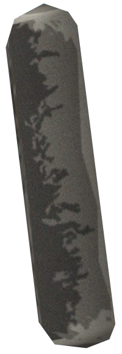
<figcaption><a href="./Cat%20Tail%20Head.md" class="wikilink" title="Cat Tail Head">Cat Tail Head</a></figcaption>
</figure></td>
<td><figure>

<figcaption><a href="./Newsprint.md" class="wikilink" title="Newsprint">Newsprint</a></figcaption>
</figure></td>
</tr>
<tr>
<td><figure>

<figcaption><a href="./Newsprint%20Roll.md" class="wikilink" title="Newsprint Roll">Newsprint Roll</a></figcaption>
</figure></td>
<td><figure>
[Missing image: Firelog.png]
<figcaption><a href="./Firelog.md" class="wikilink" title="Firelog">Firelog</a></figcaption>
</figure></td>
<td></td>
<td></td>
</tr>
</tbody>
</table>

#### Clothing

<table class="gallery">
<colgroup>
<col style="width: 25%" />
<col style="width: 25%" />
<col style="width: 25%" />
<col style="width: 25%" />
</colgroup>
<tbody>
<tr>
<td><figure>
[Missing image: Wolfskin_Coat_-_back.png]
<figcaption><a href="./Wolfskin%20Coat.md" class="wikilink" title="Wolfskin Coat">Wolfskin Coat</a></figcaption>
</figure></td>
<td><figure>

<figcaption>Cotton Socks (<a href="./Sports%20Socks.md" class="wikilink" title="Sport Socks">Sport Socks</a>)</figcaption>
</figure></td>
<td><figure>

<figcaption><a href="./Wool%20Socks.md" class="wikilink" title="Wool Socks">Wool Socks</a></figcaption>
</figure></td>
<td><figure>
[Missing image: Rabbitskin_mitts_(historical).png]
<figcaption><a href="./Rabbitskin%20Mitts.md" class="wikilink" title="Rabbitskin Mitts">Rabbitskin Mitts</a></figcaption>
</figure></td>
</tr>
<tr>
<td><figure>

<figcaption><a href="./Fleece%20Mittens.md" class="wikilink" title="Fleece Mittens">Fleece Mittens</a></figcaption>
</figure></td>
<td><figure>

<figcaption>Basic Gloves (<a href="./Ski%20Gloves.md" class="wikilink" title="Ski Gloves">Ski Gloves</a>)</figcaption>
</figure></td>
<td><figure>
[Missing image: Basic_boots_(historical).png]
<figcaption>Basic Boots <a href="./Trail%20Boots.md" class="wikilink" title="Trail Boots">Trail Boots</a></figcaption>
</figure></td>
<td><figure>
[Missing image: Basic_wool_scarf_(historical).png]
<figcaption>Basic Scarf (<a href="./Wool%20Scarf.md" class="wikilink" title="Wool Scarf">Wool Scarf</a>)</figcaption>
</figure></td>
</tr>
<tr>
<td><figure>

<figcaption>Wool Hat (<a href="./Cotton%20Toque.md" class="wikilink" title="Cotton Toque">Cotton Toque</a>)</figcaption>
</figure></td>
<td><figure>

<figcaption><a href="./Wool%20Toque.md" class="wikilink" title="Wool Toque">Wool Toque</a></figcaption>
</figure></td>
<td><figure>

<figcaption>Basic Winter Coat</figcaption>
</figure></td>
<td><figure>

<figcaption>Fleece Sweater (<a href="./Cowichan%20Sweater.md" class="wikilink" title="Cowichan Sweater">Cowichan Sweater</a>)</figcaption>
</figure></td>
</tr>
<tr>
<td><figure>
[Missing image: Sneakers.png]
<figcaption>Sneakers (<a href="./Running%20Shoes.md" class="wikilink" title="Running Shoes">Running Shoes</a>)</figcaption>
</figure></td>
<td><figure>

<figcaption>Insulated Vest (<a href="./Down%20Vest.md" class="wikilink" title="Down Vest">Down Vest</a>)</figcaption>
</figure></td>
<td><figure>
[Missing image: Deerskin_pants_(historical).png]
<figcaption><a href="./Deerskin%20Pants.md" class="wikilink" title="Deerskin Pants">Deerskin Pants</a></figcaption>
</figure></td>
<td><figure>

<figcaption><a href="./Thermal%20Underwear.md" class="wikilink" title="Thermal Underwear">Thermal Underwear</a></figcaption>
</figure></td>
</tr>
<tr>
<td><figure>
[Missing image: Insulated_boots_(historical).png]
<figcaption><a href="./Insulated%20Boots.md" class="wikilink" title="Insulated Boots">Insulated Boots</a></figcaption>
</figure></td>
<td><figure>

<figcaption><a href="./Mariner%27s%20Pea%20Coat.md" class="wikilink" title="Mariner&#39;s Pea Coat">Mariner's Pea Coat</a></figcaption>
</figure></td>
<td><figure>

<figcaption>Will's Pants (<a href="./Mackenzie%27s%20Pants.md" class="wikilink" title="Mackenzie&#39;s Pants">Mackenzie's Pants</a>)</figcaption>
</figure></td>
<td><figure>

<figcaption>Will's Parka (<a href="./Mackenzie%27s%20Parka.md" class="wikilink" title="Mackenzie&#39;s Parka">Mackenzie's Parka</a>)</figcaption>
</figure></td>
</tr>
<tr>
<td><figure>

<figcaption>Will's Shirt (<a href="./Mackenzie%27s%20Shirt.md" class="wikilink" title="Mackenzie&#39;s Shirt">Mackenzie's Shirt</a>)</figcaption>
</figure></td>
<td><figure>

<figcaption>Will's Sweater (<a href="./Mackenzie%27s%20Sweater.md" class="wikilink" title="Mackenzie&#39;s Sweater">Mackenzie's Sweater</a>)</figcaption>
</figure></td>
<td><figure>

<figcaption>Will's Toque (<a href="./Mackenzie%27s%20Toque.md" class="wikilink" title="Mackenzie&#39;s Toque">Mackenzie's Toque</a>)</figcaption>
</figure></td>
<td><figure>

<figcaption>Will's Boots (<a href="./Mackenzie%27s%20Boots.md" class="wikilink" title="Mackenzie&#39;s Boots">Mackenzie's Boots</a>)</figcaption>
</figure></td>
</tr>
<tr>
<td><figure>

<figcaption><a href="./Work%20Boots.md" class="wikilink" title="Work Boots">Work Boots</a></figcaption>
</figure></td>
<td><figure>

<figcaption><a href="./Expedition%20Parka.md" class="wikilink" title="Expedition Parka">Expedition Parka</a></figcaption>
</figure></td>
<td><figure>

<figcaption><a href="./Thin%20Wool%20Sweater.md" class="wikilink" title="Thin Wool Sweater">Thin Wool Sweater</a></figcaption>
</figure></td>
<td></td>
</tr>
</tbody>
</table>

#### Food and Drink

<table class="gallery">
<colgroup>
<col style="width: 25%" />
<col style="width: 25%" />
<col style="width: 25%" />
<col style="width: 25%" />
</colgroup>
<tbody>
<tr>
<td><figure>

<figcaption><a href="./Granola%20Bar.md" class="wikilink" title="Granola Bar">Granola Bar</a></figcaption>
</figure></td>
<td><figure>

<figcaption><a href="./Energy%20Bar.md" class="wikilink" title="Energy Bar">Energy Bar</a></figcaption>
</figure></td>
<td><figure>

<figcaption>Candy Bar (<a href="./Chocolate%20Bar.md" class="wikilink" title="Chocolate Bar">Chocolate Bar</a>)</figcaption>
</figure></td>
<td><figure>

<figcaption><a href="./Cup%20of%20Herbal%20Tea.md" class="wikilink" title="Cup of Herbal Tea">Cup of Herbal Tea</a></figcaption>
</figure></td>
</tr>
<tr>
<td><figure>
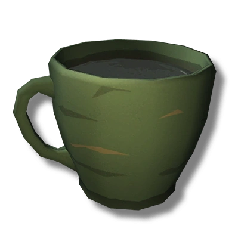
<figcaption>ditto, icon</figcaption>
</figure></td>
<td><figure>

<figcaption><a href="./Cup%20of%20Coffee.md" class="wikilink" title="Cup of Coffee">Cup of Coffee</a></figcaption>
</figure></td>
<td><figure>
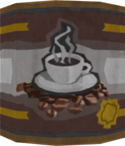
<figcaption><a href="./Tin%20of%20Coffee.md" class="wikilink" title="Tin of Coffee">Tin of Coffee</a></figcaption>
</figure></td>
<td><figure>
[Missing image: Herbal_tea.png]
<figcaption><a href="./Herbal%20Tea.md" class="wikilink" title="Herbal Tea">Herbal Tea</a></figcaption>
</figure></td>
</tr>
<tr>
<td><figure>

<figcaption><a href="./Salty%20Crackers.md" class="wikilink" title="Salty Crackers">Salty Crackers</a></figcaption>
</figure></td>
<td><figure>

<figcaption><a href="./Military-Grade%20MRE.md" class="wikilink" title="Military-Grade MRE">Military-Grade MRE</a></figcaption>
</figure></td>
<td><figure>
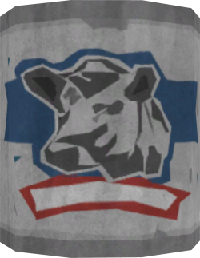
<figcaption><a href="./Condensed%20Milk.md" class="wikilink" title="Condensed Milk">Condensed Milk</a></figcaption>
</figure></td>
<td><figure>

<figcaption><a href="./Pork%20and%20Beans.md" class="wikilink" title="Pork and Beans">Pork and Beans</a></figcaption>
</figure></td>
</tr>
<tr>
<td><figure>
[Missing image: Tomato_soup.png]
<figcaption><a href="./Tomato%20Soup.md" class="wikilink" title="Tomato Soup">Tomato Soup</a></figcaption>
</figure></td>
<td><figure>

<figcaption><a href="./Pinnacle%20Peaches.md" class="wikilink" title="Pinnacle Peaches">Pinnacle Peaches</a></figcaption>
</figure></td>
<td><figure>

<figcaption><a href="./Tin%20of%20Sardines.md" class="wikilink" title="Tin of Sardines">Tin of Sardines</a></figcaption>
</figure></td>
<td><figure>

<figcaption><a href="./Dog%20Food.md" class="wikilink" title="Dog Food">Dog Food</a></figcaption>
</figure></td>
</tr>
<tr>
<td><figure>

<figcaption><a href="./Beef%20Jerky.md" class="wikilink" title="Beef Jerky">Beef Jerky</a></figcaption>
</figure></td>
<td><figure>

<figcaption><a href="./Peanut%20Butter.md" class="wikilink" title="Peanut Butter">Peanut Butter</a></figcaption>
</figure></td>
<td><figure>

<figcaption><a href="./Summit%20Soda.md" class="wikilink" title="Summit Soda">Summit Soda</a></figcaption>
</figure></td>
<td><figure>
[Missing image: Orange_soda.png]
<figcaption><a href="./Orange%20Soda.md" class="wikilink" title="Orange Soda">Orange Soda</a></figcaption>
</figure></td>
</tr>
<tr>
<td><figure>
[Missing image: Stacy's_grape_soda.png]
<figcaption>Grape Soda (<a href="./Stacy%27s%20Grape%20Soda.md" class="wikilink" title="Stacy&#39;s Grape Soda">Stacy's Grape Soda</a>)</figcaption>
</figure></td>
<td><figure>
[Missing image: Home-made_Soup_old_icon.jpg]
<figcaption><a href="./Home-made%20Soup.md" class="wikilink" title="Home-made Soup">Home-made Soup</a> icon</figcaption>
</figure></td>
<td><figure>
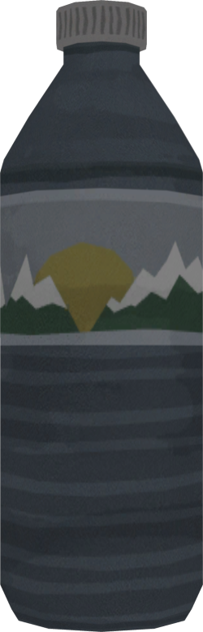
<figcaption>Old water bottle for <a href="./Water%20%28Potable%29.md" class="wikilink" title="Water (Potable)">Water (Potable)</a> or <a href="./Water%20%28Unsafe%29.md" class="wikilink" title="Water (Unsafe)">Water (Unsafe)</a></figcaption>
</figure></td>
<td><figure>

<figcaption>Old 500ml icon (small bottle)</figcaption>
</figure></td>
</tr>
<tr>
<td><figure>

<figcaption>Old 1000ml icon (Large bottle)</figcaption>
</figure></td>
<td><figure>
[Missing image: Water_(unsafe).png]
<figcaption><a href="./Water%20%28Unsafe%29.md" class="wikilink" title="Water (Unsafe)">Water (Unsafe)</a></figcaption>
</figure></td>
<td><figure>
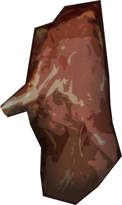
<figcaption><a href="./Rabbit%20%28Raw%29.md" class="wikilink" title="Rabbit (Raw)">Rabbit (Raw)</a></figcaption>
</figure></td>
<td><figure>

<figcaption><a href="./Rabbit%20%28Cooked%29.md" class="wikilink" title="Rabbit (Cooked)">Rabbit (Cooked)</a></figcaption>
</figure></td>
</tr>
<tr>
<td><figure>
[Missing image: Black_bear_meat.png]
<figcaption>Black Bear Meat Raw (<a href="./Bear%20Meat%20%28Raw%29.md" class="wikilink" title="Bear Meat (Raw)">Bear Meat (Raw)</a>)</figcaption>
</figure></td>
<td><figure>
[Missing image: Bear_Meat_(cooked).png]
<figcaption>Black Bear Meat Raw (<a href="./Bear%20Meat%20%28Cooked%29.md" class="wikilink" title="Bear Meat (Cooked)">Bear Meat (Cooked)</a>)</figcaption>
</figure></td>
<td><figure>
[Missing image: Wolf_meat_raw.png]
<figcaption><a href="./Wolf%20Meat%20%28Raw%29.md" class="wikilink" title="Wolf Meat (Raw)">Wolf Meat (Raw)</a></figcaption>
</figure></td>
<td><figure>
[Missing image: Wolf_meat_cooked.png]
<figcaption><a href="./Wolf%20Meat%20%28Cooked%29.md" class="wikilink" title="Wolf Meat (Cooked)">Wolf Meat (Cooked)</a></figcaption>
</figure></td>
</tr>
<tr>
<td><figure>

<figcaption><a href="./Venison%20%28Raw%29.md" class="wikilink" title="Venison (Raw)">Venison (Raw)</a></figcaption>
</figure></td>
<td><figure>

<figcaption><a href="./Venison%20%28Cooked%29.md" class="wikilink" title="Venison (Cooked)">Venison (Cooked)</a></figcaption>
</figure></td>
<td><figure>
[Missing image: Cat_tail_stalk.png]
<figcaption><a href="./Cat%20Tail%20Stalk.md" class="wikilink" title="Cat Tail Stalk">Cat Tail Stalk</a></figcaption>
</figure></td>
<td></td>
</tr>
</tbody>
</table>

#### First Aid

<table class="gallery">
<colgroup>
<col style="width: 25%" />
<col style="width: 25%" />
<col style="width: 25%" />
<col style="width: 25%" />
</colgroup>
<tbody>
<tr>
<td><figure>

<figcaption><a href="./Painkillers.md" class="wikilink" title="Painkillers">Painkillers</a></figcaption>
</figure></td>
<td><figure>
[Missing image: Antibiotics.png]
<figcaption><a href="./Antibiotics.md" class="wikilink" title="Antibiotics">Antibiotics</a></figcaption>
</figure></td>
<td><figure>

<figcaption><a href="./Antiseptic.md" class="wikilink" title="Antiseptic">Antiseptic</a></figcaption>
</figure></td>
<td><figure>
[Missing image: Old_mans_beard_wound_dressing.png]
<figcaption><a href="./Old%20Man%27s%20Beard%20Wound%20Dressing.md" class="wikilink" title="Old Man&#39;s Beard Wound Dressing">Old Man's Beard Wound Dressing</a></figcaption>
</figure></td>
</tr>
<tr>
<td><figure>
[Missing image: Bandage.png]
<figcaption><a href="./Bandage.md" class="wikilink" title="Bandage">Bandage</a></figcaption>
</figure></td>
<td><figure>
[Missing image: Water_purification_tablets.png]
<figcaption><a href="./Water%20Purification%20Tablets.md" class="wikilink" title="Water Purification Tablets">Water Purification Tablets</a></figcaption>
</figure></td>
<td><figure>
[Missing image: Rose_hip_tea.png]
<figcaption><a href="./Rose%20Hip%20Tea.md" class="wikilink" title="Rose Hip Tea">Rose Hip Tea</a></figcaption>
</figure></td>
<td><figure>
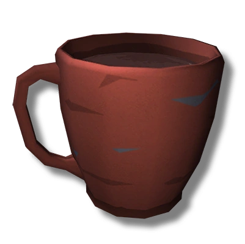
<figcaption>ditto, icon</figcaption>
</figure></td>
</tr>
<tr>
<td><figure>
[Missing image: Reishi_Tea.png]
<figcaption><a href="./Reishi%20Tea.md" class="wikilink" title="Reishi Tea">Reishi Tea</a></figcaption>
</figure></td>
<td><figure>

<figcaption>ditto, icon</figcaption>
</figure></td>
<td><figure>
[Missing image: Sewing_kit_old_model.png]
<figcaption><a href="./Sewing%20Kit.md" class="wikilink" title="Sewing Kit">Sewing Kit</a></figcaption>
</figure></td>
<td></td>
</tr>
</tbody>
</table>

#### Tools

<table class="gallery">
<colgroup>
<col style="width: 25%" />
<col style="width: 25%" />
<col style="width: 25%" />
<col style="width: 25%" />
</colgroup>
<tbody>
<tr>
<td><figure>

<figcaption><a href="./Storm%20Lantern.md" class="wikilink" title="Storm Lantern">Storm Lantern</a></figcaption>
</figure></td>
<td><figure>

<figcaption><a href="./Prybar.md" class="wikilink" title="Prybar">Prybar</a></figcaption>
</figure></td>
<td><figure>

<figcaption><a href="./Simple%20Arrow.md" class="wikilink" title="Simple Arrow">Simple Arrow</a></figcaption>
</figure></td>
<td><figure>
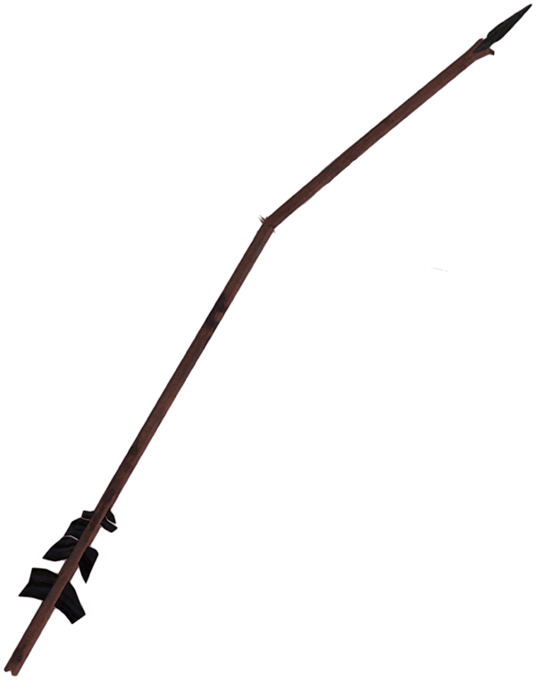
<figcaption><a href="./Broken%20Arrow.md" class="wikilink" title="Broken Arrow">Broken Arrow</a></figcaption>
</figure></td>
</tr>
<tr>
<td><figure>

<figcaption><a href="./Quality%20Tools.md" class="wikilink" title="Quality Tools">Quality Tools</a></figcaption>
</figure></td>
<td><figure>
[Missing image: Torch_-_unused.png]
<figcaption><a href="./Torch.md" class="wikilink" title="Torch">Torch</a></figcaption>
</figure></td>
<td><figure>
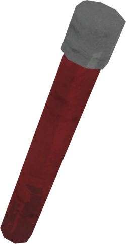
<figcaption><a href="./Flare.md" class="wikilink" title="Flare">Flare</a></figcaption>
</figure></td>
<td><figure>

<figcaption><a href="./Hatchet.md" class="wikilink" title="Hatchet">Hatchet</a></figcaption>
</figure></td>
</tr>
<tr>
<td><figure>

<figcaption><a href="./Heavy%20Hammer.md" class="wikilink" title="Heavy Hammer">Heavy Hammer</a></figcaption>
</figure></td>
<td><figure>
[Missing image: Can_opener.png]
<figcaption><a href="./Can%20Opener.md" class="wikilink" title="Can Opener">Can Opener</a></figcaption>
</figure></td>
<td><figure>
[Missing image: Rifle_Cartridge_Old.png]
<figcaption><a href="./Rifle%20Ammunition.md" class="wikilink" title="Rifle Ammunition">Rifle Ammunition</a> (Catridge)</figcaption>
</figure></td>
<td><figure>

<figcaption><a href="./Rifle%20Ammunition.md" class="wikilink" title="Rifle Ammunition">Rifle Ammunition</a> (Box)</figcaption>
</figure></td>
</tr>
<tr>
<td><figure>

<figcaption>Survive The Outdoors! <a href="./Research%20Book.md" class="wikilink" title="Research Book">Research Book</a></figcaption>
</figure></td>
<td><figure>

<figcaption>Advanced Guns Guns Guns! <a href="./Research%20Book.md" class="wikilink" title="Research Book">Research Book</a></figcaption>
</figure></td>
<td><figure>

<figcaption>Frontier Shooting Guide <a href="./Research%20Book.md" class="wikilink" title="Research Book">Research Book</a></figcaption>
</figure></td>
<td><figure>

<figcaption>The Frozen Angler <a href="./Research%20Book.md" class="wikilink" title="Research Book">Research Book</a></figcaption>
</figure></td>
</tr>
<tr>
<td><figure>

<figcaption>Wilderness Kitchen <a href="./Research%20Book.md" class="wikilink" title="Research Book">Research Book</a></figcaption>
</figure></td>
<td><figure>

<figcaption>Field Dressing Your Kill, Vol 1 <a href="./Research%20Book.md" class="wikilink" title="Research Book">Research Book</a></figcaption>
</figure></td>
<td></td>
<td></td>
</tr>
</tbody>
</table>

#### Materials

<table class="gallery">
<colgroup>
<col style="width: 25%" />
<col style="width: 25%" />
<col style="width: 25%" />
<col style="width: 25%" />
</colgroup>
<tbody>
<tr>
<td><figure>

<figcaption><a href="./Cloth.md" class="wikilink" title="Cloth">Cloth</a></figcaption>
</figure></td>
<td><figure>
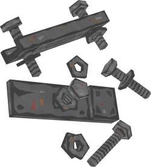
<figcaption><a href="./Scrap%20Metal.md" class="wikilink" title="Scrap Metal">Scrap Metal</a></figcaption>
</figure></td>
<td><figure>
[Missing image: Cured_leather.png]
<figcaption><a href="./Cured%20Leather.md" class="wikilink" title="Leather">Leather</a> (and early hides/pelts)</figcaption>
</figure></td>
<td><figure>
[Missing image: Old_man's_beard_lichen.png]
<figcaption><a href="./Old%20Man%27s%20Beard%20Lichen.md" class="wikilink" title="Old Man&#39;s Beard Lichen">Old Man's Beard Lichen</a></figcaption>
</figure></td>
</tr>
<tr>
<td><figure>
[Missing image: Rose_hip.png]
<figcaption><a href="./Rose%20Hip.md" class="wikilink" title="Rose Hip">Rose Hip</a></figcaption>
</figure></td>
<td><figure>

<figcaption><a href="./Reishi%20Mushroom.md" class="wikilink" title="Reishi Mushroom">Reishi Mushroom</a></figcaption>
</figure></td>
<td><figure>

<figcaption><a href="./Prepared%20Rose%20Hips.md" class="wikilink" title="Prepared Rose Hips">Prepared Rose Hips</a></figcaption>
</figure></td>
<td><figure>
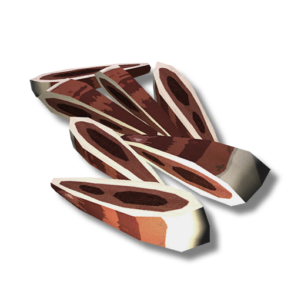
<figcaption><a href="./Prepared%20Reishi%20Mushrooms.md" class="wikilink" title="Prepared Reishi Mushrooms">Prepared Reishi Mushrooms</a></figcaption>
</figure></td>
</tr>
<tr>
<td><figure>
[Missing image: Rabbit_pelt.png]
<figcaption><a href="./Fresh%20Rabbit%20Pelt.md" class="wikilink" title="Fresh Rabbit Pelt">Fresh Rabbit Pelt</a></figcaption>
</figure></td>
<td><figure>
[Missing image: Cured_wolf_pelt.png]
<figcaption><a href="./Cured%20Wolf%20Pelt.md" class="wikilink" title="Cured Wolf Pelt">Cured Wolf Pelt</a></figcaption>
</figure></td>
<td><figure>
[Missing image: Fresh_wolf_pelt.png]
<figcaption><a href="./Fresh%20Wolf%20Pelt.md" class="wikilink" title="Fresh Wolf Pelt">Fresh Wolf Pelt</a></figcaption>
</figure></td>
<td><figure>
[Missing image: Cured_Black_Bear_Hide.png]
<figcaption><a href="./Cured%20Black%20Bear%20Hide.md" class="wikilink" title="Cured Black Bear Hide">Cured Black Bear Hide</a></figcaption>
</figure></td>
</tr>
<tr>
<td><figure>
[Missing image: Fresh_Black_Bear_Hide.png]
<figcaption><a href="./Fresh%20Black%20Bear%20Hide.md" class="wikilink" title="Fresh Black Bear Hide">Fresh Black Bear Hide</a></figcaption>
</figure></td>
<td><figure>

<figcaption>Deer Pelt</figcaption>
</figure></td>
<td><figure>
[Missing image: Arrowhead.png]
<figcaption><a href="./Arrowhead.md" class="wikilink" title="Arrowhead">Arrowhead</a></figcaption>
</figure></td>
<td><figure>
[Missing image: Crow_feather.png]
<figcaption><a href="./Crow%20Feather.md" class="wikilink" title="Crow Feather">Crow Feather</a></figcaption>
</figure></td>
</tr>
<tr>
<td><figure>

<figcaption><a href="./Arrow%20Shaft.md" class="wikilink" title="Arrow Shaft">Arrow Shaft</a></figcaption>
</figure></td>
<td><figure>
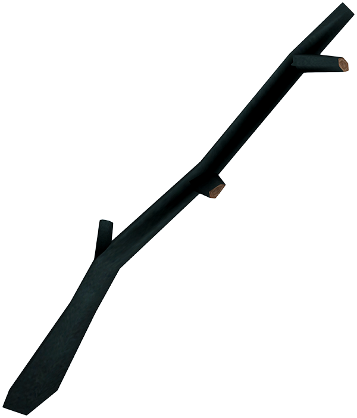
<figcaption><a href="./Green%20Maple%20Sapling.md" class="wikilink" title="Green Maple Sapling">Green Maple Sapling</a></figcaption>
</figure></td>
<td><figure>
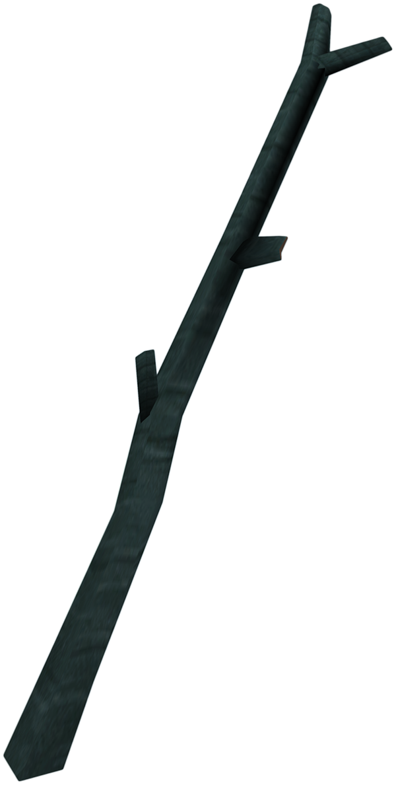
<figcaption><a href="./Green%20Birch%20Sapling.md" class="wikilink" title="Green Birch Sapling">Green Birch Sapling</a></figcaption>
</figure></td>
<td><figure>

<figcaption><a href="./Cured%20Cougar%20Hide.md" class="wikilink" title="Cured Cougar Hide">Cured Cougar Hide</a></figcaption>
</figure></td>
</tr>
<tr>
<td><figure>

<figcaption><a href="./Fresh%20Cougar%20Hide.md" class="wikilink" title="Fresh Cougar Hide">Fresh Cougar Hide</a></figcaption>
</figure></td>
<td></td>
<td></td>
<td></td>
</tr>
</tbody>
</table>

### Old Survival Menu/UI backgrounds

Most of the <a href="./Survival%20Menu.md" class="wikilink" title="Survival Menu">Survival Menu</a> backgrounds have changed from an actual book to stylized floating text. A physical book can still be heard closing when closing the Survival Menu despite the modernized changes.

<table class="gallery">
<colgroup>
<col style="width: 25%" />
<col style="width: 25%" />
<col style="width: 25%" />
<col style="width: 25%" />
</colgroup>
<tbody>
<tr>
<td><figure>

<figcaption>Skills Journal</figcaption>
</figure></td>
<td><figure>

<figcaption><a href="./Coming%20Storm.md" class="wikilink" title="Coming Storm">Coming Storm</a> <a href="./Almanac.md" class="wikilink" title="Almanac">Almanac</a></figcaption>
</figure></td>
<td><figure>
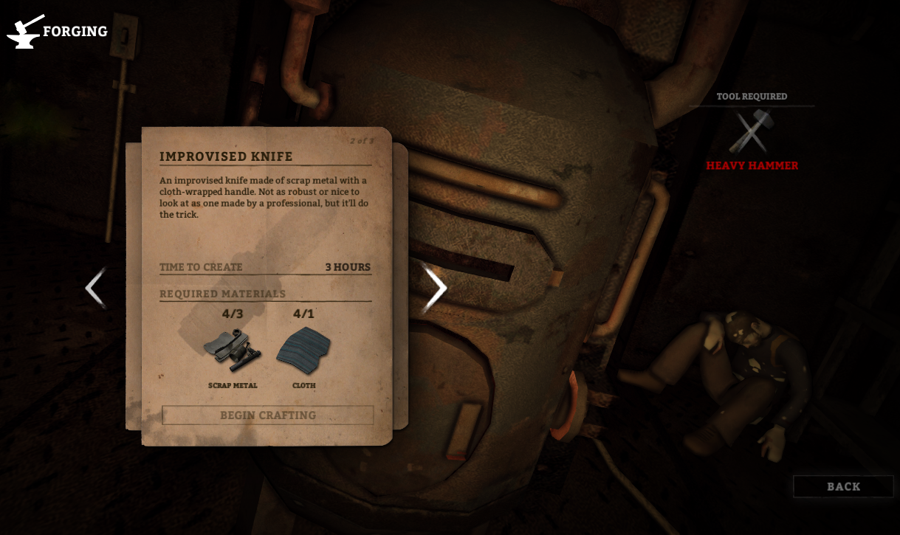
<figcaption><a href="./Forge.md" class="wikilink" title="Forge">Forge</a> Menu</figcaption>
</figure></td>
<td><figure>
[Missing image: Summary_sample.jpg]
<figcaption>Locations menu</figcaption>
</figure></td>
</tr>
<tr>
<td><figure>
[Missing image: LogBook_sample.jpg]
<figcaption>Days survived menu</figcaption>
</figure></td>
<td><figure>
[Missing image: Survival_page.jpg]
<figcaption>Old Status menu</figcaption>
</figure></td>
<td><figure>
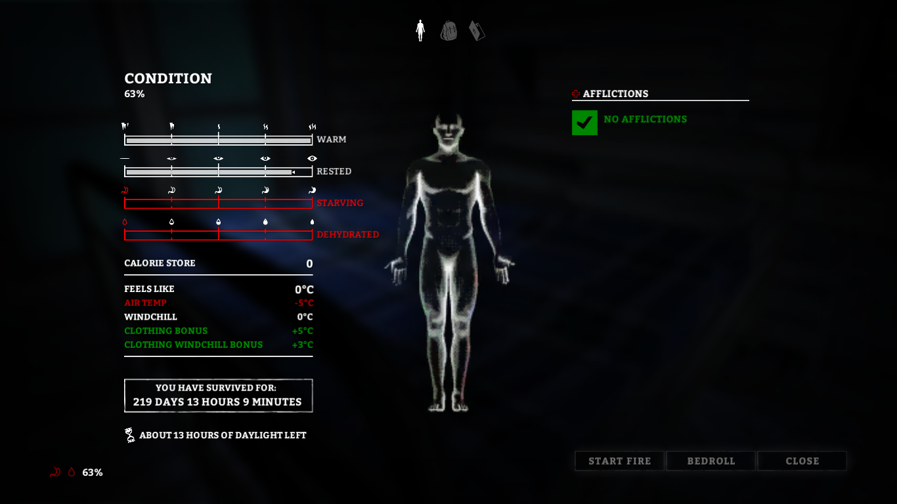
<figcaption>ditto</figcaption>
</figure></td>
<td><figure>

<figcaption>ditto</figcaption>
</figure></td>
</tr>
<tr>
<td><figure>
[Missing image: Old_Status_menu.png]
<figcaption>ditto</figcaption>
</figure></td>
<td><figure>

<figcaption><a href="./Nomad.md" class="wikilink" title="Nomad">Nomad</a> Challenge menu</figcaption>
</figure></td>
<td><figure>
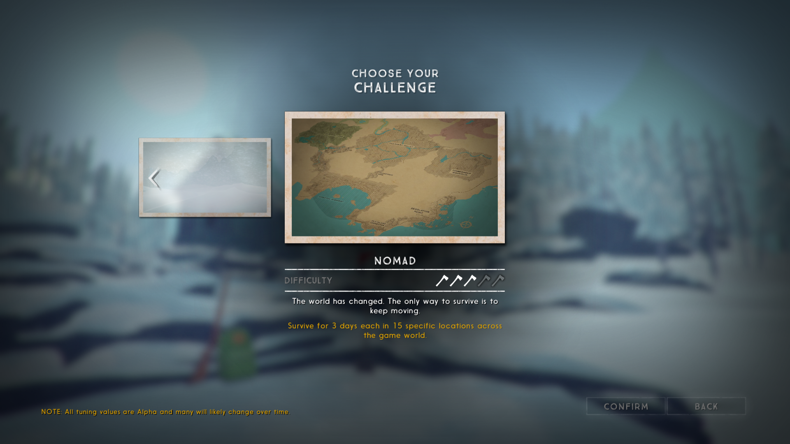
<figcaption>Nomad <a href="./Challenge.md" class="wikilink" title="Challenge">Challenge</a> selection screen</figcaption>
</figure></td>
<td><figure>

<figcaption>Clothing Interface (2017)</figcaption>
</figure></td>
</tr>
<tr>
<td><figure>
[Missing image: Radialmenu.jpg]
<figcaption>The Radial Menu underwent a complete overhaul in the Faithful Cartographer update.</figcaption>
</figure></td>
<td><figure>

<figcaption>Old Backpack inventory menu</figcaption>
</figure></td>
<td><figure>
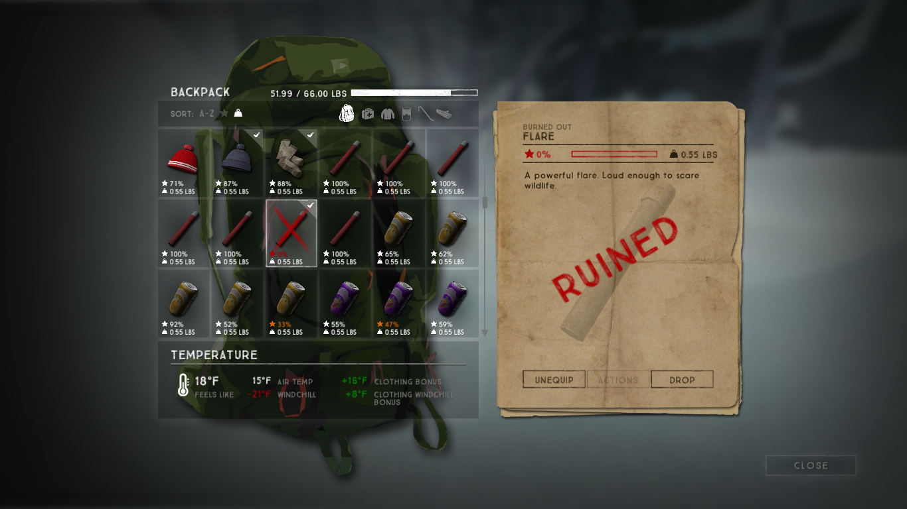
<figcaption>Ditto</figcaption>
</figure></td>
<td><figure>
[Missing image: Old_Map_ui.jpg]
<figcaption>Old Map location ui</figcaption>
</figure></td>
</tr>
<tr>
<td><figure>

<figcaption>Old <a href="./Hunting%20Rifle.md" class="wikilink" title="Hunting Rifle">Hunting Rifle</a> ammo ui</figcaption>
</figure></td>
<td><figure>
[Missing image: Old_Overlay.png]
<figcaption>Old <a href="./Survival%20Overlay.md" class="wikilink" title="Survival Overlay">Survival Overlay</a></figcaption>
</figure></td>
<td><figure>

<figcaption>ditto</figcaption>
</figure></td>
<td><figure>

<figcaption>Old <a href="./Needs.md" class="wikilink" title="Needs">Needs</a> HUD</figcaption>
</figure></td>
</tr>
</tbody>
</table>

### Survival Skills

The survival skills originally did not have a dedicated menu, but instead appeared when they were leveled up similarly to <a href="./Skills.md#Secondary_skills" class="wikilink" title="Secondary Skills">Secondary Skills</a>. Eventually players could see their survival skills in the "basic skills" tab in a book, before it was changed to a modern-style book.

<table class="gallery">
<colgroup>
<col style="width: 100%" />
</colgroup>
<tbody>
<tr>
<td><figure>

<figcaption>Skills_journal3.png</figcaption>
</figure></td>
</tr>
</tbody>
</table>

### Clock and Time of day

In the pre-alpha version, players would have a digital clock shown on HUD UI stating the exact time of day (could be changed to 12 or 24 hour display). This was later removed and replaced by "Time of Day" which showed how many hours of either light or darkness are left until the next 12 hours of the day begins.

Time of day would later undergo a few changes until it was replaced with the current rotating sun and moon icons.

## Discontinued Wintermute Content

Many of these features were in the original Predux releases of <a href="./Episode%201%20-%20Do%20Not%20Go%20Gentle.md" class="wikilink" title="Episode 1">Episode 1</a> and <a href="./Episode%202%20-%20Luminance%20Fugue.md" class="wikilink" title="Episode 2">Episode 2</a> and were removed following the Redux re-release.

### The original Wintermute storyline

The original Wintermute Storyline was largely changed in the Redux rerelease, heavily changing the plot and mission structure of the story. The original missions went in the following order:

Episode 1

- <a href="./Survival%20Of%20The%20Fittest.md" class="wikilink" title="Survival Of The Fittest">Survival Of The Fittest</a>
- <a href="./Echoes%20Of%20Astrid.md" class="wikilink" title="Echoes Of Astrid">Echoes Of Astrid</a>
- <a href="./The%20Grey%20Mother%20%28Predux%29.md" class="wikilink" title="The Grey Mother (Predux)">The Grey Mother (Predux)</a>
- <a href="./Paradise%20Lost%20%28Predux%29.md" class="wikilink" title="Paradise Lost (Predux)">Paradise Lost (Predux)</a>

Episode 2

- <a href="./Risk%20of%20Infection.md" class="wikilink" title="Risk of Infection">Risk of Infection</a>
- You Fix My Rifle?
- <a href="./Survival%20School%20%28Predux%29.md" class="wikilink" title="Survival School (Predux)">Survival School (Predux)</a>
- <a href="./Jeremiah%27s%20Folly.md" class="wikilink" title="Jeremiah&#39;s Folly">Jeremiah's Folly</a>
- <a href="./Renewed%20Hope%20%28Predux%29.md" class="wikilink" title="Renewed Hope (Predux)">Renewed Hope (Predux)</a>

### Hatch in Trapper's Homestead Floorboards

In the pre Redux version of <a href="./Episode%202%20-%20Luminance%20Fugue.md" class="wikilink" title="Episode 2">Episode 2</a>, Jeremiah would walk over to the middle of the floor and open a hatch with a ham radio inside after Mackenzie left in order to send a message out to an unknown party. This hatch is still present in the floorboards of the cabin to this day, but cannot be opened. The same radio was reworked into the mission <a href="./Signal%20to%20Noise.md" class="wikilink" title="Signal to Noise">Signal to Noise</a>, as Mackenzie must now repair it with Jeremiah.

<table class="gallery">
<colgroup>
<col style="width: 25%" />
<col style="width: 25%" />
<col style="width: 25%" />
<col style="width: 25%" />
</colgroup>
<tbody>
<tr>
<td><figure>
[Missing image: Jeremiah_Floor_Hatch_Opening.jpg]
<figcaption>Jeremiah getting out of bed to open the floor panel</figcaption>
</figure></td>
<td><figure>
[Missing image: Trapper's_Cabin_Hidden_Ham_Radio.jpg]
<figcaption>The Ham Radio in the floor panel was eventually reworked into the Redux version</figcaption>
</figure></td>
<td><figure>
[Missing image: Trapper's_Homestead_hidden_hatch.jpg]
<figcaption>The current hatch as seen in Redux Episode 2, though it cannot be opened</figcaption>
</figure></td>
<td><figure>
[Missing image: Episode_2_radio.jpg]
<figcaption>The hidden ham radio is now on the work bench in the Redux version</figcaption>
</figure></td>
</tr>
</tbody>
</table>

### Side Missions

Several side missions were cut or reworked into the Redux version of Episode 1 and 2:

- <a href="./Light%20Up%20The%20Night.md" class="wikilink" title="Light Up The Night">Light Up The Night</a> was cut from Episode 1 and was replaced by <a href="./Highway%20Robbery%20%28mission%29.md" class="wikilink" title="Highway Robbery (mission)">Highway Robbery (mission)</a>, and was unlocked by raising Grey Mother's Trust.
- <a href="./Forge%20Blueprints%20%28mission%29.md" class="wikilink" title="Forge Blueprints (mission)">Forge Blueprints (mission)</a> was cut from Episode 2 entirely, and was given by Jeremiah as a reward for raising his Trust. The player would go to the <a href="./Old%20Spence%20Family%20Homestead.md" class="wikilink" title="Old Spence Family Homestead">Old Spence Family Homestead</a> and unlock the ability to Forge improvised tools.
- <a href="./Jeremiah%27s%20Hideout.md" class="wikilink" title="Jeremiah&#39;s Hideout">Jeremiah's Hideout</a> was a location replaced by the <a href="./Aurora%20Hatch.md" class="wikilink" title="Aurora Hatch">Aurora Hatch</a> in Episode 2 following the Redux re-release. Jeremiah would give the player the side mission once their Trust level was at max and would ask Mackenzie to burn some of his old letters.

### Trust

<figure>
[Missing image: Trust_menu.jpg]
<figcaption>XTHUMB An example of the old Trust trading menu.</figcaption>
</figure>

<table>
<colgroup>
<col style="width: 33%" />
<col style="width: 33%" />
<col style="width: 33%" />
</colgroup>
<tbody>
<tr>
<td style="vertical-align: top; font-size: 3em; color: #5d5980; padding-right: 10px">
“
</td>
<td>
Trust. A hard thing to come by these days. Many people you meet will be suspicious of you. But most of them have needs they may not be able to fulfill without your help. Helping them will earn you Trust, which will in turn unlock useful Knowledge, Locations, Items, and more. Check the character's Trust entry in your Journal to learn more about them, their needs, and how they can help you.

&#10;

In game Tutorial message Pre Redux

</td>
<td style="vertical-align: bottom; font-size: 3em; color: #5d5980; padding-left: 10px">
”
</td>
</tr>
</tbody>
</table>

In the original Wintermute releases of Episodes 1 and 2, <a href="./Grey%20Mother.md" class="wikilink" title="Grey Mother">Grey Mother</a> and <a href="./Jeremiah.md" class="wikilink" title="Jeremiah">Jeremiah</a> could be given items to build up their trust with Mackenzie. Taking or breaking down items from their homes would lower trust, whereas bringing them items they wished for would increase trust (sticks, cured rabbit pelts, etc). Having a higher Trust would grant the player access to additional dialogue options, which would reveal more worldbuilding information or give access to entire side quests (such as finding a Distress Pistol in Episode 1 or Jeremiah giving the coordinates to <a href="./Jeremiah%27s%20Hideout.md" class="wikilink" title="Jeremiah&#39;s Hideout">Jeremiah's Hideout</a>). The system was ultimately removed following the Redux re-releases of both episodes and was replaced with standard dialogue options. Trust rewards always maxed out at 375 Trust, making donating more items useless. Unlocked Trust items/knowledge/blueprints would remain unlocked, even it Trust fell below the unlocking requirements.

It is possible to steal food items from Grey Mother and Jeremiah by opening canned goods and canceling halfway through, thus claiming the item and not lowering Trust. Jeremiah will know the player has taken his things even when he is passed out at the start of Episode 2.

#### Grey Mother's Trust

The following would have unlocked as Trust continued to increase:

#### Items That Increase Trust

- +1 <a href="./Stick.md" class="wikilink" title="Stick">Stick</a>
- +3 <a href="./Reishi%20Mushroom.md" class="wikilink" title="Reishi Mushroom">Reishi Mushroom</a>
- +5 <a href="./Bandage.md" class="wikilink" title="Bandage">Bandage</a>
- +10 <a href="./Military-Grade%20MRE.md" class="wikilink" title="Military-Grade MRE">Military-Grade MRE</a>
- +25 <a href="./Can%20Opener.md" class="wikilink" title="Can Opener">Can Opener</a>
- +30 <a href="./Fresh%20Rabbit%20Pelt.md" class="wikilink" title="Fresh Rabbit Pelt">Fresh Rabbit Pelt</a> or <a href="./Cured%20Rabbit%20Pelt.md" class="wikilink" title="Cured Rabbit Pelt">Cured Rabbit Pelt</a>

### Things that lose Trust

- -5 Searching containers (even if you don't take anything)
- -15 Taking items
- -25 Breaking down furniture

#### Trust Levels And Unlocks

- 25 Trust: Knowledge: Milton History - Worldbuilding information about the history of Milton. (Gives <a href="./Town%20of%20Milton.md" class="wikilink" title="Town of Milton">Town of Milton</a> <a href="./What%20I%20Know.md" class="wikilink" title="What I Know">What I Know</a> Knowledge)
- 50 Trust: Gameplay Tip: Sharpening - Gameplay tip about how to maintain Bladed tools. (Gives <a href="./Whetstone.md" class="wikilink" title="Whetstone">Whetstone</a>)
- 75 Trust: Knowledge: The Collapse - Worldbuilding information about the Collapse. (Gives <a href="./History%20of%20The%20Collapse.md" class="wikilink" title="History of The Collapse">History of The Collapse</a> Part One <a href="./What%20I%20Know.md" class="wikilink" title="What I Know">What I Know</a> Knowledge)
- 125 Trust: Cache Location - The location of a Supply Cache, updated on your Map. (Gives new <a href="./Milton%20Supply%20Caches.md" class="wikilink" title="Milton Supply Caches">Milton Supply Caches</a>)
- 175 Trust: Side Mission: Distress Pistol - Information about where you might find a Distress Pistol. (<a href="./Light%20Up%20The%20Night.md" class="wikilink" title="Light Up The Night">Light Up The Night</a>)
- 225 Trust: Blueprint: Rabbit Skin Mittens - Unlocks the Crafting Blueprint for Rabbit Skin Mittens.
- 300 Trust: Knowledge: <a href="./Perseverance%20Mills.md" class="wikilink" title="Perseverance Mills">Perseverance Mills</a> - Worldbuilding information about Perseverance Mills. (Gives <a href="./History%20of%20The%20Collapse.md" class="wikilink" title="History of The Collapse">History of The Collapse</a> Part Two <a href="./What%20I%20Know.md" class="wikilink" title="What I Know">What I Know</a> Knowledge)
- 375 Trust: Item: <a href="./Mountaineering%20Boots.md" class="wikilink" title="Mountaineering Boots">Mountaineering Boots</a> - Grey Mother gives you with Mountaineering Boots. (sic) (Gives <a href="./Mountaineering%20Boots.md" class="wikilink" title="Mountaineering Boots">Mountaineering Boots</a>)

#### Jeremiah's Trust

#### Items That Increase Trust

- +1 <a href="./Stick.md" class="wikilink" title="Stick">Stick</a>
- +3 <a href="./Cloth.md" class="wikilink" title="Cloth">Cloth</a>
- +3 <a href="./Old%20Man%27s%20Beard%20Wound%20Dressing.md" class="wikilink" title="Old Man&#39;s Beard Wound Dressing">Old Man's Beard Wound Dressing</a>
- +10 <a href="./Pork%20and%20Beans.md" class="wikilink" title="Pork and Beans">Pork and Beans</a>
- +25 <a href="./Fresh%20Rabbit%20Pelt.md" class="wikilink" title="Fresh Rabbit Pelt">Fresh Rabbit Pelt</a> or <a href="./Cured%20Rabbit%20Pelt.md" class="wikilink" title="Cured Rabbit Pelt">Cured Rabbit Pelt</a>
- +30 <a href="./Fresh%20Deer%20Hide.md" class="wikilink" title="Fresh Deer Hide">Fresh Deer Hide</a> or <a href="./Cured%20Deer%20Hide.md" class="wikilink" title="Cured Deer Hide">Cured Deer Hide</a>

### Things that lose Trust

- -5 Searching containers (even if you don't take anything)
- -15 Taking items
- -25 Breaking down furniture

#### Trust Levels And Unlocks

- 25 Trust: Knowledge: Mystery Lake - Worldbuilding information about Mystery Lake. (Unlocks <a href="./Mystery%20Lake%20%26%20Area.md" class="wikilink" title="Mystery Lake &amp; Area">Mystery Lake &amp; Area</a> <a href="./What%20I%20Know.md" class="wikilink" title="What I Know">What I Know</a> Knowledge)
- 50 Trust: Cache Location - The location of a Supply Cache, updated on your Map. (Unlocks a cache for <a href="./Mystery%20Lake%20Supply%20Caches.md" class="wikilink" title="Mystery Lake Supply Caches">Mystery Lake Supply Caches</a>)
- 75 Trust: Knowledge: Blueprint: Improvised Hatchet - Unlocks the Crafting Blueprint for Improvised Hatchet (unlocks the <a href="./Forge%20Blueprints.md" class="wikilink" title="Forge Blueprints">Forge Blueprints</a> side mission)
- 125 Trust: Knowledge: Carter Dam - Worldbuilding information about Carter Hydro Dam. (Unlocks <a href="./Carter%20Hydro%20Dam%20%28Collectible%29.md" class="wikilink" title="Carter Hydro Dam">Carter Hydro Dam</a> <a href="./What%20I%20Know.md" class="wikilink" title="What I Know">What I Know</a> Knowledge)
- 175 Trust: Blueprint: Deerskin Pants and Deerskin Boots - Unlocks the Crafting Blueprint for Deerskin Pants and Deerskin Boots.
- 225 Trust: Blueprint: Snow Shelter - Unlocks the Crafting Blueprint for the Snow Shelter.
- 300 Trust: Knowledge: Aurora Observations - Worldbuilding information about the Aurora. (Unlocks <a href="./History%20of%20The%20Collapse.md" class="wikilink" title="History of The Collapse">History of The Collapse</a> Part 3 and 4 <a href="./What%20I%20Know.md" class="wikilink" title="What I Know">What I Know</a> Knowledge)
- 375 Trust: Side Mission: Old Letters - Jeremiah Wants you to find and destroy some of his old letters. (Unlocks <a href="./Jeremiah%27s%20Hideout.md" class="wikilink" title="Jeremiah&#39;s Hideout">Jeremiah's Hideout</a> side mission)

<table class="gallery">
<colgroup>
<col style="width: 33%" />
<col style="width: 33%" />
<col style="width: 33%" />
</colgroup>
<tbody>
<tr>
<td><figure>
[Missing image: GreyMotherTrustOutdated.jpg]
<figcaption>The Journal Trust Menu for Grey Mother</figcaption>
</figure></td>
<td><figure>
[Missing image: Jeremiah_Trust_Menu.jpg]
<figcaption>Jeremiah's Trust info</figcaption>
</figure></td>
<td><figure>
[Missing image: Jeremiah_Trust_Menu_bed.jpg]
<figcaption>Ditto</figcaption>
</figure></td>
</tr>
</tbody>
</table>

### 3rd Person Cutscenes

With the original Predux release of Episode 1 and 2, Mackenzie would appear in 3rd person in each cutscene. He would always wear his default clothing, regardless of what was chosen to be worn by the player, and was far more expressive and interactive when meeting with other characters.

Following the Redux updates, all cutscenes were replaced with a first person perspective and were completely redesigned from Makenzie's perspective. All cutscenes in future Episodes still feature first person character interactions to date.

<table class="gallery">
<colgroup>
<col style="width: 100%" />
</colgroup>
<tbody>
<tr>
<td><figure>
[Missing image: Prisonbus2.jpg]
<figcaption>Mackenzie finding the Crashed Prison Bus and activating a 3rd person cutscene</figcaption>
</figure></td>
</tr>
</tbody>
</table>

### Jeremiah's Bearskin Coat

As part of the <a href="./Survival%20School%20%28Predux%29.md" class="wikilink" title="Survival School (Predux)">Survival School (Predux)</a> mission, Mackenzie needed to repair <a href="./Jeremiah%27s%20Bearskin%20Coat.md" class="wikilink" title="Jeremiah&#39;s Bearskin Coat">Jeremiah's Bearskin Coat</a> in order to learn about <a href="./Mending.md" class="wikilink" title="Mending">Mending</a>. This was the same coat that Jeremiah was wearing when the <a href="./Old%20Bear.md" class="wikilink" title="Old Bear">Old Bear</a> attacked him at the end of Episode 1. The coat was not a Collectible, but rather a <a href="./Clothing.md" class="wikilink" title="Clothing">Clothing</a> item, and had no clothing stats, could not be worn, and weighed 5.00 kg. It would be repaired with 1 <a href="./Cured%20Black%20Bear%20Hide.md" class="wikilink" title="Cured Black Bear Hide">Cured Black Bear Hide</a>, and later be returned to Jeremiah.

### Cut Tools

#### Bolt Cutters

The **<a href="./Bolt%20Cutters.md" class="wikilink" title="Bolt Cutters">Bolt Cutters</a>** were a tool found exclusively in <a href="./Episode%202%20-%20Luminance%20Fugue.md" class="wikilink" title="Episode 2">Episode 2</a> of <a href="./Wintermute.md" class="wikilink" title="Wintermute">Wintermute</a>. They could be found in the <a href="./Maintenance%20Yard.md" class="wikilink" title="Maintenance Yard">Maintenance Yard</a> in <a href="./Broken%20Railroad.md" class="wikilink" title="Broken Railroad">Broken Railroad</a> and were used to open the gate that led to the <a href="./Hunting%20Lodge.md" class="wikilink" title="Hunting Lodge">Hunting Lodge</a>.

The bolt cutters were removed from the game entirely after the Redux update, however they were re-introduced in the ending of <a href="./Episode%203%20-%20Crossroads%20Elegy.md" class="wikilink" title="Episode 3">Episode 3</a> as a puzzle tool, and later in <a href="./Episode%204%20-%20Fury%2C%20Then%20Silence.md" class="wikilink" title="Episode 4">Episode 4</a>, both being used to cut open a single gate again. They were also introduced in Survival Mode as part of the <a href="./Buried%20Echoes.md" class="wikilink" title="Buried Echoes">Buried Echoes</a> Tale, and are used to cut open several gates as part of the Tale to access parts of the <a href="./Zone%20of%20Contamination.md" class="wikilink" title="Zone of Contamination">Zone of Contamination</a>.

<table class="gallery">
<colgroup>
<col style="width: 50%" />
<col style="width: 50%" />
</colgroup>
<tbody>
<tr>
<td><figure>

<figcaption>Old icon</figcaption>
</figure></td>
<td><figure>

<figcaption>Current icon</figcaption>
</figure></td>
</tr>
</tbody>
</table>

#### Jeremiah's Knife

<a href="./Jeremiah%27s%20Knife.md" class="wikilink" title="Jeremiah&#39;s Knife">Jeremiah's Knife</a> was a tool found exclusively in <a href="./Episode%202%20-%20Luminance%20Fugue.md" class="wikilink" title="Episode 2">Episode 2</a> of <a href="./Wintermute.md" class="wikilink" title="Wintermute">Wintermute</a>. It was removed from Episode and the game entirely after the Redux update, however the icon can still be seen occasionally in Survival Mode when crafting at a Work Bench. The knife is still present as a spawnable object in the Wintermute game files. It has been seen in an official trailer as late as December 5th 2023, as well as an icon for Misery Mode during the May 13th 2024 News update.

<table class="gallery">
<colgroup>
<col style="width: 50%" />
<col style="width: 50%" />
</colgroup>
<tbody>
<tr>
<td><figure>

<figcaption>Jeremiah's_Knife_icon.png</figcaption>
</figure></td>
<td><figure>
[Missing image: Misery_Mode.jpg]
<figcaption>The knife in the Misery Mode icon</figcaption>
</figure></td>
</tr>
</tbody>
</table>

#### Jeremiah's Broken Rifle and Hunting Lodge Rifle

Jeremiah's rifle originally breaks after Mackenzie fires it at the end of Episode 2, with an entire mission dedicated to fixing <a href="./Jeremiah%27s%20Broken%20Rifle.md" class="wikilink" title="Jeremiah&#39;s Broken Rifle">Jeremiah's Broken Rifle</a> while looking for your own rifle. A unique Hunting Rifle would be found in the mission You Fix My Rifle? and was used for the rest of the Story. The Hunting Lodge Rifle was eventually replaced by the <a href="./Broken%20Bear%20Spear.md" class="wikilink" title="Broken Bear Spear">Broken Bear Spear</a>, with a Jeremiah's Rifle being available from the start of Episode 2 in the Redux <a href="./The%20Wounded%20Trapper.md" class="wikilink" title="The Wounded Trapper">The Wounded Trapper</a> mission. Features of the <a href="./Hunting%20Lodge%20Rifle.md" class="wikilink" title="Hunting Lodge Rifle">Hunting Lodge Rifle</a> would later be recycled into the <a href="./Curator%27s%20Rifle.md" class="wikilink" title="Curator&#39;s Rifle">Curator's Rifle</a> and <a href="./Vaughn%27s%20Rifle.md" class="wikilink" title="Vaughn&#39;s Rifle">Vaughn's Rifle</a>.

<table class="gallery">
<colgroup>
<col style="width: 25%" />
<col style="width: 25%" />
<col style="width: 25%" />
<col style="width: 25%" />
</colgroup>
<tbody>
<tr>
<td><figure>
[Missing image: Hunting_Lodge_Rifle_menu.jpg]
<figcaption>menu ui model</figcaption>
</figure></td>
<td><figure>
[Missing image: Hunting_Lodge_Rifle_Rack.jpg]
<figcaption>The Hunting Lodge Rifle in the Hunting Lodge</figcaption>
</figure></td>
<td><figure>

<figcaption>Hunting Lodge Rifle icon</figcaption>
</figure></td>
<td><figure>

<figcaption>Jeremiah's Broken/Repaired Rifle icon</figcaption>
</figure></td>
</tr>
</tbody>
</table>

### Cut Collectibles

In the Predux version of <a href="./Episode%201%20-%20Do%20Not%20Go%20Gentle.md" class="wikilink" title="Episode 1">Episode 1</a> and <a href="./Episode%202%20-%20Luminance%20Fugue.md" class="wikilink" title="Episode 2">Episode 2</a>, several collectibles did not make the transition to Redux:

Episode 1

- A <a href="./Lock%20Box%20Key%20%28Predux%29.md" class="wikilink" title="key">key</a> on the body of <a href="./Martin%20Barker.md" class="wikilink" title="Martin Barker">Martin Barker</a> was cut from the game.
- The key would open a lockbox containing an <a href="./Emergency%20Kit%20Note.md" class="wikilink" title="Emergency Kit Note">Emergency Kit Note</a> inside. This same lockbox would later be found next to <a href="./Hobbs.md" class="wikilink" title="Hobbs">Hobbs</a> in the Redux, minus the note, and would be filled with <a href="./Cash.md" class="wikilink" title="Cash">Cash</a> instead of Emergency Supplies.

Episode 2

- <a href="./Jeremiah%27s%20Broken%20Rifle.md" class="wikilink" title="Jeremiah&#39;s Broken Rifle">Jeremiah's Broken Rifle</a>, and <a href="./Jeremiah%27s%20Repaired%20Rifle.md" class="wikilink" title="Jeremiah&#39;s Repaired Rifle">Jeremiah's Repaired Rifle</a> would be cut from the game.
- A side mission involving burning <a href="./Jeremiah%27s%20Papers.md" class="wikilink" title="Jeremiah&#39;s Papers">Jeremiah's Papers</a> would be replaced by the side mission <a href="./Aurora%20Hatch.md" class="wikilink" title="Aurora Hatch">Aurora Hatch</a>.
- Mackenzie was required to shoot and cut the ear off of the <a href="./Old%20Bear.md" class="wikilink" title="Old Bear">Old Bear</a> and then return it to <a href="./Jeremiah.md" class="wikilink" title="Jeremiah">Jeremiah</a> in order to prove that the Old Bear was slain.

<table class="gallery">
<colgroup>
<col style="width: 33%" />
<col style="width: 33%" />
<col style="width: 33%" />
</colgroup>
<tbody>
<tr>
<td><figure>
[Missing image: The_Old_Bear's_Ear.jpg]
<figcaption>The Ear after killing the Old Bear</figcaption>
</figure></td>
<td><figure>

<figcaption>collectible icon</figcaption>
</figure></td>
<td><figure>

<figcaption>Jeremiah's Papers</figcaption>
</figure></td>
</tr>
</tbody>
</table>

## Early Item Designs

- An early version of the <a href="./Revolver.md" class="wikilink" title="Revolver">Revolver</a> was planned but ultimately never introduced into the game until the Steadfast Ranger update, including <a href="./Revolver%20Ammunition.md" class="wikilink" title="Revolver Ammunition">Revolver Ammunition</a> and <a href="./Revolver%20Shell%20Casing.md" class="wikilink" title="Revolver Shell Casings">Revolver Shell Casings</a>. Textures for Revolver Ammunition can be found as early as the Early Access Launch Update.
- Hinterland released a teaser image of the <a href="./Bear%20Spear.md" class="wikilink" title="Bear Spear">Bear Spear</a> in their News Update shortly before the Wintermute Redux update.
- An early screenshot showed the <a href="./Spray%20Paint.md" class="wikilink" title="Spray Paint">Spray Paint</a> with a blue cap instead of the orange cap in the final release.

<table class="gallery">
<colgroup>
<col style="width: 33%" />
<col style="width: 33%" />
<col style="width: 33%" />
</colgroup>
<tbody>
<tr>
<td><figure>

<figcaption>Early Revolver, Ammunitions, Cartridges, and Casings</figcaption>
</figure></td>
<td><figure>
[Missing image: Early_Bear_Spear.png]
<figcaption>Early Bear Spear teaser image</figcaption>
</figure></td>
<td><figure>
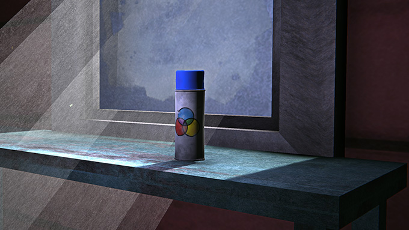
<figcaption>Early Spray Paint</figcaption>
</figure></td>
</tr>
</tbody>
</table>

## Unused Icons/Textures

Several icons/textures for items can be found in the game files as far back as the alpha builds, yet these items have not been seen or used in game yet. They are considered cut content. Some gear icons can be spawned but do not have real gameplay functionality.

- The Wolf Carcass is a Wolf Carcass that can be carried around and harvested, likely for testing reasons.
- Newsprint Insulation can be harvested for a Newsprint, also likely for testing purposes.

<table class="gallery">
<colgroup>
<col style="width: 25%" />
<col style="width: 25%" />
<col style="width: 25%" />
<col style="width: 25%" />
</colgroup>
<tbody>
<tr>
<td><figure>

<figcaption>Mountain Goat Feat (added 2019)</figcaption>
</figure></td>
<td><figure>

<figcaption>Expert Crafter Feat</figcaption>
</figure></td>
<td><figure>

<figcaption><a href="./Tin%20of%20Coffee.md" class="wikilink" title="Tin of Coffee">Tin of Coffee</a> cut texture</figcaption>
</figure></td>
<td><figure>

<figcaption><a href="./Summit%20Soda.md" class="wikilink" title="Summit Soda">Summit Soda</a> cut texture</figcaption>
</figure></td>
</tr>
<tr>
<td><figure>

<figcaption><a href="./Orange%20Soda.md" class="wikilink" title="Orange Soda">Orange Soda</a> cut texture</figcaption>
</figure></td>
<td><figure>
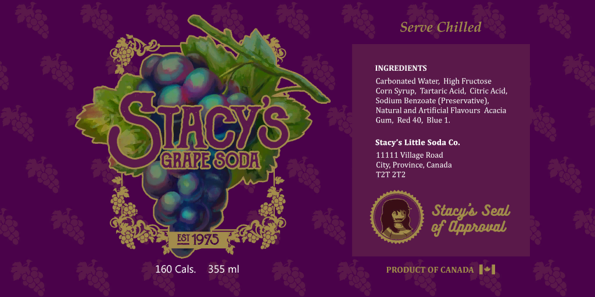
<figcaption><a href="./Stacy%27s%20Grape%20Soda.md" class="wikilink" title="Stacy&#39;s Grape Soda">Stacy's Grape Soda</a> cut texture</figcaption>
</figure></td>
<td><figure>

<figcaption><a href="./Military-Grade%20MRE.md" class="wikilink" title="MRE">MRE</a> cut texture</figcaption>
</figure></td>
<td><figure>

<figcaption><a href="./Pork%20and%20Beans.md" class="wikilink" title="Pork and Beans">Pork and Beans</a> cut texture</figcaption>
</figure></td>
</tr>
<tr>
<td><figure>

<figcaption><a href="./Pinnacle%20Peaches.md" class="wikilink" title="Pinnacle Peaches">Pinnacle Peaches</a> cut texture</figcaption>
</figure></td>
<td><figure>

<figcaption><a href="./Salty%20Crackers.md" class="wikilink" title="Salty Crackers">Salty Crackers</a> cut texture</figcaption>
</figure></td>
<td><figure>

<figcaption>Wolf Carcass</figcaption>
</figure></td>
<td><figure>

<figcaption>Newsprint Insulation</figcaption>
</figure></td>
</tr>
<tr>
<td><figure>

<figcaption>Fire Axe</figcaption>
</figure></td>
<td><figure>
[Missing image: The_Long_Dark_Key_Art-1500px.png]
<figcaption>The Fire Axe seen in a promotional image circa 2015</figcaption>
</figure></td>
<td><figure>
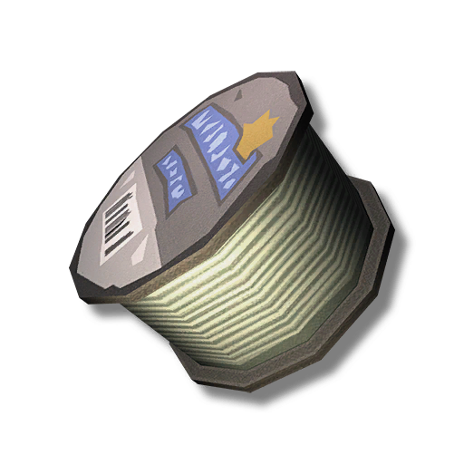
<figcaption>Fishing Line</figcaption>
</figure></td>
<td><figure>
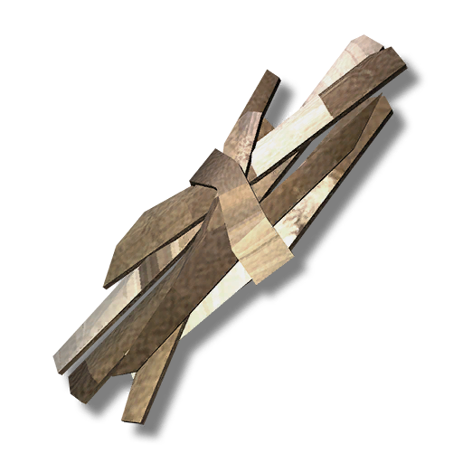
<figcaption>Leather Strips</figcaption>
</figure></td>
</tr>
<tr>
<td><figure>

<figcaption>Nylon</figcaption>
</figure></td>
<td><figure>

<figcaption>Revolver 44 Mag Bullet</figcaption>
</figure></td>
<td><figure>

<figcaption>Rifle Bullet</figcaption>
</figure></td>
<td><figure>
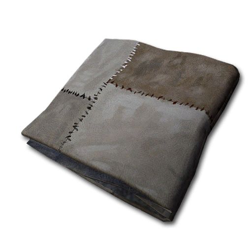
<figcaption>Cloth Sheet</figcaption>
</figure></td>
</tr>
<tr>
<td><figure>

<figcaption>Unknown Socks icon (Possibly Improvised Socks)</figcaption>
</figure></td>
<td><figure>
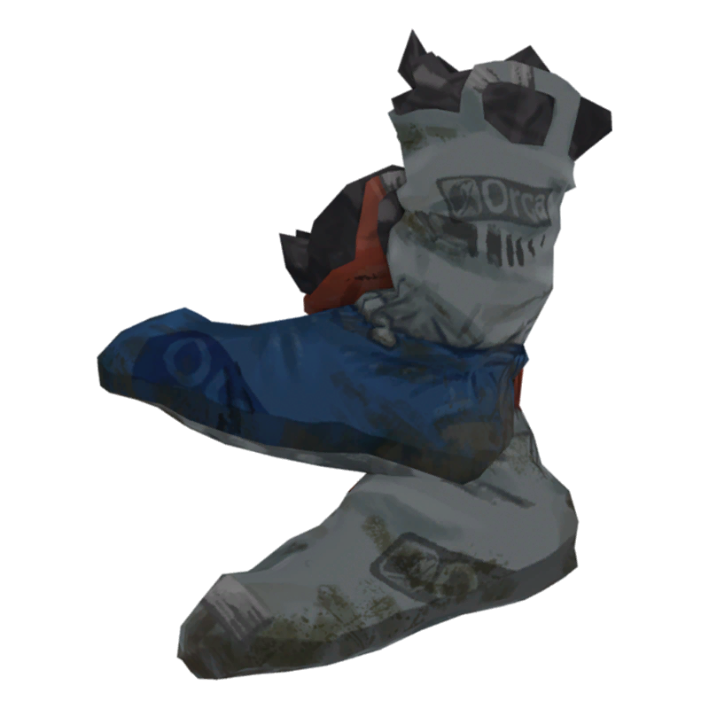
<figcaption>ditto, damaged</figcaption>
</figure></td>
<td><figure>
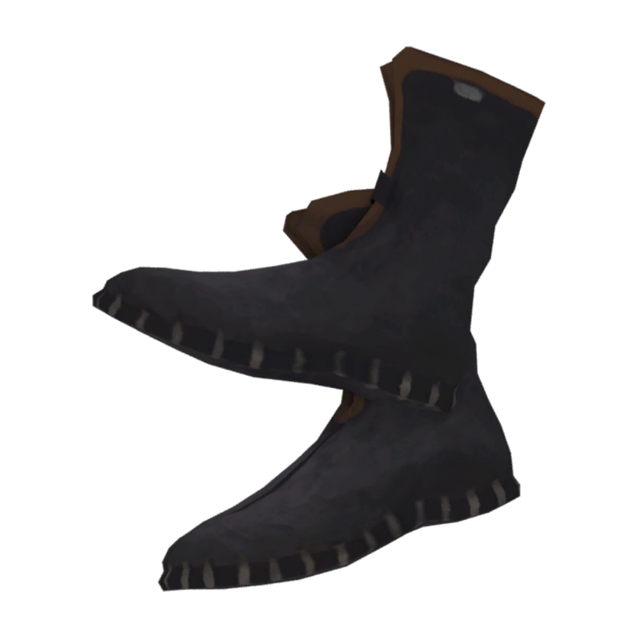
<figcaption>Unknown Socks icon (possibly Technical Socks)</figcaption>
</figure></td>
<td><figure>
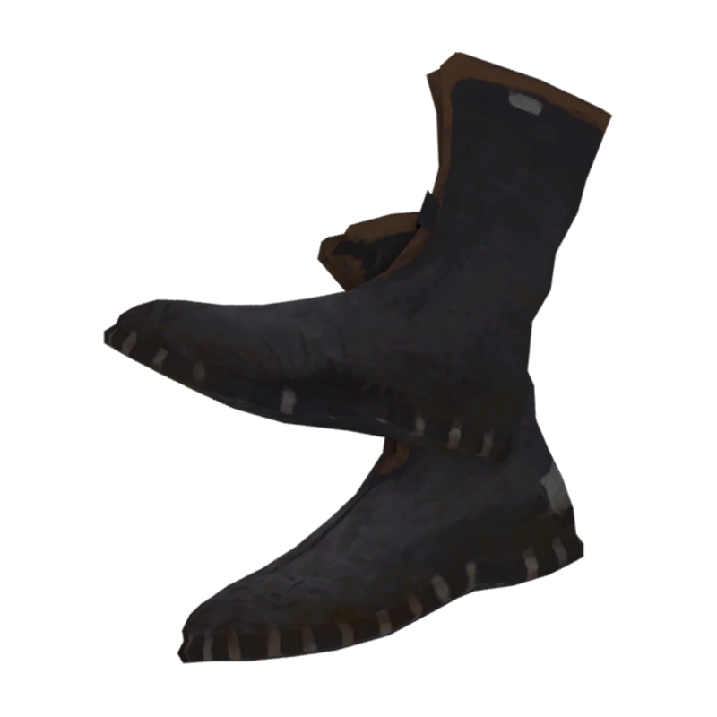
<figcaption>Ditto</figcaption>
</figure></td>
</tr>
<tr>
<td><figure>

<figcaption>Journal Texture</figcaption>
</figure></td>
<td><figure>
[Missing image: Cat_Tail_plant.png]
<figcaption>Cat Tail Plant</figcaption>
</figure></td>
<td><figure>

<figcaption>Lean To</figcaption>
</figure></td>
<td><figure>

<figcaption>Pickled Eggs</figcaption>
</figure></td>
</tr>
<tr>
<td><figure>
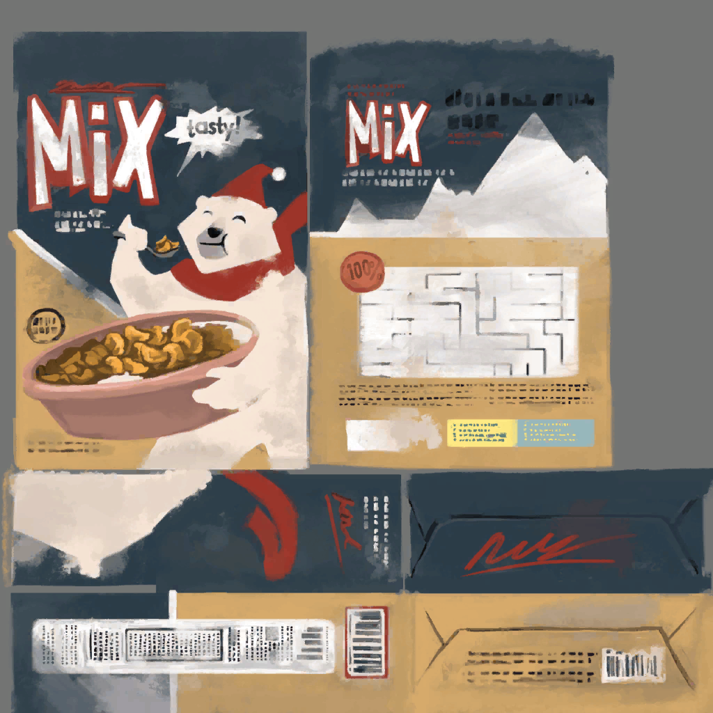
<figcaption>Alternate <a href="./Cereal.md" class="wikilink" title="Cereal">Cereal</a> box</figcaption>
</figure></td>
<td><figure>

<figcaption>Dried Mangos</figcaption>
</figure></td>
<td><figure>
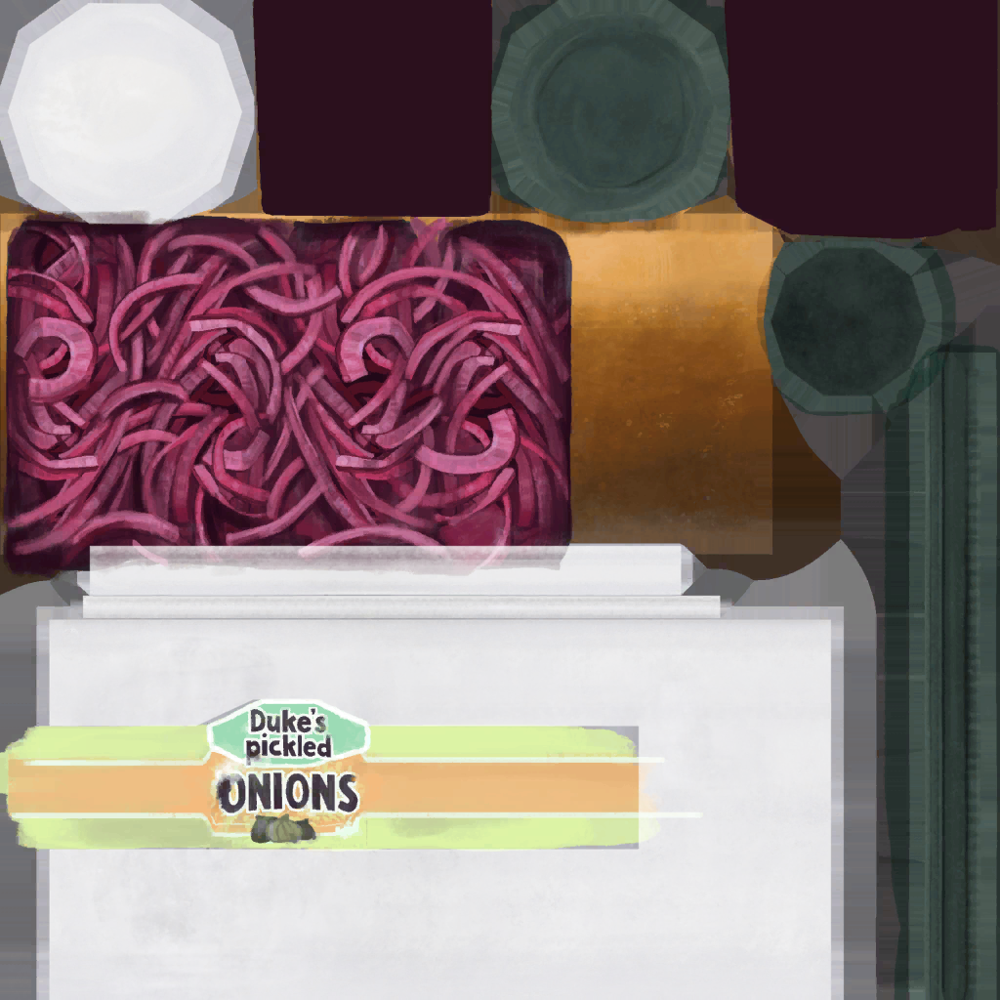
<figcaption>Pickled Onions</figcaption>
</figure></td>
<td><figure>

<figcaption>Canned Peas and Carrots</figcaption>
</figure></td>
</tr>
<tr>
<td><figure>

<figcaption>Canned Bean Brothers</figcaption>
</figure></td>
<td><figure>

<figcaption>Pemmican Oil</figcaption>
</figure></td>
<td><figure>

<figcaption>Fishing Line Texture</figcaption>
</figure></td>
<td><figure>
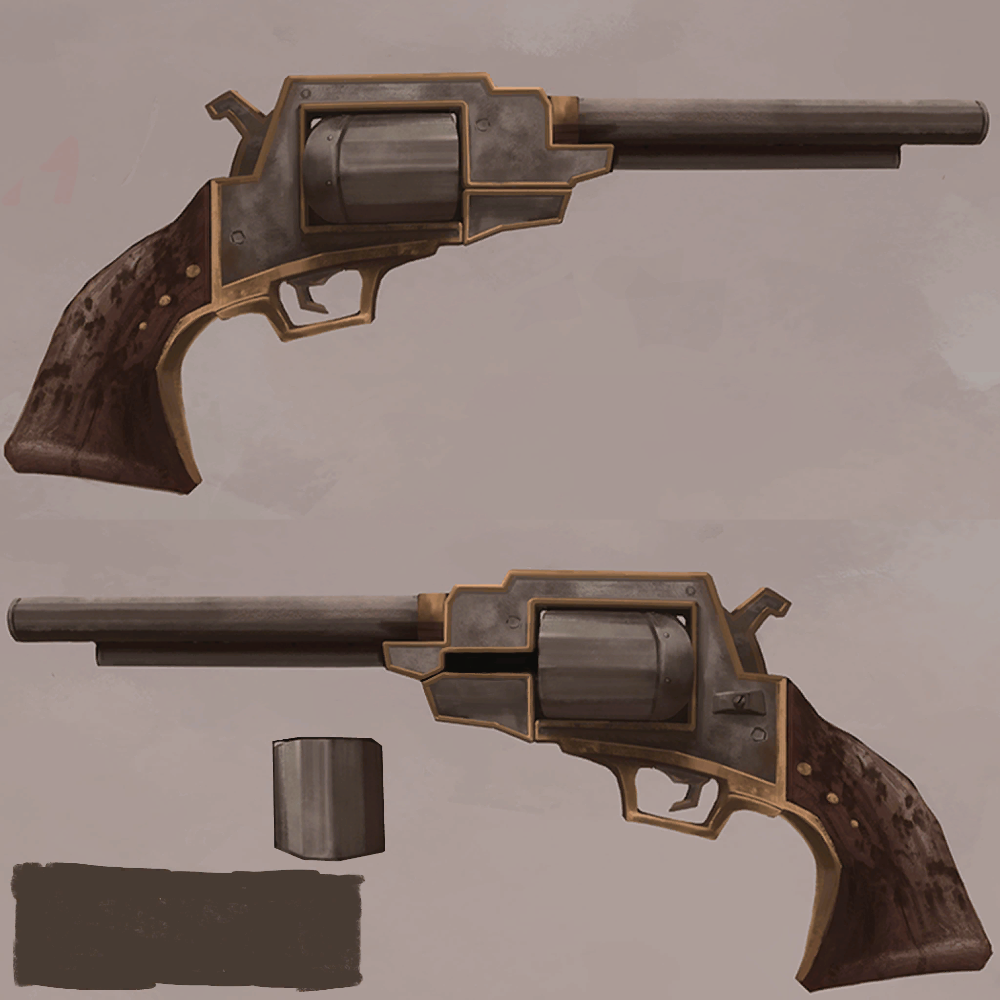
<figcaption>Possible alternate <a href="./Revolver.md" class="wikilink" title="Revolver">Revolver</a></figcaption>
</figure></td>
</tr>
<tr>
<td><figure>

<figcaption>Deerskin Hat</figcaption>
</figure></td>
<td><figure>

<figcaption>Deerskin Coat</figcaption>
</figure></td>
<td><figure>
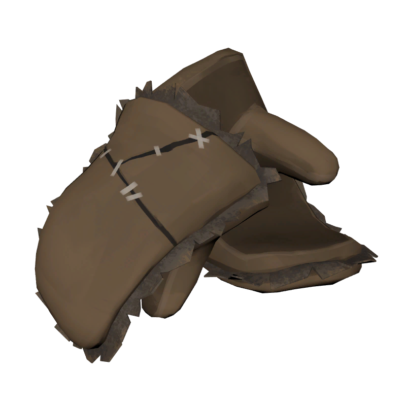
<figcaption>Deerskin Gloves</figcaption>
</figure></td>
<td><figure>

<figcaption>Episode 5 Medical Clinic Clipboard</figcaption>
</figure></td>
</tr>
<tr>
<td><figure>

<figcaption>Episode 5 Police Report</figcaption>
</figure></td>
<td><figure>

<figcaption>Episode 5 Desperation Bay Map</figcaption>
</figure></td>
<td><figure>

<figcaption>Episode 5 Ship Doctor ID</figcaption>
</figure></td>
<td><figure>
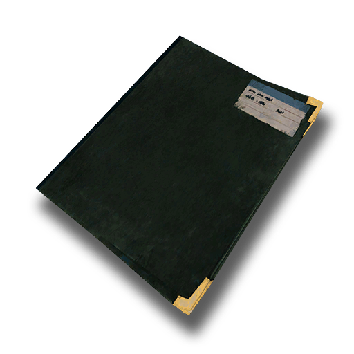
<figcaption>Episode 5 Ship Doctor Ledger</figcaption>
</figure></td>
</tr>
<tr>
<td><figure>
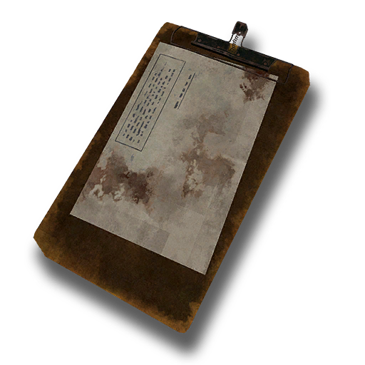
<figcaption>Episode 5 Ship Sickbay Note</figcaption>
</figure></td>
<td><figure>

<figcaption>Episode 5 Steam Train Brake Lever</figcaption>
</figure></td>
<td><figure>

<figcaption>Episode 5 Alternative <a href="./Supply%20Room%20Key.md" class="wikilink" title="Supply Room Key">Supply Room Key</a></figcaption>
</figure></td>
<td></td>
</tr>
</tbody>
</table>

## Cut Achievements/Badges

Several Achievements and icons were changed with the release of *The Long Dark* V1.00 Wintermute release. The previous Achievements' stylized appearance would later be reworked into the <a href="./Badges.md" class="wikilink" title="Badges">Badges</a> and <a href="./Feats.md" class="wikilink" title="Feats">Feats</a> systems.

A list of achievements that were cut from the game include:

<table>
<colgroup>
<col style="width: 33%" />
<col style="width: 33%" />
<col style="width: 33%" />
</colgroup>
<tbody>
<tr>
<td>
<strong>Image</strong>
</td>
<td>
<strong>Name</strong>
</td>
<td>
<strong>Description</strong>
</td>
</tr>
<tr>
<td><figure>
[Missing image: Two_for_Two.jpg]
<figcaption>Two_for_Two.jpg</figcaption>
</figure></td>
<td>
<strong><a href="./Two%20for%20Two.md" class="wikilink" title="Two for Two">Two for Two</a></strong>
</td>
<td>
Survive for 2 days in a single Survival Mode game.
</td>
</tr>
<tr>
<td><figure>
[Missing image: Wolfbait.jpg]
<figcaption>Wolfbait.jpg</figcaption>
</figure></td>
<td>
<strong><a href="./Wolfbait.md" class="wikilink" title="Wolfbait">Wolfbait</a></strong>
</td>
<td>
Survive 5 days in a single Survival Mode game.
</td>
</tr>
<tr>
<td><figure>
[Missing image: It's_Getting_Cold_Out_There.jpg]
<figcaption>It's_Getting_Cold_Out_There.jpg</figcaption>
</figure></td>
<td>
<strong><a href="./It%27s%20Getting%20Cold%20Out%20There.md" class="wikilink" title="It&#39;s Getting Cold Out There">It's Getting Cold Out There</a></strong>
</td>
<td>
Survive 15 days in a single Survival Mode game.
</td>
</tr>
<tr>
<td><figure>
[Missing image: Tough_as_Nails.jpg]
<figcaption>Tough_as_Nails.jpg</figcaption>
</figure></td>
<td>
<strong><a href="./Tough%20as%20Nails.md" class="wikilink" title="Tough as Nails">Tough as Nails</a></strong>
</td>
<td>
Survive 20 days in a single Survival Mode game.
</td>
</tr>
<tr>
<td><figure>
[Missing image: You_Prep_the_Preppers.jpg]
<figcaption>You_Prep_the_Preppers.jpg</figcaption>
</figure></td>
<td>
<strong><a href="./You%20Prep%20the%20Preppers.md" class="wikilink" title="You Prep the Preppers">You Prep the Preppers</a></strong>
</td>
<td>
Survive 30 days in a single Survival Mode game.
</td>
</tr>
<tr>
<td><figure>
[Missing image: Master_Survivor.jpg]
<figcaption>Master_Survivor.jpg</figcaption>
</figure></td>
<td>
<strong><a href="./Master%20Survivor.md" class="wikilink" title="Master Survivor">Master Survivor</a></strong>
</td>
<td>
Survive 40 days in a single Survival Mode game.
</td>
</tr>
<tr>
<td><figure>
[Missing image: One_With_Nature.jpg]
<figcaption>One_With_Nature.jpg</figcaption>
</figure></td>
<td>
<strong><a href="./One%20With%20Nature.md" class="wikilink" title="One With Nature">One With Nature</a></strong>
</td>
<td>
Survive for 200 days in a single Survival Mode game.
</td>
</tr>
</tbody>
</table>

The following achievements were kept but received a new achievement icon:

<table>
<colgroup>
<col style="width: 33%" />
<col style="width: 33%" />
<col style="width: 33%" />
</colgroup>
<tbody>
<tr>
<td>
<strong>Image</strong>
</td>
<td>
<strong>Name</strong>
</td>
<td>
<strong>Description</strong>
</td>
</tr>
<tr>
<td><figure>
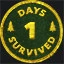
<figcaption>The_First_of_Many_old_icon.webp</figcaption>
</figure></td>
<td>
<strong>First of Many</strong>
</td>
<td>
Survive for 1 day in a single Survival Mode game.
</td>
</tr>
<tr>
<td><figure>
[Missing image: You_Made_It!_old_icon.webp]
<figcaption>You_Made_It!_old_icon.webp</figcaption>
</figure></td>
<td>
<strong>You Made It!</strong>
</td>
<td>
Survive 10 days in a single Survival Mode game.
</td>
</tr>
<tr>
<td><figure>
[Missing image: Ready_for_when_the_SHTF!_old_icon.webp]
<figcaption>Ready_for_when_the_SHTF!_old_icon.webp</figcaption>
</figure></td>
<td>
<strong>Ready for when the SHTF!</strong>
</td>
<td>
Survive for 50 days in a single Survival Mode game.
</td>
</tr>
<tr>
<td><figure>

<figcaption>Centurion_old_icon.webp</figcaption>
</figure></td>
<td>
<strong>Centurion</strong>
</td>
<td>
Survive for 100 days in a single Survival Mode game.
</td>
</tr>
<tr>
<td><figure>
[Missing image: Exploration_Game_old_icon.webp]
<figcaption>Exploration_Game_old_icon.webp</figcaption>
</figure></td>
<td>
<strong>Exploration Game</strong>
</td>
<td>
Visit every interior location in both <a href="./Mystery%20Lake%20%28region%29.md" class="wikilink" title="Mystery Lake">Mystery Lake</a> and <a href="./Coastal%20Highway.md" class="wikilink" title="Coastal Highway">Coastal Highway</a> (single game)
</td>
</tr>
<tr>
<td><figure>
[Missing image: Waste_Not,_Want_Not_old_icon.webp]
<figcaption>Waste_Not,_Want_Not_old_icon.webp</figcaption>
</figure></td>
<td>
<strong>Waste Not, Want Not</strong>
</td>
<td>
Harvest 10 Complete <a href="./Deer%20Carcass.md" class="wikilink" title="Deer Carcasses">Deer Carcasses</a> (single game)
</td>
</tr>
<tr>
<td><figure>
[Missing image: Night_Walker_old_icon.webp]
<figcaption>Night_Walker_old_icon.webp</figcaption>
</figure></td>
<td>
<strong>Night Walker</strong>
</td>
<td>
Survive an entire Night outside (single game)
</td>
</tr>
<tr>
<td><figure>
[Missing image: Beneath_a_Starry_Sky_old_icon.webp]
<figcaption>Beneath_a_Starry_Sky_old_icon.webp</figcaption>
</figure></td>
<td>
<strong>Beneath a Stary Sky</strong>
</td>
<td>
Survive 3 consecutive Nights outside (single game)
</td>
</tr>
<tr>
<td><figure>
[Missing image: Silent_Hunter_old_icon.webp]
<figcaption>Silent_Hunter_old_icon.webp</figcaption>
</figure></td>
<td>
<strong>Silent Hunter</strong>
</td>
<td>
Survive the first 50 days without firing the <a href="./Hunting%20Rifle.md" class="wikilink" title="hunting rifle">hunting rifle</a>, <a href="./Revolver.md" class="wikilink" title="revolver">revolver</a> or the <a href="./Distress%20Pistol.md" class="wikilink" title="distress pistol">distress pistol</a> (single game)
</td>
</tr>
<tr>
<td><figure>
[Missing image: Pacifist_old_icon.webp]
<figcaption>Pacifist_old_icon.webp</figcaption>
</figure></td>
<td>
<strong>Pacifist</strong>
</td>
<td>
Survive the first 25 days without killing anything (single game)
</td>
</tr>
<tr>
<td><figure>
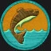
<figcaption>It_was_THIS_Big!_old_icon.webp</figcaption>
</figure></td>
<td>
<strong>It was THIS Big!</strong>
</td>
<td>
<a href="./Ice%20Fishing.md" class="wikilink" title="Catch">Catch</a> a fish weighing over 5kg (11 lbs).
</td>
</tr>
<tr>
<td><figure>

<figcaption>Wrapped_in_Furs_old_icon.webp</figcaption>
</figure></td>
<td>
<strong>Wrapped in Furs</strong>
</td>
<td>
Sleep in a <a href="./Bear%20Skin%20Bedroll.md" class="wikilink" title="Bear Skin Bedroll">Bear Skin Bedroll</a> while wearing a <a href="./Wolfskin%20Coat.md" class="wikilink" title="Wolfskin Coat">Wolfskin Coat</a>, <a href="./Deerskin%20Boots.md" class="wikilink" title="Deerskin Boots">Deerskin Boots</a>, and <a href="./Rabbitskin%20Mitts.md" class="wikilink" title="Rabbitskin Mittens">Rabbitskin Mittens</a>.
</td>
</tr>
<tr>
<td><figure>
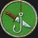
<figcaption>Living_Off_the_Land_old_icon.webp</figcaption>
</figure></td>
<td>
<strong>Living Off the Land</strong>
</td>
<td>
Survive 25 consecutive full days only consuming calories harvested from wild plants and animals (single game)
</td>
</tr>
<tr>
<td><figure>

<figcaption>Natural_Healer_old_icon.webp</figcaption>
</figure></td>
<td>
<strong>Natural Healer</strong>
</td>
<td>
Heal yourself using all types of natural <a href="./First%20Aid.md" class="wikilink" title="medicines">medicines</a> (single game)
</td>
</tr>
<tr>
<td><figure>

<figcaption>Happy_Harvester_old_icon.webp</figcaption>
</figure></td>
<td>
<strong>Happy Harvester</strong>
</td>
<td>
Harvest 25 of each kind of plant (single game)
</td>
</tr>
</tbody>
</table>

<table class="gallery">
<colgroup>
<col style="width: 33%" />
<col style="width: 33%" />
<col style="width: 33%" />
</colgroup>
<tbody>
<tr>
<td><figure>
[Missing image: Achievements_collage_22.png]
<figcaption>All 22 achievement icons, pre V1.15.</figcaption>
</figure></td>
<td><figure>
[Missing image: Whiteout_badge.png]
<figcaption>Old Whiteout Badge</figcaption>
</figure></td>
<td><figure>
[Missing image: Nomad_badge.png]
<figcaption>Old Nomad Badge</figcaption>
</figure></td>
</tr>
</tbody>
</table>

## Discontinued Icons

### Afflictions

<table class="gallery">
<colgroup>
<col style="width: 25%" />
<col style="width: 25%" />
<col style="width: 25%" />
<col style="width: 25%" />
</colgroup>
<tbody>
<tr>
<td><figure>

<figcaption>Dysentary</figcaption>
</figure></td>
<td><figure>
[Missing image: Food_poisoning.png]
<figcaption>Food Poisoning</figcaption>
</figure></td>
<td><figure>
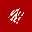
<figcaption>Minor Bruising</figcaption>
</figure></td>
<td><figure>

<figcaption>Major Bruising</figcaption>
</figure></td>
</tr>
<tr>
<td><figure>

<figcaption>Laceration</figcaption>
</figure></td>
<td><figure>

<figcaption>Sprained Wrist</figcaption>
</figure></td>
<td><figure>

<figcaption>Sprained Ankle</figcaption>
</figure></td>
<td><figure>
[Missing image: Burns.png]
<figcaption>Burns</figcaption>
</figure></td>
</tr>
<tr>
<td><figure>

<figcaption>Blood Loss</figcaption>
</figure></td>
<td><figure>
[Missing image: Frostbite_old.png]
<figcaption>Frostbite</figcaption>
</figure></td>
<td><figure>

<figcaption>Intestinal Parasites</figcaption>
</figure></td>
<td><figure>
[Missing image: Hypothermia.png]
<figcaption>Hypothermia</figcaption>
</figure></td>
</tr>
<tr>
<td><figure>

<figcaption>Affliction symbol present when suffering from an affliction</figcaption>
</figure></td>
<td><figure>

<figcaption>Symbol for no Afflictions</figcaption>
</figure></td>
<td><figure>
[Missing image: Fatigue_reduced.png]
<figcaption>Fatigue Reduced</figcaption>
</figure></td>
<td><figure>
[Missing image: Warming_up.png]
<figcaption>Warming Up</figcaption>
</figure></td>
</tr>
<tr>
<td><figure>
[Missing image: Improved_rest.png]
<figcaption>Improved Sleep</figcaption>
</figure></td>
<td></td>
<td></td>
<td></td>
</tr>
</tbody>
</table>

### Skills

<table class="gallery">
<colgroup>
<col style="width: 25%" />
<col style="width: 25%" />
<col style="width: 25%" />
<col style="width: 25%" />
</colgroup>
<tbody>
<tr>
<td><figure>
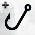
<figcaption>Ice Fishing</figcaption>
</figure></td>
<td><figure>

<figcaption>Carcass Harvesting</figcaption>
</figure></td>
<td><figure>

<figcaption>Mending</figcaption>
</figure></td>
<td><figure>
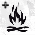
<figcaption>Firestarting</figcaption>
</figure></td>
</tr>
<tr>
<td><figure>

<figcaption>Cooking</figcaption>
</figure></td>
<td><figure>
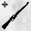
<figcaption>Rifle Firearm Skill (Formerly named Firearms Skill)</figcaption>
</figure></td>
<td></td>
<td></td>
</tr>
</tbody>
</table>

### Other

<table class="gallery">
<colgroup>
<col style="width: 100%" />
</colgroup>
<tbody>
<tr>
<td><figure>

<figcaption>Windshield</figcaption>
</figure></td>
</tr>
</tbody>
</table>

### Challenge Portraits

<table class="gallery">
<colgroup>
<col style="width: 25%" />
<col style="width: 25%" />
<col style="width: 25%" />
<col style="width: 25%" />
</colgroup>
<tbody>
<tr>
<td><figure>
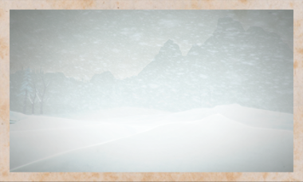
<figcaption><a href="./Whiteout.md" class="wikilink" title="Whiteout">Whiteout</a></figcaption>
</figure></td>
<td><figure>

<figcaption><a href="./Nomad.md" class="wikilink" title="Nomad">Nomad</a></figcaption>
</figure></td>
<td><figure>
[Missing image: Hopeless_Rescue.png]
<figcaption><a href="./Hopeless%20Rescue.md" class="wikilink" title="Hopeless Rescue">Hopeless Rescue</a></figcaption>
</figure></td>
<td><figure>
[Missing image: The_Hunted,_Part_One.png]
<figcaption><a href="./The%20Hunted%2C%20Part%20One.md" class="wikilink" title="The Hunted, Part One">The Hunted, Part One</a></figcaption>
</figure></td>
</tr>
</tbody>
</table>

### Region Portraits

<table class="gallery">
<colgroup>
<col style="width: 25%" />
<col style="width: 25%" />
<col style="width: 25%" />
<col style="width: 25%" />
</colgroup>
<tbody>
<tr>
<td><figure>

<figcaption><a href="./Mystery%20Lake%20%28location%29.md" class="wikilink" title="Mystery Lake">Mystery Lake</a></figcaption>
</figure></td>
<td><figure>

<figcaption><a href="./The%20Ravine.md" class="wikilink" title="The Ravine">The Ravine</a></figcaption>
</figure></td>
<td><figure>

<figcaption><a href="./Coastal%20Highway.md" class="wikilink" title="Coastal Highway">Coastal Highway</a></figcaption>
</figure></td>
<td><figure>

<figcaption><a href="./Pleasant%20Valley.md" class="wikilink" title="Pleasant Valley">Pleasant Valley</a></figcaption>
</figure></td>
</tr>
<tr>
<td><figure>

<figcaption><a href="./Winding%20River.md" class="wikilink" title="Winding River">Winding River</a></figcaption>
</figure></td>
<td><figure>
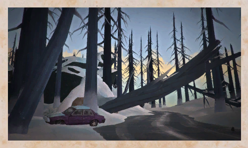
<figcaption><a href="./Crumbling%20Highway.md" class="wikilink" title="Crumbling Highway">Crumbling Highway</a></figcaption>
</figure></td>
<td><figure>
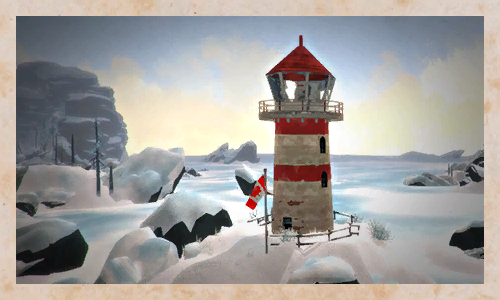
<figcaption><a href="./Desolation%20Point.md" class="wikilink" title="Desolation Point">Desolation Point</a></figcaption>
</figure></td>
<td><figure>

<figcaption><a href="./Timberwolf%20Mountain.md" class="wikilink" title="Timberwolf Mountain">Timberwolf Mountain</a></figcaption>
</figure></td>
</tr>
<tr>
<td><figure>

<figcaption><a href="./Forlorn%20Muskeg.md" class="wikilink" title="Forlorn Muskeg">Forlorn Muskeg</a></figcaption>
</figure></td>
<td><figure>

<figcaption><a href="./Broken%20Railroad.md" class="wikilink" title="Broken Railroad">Broken Railroad</a></figcaption>
</figure></td>
<td><figure>

<figcaption><a href="./Mountain%20Town.md" class="wikilink" title="Mountain Town">Mountain Town</a></figcaption>
</figure></td>
<td><figure>
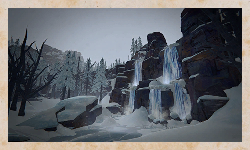
<figcaption><a href="./Hushed%20River%20Valley.md" class="wikilink" title="Hushed River Valley">Hushed River Valley</a></figcaption>
</figure></td>
</tr>
<tr>
<td><figure>

<figcaption><a href="./Bleak%20Inlet.md" class="wikilink" title="Bleak Inlet">Bleak Inlet</a></figcaption>
</figure></td>
<td><figure>

<figcaption>RegionAtlas-resources.assets-562_(6).png</figcaption>
</figure></td>
<td><figure>

<figcaption>Broken_railroad_titlecard_new.png</figcaption>
</figure></td>
<td><figure>
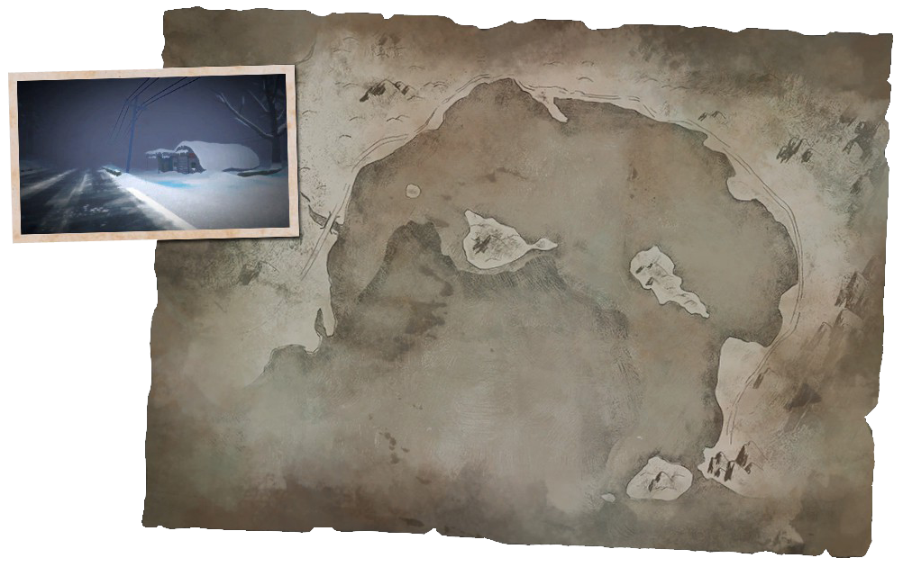
<figcaption>Coastal_highway_titlecard_new.png</figcaption>
</figure></td>
</tr>
<tr>
<td><figure>

<figcaption>Pleasant_valley_titlecard_new.png</figcaption>
</figure></td>
<td><figure>

<figcaption>Forlorn_muskeg_titlecard_new.png</figcaption>
</figure></td>
<td><figure>

<figcaption>Mystery_lake_titlecard_new.png</figcaption>
</figure></td>
<td><figure>
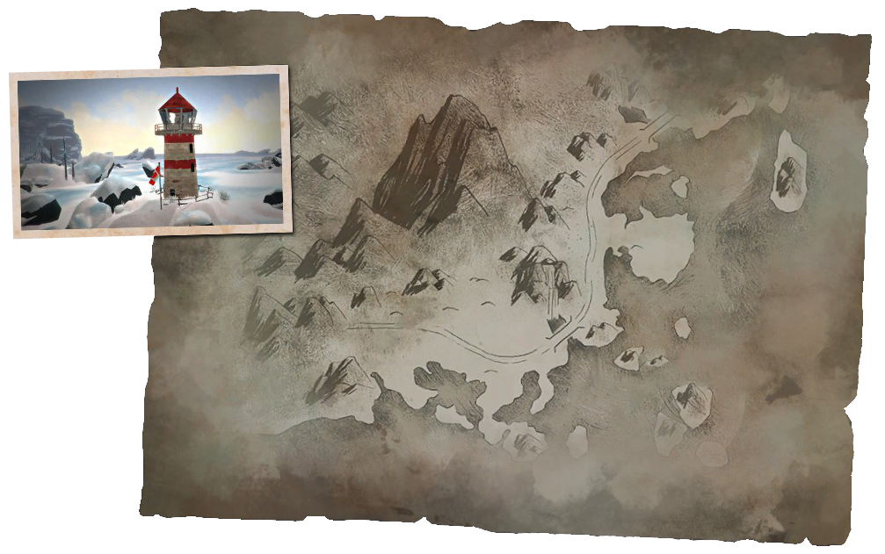
<figcaption>Desolation_point_titlecard_new.png</figcaption>
</figure></td>
</tr>
<tr>
<td><figure>
[Missing image: Broken_railway_titlecard.jpg]
<figcaption>Broken Railroad Selection</figcaption>
</figure></td>
<td></td>
<td></td>
<td></td>
</tr>
</tbody>
</table>

### Old Region Maps

<table class="gallery">
<colgroup>
<col style="width: 25%" />
<col style="width: 25%" />
<col style="width: 25%" />
<col style="width: 25%" />
</colgroup>
<tbody>
<tr>
<td><figure>
[Missing image: Global_map_Published_by_development_team.jpg]
<figcaption>0.298 (Timberwolf Mountain Update) World Map released by Hinterland. Never officially in game</figcaption>
</figure></td>
<td><figure>
[Missing image: World_Map_1.00_(Wintermute_Launch).jpg]
<figcaption>1.00 (Wintermute Update) This was the first in game world map. Mountain Town was only available for Wintermute at the time</figcaption>
</figure></td>
<td><figure>
[Missing image: Lower_Great_Bear_1.16.jpg]
<figcaption>1.16 (Rugged Sentinel Update)</figcaption>
</figure></td>
<td><figure>
[Missing image: Lower_Great_Bear_V1.33.jpg]
<figcaption>1.33 (Vigilant Flame Update) World Map</figcaption>
</figure></td>
</tr>
<tr>
<td><figure>
[Missing image: World_Map_1.64.jpg]
<figcaption>1.64 (Errant Pilgrim Update)</figcaption>
</figure></td>
<td><figure>
[Missing image: World_Map_Overview_V1.89.jpg]
<figcaption>1.89 (Hesitant Prospect Update)</figcaption>
</figure></td>
<td><figure>

<figcaption>1.89 (Hesitant Prospect Update) Selection Screen</figcaption>
</figure></td>
<td><figure>
[Missing image: Lower_Great_Bear_1.98.jpg]
<figcaption>1.98 (Perilous Constraint Update)</figcaption>
</figure></td>
</tr>
<tr>
<td><figure>
[Missing image: TLD_regions1.jpg]
<figcaption>1.98 Selection Screen</figcaption>
</figure></td>
<td><figure>

<figcaption>2.03 (Tales from the Far Territory Part 1) Current Map</figcaption>
</figure></td>
<td><figure>

<figcaption>V2.03 (Part One Forsaken Airfield Update)</figcaption>
</figure></td>
<td><figure>

<figcaption>2.03 selection region map (missing Far Range Branch Line)</figcaption>
</figure></td>
</tr>
<tr>
<td><figure>

<figcaption>2.25 (TFTFT PART FOUR: Buried Echoes Update) World Map</figcaption>
</figure></td>
<td><figure>
[Missing image: TLD_regions_list2.jpg]
<figcaption>ditto, region selection</figcaption>
</figure></td>
<td><figure>
[Missing image: Far_Territory_Part_5_Map.jpg]
<figcaption>2.28 (Part 5 Last Horizon Update) Current Map</figcaption>
</figure></td>
<td><figure>
[Missing image: Far_Territory_Selection_Part_5.jpg]
<figcaption>Ditto, selection screen</figcaption>
</figure></td>
</tr>
<tr>
<td><figure>
[Missing image: Cauldron_Island_V2.58.jpg]
<figcaption>Cauldron Island (Part One V2.58)</figcaption>
</figure></td>
<td></td>
<td></td>
<td></td>
</tr>
</tbody>
</table>

### Title Screens

<table class="gallery">
<colgroup>
<col style="width: 25%" />
<col style="width: 25%" />
<col style="width: 25%" />
<col style="width: 25%" />
</colgroup>
<tbody>
<tr>
<td><figure>
[Missing image: Main_Menu_Alpha_Sandbox.jpg]
<figcaption>Pre Alpha Menu</figcaption>
</figure></td>
<td><figure>
[Missing image: Penitent_Scholar_Title_Screen.jpg]
<figcaption>Penitent Scholar</figcaption>
</figure></td>
<td><figure>
[Missing image: In_game_cabin.jpg]
<figcaption>Aurora Version</figcaption>
</figure></td>
<td><figure>
[Missing image: The_Long_Dark_Halloween_main_menu_theme.jpg]
<figcaption><a href="./4%20Days%20of%20Night%20Event.md" class="wikilink" title="4DON">4DON</a> Version (Pre Alpha)</figcaption>
</figure></td>
</tr>
<tr>
<td><figure>
[Missing image: 4DON_Main_Menu.jpg]
<figcaption>4DON</figcaption>
</figure></td>
<td><figure>
[Missing image: The_Long_Dark_main_menu_theme.jpg]
<figcaption>V1.00-1.60</figcaption>
</figure></td>
<td><figure>
[Missing image: Crossroads_Elegy_Main_Menu.jpg]
<figcaption>Crossroads Elegy</figcaption>
</figure></td>
<td><figure>
[Missing image: Crossroads_Elegy_Main_Menu_Night.jpg]
<figcaption>Crossroads Elegy (Night)</figcaption>
</figure></td>
</tr>
<tr>
<td><figure>
[Missing image: Hesitant_Prospect_Main_Menu.jpg]
<figcaption>Hesitant Prospect</figcaption>
</figure></td>
<td><figure>
[Missing image: Episode_4_Main_Menu.jpg]
<figcaption>Fury, Then Silence</figcaption>
</figure></td>
<td><figure>
[Missing image: Perilous_Constraint_Main_Menu.jpg]
<figcaption>Perilous Constraint</figcaption>
</figure></td>
<td><figure>
[Missing image: Forsaken_Airfield_Menu.jpg]
<figcaption>Forsaken Airfield Update</figcaption>
</figure></td>
</tr>
<tr>
<td><figure>
[Missing image: Transfer_Pass_Main_Menu.jpg]
<figcaption>2.09 Part 2 and 3 Signal Void/Frontier Comforts</figcaption>
</figure></td>
<td><figure>
[Missing image: Buried_Echoes_Main_Menu.jpg]
<figcaption>Buried Echoes Update</figcaption>
</figure></td>
<td><figure>
[Missing image: Main_Menu_Last_Horizon.jpg]
<figcaption>Last Horizon</figcaption>
</figure></td>
<td><figure>
[Missing image: Broken_Silence_Menu.jpg]
<figcaption>Broken Silence Update</figcaption>
</figure></td>
</tr>
<tr>
<td><figure>
[Missing image: Iron_Road_Screen.jpg]
<figcaption>Iron Road part 1</figcaption>
</figure></td>
<td></td>
<td></td>
<td></td>
</tr>
</tbody>
</table>

**Lua execution error in Module:Navbox function navbox**

## Notes

[^1]: <https://www.shacknews.com/article/142391/the-long-dark-raphael-van-lierop-interview-2024>
