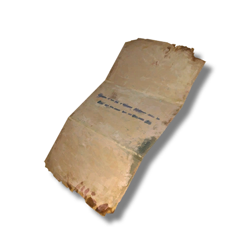

# Dam Control Room Code

<table class="infobox">
<caption>Dam Control Room Code</caption>
<colgroup>
<col style="width: 50%" />
<col style="width: 50%" />
</colgroup>
<tbody>
<tr>
<td colspan="2"><figure>

<figcaption>Dam_Control_Room_Code_icon.png</figcaption>
</figure></td>
</tr>
<tr>
<td>
Release
</td>
<td>
<a href="./The%20Long%20Dark%20%E2%80%94%20Early%20Access%20Changelog.md#1.00" class="wikilink" title="1 August 2017">1 August 2017</a>
</td>
</tr>
<tr>
<td>
Wintermute
</td>
<td>
<a href="./Episode%202%20-%20Luminance%20Fugue.md" class="wikilink" title="Episode 2">Episode 2</a> - <a href="./Renewed%20Hope%20%28Predux%29.md" class="wikilink" title="Renewed Hope (Predux)">Renewed Hope (Predux)</a>
</td>
</tr>
<tr>
<td colspan="2" class="section">
<strong>Properties</strong>
</td>
</tr>
<tr>
<td>
Item type
</td>
<td>
<a href="./Collectibles.md" class="wikilink" title="Collectibles">Collectibles</a>|-
</td>
</tr>
<tr>
<td>
Stackable
</td>
<td>
No
</td>
</tr>
<tr>
<td>
Examine
</td>
<td>
A note containing the Dam's Control Room entry code number
</td>
</tr>
<tr>
<td colspan="2" class="section">
<strong>Values</strong>
</td>
</tr>
<tr>
<td>
Weight
</td>
<td>
0.00 kg (0 lbs)
</td>
</tr>
<tr>
<td colspan="2" class="section">
<strong>Actions</strong>
</td>
</tr>
<tr>
<td>
Backpack
</td>
<td>
Examine
</td>
</tr>
<tr>
<td>
On ground
</td>
<td>
Take It, Leave It
</td>
</tr>
</tbody>
</table>

**Dam Control Room Code** was a <a href="./Collectibles.md" class="wikilink" title="Collectible">Collectible</a> item found in the Predux version of <a href="./Episode%202%20-%20Luminance%20Fugue.md" class="wikilink" title="Episode 2">Episode 2</a> of the <a href="./Wintermute.md" class="wikilink" title="Wintermute">Wintermute</a> story mode. It was added to the player's inventory at the start of the mission <a href="./Renewed%20Hope%20%28Predux%29.md" class="wikilink" title="Renewed Hope (Predux)">Renewed Hope (Predux)</a>. It is the same code that <a href="./Jeremiah.md" class="wikilink" title="Jeremiah">Jeremiah</a> gives to <a href="./Will%20Mackenzie.md" class="wikilink" title="Will Mackenzie">Will Mackenzie</a> to let him through the <a href="./Carter%20Hydro%20Dam.md" class="wikilink" title="Carter Hydro Dam">Carter Hydro Dam</a>. It was cut in the Redux version, as no code is needed to open the Control Room door in the Dam, and the note is now considered <a href="./Cut%20%E2%80%94%20Discontinued%20Content.md" class="wikilink" title="Cut/Discontinued Content">Cut/Discontinued Content</a>.

## Transcript

The following text is transcribed from **Dam Control Room Code**

Jeremiah's code for the Dam's Control Room: 7611 Use it when the aurora is in the sky!

## Update history

\* UPDATE **17 December 2018 (<a href="./The%20Long%20Dark%20%E2%80%94%20Changelog.md#1.41" class="wikilink" title="Update">Update</a>):**

- - Added to game.

<!-- -->

- UPDATE **1 August 2017 (<a href="./The%20Long%20Dark%20%E2%80%94%20Changelog.md#1.41" class="wikilink" title="Update">Update</a>):**
  - Removed from the game but still in the game files.

**Lua execution error in Module:Navbox function navbox**

