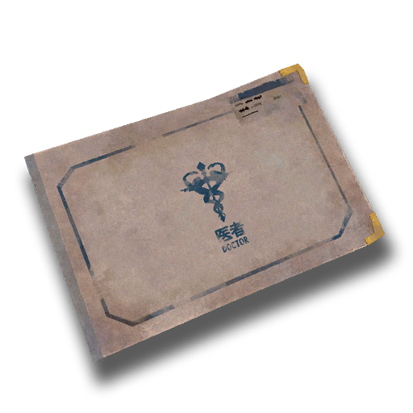

# Dead Wake

<table class="infobox">
<caption>Dead Wake</caption>
<colgroup>
<col style="width: 50%" />
<col style="width: 50%" />
</colgroup>
<tbody>
<tr>
<td colspan="2"><figure>
[Missing image: Dead_Wake_icon.png]
<figcaption>Dead_Wake_icon.png</figcaption>
</figure></td>
</tr>
<tr>
<td>
Description
</td>
<td>
Collect all the writings and personal effects left behind by the ship's crew.
</td>
</tr>
</tbody>
</table>

**Dead Wake** is a hidden <a href="./The%20Long%20Dark%20%E2%80%94%20Achievements.md" class="wikilink" title="achievement">achievement</a> in *<a href="./Wintermute.md" class="wikilink" title="Wintermute">Wintermute</a>* <a href="./Episode%205%20-%20The%20Light%20At%20The%20End%20Of%20All%20Things.md" class="wikilink" title="Episode 5: The Light At The End Of All Things">Episode 5: The Light At The End Of All Things</a> of *<a href="./The%20Long%20Dark.md" class="wikilink" title="The Long Dark">The Long Dark</a>*.

## Guide

This is a missable hidden achievement in the main story mission <a href="./A%20Cry%20For%20Help.md" class="wikilink" title="A Cry For Help">A Cry For Help</a>. After arriving aboard the derelict Japanese cargo ship <a href="./Fukkatsu%20Maru.md" class="wikilink" title="Fukkatsu Maru">Fukkatsu Maru</a>, the player must find all notes on the derelict ship and the achievement will unlock.

- \[Missing image: Piece_Of_Paper_icon.png\] <a href="./Piece%20Of%20Paper.md" class="wikilink" title="Piece Of Paper">Piece Of Paper</a>
-  <a href="./Note.md" class="wikilink" title="Note">Note</a>
-  <a href="./Medical%20Log.md" class="wikilink" title="Medical Log">Medical Log</a>
-  <a href="./ID%20Card.md" class="wikilink" title="ID Card">ID Card</a>

Stepping out of the radio room and jumping into the bridge will make it pretty much impossible to backtrack to get the previous collectibles, but you can attempt to sprint from the chair to the barrel and to another barrel straight into the broken window.

-  <a href="./Sea%20Charts.md" class="wikilink" title="Sea Charts">Sea Charts</a>
-  <a href="./Worn%20Logbook.md" class="wikilink" title="Worn Logbook">Worn Logbook</a>

The \*  <a href="./Locker%20Key.md" class="wikilink" title="Locker Key">Locker Key</a> is not needed to unlock the achievement.

## Game History

\* UPDATE **31 March 2026 (<a href="./The%20Long%20Dark%20%E2%80%94%20Changelog.md#2.52" class="wikilink" title="Update">Update</a>):**

- - Added to game.

**Lua execution error in Module:Navbox function navbox**

