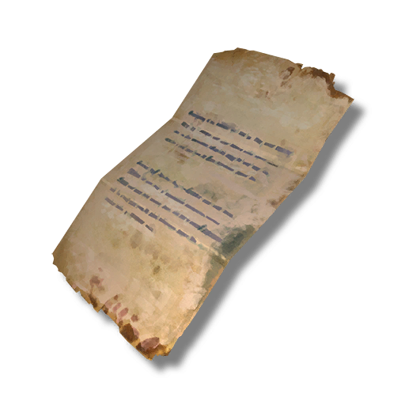
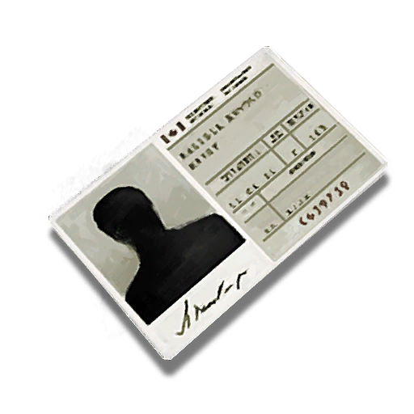
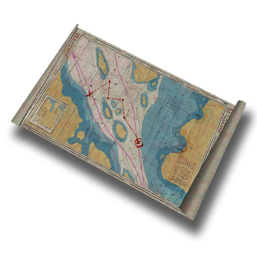
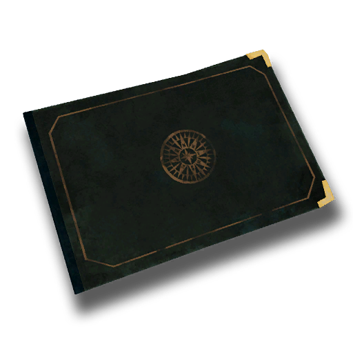
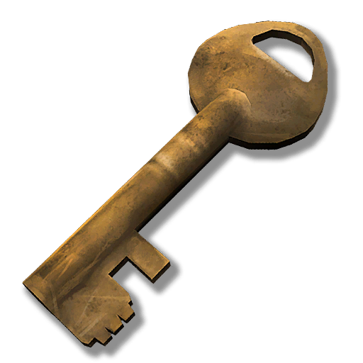

# Dead Wake

**Categories:** Achievements, Pages with update history · **Source:** [Fandom](https://thelongdark.fandom.com/wiki/Dead_Wake)

**Dead Wake**

| Property | Details |
| --- | --- |
| | [Dead Wake icon](../assets/Dead_Wake_icon.png) |
| Description | Collect all the writings and personal effects left behind by the ship's crew. |

**Dead Wake** is a hidden [achievement](./The%20Long%20Dark%20%E2%80%94%20Achievements.md) in _[Wintermute](./Wintermute.md)_ [Episode 5: The Light At The End Of All Things](./Episode%205%20-%20The%20Light%20At%20The%20End%20Of%20All%20Things.md) of _[The Long Dark](./The%20Long%20Dark.md)_.

## Guide

This is a missable hidden achievement in the main story mission [A Cry For Help](./A%20Cry%20For%20Help.md). After arriving aboard the derelict Japanese cargo ship [Fukkatsu Maru](./Fukkatsu%20Maru.md), the player must find all notes on the derelict ship and the achievement will unlock.

-  [Piece Of Paper](./Piece%20Of%20Paper.md)
-  [Note](./Note.md)
-  [Medical Log](./Medical%20Log.md)
-  [ID Card](./ID%20Card.md)

Stepping out of the radio room and jumping into the bridge will make it pretty much impossible to backtrack to get the previous collectibles, but you can attempt to sprint from the chair to the barrel and to another barrel straight into the broken window.

-  [Sea Charts](./Sea%20Charts.md)
-  [Worn Logbook](./Worn%20Logbook.md)

The \*  [Locker Key](./Locker%20Key.md) is not needed to unlock the achievement.

## Game History

\* UPDATE **31 March 2026 ([Update](./The%20Long%20Dark%20%E2%80%94%20Changelog.md#version-2-52)):**

- Added to game.
