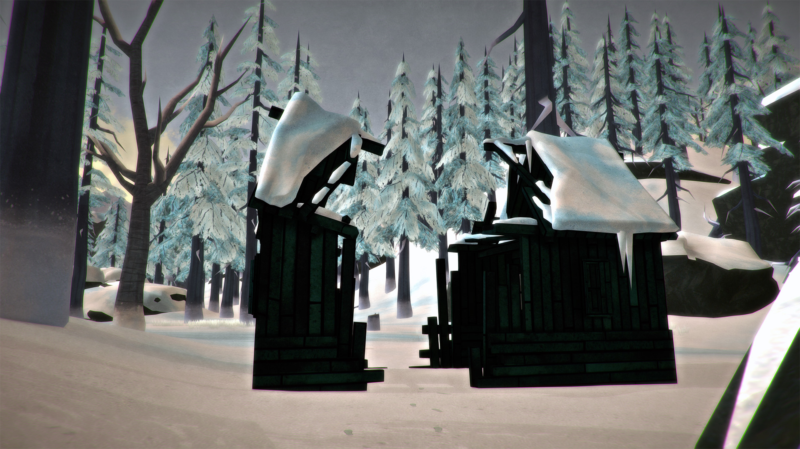
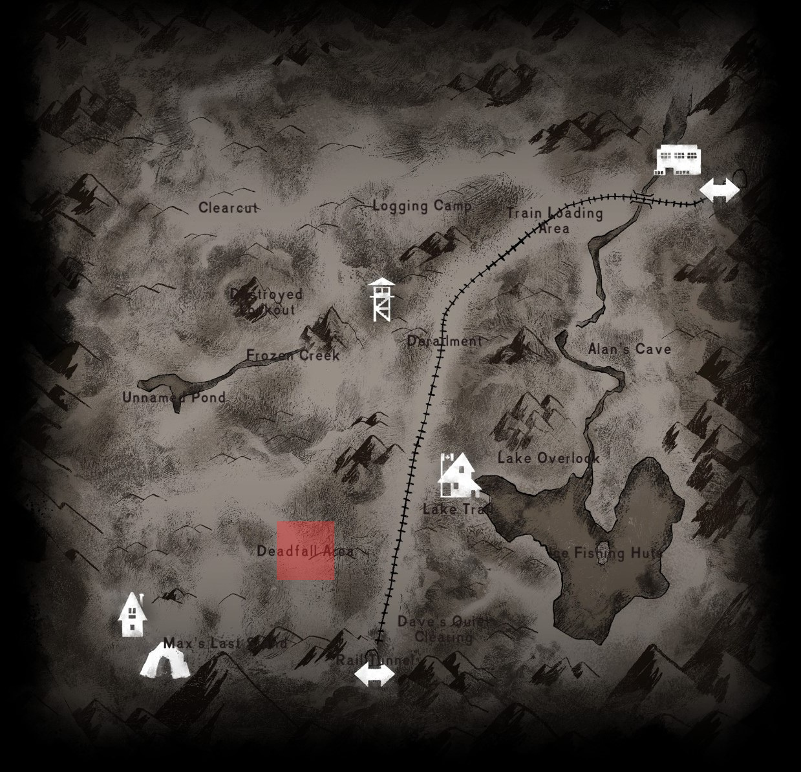

# Deadfall Area

**Categories:** Locations, Locations in Mystery Lake, Outdoor locations, Sheltered locations · **Source:** [Fandom](https://thelongdark.fandom.com/wiki/Deadfall_Area)

**Deadfall Area**

_Deadfall\_area.jpg_

**Location**

_Deadfall\_Area\_Location.png_

**Region:** [Mystery Lake](./Mystery%20Lake%20%28region%29.md)

**General**

**Type:** Outdoors

Provides some shelter / **Deadfall Area** is a location in [Mystery Lake](./Mystery%20Lake%20%28region%29.md).

## Overview

Deadfall Area lies between [Camp Office](./Camp%20Office.md) and [Trapper's Homestead](./Trapper%27s%20Homestead.md). The Deadfall Area's sole man-made structure is a ruined building that may contain some loot and offers some shelter from storms. It also contains a [Wood Stove](./Wood%20Stove.md). You can sometimes find [firelogs](./Firelog.md) and a possible corpse.

A [hatchet](./Hatchet.md) is commonly found next to the wood burning stove.
