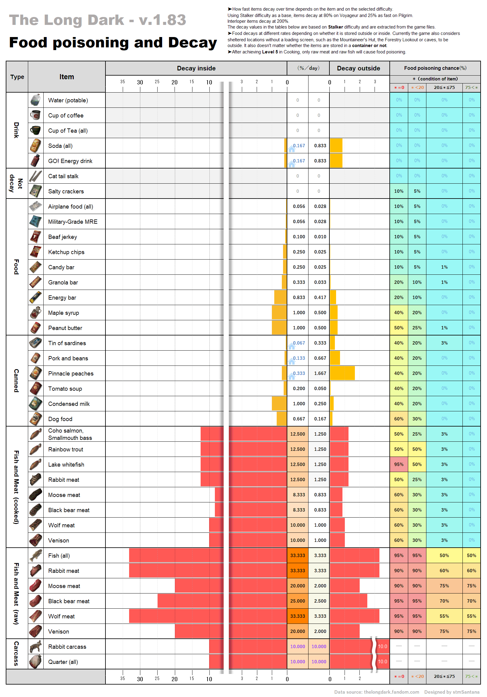

# Decay

**Categories:** Gameplay, Pages with update history · **Source:** [Fandom](https://thelongdark.fandom.com/wiki/Decay)

**Contents**

- [Food and Drink](#food-and-drink)
- [Packaged Food](#packaged-food)
- [Recipes](#recipes)
- [Ingredients](#ingredients)
- [Quartering](#quartering)
- [Clothing](#clothing)
- [Wintermute Clothing](#wintermute-clothing)
- [Hats and Scarves](#hats-and-scarves)
- [Gloves](#gloves)
- [Shirts and Sweaters](#shirts-and-sweaters)
- [Coats, Vests, and Jackets](#coats-vests-and-jackets)
- [Underwear](#underwear)
- [Pants](#pants)
- [Socks](#socks)
- [Shoes and boots](#shoes-and-boots)
- [Accessories](#accessories)
- [Medical supplies](#medical-supplies)
- [Tools](#tools)
- [Tool Decay Per Action](#tool-decay-per-action)
- [Tool decay from use over time](#tool-decay-from-use-over-time)
- [Weapons](#weapons)
- [Rifles](#rifles)
- [Pistols](#pistols)
- [Bows](#bows)
- [Arrows](#arrows)
- [Arrow Condition Decay on Impact](#arrow-condition-decay-on-impact)
- [Bedrolls](#bedrolls)
- [Tales from the Far Territory](#tales-from-the-far-territory)
- [Materials](#materials)
- [Update history](#update-history)

Most items will gradually **decay** over time in _[The Long Dark](./The%20Long%20Dark.md)_. Tools degrade only when used, while [Food And Drink](./Food%20And%20Drink.md), [Clothing](./Clothing.md), and some [Materials](./Materials.md) decay over time.

All materials, tools, clothing, and food items have a condition amount ranging from \*100-0%.

- A white number signifies item decay ranging from \*100-50.00%
- yellow for \*49-10.01%
- red for \*10-0%

Items with \*0% decay will feature a red **RUINED** message in the inventory menu and cannot be repaired. Ruined items can only broken down for materials or disposed of (although food items can still be eaten at the risk of [Food Poisoning](./Food%20Poisoning.md)).

Items that are Ruined while in the player's inventory and are then placed inside containers **WILL DISAPPEAR** from the game world forever, unless they can be harvested. This can be useful to remove Ruined repair items ([Sewing Kits](./Sewing%20Kit.md), [Whetstones](./Whetstone.md), [Fishing Tackles](./Fishing%20Tackle.md)) or other commonly found tools ([Flare](./Flare.md), [Canister](./Canister.md), ect.)

How fast items decay over time depends on the item, outdoors or indoors, whether a clothing item is worn or not, and the selected difficulty. Typically, food stored outdoors will decay slowest, whereas the opposite (indoors) will decay the fastest. Notable exceptions are canned food and soda.

Using Stalker difficulty as a base, items decay at 80% on Voyageur and 25% as fast on Pilgrim. Interloper items decay at 200%. The corpses of animals killed by the player will decay in three days, no matter the difficulty level.

The decay values in the tables below are based on Stalker difficulty and are extracted from the game files.

<!-- #food_and_drink -->
​

<!-- #Food_and_Drink -->
​

<!-- #Food_and_drink -->
​

<!-- #Food_And_Drink -->
​

<!-- #food-and-drink -->
## Food and Drink

[Food](./Food%20And%20Drink.md) decays at different rates, depending on whether it is stored outside or inside. Currently, the game also considers sheltered locations without a loading screen, such as the [Mountaineer's Hut](./Mountaineer%27s%20Hut.md), the [Forestry Lookout](./Forestry%20Lookout.md) or caves, to be **outside**.

Food items feature a unique status title next to the item names that is determined by the following decay ranges:

**Canned**

- _Brand New_ - \*100-70%
- _Dusty_ - \*69-40%
- _Banged Up_ - \*39-20%
- _Rusty_ - \*19-5%
- _Ruined_ - \*4-0%

<!-- #packaged_food -->
​

<!-- #Packaged_Food -->
​

<!-- #Packaged_food -->
​

<!-- #packaged-food -->
### Packaged Food

This only shows up next to [Chocolate Bar](./Chocolate%20Bar.md) and [Granola Bar](./Granola%20Bar.md)

- _New_ - \*100-71%
- _Stale_- \*70-20%
- _Mouldy_- \*19-5%
- _Ruined_ - \*4-0%

**Raw/Cooked Meat**

Meat slowly grows more spoiled in color over time to reflect age (ex see [Rabbit (Cooked)](./Rabbit%20%28Cooked%29.md#Gallery))

- _Fresh_ - \*100-90%
- _Gamey_ - \*89-70%
- _Mouldy_ - \*69-40%
- _Rancid_ - \*39-5%
- _Ruined_ - \*4-0%

**Recipes**

- _Gourmet_ - \*100-70%
- _Elegant_ - \*69-40%
- _Acceptable_ - \*39-20%
- _Crude_ - \*19-5%
- _Ruined_ - \*4-0%

Eating food with yellow or red decay ranges can inflict [Food Poisoning](./Food%20Poisoning.md) upon the player if they have low [Cooking](./Cooking.md) Skill.

| Name | Decay inside (%/day) | Decay outside (%/day) | Best stored |
| --- | --- | --- | --- |
| [Acorns (Cooked)](./Acorns%20%28Cooked%29.md) | 0.000 | 0.000 | Any |
| [Acorns (Cooked - Large Portion)](./Acorns%20%28Cooked%20-%20Large%20Portion%29.md) | 0.000 | 0.000 | Any |
| [Airline Food - Chicken](./Airline%20Food%20-%20Chicken.md) | 0.055 | 0.028 | Outside |
| [Airline Food - Vegetarian](./Airline%20Food%20-%20Vegetarian.md) | 0.055 | 0.028 | Outside |
| [Animal Fat](./Animal%20Fat.md) | 16.667 | 1.667 | Outside |
| [Beef Jerky](./Beef%20Jerky.md) | 0.100 | 0.010 | Outside |
| [Birch Bark Tea](./Birch%20Bark%20Tea.md) | 0.000 | 0.000 | Any |
| [Burdock Tea](./Burdock%20Tea.md) | 0.000 | 0.000 | Any |
| [Burbot (Cooked)](./Burbot%20%28Cooked%29.md) | 3.125 | 0.313 | Outside |
| [Burbot (Raw)](./Burbot%20%28Raw%29.md) | 8.333 | 0.833 | Outside |
| [Bear Meat (Raw)](./Bear%20Meat%20%28Raw%29.md) | 6.250 | 0.625 | Outside |
| [Bear Meat (Cooked)](./Bear%20Meat%20%28Cooked%29.md) | 2.083 | 0.208 | Outside |
| [Chocolate Bar](./Chocolate%20Bar.md) | 0.250 | 0.025 | Outside |
| [Canned Pineapple](./Canned%20Pineapple.md) | 0.183 | 0.913 | Inside |
| [Cat Tail Stalk](./Cat%20Tail%20Stalk.md) | 0.000 | 0.000 | Any |
| [Cereal](./Cereal.md) | 0.075 | 0.038 | Outside |
| [Canned Corn](./Canned%20Corn.md) | 0.084 | 0.417 | Inside |
| [Canned Ham](./Canned%20Ham.md) | 0.067 | 0.333 | Inside |
| [Coho Salmon (Cooked)](./Coho%20Salmon%20%28Cooked%29.md) | 3.125 | 0.313 | Outside |
| [Coho Salmon (Raw)](./Coho%20Salmon%20%28Raw%29.md) | 8.333 | 0.833 | Outside |
| [Cooked Potato](./Cooked%20Potato.md) | 4.000 | 1.000 | Outside |
| [Condensed Milk](./Condensed%20Milk.md) | 0.500 | 2.500 | Inside |
| [Cougar Meat (Cooked)](./Cougar%20Meat%20%28Cooked%29.md) | 2.083 | 0.208 | Outside |
| [Cougar Meat (Raw)](./Cougar%20Meat%20%28Raw%29.md) | 5.000 | 0.500 | Outside |
| [Cup of Acorn Coffee](./Cup%20of%20Acorn%20Coffee.md) | 0.000 | 0.000 | Any |
| [Cup of Coffee](./Cup%20of%20Coffee.md) | 0.000 | 0.000 | Any |
| [Cup of Herbal Tea](./Cup%20of%20Herbal%20Tea.md) | 0.000 | 0.000 | Any |
| [Cured Fish](./Cured%20Fish.md) | 0.100 | 0.010 | Outside |
| [Cured Meat](./Cured%20Meat.md) | 0.100 | 0.010 | Outside |
| [Dog Food](./Dog%20Food.md) | 0.333 | 1.667 | Inside |
| [Dried Apples](./Dried%20Apples.md) | 0.075 | 0.038 | Outside |
| [Energy Bar](./Energy%20Bar.md) | 0.833 | 0.417 | Outside |
| [Go! Energy Drink](./Go!%20Energy%20Drink.md) | 0.167 | 0.833 | Inside |
| [Granola Bar](./Granola%20Bar.md) | 0.333 | 0.033 | Outside |
| [Goldeye (Cooked)](./Goldeye%20%28Cooked%29.md) | 3.125 | 0.313 | Outside |
| [Goldeye (Raw)](./Goldeye%20%28Raw%29.md) | 8.333 | 0.833 | Outside |
| [Ketchup Chips](./Ketchup%20Chips.md) | 0.250 | 0.025 | Outside |
| [Lake Whitefish (Cooked)](./Lake%20Whitefish%20%28Cooked%29.md) | 3.125 | 0.313 | Outside |
| [Lake Whitefish (Raw)](./Lake%20Whitefish%20%28Raw%29.md) | 8.333 | 0.833 | Outside |
| [Maple Syrup](./Maple%20Syrup.md) | 1.000 | 0.500 | Outside |
| [Military-Grade MRE](./Military-Grade%20MRE.md) | 0.055 | 0.028 | Outside |
| [Moose Meat (Cooked)](./Moose%20Meat%20%28Cooked%29.md) | 2.083 | 0.208 | Outside |
| [Moose Meat (Raw)](./Moose%20Meat%20%28Raw%29.md) | 5.000 | 0.500 | Outside |
| [Orange Soda](./Orange%20Soda.md) | 0.167 | 0.833 | Inside |
| [Peanut Butter](./Peanut%20Butter.md) | 1.000 | 0.500 | Outside |
| [Pickles](./Pickles.md) | 0.200 | 0.050 | Outside |
| [Pinnacle Peaches](./Pinnacle%20Peaches.md) | 0.167 | 0.830 | Inside |
| [Pork and Beans](./Pork%20and%20Beans.md) | 0.067 | 0.333 | Inside |
| [Prepared Burdock](./Prepared%20Burdock.md) | 0.067 | 0.007 | Outside |
| [Ptarmigan (Cooked)](./Ptarmigan%20%28Cooked%29.md) | 3.125 | 0.313 | Outside |
| [Ptarmigan (Raw)](./Ptarmigan%20%28Raw%29.md) | 8.333 | 0.833 | Outside |
| [Rabbit (Cooked)](./Rabbit%20%28Cooked%29.md) | 3.125 | 0.313 | Outside |
| [Rabbit (Raw)](./Rabbit%20%28Raw%29.md) | 8.333 | 0.833 | Outside |
| [Rainbow Trout (Cooked)](./Rainbow%20Trout%20%28Cooked%29.md) | 3.125 | 0.313 | Outside |
| [Rainbow Trout (Raw)](./Rainbow%20Trout%20%28Raw%29.md) | 8.333 | 0.833 | Outside |
| [Red Irish Lord (Cooked)](./Red%20Irish%20Lord%20%28Cooked%29.md) | 3.125 | 0.313 | Outside |
| [Red Irish Lord (Raw)](./Red%20Irish%20Lord%20%28Raw%29.md) | 8.333 | 0.833 | Outside |
| [Reishi Tea](./Reishi%20Tea.md) | 0.000 | 0.000 | Any |
| [Rockfish (Cooked)](./Rockfish%20%28Cooked%29.md) | 3.125 | 0.313 | Outside |
| [Rockfish (Raw)](./Rockfish%20%28Raw%29.md) | 8.333 | 0.833 | Outside |
| [Rose Hip Tea](./Rose%20Hip%20Tea.md) | 0.000 | 0.000 | Any |
| [Salty Crackers](./Salty%20Crackers.md) | 0.000 | 0.000 | Any |
| [Smallmouth Bass (Cooked)](./Smallmouth%20Bass%20%28Cooked%29.md) | 3.125 | 0.313 | Outside |
| [Smallmouth Bass (Raw)](./Smallmouth%20Bass%20%28Raw%29.md) | 8.333 | 0.833 | Outside |
| [Stacy's Grape Soda](./Stacy%27s%20Grape%20Soda.md) | 0.167 | 0.833 | Inside |
| [Summit Soda](./Summit%20Soda.md) | 0.167 | 0.833 | Inside |
| [Tin of Sardines](./Tin%20of%20Sardines.md) | 0.033 | 0.167 | Inside |
| [Tomato Soup](./Tomato%20Soup.md) | 0.100 | 0.500 | Inside |
| [Venison (Cooked)](./Venison%20%28Cooked%29.md) | 2.500 | 0.250 | Outside |
| [Venison (Raw)](./Venison%20%28Raw%29.md) | 5.000 | 0.500 | Outside |
| [Wolf Meat (Cooked)](./Wolf%20Meat%20%28Cooked%29.md) | 2.500 | 0.250 | Outside |
| [Wolf Meat (Raw)](./Wolf%20Meat%20%28Raw%29.md) | 8.333 | 0.833 | Outside |
| [Water (Unsafe)](./Water%20%28Unsafe%29.md) | 0.000 | 0.000 | Any |
| [Water (Potable)](./Water%20%28Potable%29.md) | 0.000 | 0.000 | Any |

<!-- #Recipes -->
​

<!-- #recipes -->
### Recipes

| Name | Decay inside (%/day) | Decay outside (%/day) | Best stored |
| --- | --- | --- | --- |
| [Acorn Bannock](./Acorn%20Bannock.md) | 20.000 | 5.000 | Outside |
| [Acorn Pancakes](./Acorn%20Pancakes.md) | 20.000 | 5.000 | Outside |
| [Bannock](./Bannock.md) | 20.000 | 5.000 | Outside |
| [Breyerhouse Pie](./Breyerhouse%20Pie.md) | 20.000 | 5.000 | Outside |
| [Broth](./Broth.md) | 0.667 | 0.167 | Outside |
| [Camber Flight Porridge](./Camber%20Flight%20Porridge.md) | 20.000 | 5.000 | Outside |
| [Coastal Fishcakes](./Coastal%20Fishcakes.md) | 20.000 | 5.000 | Outside |
| [Dockworker's Pie](./Dockworker%27s%20Pie.md) | 20.000 | 5.000 | Outside |
| [Lily's Pancakes](./Lily%27s%20Pancakes.md) | 20.000 | 5.000 | Outside |
| [Pancakes](./Pancakes.md) | 20.000 | 5.000 | Outside |
| [Peach Pie](./Peach%20Pie.md) | 20.000 | 5.000 | Outside |
| [Pemmican Bar](./Pemmican%20Bar.md) | 4.000 | 0.800 | Outside |
| [Porridge](./Porridge.md) | 20.000 | 5.000 | Outside |
| [Ptarmigan Pie](./Ptarmigan%20Pie.md) | 20.000 | 5.000 | Outside |
| [Ptarmigan Stew](./Ptarmigan%20Stew.md) | 20.000 | 5.000 | Outside |
| [Prepper's Pie](./Prepper%27s%20Pie.md) | 20.000 | 5.000 | Outside |
| [Rabbit Pie](./Rabbit%20Pie.md) | 20.000 | 5.000 | Outside |
| [Rabbit Stew](./Rabbit%20Stew.md) | 20.000 | 5.000 | Outside |
| [Ranger Stew](./Ranger%20Stew.md) | 20.000 | 5.000 | Outside |
| [Rose Hip Pie](./Rose%20Hip%20Pie.md) | 20.000 | 5.000 | Outside |
| [Stalker's Pie](./Stalker%27s%20Pie.md) | 20.000 | 5.000 | Outside |
| [Thomson Family Stew](./Thomson%20Family%20Stew.md) | 20.000 | 5.000 | Outside |
| [Trout Stew](./Trout%20Stew.md) | 20.000 | 5.000 | Outside |
| [Venison Pie](./Venison%20Pie.md) | 20.000 | 5.000 | Outside |
| [Venison Stew](./Venison%20Stew.md) | 20.000 | 5.000 | Outside |

<!-- #Ingredients -->
​

<!-- #ingredients -->
### Ingredients

| Name | Decay inside (%/day) | Decay outside (%/day) | Best stored |
| --- | --- | --- | --- |
| [Burdock Root](./Burdock%20Root.md) | 0.100 | 0.100 | Any |
| [Carrot](./Carrot.md) | 0.000 | 0.000 | Any |
| [Cooking Oil](./Cooking%20Oil.md) | 0.000 | 0.000 | Any |
| [Old Mill Flour](./Old%20Mill%20Flour.md) | 0.125 | 0.125 | Any |
| [Running River Oats](./Running%20River%20Oats.md) | 0.200 | 0.200 | Any |
| [Salt](./Salt.md) | 0.000 | 0.000 | Any |
| [Potato](./Potato.md) | 0.500 | 0.500 | Any |

<!-- #Quartering -->
​

<!-- #quartering -->
### Quartering

| Name | Decay inside (%/day) | Decay outside (%/day) | Best stored |
| --- | --- | --- | --- |
| [Bear Quarter](./Bear.md) | 10.000 | 10.000 | Any |
| [Cougar Quarter](./Cougar%20Quarter.md) | 10.000 | 10.000 | Any |
| [Deer Quarter](./Deer.md) | 10.000 | 10.000 | Any |
| [Moose Quarter](./Moose.md) | 10.000 | 10.000 | Any |
| [Ptarmigan Carcass](./Ptarmigan%20Carcass.md) | 10.000 | 10.000 | Any |
| [Rabbit Carcass](./Rabbit%20Carcass.md) | 10.000 | 10.000 | Any |
| [Wolf Quarter](./Wolf.md) | 10.000 | 10.000 | Any |

<!-- #Clothing -->
​

<!-- #clothing -->
## Clothing

[Clothing](./Clothing.md) items have three different decay speeds: when stored (in- or outside), when worn inside and when worn outside. Clothes gradually offer less protection from the cold the more they decay, making it important to keep one's clothes in good condition.

The overall item condition will affect the status next to the clothing name, which will be:

- _New_ - \*100-90%
- _Decent_ - \*89-80%
- _Worn_ - \*79-40%
- _Torn_ - \*39-30%
- _Ragged_ - \*29-10%
- _Ruined_ - \*9-0%

Clothes can also rapidly decay from blizzards, wolf attacks, and [falling](./Torn%20Clothing.md).

<!-- #wintermute_clothing -->
​

<!-- #Wintermute_Clothing -->
​

<!-- #Wintermute_clothing -->
​

<!-- #wintermute-clothing -->
### Wintermute Clothing

| Name | Decay when stored (%/day) | Worn inside (%/day) | Worn outside (%/day) |
| --- | --- | --- | --- |
| [Astrid's Boots](./Astrid%27s%20Boots.md) |  |  |  |
| [Astrid's Gloves](./Astrid%27s%20Gloves.md) |  |  |  |
| [Astrid's Jacket](./Astrid%27s%20Jacket.md) |  |  |  |
| [Astrid's Jeans](./Astrid%27s%20Jeans.md) |  |  |  |
| [Astrid's Sweater](./Astrid%27s%20Sweater.md) |  |  |  |
| [Astrid's Toque](./Astrid%27s%20Toque.md) |  |  |  |
| [Mountaineering Boots](./Mountaineering%20Boots.md) | 0.040 | 0.100 | 0.400 |
| [Mackenzie's Boots](./Mackenzie%27s%20Boots.md) | 0.067 | 0.067 | 0.333 |
| [Mackenzie's Parka](./Mackenzie%27s%20Parka.md) | 0.040 | 0.100 | 0.200 |
| [Mackenzie's Toque](./Mackenzie%27s%20Toque.md) | 0.000 | 0.250 | 0.500 |
| [Mackenzie's Pants](./Mackenzie%27s%20Pants.md) | 0.100 | 0.250 | 0.500 |
| [Mackenzie's Shirt](./Mackenzie%27s%20Shirt.md) | 0.250 | 0.250 | 0.500 |
| [Mackenzie's Sweater](./Mackenzie%27s%20Sweater.md) | 0.250 | 0.250 | 0.500 |

<!-- #hats_and_scarves -->
​

<!-- #Hats_and_Scarves -->
​

<!-- #Hats_and_scarves -->
​

<!-- #Hats_And_Scarves -->
​

<!-- #hats-and-scarves -->
### Hats and Scarves

| Name | Decay when stored (%/day) | Worn inside (%/day) | Worn outside (%/day) |
| --- | --- | --- | --- |
| [Aviator Cap](./Aviator%20Cap.md) | 0.025 | 0.063 | 0.250 |
| [Balaclava](./Balaclava.md) | 0.100 | 0.250 | 1.000 |
| [Baseball Cap](./Baseball%20Cap.md) | 0.333 | 0.833 | 3.333 |
| [Cotton Scarf](./Cotton%20Scarf.md) | 0.133 | 0.333 | 1.333 |
| [Cotton Toque](./Cotton%20Toque.md) | 0.500 | 1.000 | 2.000 |
| [Cougar Hide Wrap](./Cougar%20Hide%20Wrap.md) | 0.017 | 0.0425 | 0.170 |
| [Fleece Cowl](./Fleece%20Cowl.md) | 0.125 | 0.313 | 1.250 |
| [Hardhat](./Hardhat.md) | 0.029 | 0.071 | 0.286 |
| [Improvised Head Wrap](./Improvised%20Head%20Wrap.md) | 1.000 | 2.000 | 4.000 |
| [Long Wool Scarf](./Long%20Wool%20Scarf.md) | 0.067 | 0.167 | 0.667 |
| [Rabbitskin Hat](./Rabbitskin%20Hat.md) | 0.067 | 0.167 | 0.667 |
| [Technical Balaclava](./Technical%20Balaclava.md) | 0.050 | 0.125 | 0.500 |
| [Wolfskin Hat](./Wolfskin%20Hat.md) | 0.022 | 0.055 | 0.22 |
| [Wool Scarf](./Wool%20Scarf.md) | 0.100 | 0.250 | 1.000 |
| [Wool Toque](./Wool%20Toque.md) | 0.133 | 0.333 | 1.333 |

<!-- #Gloves -->
​

<!-- #gloves -->
### Gloves

| Name | Decay when stored (%/day) | Worn inside (%/day) | Worn outside (%/day) |
| --- | --- | --- | --- |
| [Driving Gloves](./Driving%20Gloves.md) | 0.500 | 1.000 | 2.000 |
| [Fleece Mittens](./Fleece%20Mittens.md) | 0.333 | 1.000 | 1.333 |
| [Gauntlets](./Gauntlets.md) | 0.125 | 0.375 | 0.500 |
| [Improvised Hand Wraps](./Improvised%20Hand%20Wraps.md) | 0.500 | 1.000 | 2.000 |
| [Rabbitskin Mitts](./Rabbitskin%20Mitts.md) | 0.050 | 0.125 | 0.500 |
| [Ski Gloves](./Ski%20Gloves.md) | 0.167 | 0.333 | 0.667 |
| [Tactical Gloves](./Tactical%20Gloves.md) | 0.020 | 0.200 | 0.400 |
| [Wool Mittens](./Wool%20Mittens.md) | 0.250 | 0.750 | 1.000 |
| [Work Gloves](./Work%20Gloves.md) | 0.167 | 0.333 | 0.667 |

<!-- #shirts_and_sweaters -->
​

<!-- #Shirts_and_Sweaters -->
​

<!-- #Shirts_and_sweaters -->
​

<!-- #Shirts_And_Sweaters -->
​

<!-- #shirts-and-sweaters -->
### Shirts and Sweaters

| Name | Decay when stored (%/day) | Worn inside (%/day) | Worn outside (%/day) |
| --- | --- | --- | --- |
| [Cowichan Sweater](./Cowichan%20Sweater.md) | 0.033 | 0.083 | 0.333 |
| [Dress Shirt](./Dress%20Shirt.md) | 0.333 | 1.000 | 1.333 |
| [Festive Sweater](./Festive%20Sweater.md) | 0.033 | 0.083 | 0.333 |
| [Fisherman's Sweater](./Fisherman%27s%20Sweater.md) | 0.040 | 0.100 | 0.400 |
| [Hockey Jersey](./Hockey%20Jersey.md) | 0.033 | 0.083 | 0.333 |
| [Hoodie](./Hoodie.md) | 0.100 | 0.250 | 1.000 |
| [Plaid Shirt](./Plaid%20Shirt.md) | 0.250 | 0.750 | 1.000 |
| [Sweatshirt](./Sweatshirt.md) | 0.250 | 0.750 | 1.000 |
| [Thick Wool Sweater](./Thick%20Wool%20Sweater.md) | 0.050 | 0.125 | 0.500 |
| [Thin Wool Sweater](./Thin%20Wool%20Sweater.md) | 0.067 | 0.167 | 0.667 |
| [T-Shirt](./T-Shirt.md) | 0.500 | 1.500 | 2.000 |
| [Wool Shirt](./Wool%20Shirt.md) | 0.167 | 0.500 | 0.667 |

<!-- #coats_vests_and_jackets -->
​

<!-- #Coats,_Vests,_and_Jackets -->
​

<!-- #coats,_vests,_and_jackets -->
​

<!-- #Coats,_vests,_and_jackets -->
​

<!-- #Coats,_Vests,_And_Jackets -->
​

<!-- #coats-vests-and-jackets -->
### Coats, Vests, and Jackets

| Name | Decay when stored (%/day) | Worn inside (%/day) | Worn outside (%/day) |
| --- | --- | --- | --- |
| [Bearskin Coat](./Bearskin%20Coat.md) | 0.133 | 0.033 | 0.133 |
| [Down Vest](./Down%20Vest.md) | 0.250 | 0.750 | 1.000 |
| [Expedition Parka](./Expedition%20Parka.md) | 0.063 | 0.188 | 0.250 |
| [Flight Jacket](./Flight%20Jacket.md) | 0.025 | 0.063 | 0.250 |
| [Light Shell](./Light%20Shell.md) | 0.167 | 0.333 | 0.667 |
| [Mackinaw Jacket](./Mackinaw%20Jacket.md) | 0.083 | 0.250 | 0.333 |
| [Mariner's Pea Coat](./Mariner%27s%20Pea%20Coat.md) | 0.071 | 0.071 | 0.286 |
| [Military Coat](./Military%20Coat.md) | 0.071 | 0.214 | 0.286 |
| [Miner's Jacket](./Miner%27s%20Jacket.md) | 0.029 | 0.071 | 0.286 |
| [Moose-Hide Cloak](./Moose-Hide%20Cloak.md) | 0.033 | 0.027 | 0.133 |
| [Old Fashioned Parka](./Old%20Fashioned%20Parka.md) | 0.083 | 0.250 | 0.333 |
| [Simple Parka](./Simple%20Parka.md) | 0.100 | 0.300 | 0.400 |
| [Ski Jacket](./Ski%20Jacket.md) | 0.067 | 0.167 | 0.667 |
| [Sport Vest](./Sport%20Vest.md) | 0.333 | 0.667 | 1.333 |
| [Tactical Jacket](./Tactical%20Jacket.md) | 0.017 | 0.210 | 0.290 |
| [Urban Parka](./Urban%20Parka.md) | 0.200 | 0.600 | 0.800 |
| [Windbreaker](./Windbreaker.md) | 0.333 | 1.000 | 1.333 |
| [Wolfskin Coat](./Wolfskin%20Coat.md) | 0.020 | 0.050 | 0.200 |

<!-- #Underwear -->
​

<!-- #underwear -->
### Underwear

| Name | Decay when stored (%/day) | Worn inside (%/day) | Worn outside (%/day) |
| --- | --- | --- | --- |
| [Thermal Underwear](./Thermal%20Underwear.md) | 0.200 | 0.500 | 2.000 |
| [Wool Longjohns](./Wool%20Longjohns.md) | 0.100 | 0.250 | 1.000 |

<!-- #Pants -->
​

<!-- #pants -->
### Pants

| Name | Decay when stored (%/day) | Worn inside (%/day) | Worn outside (%/day) |
| --- | --- | --- | --- |
| [Cargo Pants](./Cargo%20Pants.md) | 0.067 | 0.167 | 0.667 |
| [Combat Pants](./Combat%20Pants.md) | 0.067 | 0.167 | 0.667 |
| [Deerskin Pants](./Deerskin%20Pants.md) | 0.029 | 0.071 | 0.286 |
| [Jeans](./Jeans.md) | 0.100 | 0.500 | 1.000 |
| [Miner's Pants](./Miner%27s%20Pants.md) | 0.050 | 0.125 | 0.500 |
| [Snow Pants](./Snow%20Pants.md) | 0.080 | 0.200 | 0.800 |
| [Wolfskin Pants](./Wolfskin%20Pants.md) | 0.020 | 0.050 | 0.200 |
| [Work Pants](./Work%20Pants.md) | 0.050 | 0.250 | 0.500 |

<!-- #Socks -->
​

<!-- #socks -->
### Socks

| Name | Decay when stored (%/day) | Worn inside (%/day) | Worn outside (%/day) |
| --- | --- | --- | --- |
| [Climbing Socks](./Climbing%20Socks.md) | 0.100 | 0.250 | 1.000 |
| [Sports Socks](./Sports%20Socks.md) | 0.625 | 1.875 | 2.500 |
| [Wool Socks](./Wool%20Socks.md) | 0.133 | 0.333 | 1.333 |

<!-- #shoes_and_boots -->
​

<!-- #Shoes_and_boots -->
​

<!-- #Shoes_And_Boots -->
​

<!-- #shoes-and-boots -->
### Shoes and boots

| Name | Decay when stored (%/day) | Worn inside (%/day) | Worn outside (%/day) |
| --- | --- | --- | --- |
| [Chemical Boots](./Chemical%20Boots.md) | 0.050 | 0.0625 | 0.250 |
| [Combat Boots](./Combat%20Boots.md) | 0.067 | 0.067 | 0.667 |
| [Deerskin Boots](./Deerskin%20Boots.md) | 0.033 | 0.033 | 0.333 |
| [Insulated Boots](./Insulated%20Boots.md) | 0.125 | 0.250 | 0.500 |
| [Leather Shoes](./Leather%20Shoes.md) | 0.167 | 0.167 | 0.667 |
| [Mukluks](./Mukluks.md) | 0.040 | 0.100 | 0.400 |
| [Running Shoes](./Running%20Shoes.md) | 0.250 | 0.250 | 1.000 |
| [Ski Boots](./Ski%20Boots.md) | 0.050 | 0.100 | 0.200 |
| [Trail Boots](./Trail%20Boots.md) | 0.067 | 0.067 | 0.667 |
| [Work Boots](./Work%20Boots.md) | 0.050 | 0.125 | 0.500 |

<!-- #Accessories -->
​

<!-- #accessories -->
### Accessories

| Name | Decay when stored (%/day) | Worn inside (%/day) | Worn outside (%/day) |
| --- | --- | --- | --- |
| [Ballistic Vest](./Ballistic%20Vest.md) | 0.000 | 0.000 | 0.120 |
| [Crampons](./Crampons.md) | 0.010 | 0.020 | 0.010 |
| [Foreman's Tool Belt](./Foreman%27s%20Tool%20Belt.md) | 0.017 | 0.017 | 0.017 |
| [Improvised Crampons](./Improvised%20Crampons.md) | 0.020 | 0.020 | 0.010 |
| [Improvised Insulation](./Improvised%20Insulation.md) | 0.100 | 0.000 | 0.050 |
| [Moose-Hide Satchel](./Moose-Hide%20Satchel.md) | 0.010 | 0.010 | 0.010 |
| [Security Chief's Rifle Holster](./Security%20Chief%27s%20Rifle%20Holster.md) | 0.010 | 0.010 | 0.010 |
| [Wool Ear Wrap](./Wool%20Ear%20Wrap.md) | 0.133 | 0.333 | 1.333 |

<!-- #medical_supplies -->
​

<!-- #Medical_supplies -->
​

<!-- #Medical_Supplies -->
​

<!-- #medical-supplies -->
## Medical supplies

Only painkillers, antibiotics and water purification tablets decay over time. Fortunately, there are craftable alternatives ([Reishi Tea](./Reishi%20Tea.md), [Rose Hip Tea](./Rose%20Hip%20Tea.md)) that do not decay, and otherwise, one may trade for them with the [Trader](./Trader.md). [Antiseptic](./Antiseptic.md) only decays when used, similar to tools.

Storing these supplies inside does not alter the rate of decay. Ruined meds may still be used through the [Radial Menu](./Radial%20Menu.md), and will not stack if dropped and picked up.

| Name | Decay over time (%/day) |
| --- | --- |
| [Antibiotics](./Antibiotics.md) | 0.100 |
| [Painkillers](./Painkillers.md) | 0.100 |
| [Prepared Burdock](./Prepared%20Burdock.md) | 0.067 |
| [Water Purification Tablets](./Water%20Purification%20Tablets.md) | 0.200 |

<!-- #Tools -->
​

<!-- #tools -->
## Tools

Tools will only decay condition when they're used. Once their condition goes below a set threshold, they gain a chance to break on use that increases linearly as the condition falls below the threshold.

Note that these decay values are not affected by the difficulty multiplier.

<!-- #tool_decay_per_action -->
​

<!-- #Tool_Decay_Per_Action -->
​

<!-- #Tool_decay_per_action -->
​

<!-- #tool-decay-per-action -->
### Tool Decay Per Action

| Name | Decay per action (%) | Breaking threshold (%) |
| --- | --- | --- |
| [Hunting Knife](./Hunting%20Knife.md) | 2.000 | 15 |
| [Improvised Knife](./Improvised%20Knife.md) | 3.000 | 30 |
| [Cougar Claw Knife](./Cougar%20Claw%20Knife.md) | 2.000 | 15 |
| [Survival Knife](./Survival%20Knife.md) | 0.750 | 15 |
| [Scrap Metal Shard](./Scrap%20Metal%20Shard.md) | 2.000 | 15 |
| [Hatchet](./Hatchet.md) | 2.000 | 15 |
| [Improvised Hatchet](./Improvised%20Hatchet.md) | 3.000 | 30 |
| [Hacksaw](./Hacksaw.md) | 5.000 | 25 |
| [Heavy Hammer](./Heavy%20Hammer.md) | 0.667 | 10 |
| [Prybar](./Prybar.md) | 1.600 | 20 |
| [Simple Tools](./Simple%20Tools.md) | 3.333 | 20 |
| [Quality Tools](./Quality%20Tools.md) | 2.000 | 10 |
| [Whetstone](./Whetstone.md) | 5.000 | 20 |
| [Firearm Cleaning Kit](./Firearm%20Cleaning%20Kit.md) | 5.000 | 20 |
| [Sewing Kit](./Sewing%20Kit.md) | 5.000 | 20 |
| [Fishing Tackle](./Fishing%20Tackle.md) | 10.000 | 20 |
| [Firestriker](./Firestriker.md) | 2.000 | 10 |
| [Torch](./Torch.md) (Lit) | 33% per 30 minutes | 0 |

<!-- #tool_decay_from_use_over_time -->
​

<!-- #Tool_decay_from_use_over_time -->
​

<!-- #Tool_Decay_From_Use_Over_Time -->
​

<!-- #tool-decay-from-use-over-time -->
## Tool decay from use over time

Tools used to craft recipes, harvest carcasses, and clear ice holes will decay condition over time.

| Name | Crafting (%/hour) | Harvesting animals (%/hour) | Clearing ice fishing hole (%) |
| --- | --- | --- | --- |
| [Quality Tools](./Quality%20Tools.md) | 1.000 |  |  |
| [Simple Tools](./Simple%20Tools.md) | 1.667 |  |  |
| [Sewing Kit](./Sewing%20Kit.md) | 5.000 |  |  |
| [Fishing Tackle](./Fishing%20Tackle.md) | 10.000 |  |  |
| [Heavy Hammer](./Heavy%20Hammer.md) | 0.667 |  | 1.333 |
| [Hacksaw](./Hacksaw.md) |  | 1.000 |  |
| [Hatchet](./Hatchet.md) | 1.000 | 1.000 | 5.000 |
| [Hunting Knife](./Hunting%20Knife.md) | 1.000 | 1.000 | 5.000 |
| [Improvised Hatchet](./Improvised%20Hatchet.md) | 1.500 | 1.500 | 10.000 |
| [Improvised Knife](./Improvised%20Knife.md) | 1.500 | 1.500 | 8.000 |
| [Cougar Claw Knife](./Cougar%20Claw%20Knife.md) | 1.000 | 1.000 | 5.000 |
| [Survival Knife](./Survival%20Knife.md) | 0.500 | 0.500 | 2.500 |
| [Scrap Metal Shard](./Scrap%20Metal%20Shard.md) | 1.000 | 1.000 | 5.000 |

<!-- #Weapons -->
​

<!-- #weapons -->
## Weapons

Weapons decay, but only when fired. Once their condition goes below a set threshold, they gain a chance to break on use that increases linearly as the condition falls below the threshold.

<!-- #Rifles -->
​

<!-- #rifles -->
### Rifles

| Name | Decay per action (%) | Breaking threshold (%) |
| --- | --- | --- |
| [Barb's Rifle](./Barb%27s%20Rifle.md) | 1.125 | 10 |
| [Hunting Rifle](./Hunting%20Rifle.md) | 1.325 | 10 |
| [Curator's Rifle](./Curator%27s%20Rifle.md) | 1.325 | 10 |
| [Vaughn's Rifle](./Vaughn%27s%20Rifle.md) | 2.000 | 10 |
| [Bunker Rifle](./Bunker%20Rifle.md) | 4.000 | 10 |

<!-- #Pistols -->
​

<!-- #pistols -->
### Pistols

| Name | Decay per action (%) | Breaking threshold (%) |
| --- | --- | --- |
| [Revolver](./Revolver.md) | 1.000 | 10 |
| [Warden's Revolver](./Warden%27s%20Revolver.md) | 1.000 | 10 |
| [Hunter's Revolver](./Hunter%27s%20Revolver.md) | 1.000 | 10 |
| [Forester's Revolver](./Forester%27s%20Revolver.md) | 0.750 | 10 |
| [Distress Pistol](./Distress%20Pistol.md) | 4.000 | 10 |

<!-- #Bows -->
​

<!-- #bows -->
### Bows

| Name | Decay per action (%) | Breaking threshold (%) |
| --- | --- | --- |
| [Survival Bow](./Survival%20Bow.md) | 2.000 | 15 |
| [Bushcraft Bow](./Bushcraft%20Bow.md) | 1.600 | 50 |
| [Sport Bow](./Sport%20Bow.md) | 1.250 | 15 |
| [Woodwright's Bow](./Woodwright%27s%20Bow.md) | 1.000 | 15 |

<!-- #Arrows -->
​

<!-- #arrows -->
## Arrows

[Simple Arrows](./Simple%20Arrow.md), [Manufactured Arrows](./Manufactured%20Arrow.md), and [Fire Hardened Arrows](./Fire%20Hardened%20Arrow.md) decay, but only when they're used. Total arrow durability is variable and depends on a material table to determine it's condition loss; with the hardness of the material and the angle at which the arrow impacts the target determining the amount of degradation received. After a hit takes an arrow's condition below 0% it will turn into it's broken variant then fall to the ground where it may be retrieved.

<!-- #arrow_condition_decay_on_impact -->
​

<!-- #Arrow_Condition_Decay_on_Impact -->
​

<!-- #Arrow_condition_decay_on_impact -->
​

<!-- #Arrow_Condition_Decay_On_Impact -->
​

<!-- #arrow-condition-decay-on-impact -->
### Arrow Condition Decay on Impact

| Arrow Type | Snow | Flesh | Wood | Stone/Metal |
| --- | --- | --- | --- | --- |
| [Simple Arrow](./Simple%20Arrow.md) | 4% | 24% | 30% | 55% |
| [Fire Hardened Arrow](./Fire%20Hardened%20Arrow.md) | 7.5% | 47.5%* | 59.5% | 100%* |
| [Manufactured Arrow](./Manufactured%20Arrow.md) | 2% | 12% | 15% | 27.5% |

*Full condition fire hardened arrows break instantly upon hitting medium and larger wildlife, but may still survive hard impacts with stone/metal at glancing angles.

<!-- #Bedrolls -->
​

<!-- #bedrolls -->
## Bedrolls

Bedrolls both decay over time and when used.

| Name | Decay per day (unused) | Decay per day (used) |
| --- | --- | --- |
| [Bedroll](./Bedroll.md) | 0.200% | 1.644% |
| [Bear Skin Bedroll](./Bear%20Skin%20Bedroll.md) | 0.274% | 2.400% |
| [Improvised Down Bedroll](./Improvised%20Down%20Bedroll.md) | 0.300% | 2.600% |

<!-- #tales_from_the_far_territory -->
​

<!-- #Tales_from_the_Far_Territory -->
​

<!-- #Tales_from_the_far_territory -->
​

<!-- #Tales_From_The_Far_Territory -->
​

<!-- #tales-from-the-far-territory -->
## Tales from the Far Territory

Tales from the Far Territory tools.

| Name | Decay when stored (%/day) |
| --- | --- |
| [Travois](./Travois.md) | 0.125 |
| [Insulated Flask](./Insulated%20Flask.md) | 0.010 |
| [Respirator](./Respirator.md) | 0.000 |

<!-- #Materials -->
​

<!-- #materials -->
## Materials

Fresh Hides, Pelts, and Guts stop decaying once they've cured completely. All other materials not mentioned here don't decay.

| Name | Decay over time (%/day) |
| --- | --- |
| [Flare Shell](./Flare%20Shell.md) | 0.067 |
| [Fresh Cougar Hide](./Fresh%20Cougar%20Hide.md) | 2.857 |
| [Fresh Black Bear Hide](./Fresh%20Black%20Bear%20Hide.md) | 3.333 |
| [Fresh Deer Hide](./Fresh%20Deer%20Hide.md) | 3.333 |
| [Fresh Gut](./Fresh%20Gut.md) | 5.000 |
| [Fresh Moose Hide](./Fresh%20Moose%20Hide.md) | 2.857 |
| [Fresh Rabbit Pelt](./Fresh%20Rabbit%20Pelt.md) | 6.667 |
| [Fresh Wolf Pelt](./Fresh%20Wolf%20Pelt.md) | 5.000 |

<!-- #update_history -->
​

<!-- #Update_history -->
​

<!-- #Update_History -->
​

<!-- #update-history -->
## Update history

\* UPDATE **27 May 2025 ([Update](./The%20Long%20Dark%20%E2%80%94%20Changelog.md#2.42)):**

- Re-tuned food decay values for canned goods and meat. Canned goods decay reduced by 1/2, all meat decay is now 1/4 its previous value.

[ru:Порча](https://ru.wikipedia.org/wiki/%D0%9F%D0%BE%D1%80%D1%87%D0%B0) [es:Deterioro](https://es.wikipedia.org/wiki/Deterioro) [fr:Dégradation](https://fr.wikipedia.org/wiki/D%C3%A9gradation)
