# Decorations

**Categories:** Interactable Objects · **Source:** [Fandom](https://thelongdark.fandom.com/wiki/Decorations)

**Contents**

- [Limitations](#limitations)
- [Craftable Decorations](#craftable-decorations)
- [Anywhere](#anywhere)
- [Work Bench](#work-bench)
- [Furniture Workbench](#furniture-workbench)
- [Lootable Decorations](#lootable-decorations)
- [Destroyable Decorations](#destroyable-decorations)

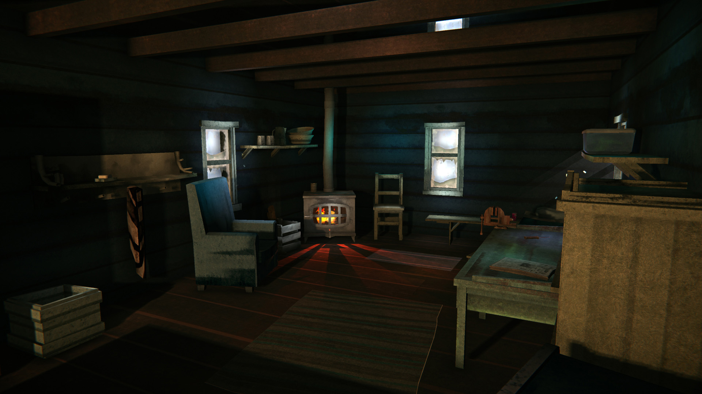

_A [Safehouse](./Safehouse.md) before decorating_

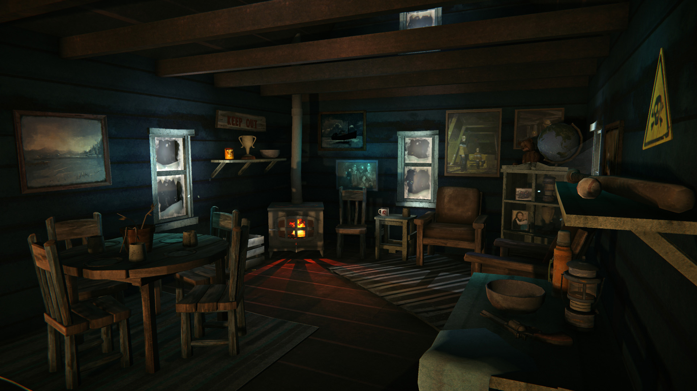

**Decorations** is a section of the Backpack in the [Survival Menu](./Survival%20Menu.md) that contains all items that can be carried around and placed inside an interior as part of the [Safehouse Customization](./Safehouse%20Customization.md) feature. It was added as part of a free update for [Tales from the Far Territory](./Tales%20from%20the%20Far%20Territory.md) Part 6: Broken Silence.

## Limitations

Some Decorations have limitations on where they can be placed.

- Some items can only be placed on walls (mirrors, [First Aid Kit](./First%20Aid%20Kit.md), [Medicine Shelf](./Medicine%20Shelf.md)).
- Most items can only be placed on the floor or on top of other objects.
- Computer Monitors that contain [Buffer Memories](./Buffer%20Memories.md) cannot be picked up.
- All Decorations that can be carried have weight and a unique icon.
  - If these items are dropped on the ground, a [Safehouse Decoration Box](./Safehouse%20Decoration%20Box.md) is produced to contain them, with each box having 100.00 kg of space.
  - Very large furniture decorations created at a [Furniture Workbench](./Furniture%20Workbench.md) cannot be carried around (despite having weight) and can only be harvested to partially regain materials once they are created (or they can be outright destroyed as usual).

## Craftable Decorations

These Decorations can be [Crafted](./Crafting.md) with the aid of [Woodworking Tools](./Woodworking%20Tools.md) (except for [Bear Hide Rug](./Bear%20Hide%20Rug.md)).

### Anywhere

| Recipe | Materials | Time | Weight | Crafted |
| --- | --- | --- | --- | --- |
|  [Carved Bear Figurine](./Carved%20Bear%20Figurine.md) | 1x  [Cedar Firewood](./Cedar%20Firewood.md) | 4 Hours | 0.25 kg _(0.55 lb)_ | Anywhere |
|  [Carved Cougar Figurine](./Carved%20Cougar%20Figurine.md) | 1x  [Cedar Firewood](./Cedar%20Firewood.md) | 4 Hours | 0.25 kg _(0.55 lb)_ | Anywhere |
|  [Carved Wolf Figurine](./Carved%20Wolf%20Figurine.md) | 1x  [Cedar Firewood](./Cedar%20Firewood.md) | 4 Hours | 0.25 kg _(0.55 lb)_ | Anywhere |
|  [Decorative End Table](./Decorative%20End%20Table.md) | 6x  [Cedar Firewood](./Cedar%20Firewood.md) | 5 Hours | 2.00 kg _(4.4 lb)_ | Anywhere |
|  [Decorative Art](./Decorative%20Art.md) | 2x  [Fir Firewood](./Fir%20Firewood.md) 1x  [Cedar Firewood](./Cedar%20Firewood.md) 1x  [Reclaimed Wood](./Reclaimed%20Wood.md) | 5 Hours | 1.00 kg _(2.2 lb)_ | Anywhere |
|  [Decorative Art (2)](./Decorative%20Art%20%282%29.md) | 2x  [Fir Firewood](./Fir%20Firewood.md) 1x  [Cedar Firewood](./Cedar%20Firewood.md) 1x  [Reclaimed Wood](./Reclaimed%20Wood.md) | 5 Hours | 1.00 kg _(2.2 lb)_ | Anywhere |
|  [Furniture Workbench](./Furniture%20Workbench.md) | 10x  [Cedar Firewood](./Cedar%20Firewood.md) | 4 Hours | 15.00 kg _(33 lb)_ | Anywhere |

### Work Bench

| Recipe | Materials | Time | Weight | Crafted |
| --- | --- | --- | --- | --- |
|  [Bear Hide Rug](./Bear%20Hide%20Rug.md) | 1x [Cured Deer Hide](./Cured%20Deer%20Hide.md) 1x [Cured Black Bear Hide](./Cured%20Black%20Bear%20Hide.md) 2x [Cured Gut](./Cured%20Gut.md) | 8 Hours | 12.00 kg _(26.4 lb)_ | [Work Bench](./Work%20Bench.md) |

### Furniture Workbench

Once crafted, the following Decorations crafted at a Furniture Workbench will be placed in a container in that Workbench (they can be placed your Safehouse by opening the Furniture Workbench and selecting them). They cannot be placed in the player's inventory despite having a weight class, and furniture with containers cannot be broken down to regain some of their resources once placed in the Safehouse.

Recipe

Materials

Time

Weight

Crafted

 [Bear Hide Bed](./Bear%20Hide%20Bed.md)

18x  [Fir Firewood](./Fir%20Firewood.md) 4x [Cured Gut](./Cured%20Gut.md)

1x  [Cured Black Bear Hide](./Cured%20Black%20Bear%20Hide.md)

16x  [Ptarmigan Down](./Ptarmigan%20Down.md)

24 Hours

10.00 kg  
 _(22 lb)_

[Furniture Workbench](./Furniture%20Workbench.md)

 [Coffee Table](./Coffee%20Table.md)

6x  [Fir Firewood](./Fir%20Firewood.md)

4 Hours

5.00 kg  
 _(11 lb)_

[Furniture Workbench](./Furniture%20Workbench.md)

 [Rustic End Table](./Rustic%20End%20Table.md)

6x  [Cedar Firewood](./Cedar%20Firewood.md) 2x  [Reclaimed Wood](./Reclaimed%20Wood.md)

6 Hours

20.00 kg  
 _(44 lb)_

[Furniture Workbench](./Furniture%20Workbench.md)

 [Round Table](./Round%20Table.md)

12x  [Fir Firewood](./Fir%20Firewood.md)

9 Hours

5.00 kg  
 _(11 lb)_

[Furniture Workbench](./Furniture%20Workbench.md)

 [Rustic Table](./Rustic%20Table.md)

10x  [Fir Firewood](./Fir%20Firewood.md)

8 Hours

8.00 kg  
 _(17.6 lb)_

[Furniture Workbench](./Furniture%20Workbench.md)

 [Square Table](./Square%20Table.md)

8x  [Fir Firewood](./Fir%20Firewood.md)

7 Hours

5.00 kg  
 _(11 lb)_

[Furniture Workbench](./Furniture%20Workbench.md)

\[Missing image: \[\[File:Rustic\_Chair\_icon.png\] [Rustic Chair](./Rustic%20Chair.md)

`icon.png|link=`[`Rustic Chair`](./Rustic%20Chair.md)

29x29px\]\] link=Rustic Chair|29x29px [Rustic Chair](./Rustic%20Chair.md)

 [Rustic Chair](./Rustic%20Chair.md) \]\]

The following Decorations are automatically placed into the player's inventory once crafted.

| Recipe | Materials | Time | Weight | Crafted |
| --- | --- | --- | --- | --- |
|  [Framed Hockey Jersey](./Framed%20Hockey%20Jersey.md) | 2x  [Fir Firewood](./Fir%20Firewood.md) 1x  [Scrap Metal](./Scrap%20Metal.md) 1x  [Hockey Jersey](./Hockey%20Jersey.md) | 4 Hours | 2.00 kg _(4.4 lb)_ | [Furniture Workbench](./Furniture%20Workbench.md) |
| 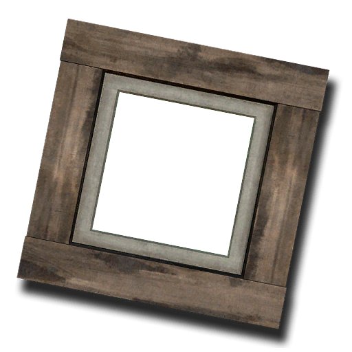 [Framed Photo](./Framed%20Photo.md) | 1x  [Fir Firewood](./Fir%20Firewood.md) 1x  [Camera](./Camera.md) Photo | 2 Hours | 0.25 kg _(0.55 lb)_ | [Furniture Workbench](./Furniture%20Workbench.md) |
|  [Mounted Burbot](./Mounted%20Burbot.md) | 1x  [Fir Firewood](./Fir%20Firewood.md) 1x  [Burbot (Raw)](./Burbot%20%28Raw%29.md) | 4 Hours | 0.50 kg _(1.1 lb)_ | [Furniture Workbench](./Furniture%20Workbench.md) |
|  [Mounted Coho Salmon](./Mounted%20Coho%20Salmon.md) | 1x  [Fir Firewood](./Fir%20Firewood.md) 1x  [Coho Salmon (Raw)](./Coho%20Salmon%20%28Raw%29.md) | 4 Hours | 1.00 kg _(2.2 lb)_ | [Furniture Workbench](./Furniture%20Workbench.md) |
|  [Mounted Goldeye](./Mounted%20Goldeye.md) | 1x  [Fir Firewood](./Fir%20Firewood.md) 1x  [Goldeye (Raw)](./Goldeye%20%28Raw%29.md) | 4 Hours | 0.50 kg _(1.1 lb)_ | [Furniture Workbench](./Furniture%20Workbench.md) |
|  [Mounted Lake Whitefish](./Mounted%20Lake%20Whitefish.md) | 1x  [Fir Firewood](./Fir%20Firewood.md) 1x  [Lake Whitefish (Raw)](./Lake%20Whitefish%20%28Raw%29.md) | 4 Hours | 0.50 kg _(1.1 lb)_ | [Furniture Workbench](./Furniture%20Workbench.md) |
| 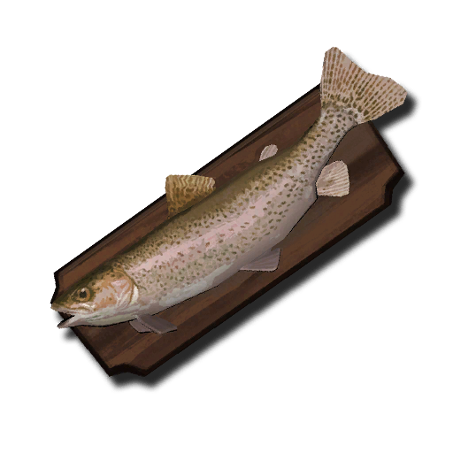 [Mounted Rainbow Trout](./Mounted%20Rainbow%20Trout.md) | 1x  [Fir Firewood](./Fir%20Firewood.md) 1x  [Rainbow Trout (Raw)](./Rainbow%20Trout%20%28Raw%29.md) | 4 Hours | 0.50 kg _(1.1 lb)_ | [Furniture Workbench](./Furniture%20Workbench.md) |
|  [Mounted Red Irish Lord](./Mounted%20Red%20Irish%20Lord.md) | 1x  [Fir Firewood](./Fir%20Firewood.md) 1x  [Red Irish Lord (Raw)](./Red%20Irish%20Lord%20%28Raw%29.md) | 4 Hours | 0.50 kg _(1.1 lb)_ | [Furniture Workbench](./Furniture%20Workbench.md) |
|  [Mounted Rockfish](./Mounted%20Rockfish.md) | 1x  [Fir Firewood](./Fir%20Firewood.md) 1x  [Rockfish (Raw)](./Rockfish%20%28Raw%29.md) | 4 Hours | 0.50 kg _(1.1 lb)_ | [Furniture Workbench](./Furniture%20Workbench.md) |
|  [Mounted Smallmouth Bass](./Mounted%20Smallmouth%20Bass.md) | 1x  [Fir Firewood](./Fir%20Firewood.md) 1x  [Smallmouth Bass (Raw)](./Smallmouth%20Bass%20%28Raw%29.md) | 4 Hours | 0.50 kg _(1.1 lb)_ | [Furniture Workbench](./Furniture%20Workbench.md) |
|  [Rustic Stool](./Rustic%20Stool.md) | 4x  [Fir Firewood](./Fir%20Firewood.md) | 2 Hours | 2.00 kg _(4.4 lb)_ | [Furniture Workbench](./Furniture%20Workbench.md) |

## Lootable Decorations

The following Decorations cannot be crafted, but are already present within many interiors. They can be moved as normal while in Customization Mode, but can also be placed inside the player's backpack and carried around between [safehouses](./Safehouse.md).

- The option to take or destroy these items appears when examined.
  - When taken, this type of Decoration has a unique icon and weight, cannot be harvested for materials, and is placed in the Decorations section of the Backpack inventory.
  - When destroyed, they are permanently removed from the interior. Caution is advised when doing this, as destroying these Decorations means they cannot be crafted/taken from another location to be placed into another interior.
  - Lootable Decorations cannot be destroyed in the player's Inventory or in a [Safehouse Decoration Box](./Safehouse%20Decoration%20Box.md). They must be placed in a Saferoom before the option appears.
- There can be multiple versions of an item with the same name, but with different weights and models.
- Some of these items display a different name when examined in Customization Mode (ex [Backpack](./Backpack.md) is "Back Pack" or [Metal Lamp](./Metal%20Lamp.md) is "Lamp").
- Fish Mounts are different from the player crafted versions and are found in cabins.
- Carrying multiple Decorations adds up quickly. The heaviest Decorations are 5.00kg, while the lightest tend to be 0.05kg. Using a [Travois](./Travois.md) can be helpful for transporting large amounts of heavy Decorations.

| Icon | Name | Weight | Location Found |
| --- | --- | --- | --- |
|  | Banner | 5.00 kg _(11 lb)_ | [St. Christopher's Church](./St.%20Christopher%27s%20Church.md), [Pleasant Valley Church](./Pleasant%20Valley%20Church.md) |
|  | Baseball | 0.05 kg _(0.11 lb)_ | [Blackrock Prison](./Blackrock%20Prison.md) Warden's Office, [Main Hangar](./Main%20Hangar.md) office (where [Stained Paper](./Stained%20Paper.md) is found) |
|  | Baseball Bat | 0.50 kg _(1.1 lb)_ | [Blackrock Prison](./Blackrock%20Prison.md) Warden's Office |
|  | [Basin](./Basin.md) | 2.00 kg _(4.4 lb)_ | [Quonset Garage](./Quonset%20Garage.md) |
| 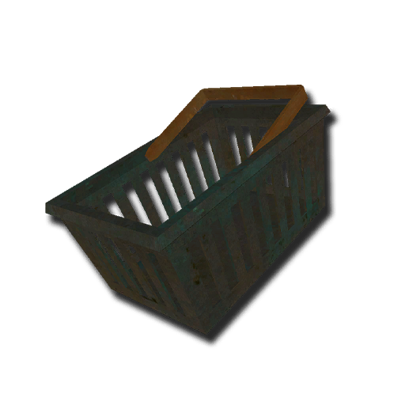 | Basket | 0.25 kg _(0.55 lb)_ | [Main Hangar](./Main%20Hangar.md), [Convenience Store](./Convenience%20Store.md), [Basement (Sundered Pass)](./Basement%20%28Sundered%20Pass%29.md) |
|  | Blender | 0.25 kg _(0.55 lb)_ | Trailers, [Paradise Meadows Farm](./Paradise%20Meadows%20Farm.md), Houses |
|  | Bowl | 0.05 kg _(0.11 lb)_ | Houses, Trailers |
| 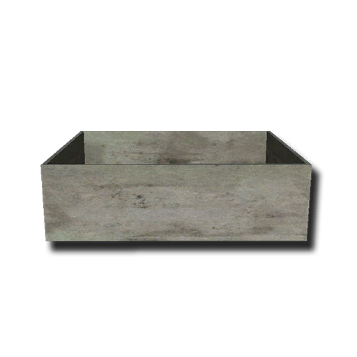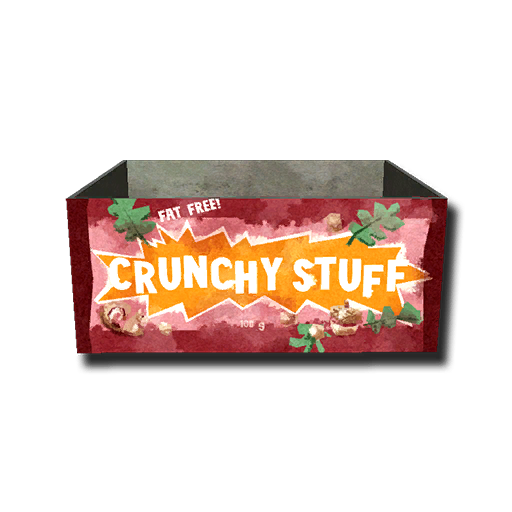 | [Box](./Cardboard%20Box.md) | 0.10 kg _(0.22 lb)_ | Houses, [Convenience Store](./Convenience%20Store.md), [Rural Store](./Rural%20Store.md), Trailers |
|  | Broken Drawer | 1.00 kg _(2.2 lb)_ | Offices |
|  | [Broom](./Broom.md) | 0.20 kg _(0.44 lb)_ | Houses, Industrial Areas |
| 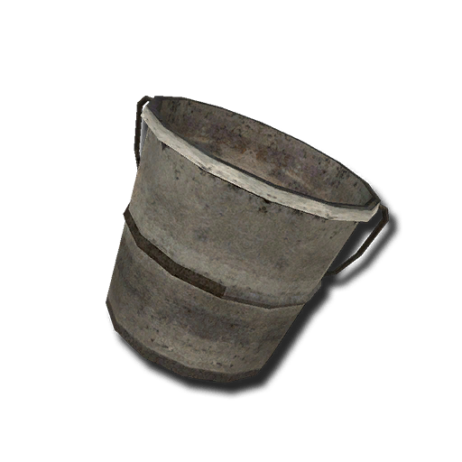 | [Bucket](./Metal%20Pail.md) | 1.00 kg _(2.2 lb)_ | Houses, Industrial Areas |
| 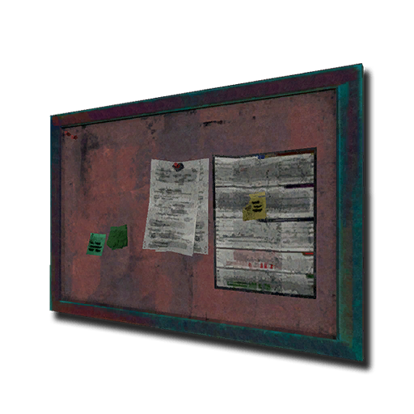 | Bulletin Board | 5.00 kg _(11 lb)_ | Industrial Areas |
| 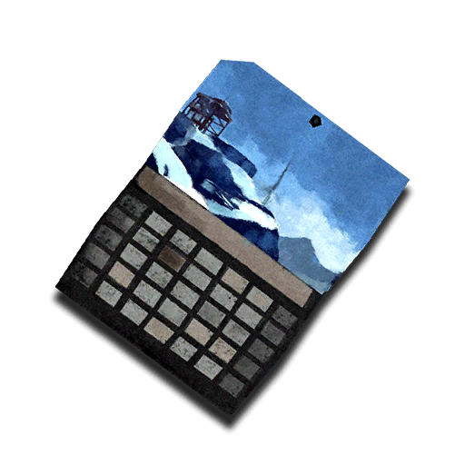 | Calendar | 0.10 kg _(0.22 lb)_ | Houses, Industrial Areas |
|  | Calendar | 0.25 kg _(0.55 lb)_ | Houses, Industrial Areas |
|  | Cart | 5.00 kg _(11 lb)_ | [Idle Camp](./Idle%20Camp.md) mess hall |
|  | Cassete | 0.10 kg _(0.22 lb)_ | [Blackrock Prison](./Blackrock%20Prison.md) Warden's Office, [Cabin](./Cabin.md), [Carter Hydro Dam](./Carter%20Hydro%20Dam.md) |
|  | Chair | 4.00 kg _(8.8 lb)_ | [Main Hangar](./Main%20Hangar.md), [Community Hall](./Community%20Hall.md), [Blackrock Prison](./Blackrock%20Prison.md) Offices/Infirmary |
|  | Chair | 5.00 kg _(11 lb)_ | Houses, [Hunting Lodge](./Hunting%20Lodge.md), Metal chair [Blackrock Prison](./Blackrock%20Prison.md) (Infirmary), |
|  | Clock | 1.00 kg _(2.2 lb)_ | Houses |
|  | Coffee Machine | 0.50 kg _(1.1 lb)_ | Kitchens, Trailers, Cabins |
| 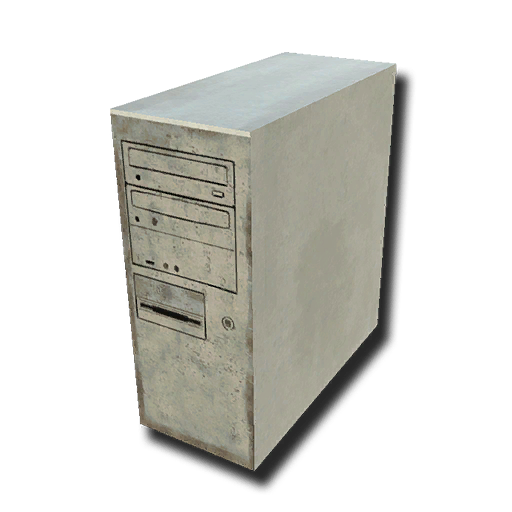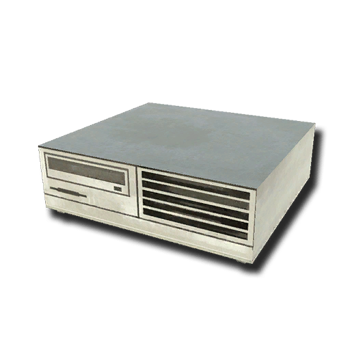 | Computer | 5.00 kg _(11 lb)_ | Industrial Areas |
|  | Cone | 0.25 kg _(0.55 lb)_ | [Main Hangar](./Main%20Hangar.md) (2 different cone models but display the same Backpack icon) |
| 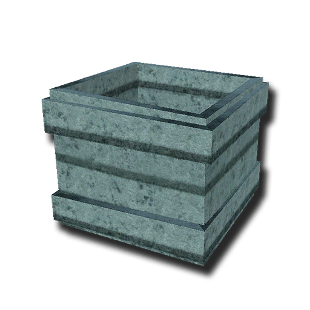 | [Crate](./Crate.md) | 0.30 kg _(0.66 lb)_ | Industrial Areas |
|  | Crib | 5.00 kg _(11 lb)_ | [Milton House](./Milton%20House.md) (house close to Grey Mother's leading to [Radio Tower](./Radio%20Tower.md)) |
| 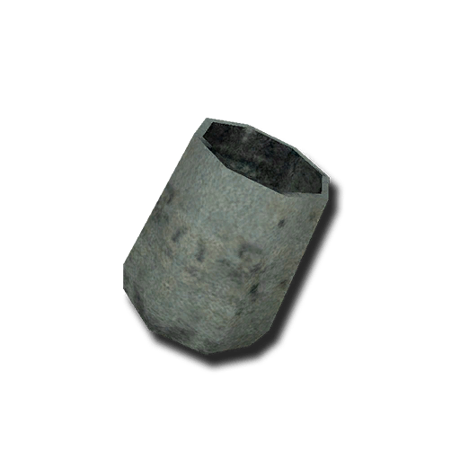 | Cup | 0.05 kg _(0.11 lb)_ | Houses, [Convenience Store](./Convenience%20Store.md) |
| 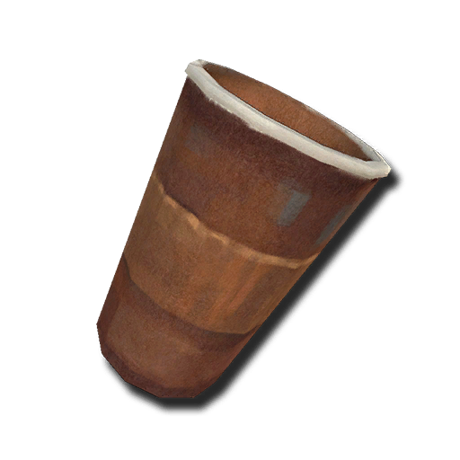 | Cup | 0.10 kg _(0.22 lb)_ | [Concentrator](./Concentrator.md), [Control Tower](./Control%20Tower.md) |
|  | Cutting Board | 0.10 kg _(0.22 lb)_ | House Kitchens |
| 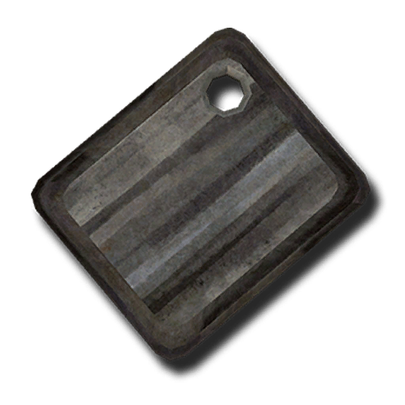 | Cutting Board | 0.25 kg _(0.55 lb)_ | House Kitchens |
|  | Deer Mount | 5.00 kg _(11 lb)_ | [Hunting Lodge](./Hunting%20Lodge.md), Hunting [Prepper Cache](./Prepper%20Cache.md), Places with animal trophies |
|  | Disk | 0.02 kg _(0.044 lb)_ | Near Computers, [Maintenance Yard](./Maintenance%20Yard.md), [Carter Hydro Dam](./Carter%20Hydro%20Dam.md) |
|  | Dream Catcher | 0.10 kg _(0.22 lb)_ | [Camp Office](./Camp%20Office.md), [Mindful Cabin](./Mindful%20Cabin.md), [Lake Cabins](./Lake%20Cabins.md), Cabin under [Abandoned Lookout](./Abandoned%20Lookout.md) |
|  | Festive Lights | 0.25 kg _(0.55 lb)_ | [Hangar Basement](./Hangar%20Basement.md), [Community Hall](./Community%20Hall.md), [Carter Hydro Dam](./Carter%20Hydro%20Dam.md) (office stairwell), [Hunting Lodge](./Hunting%20Lodge.md) ([Festive Sweater](./Festive%20Sweater.md) is usually nearby) |
|  | Fish Mount | 0.25 kg _(0.55 lb)_ | Cabins, [Hunting Lodge](./Hunting%20Lodge.md), [Maintenance Yard](./Maintenance%20Yard.md) |
| 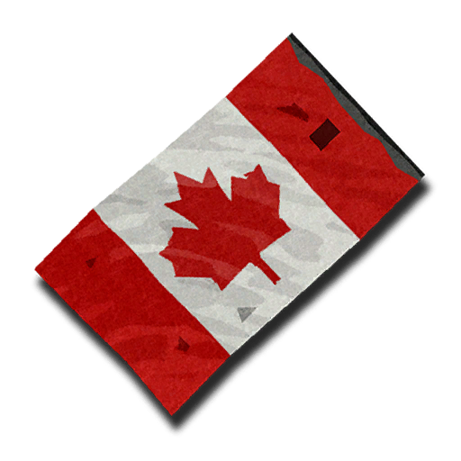 | Flag | 0.25 kg _(0.55 lb)_ | [Milton Post Office](./Milton%20Post%20Office.md), [Concentrator](./Concentrator.md) (7th Floor Offices) Large flags on the [Maintenance Yard](./Maintenance%20Yard.md) Shed ceiling (can be reached in [Safe House Customization](./Safehouse%20Customization.md) with a plank), [Carter Hydro Dam](./Carter%20Hydro%20Dam.md) Turbine Room (can be reached in [Safe House Customization](./Safehouse%20Customization.md) with various stacked items, flag keeps "swaying" property when placed in new locations) Small table flag in [Blackrock Prison](./Blackrock%20Prison.md) Warden's office |
| 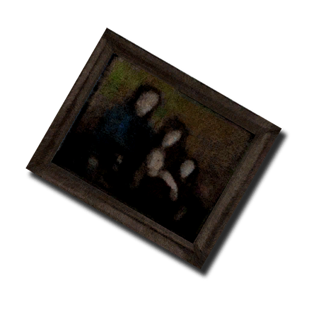 | Frame | 0.15 kg _(0.33 lb)_ | Houses |
|  | Frame (Table) | 0.25 kg _(0.55 lb)_ | Houses (these are table picture frames) |
| 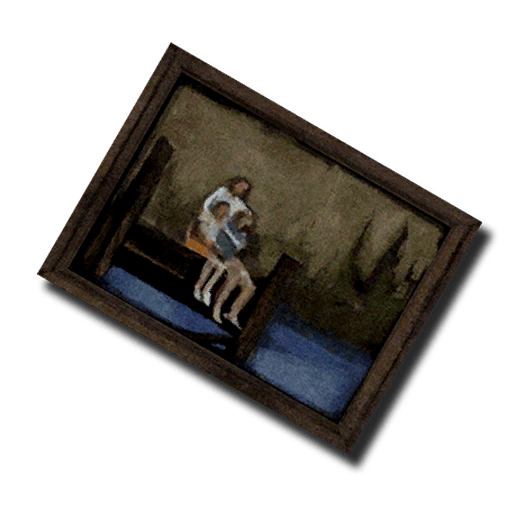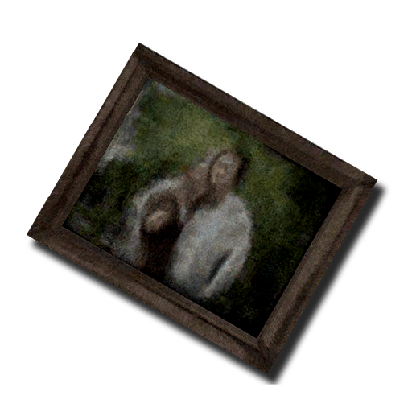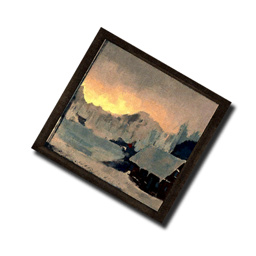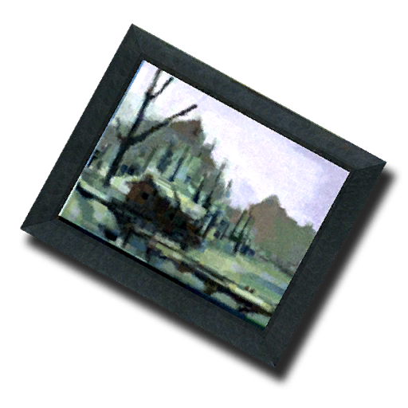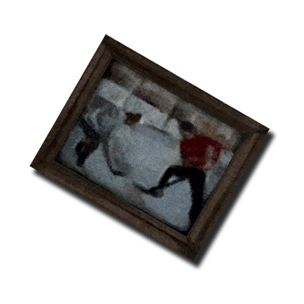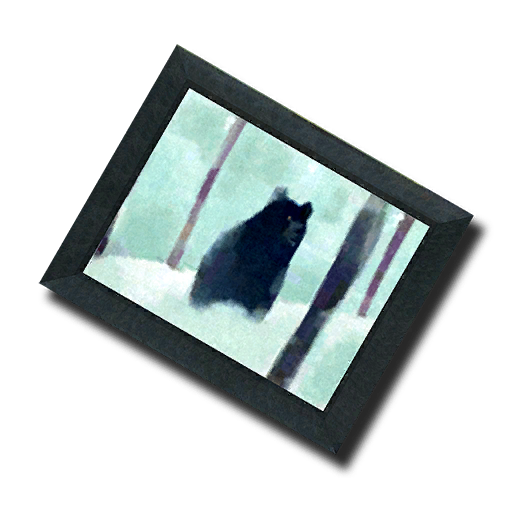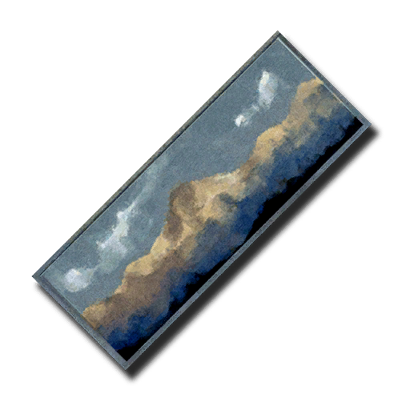 | Frame | 0.25 kg _(0.55 lb)_ | Houses |
|  | Frame (Frame 2) | 0.25 kg _(0.55 lb)_ | Houses |
|  | Frame | 0.25 kg _(0.55 lb)_ | [Camp Office](./Camp%20Office.md) welcome sign |
| 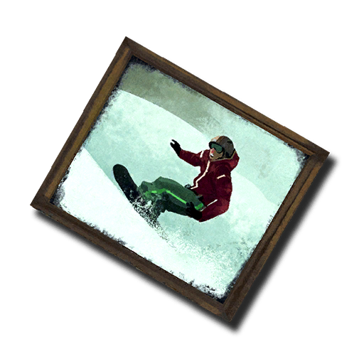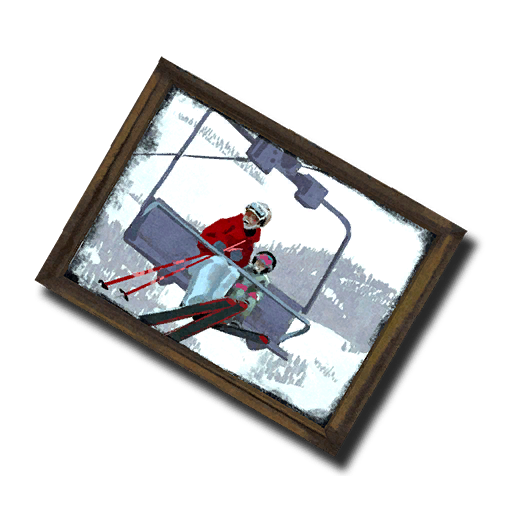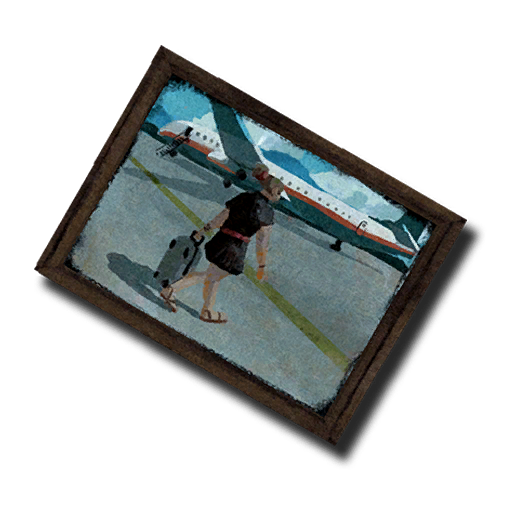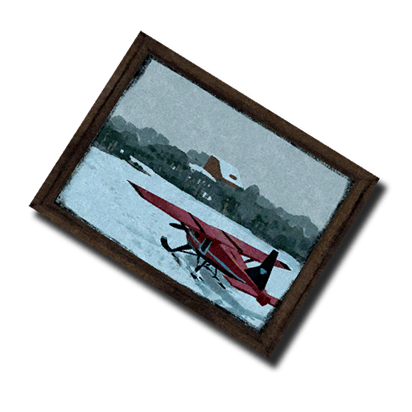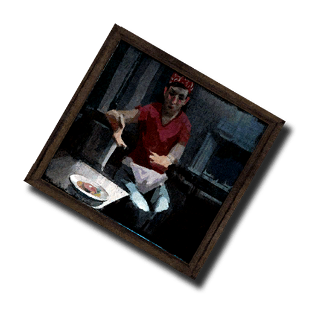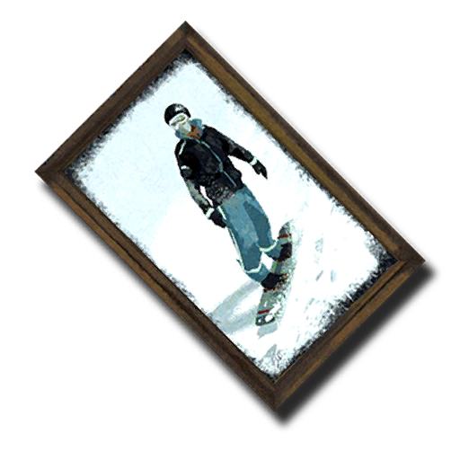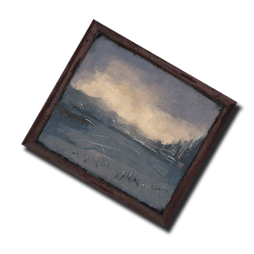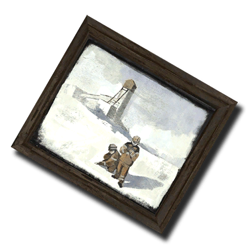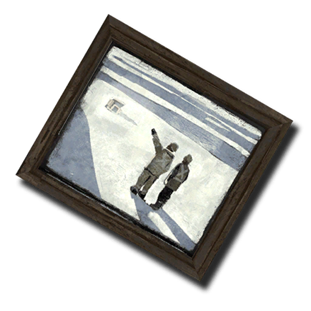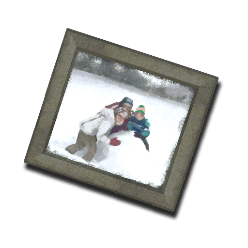 | Frame (FT) | 0.25 kg _(0.55 lb)_ | These are found in houses/buildings in the Far Territory. [Vacant Depot](./Vacant%20Depot.md), [Idle Camp](./Idle%20Camp.md), [Last Lonely House](./Last%20Lonely%20House.md), etc |
|  | Frame (FT) | 0.25 kg _(0.55 lb)_ | These are found in houses/buildings in the Far Territory. [Vacant Depot](./Vacant%20Depot.md), [Idle Camp](./Idle%20Camp.md), [Last Lonely House](./Last%20Lonely%20House.md), etc |
| 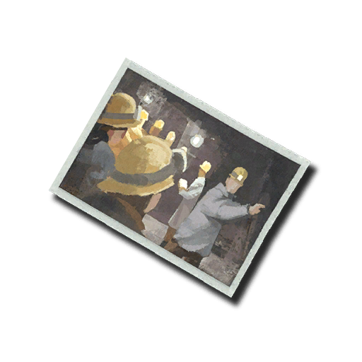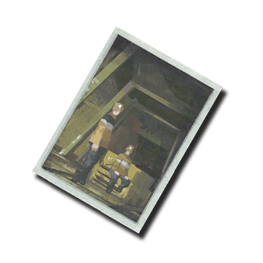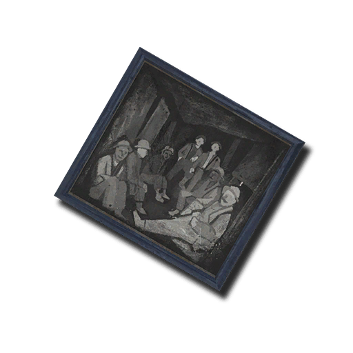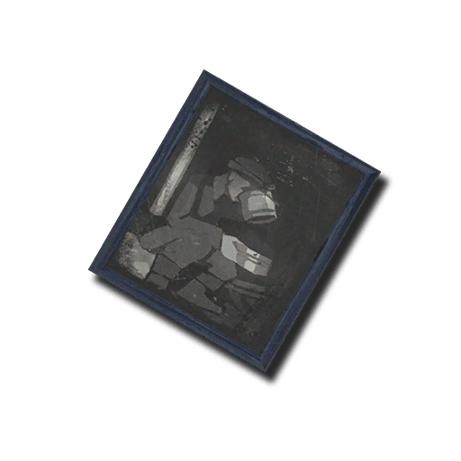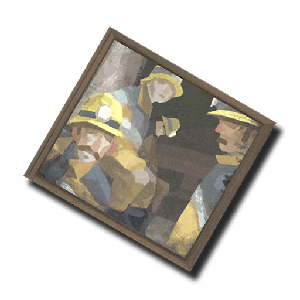 | Frame (Miner) | 0.25 kg _(0.55 lb)_ | [Vacant Depot](./Vacant%20Depot.md), [Idle Camp](./Idle%20Camp.md), [Concentrator](./Concentrator.md) Offices |
| 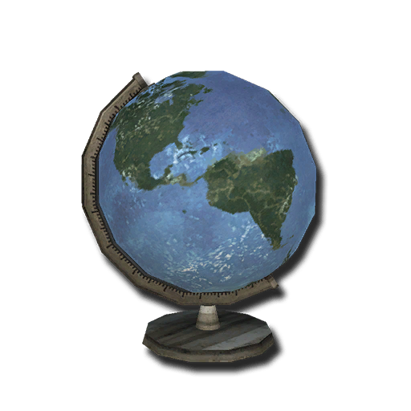 | Globe | 1.00 kg _(2.2 lb)_ | [Paradise Meadows Farm](./Paradise%20Meadows%20Farm.md), [Blackrock Prison](./Blackrock%20Prison.md) Warden's Office, [Main Hangar](./Main%20Hangar.md), [Bunker Alpha](./Bunker%20Alpha.md) |
|  | Hockey Stick | 0.25 kg _(0.55 lb)_ | [Last Resort Cannery](./Last%20Resort%20Cannery.md) Trailer, [Island Cottage](./Island%20Cottage.md), [Basement (Sundered Pass)](./Basement%20%28Sundered%20Pass%29.md) |
|  | Hook | 0.10 kg _(0.22 lb)_ | Houses |
|  | Horseshoe | 0.10 kg _(0.22 lb)_ | [Hunting Lodge](./Hunting%20Lodge.md) Basement, [Blackrock Prison](./Blackrock%20Prison.md) Warden's Office |
| 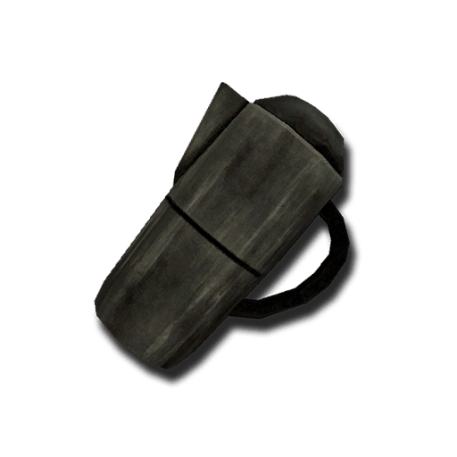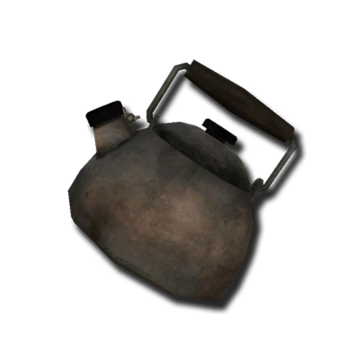 | Kettle | 0.25 kg _(0.55 lb)_ | [Last Resort Cannery](./Last%20Resort%20Cannery.md) Trailer, [Station Bunkhouse](./Station%20Bunkhouse.md), [Pensive Lookout](./Pensive%20Lookout.md) |
|  | Keyboard | 0.20 kg _(0.44 lb)_ | Near Computers |
|  | Knob | 0.25 kg _(0.55 lb)_ | [Concentrator](./Concentrator.md) (6th Floor, to the right of where the Woodworking Tools spawn in a machine), [Conveyor Room](./Conveyor%20Room.md) near the entrance to Langston Mine |
|  | Lamp | 0.25 kg _(0.55 lb)_ | Green lamp found in [Blackrock Prison](./Blackrock%20Prison.md) Warden's Office Signal Void bunkers, Blackrock Prison (Infirmary), [Main Hangar](./Main%20Hangar.md) |
| 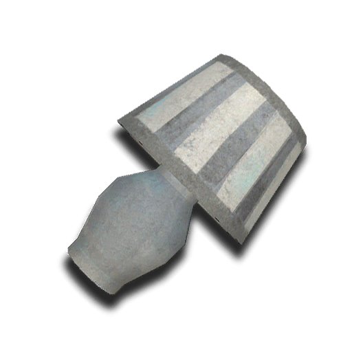 | Lamp | 1.00 kg _(2.2 lb)_ | Houses |
| 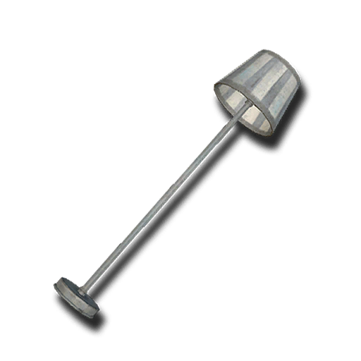 | Lamp | 2.00 kg _(4.4 lb)_ | Houses |
| 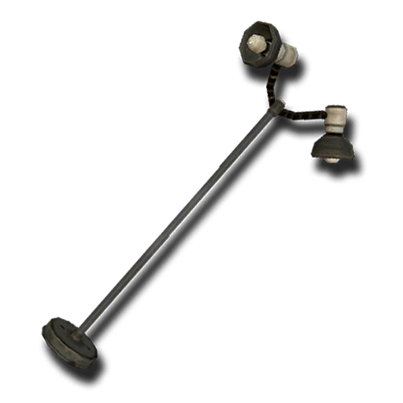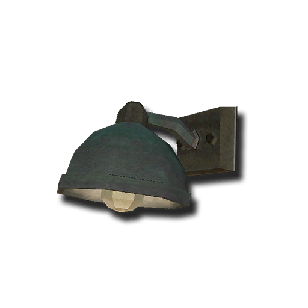 | [Lamp](./Metal%20Lamp.md) | 5.00 kg _(11 lb)_ | Houses |
|  | Light | 0.25 kg _(0.55 lb)_ | [Camp Office](./Camp%20Office.md), [Cannery Worker Residences](./Cannery%20Worker%20Residences.md), [Justy's Hovel](./Justy%27s%20Hovel.md) |
| 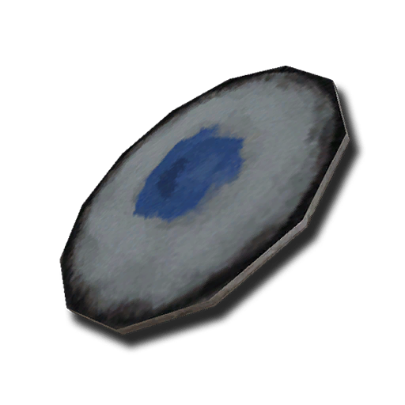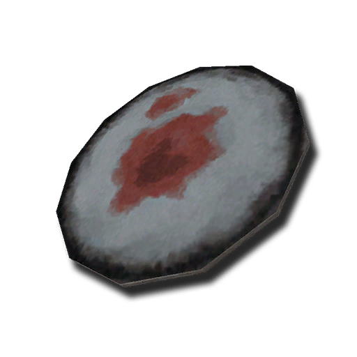 | Lid (Paintcan) | 0.25 kg _(0.55 lb)_ | Sheds, Industrial Areas |
|  | Microscope | 0.25 kg _(0.55 lb)_ | [Blackrock Prison](./Blackrock%20Prison.md) (Infirmary), [Bunker Alpha](./Bunker%20Alpha.md), [Bunker Beta](./Bunker%20Beta.md), [Bunker Gamma](./Bunker%20Gamma.md), [Bunker Omega](./Bunker%20Omega.md) |
| 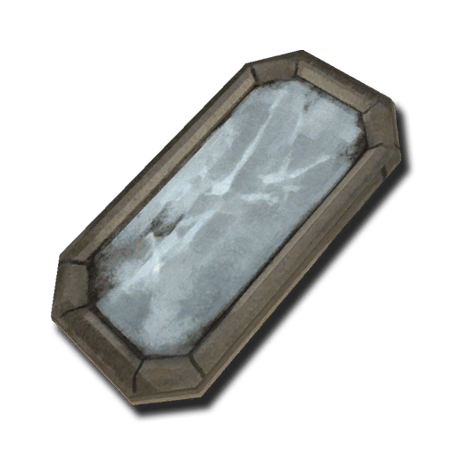 | Mirror | 3.00 kg _(6.6 lb)_ | [Hunting Lodge](./Hunting%20Lodge.md), [Vacant Depot](./Vacant%20Depot.md), [Bunker Omega](./Bunker%20Omega.md), [Foreman's Retreat](./Foreman%27s%20Retreat.md) |
|  | Monitor | 4.00 kg _(8.8 lb)_ | Industrial Areas |
|  | Moose Mount | 5.00 kg _(11 lb)_ | [Community Hall](./Community%20Hall.md) |
|  | Mouse | 0.05 kg _(0.11 lb)_ | Near Computers |
|  | Number | 0.25 kg _(0.55 lb)_ | [Blackrock Prison](./Blackrock%20Prison.md) (inside the prison) |
|  | [Oven](./Toaster.md) | 1.00 kg _(2.2 lb)_ | Kitchens |
|  | [Oven](./Microwave.md) | 5.00 kg _(11 lb)_ | [Milton House](./Milton%20House.md) (only one microwave can be picked up) |
|  | Paintcan | 0.25 kg _(0.55 lb)_ | Sheds, Industrial Areas |
|  | Paintbrush | 0.10 kg _(0.22 lb)_ | Sheds, Industrial Areas |
|  | Phone | 0.25 kg _(0.55 lb)_ | Wall Phones - Industrial areas Office Phone - Offices |
|  | Pillow | 0.15 kg _(0.33 lb)_ | Trailers |
|  | Pitcher | 0.25 kg _(0.55 lb)_ | Kitchens |
|  | Plant | 5.00 kg _(11 lb)_ 1.00 kg _(2.2 lb)_ | Houses |
|  | Poster | 0.05 kg _(0.11 lb)_ | Houses |
|  | Poster | 0.25 kg _(0.55 lb)_ | Houses |
|  | Rack | 0.20 kg _(0.44 lb)_ | Houses |
|  | Rack | 0.30 kg _(0.66 lb)_ | Houses |
|  | Rack | 0.50 kg _(1.1 lb)_ | Houses. Gun Rack - [Forestry Lookout](./Forestry%20Lookout.md), [Pensive Lookout](./Pensive%20Lookout.md), [Abandoned Lookout](./Abandoned%20Lookout.md), [Trapper's Homestead](./Trapper%27s%20Homestead.md), [Hunting Lodge](./Hunting%20Lodge.md), [Foreman's Retreat](./Foreman%27s%20Retreat.md) |
|  | Rack | 0.75 kg _(1.65 lb)_ | Hunting Prepper Cache, [Last Lonely House](./Last%20Lonely%20House.md), [Milton House (Grey Mother's)](./Milton%20House%20%28Grey%20Mother%27s%29.md), [Last Resort Cannery](./Last%20Resort%20Cannery.md) (trailer) |
|  | Radio | 0.10 kg _(0.22 lb)_ | House Bedrooms, [Bunker Alpha](./Bunker%20Alpha.md) [Blackrock Prison](./Blackrock%20Prison.md) (room with [Note (Survival 2)](./Note%20%28Survival%202%29.md) closest to the cells), [Control Tower](./Control%20Tower.md) |
|  | [Radio](./Radio.md) | 2.00 kg _(4.4 lb)_ | Found in various buildings |
|  | Rake | 0.25 kg _(0.55 lb)_ | [Basement (Sundered Pass)](./Basement%20%28Sundered%20Pass%29.md), [Maintenance Yard](./Maintenance%20Yard.md) |
|  | Rug | 1.00 kg _(2.2 lb)_ | Houses, Industrial Areas |
|  | Rug | 2.00 kg _(4.4 lb)_ | Houses, Industrial Areas |
|  | Rug | 5.00 kg _(11 lb)_ | Houses, Industrial Areas |
|  | Rocking Horse | 3.00 kg _(6.6 lb)_ | [Milton House](./Milton%20House.md) (house close to Grey Mother's leading to [Radio Tower](./Radio%20Tower.md)) |
|  | Shelf (Corner) | 5.00 kg _(11 lb)_ | [Idle Camp](./Idle%20Camp.md) mess hall kitchen, [Island Cottage](./Island%20Cottage.md) |
|  | Shelf | 2.00 kg _(4.4 lb)_ | Houses |
|  | Skull | 0.25 kg _(0.55 lb)_ | [Hunting Lodge](./Hunting%20Lodge.md), Hunting [Prepper Cache](./Prepper%20Cache.md), [Camp Office](./Camp%20Office.md), Found on Mounts in places with animal trophies |
|  | Skull | 0.25 kg _(0.55 lb)_ | Hunting [Prepper Cache](./Prepper%20Cache.md) |
|  | Sign (Terminal) | 0.10 kg _(0.22 lb)_ | [Terminal](./Terminal.md) |
|  | Sign (Depot) | 0.25 kg _(0.55 lb)_ | [Vacant Depot](./Vacant%20Depot.md) (currently cannot take second one as it is outside) |
|  | Sign (Steam) | 0.25 kg _(0.55 lb)_ | [Steam Tunnels](./Steam%20Tunnels.md) (currently cannot take these) |
|  | Sign (Small) | 0.25 kg _(0.55 lb)_ | Industrial Areas |
|  | Sign (Mine) | 0.25 kg _(0.55 lb)_ | Industrial Mine areas (Many of these are from the [Langston Mine](./Langston%20Mine.md), [Last Prospect](./Last%20Prospect.md), and [Cinder Hills Coal Mine](./Cinder%20Hills%20Coal%20Mine.md) middle level, which you cannot take) |
|  | Sign (Prison) | 0.25 kg _(0.55 lb)_ | [Blackrock Prison](./Blackrock%20Prison.md) and Infirmary |
|  | Sign (Store) | 0.25 kg _(0.55 lb)_ | [Convenience Store](./Convenience%20Store.md) |
|  | Sign (Store) | 5.00 kg _(11 lb)_ | [Convenience Store](./Convenience%20Store.md) |
|  | Sign (Industrial) | 0.25 kg _(0.55 lb)_ | Industrial Areas, [Carter Hydro Dam](./Carter%20Hydro%20Dam.md), [Concentrator](./Concentrator.md), [Conveyor Room](./Conveyor%20Room.md), [Headframe Building](./Headframe%20Building.md), [Maintenance Yard](./Maintenance%20Yard.md) |
|  | Sign (Refuge) | 0.25 kg _(0.55 lb)_ | [Placid Notch](./Placid%20Notch.md), [Final Refuge](./Final%20Refuge.md), [Lotte's Rest](./Lotte%27s%20Rest.md) (currently cannot take lettered signs) |
|  | Sign (Poster) | 0.25 kg _(0.55 lb)_ | [Maintenance Yard](./Maintenance%20Yard.md), [Terminal](./Terminal.md), [Main Hangar](./Main%20Hangar.md), [Carter Hydro Dam](./Carter%20Hydro%20Dam.md) |
|  | Sign (Wet) | 0.25 kg _(0.55 lb)_ | Industrial/Commercial Bathrooms |
|  | Soap | 0.25 kg _(0.55 lb)_ | [Trapper's Homestead](./Trapper%27s%20Homestead.md), Bathrooms, [Bunker Omega](./Bunker%20Omega.md) |
|  | Speaker | 0.25 kg _(0.55 lb)_ | [Idle Camp](./Idle%20Camp.md), [Community Hall](./Community%20Hall.md), [Main Hangar](./Main%20Hangar.md) |
|  | Stove | 3.00 kg _(6.6 lb)_ | Trailers, [Paradise Meadows Farm](./Paradise%20Meadows%20Farm.md), [Last Resort Cannery](./Last%20Resort%20Cannery.md) Trailer |
|  | [Suitcase](./Suitcase.md) | 0.25 kg _(0.55 lb)_ | [Terminal](./Terminal.md), [Concentrator](./Concentrator.md) (Offices), occasionally near bathrooms in houses |
|  | Teddy Bear | 0.25 kg _(0.55 lb)_ | [Milton House](./Milton%20House.md) (house close to Grey Mother's leading to [Radio Tower](./Radio%20Tower.md)), [Main Hangar](./Main%20Hangar.md), [Cabin (Sundered Pass)](./Cabin%20%28Sundered%20Pass%29.md), [Bunker Omega](./Bunker%20Omega.md), [Basement (Sundered Pass)](./Basement%20%28Sundered%20Pass%29.md) |
|  | Television | 5.00 kg _(11 lb)_ | Homes, Industrial areas |
|  | Time Clock | 5.00 kg _(11 lb)_ | Industrial Areas |
|  | Tire | 5.00 kg _(11 lb)_ | [Quonset Garage](./Quonset%20Garage.md), [Maintenance Yard](./Maintenance%20Yard.md), [Main Hangar](./Main%20Hangar.md), [Weather Station](./Weather%20Station.md) |
|  | Toilet Seat | 0.25 kg _(0.55 lb)_ | [Idle Camp](./Idle%20Camp.md) |
|  | Tractor | 0.25 kg _(0.55 lb)_ | [Milton House](./Milton%20House.md) (house close to Grey Mother's leading to [Radio Tower](./Radio%20Tower.md)) |
|  | Trophy | 0.25 kg _(0.55 lb)_ | [Milton House (Grey Mother's)](./Milton%20House%20%28Grey%20Mother%27s%29.md), [Paradise Meadows Farm](./Paradise%20Meadows%20Farm.md), [Blackrock Prison](./Blackrock%20Prison.md) Warden's Office, [Carter Hydro Dam](./Carter%20Hydro%20Dam.md) (admin office) |
|  | Wheel | 2.00 kg _(4.4 lb)_ | [Hunting Lodge](./Hunting%20Lodge.md), [Camp Office](./Camp%20Office.md) |
|  | Wheel | 4.00 kg _(8.8 lb)_ | [Hunting Lodge](./Hunting%20Lodge.md), [Camp Office](./Camp%20Office.md), [Headframe Building](./Headframe%20Building.md) |
|  | Wooden Spoon | 1.00 kg _(2.2 lb)_ | Kitchens |
|  | Unobtainable |  | These are icons of items currently outside of customization areas but can technically be picked up |
|  | Unknown |  | These items are in the game files but many either do not exist or cannot be pick up inside Customization zones. |
|  | Cash Machine | 5.00 kg _(11 lb)_ | Cash Machine has been removed from [Milton Credit Union](./Milton%20Credit%20Union.md) |
|  | Skull | 0.25 kg _(0.55 lb)_ | Skull has been removed from [Bunker Omega](./Bunker%20Omega.md) ([Dr. Rüdiger](./Dr.%20R%C3%BCdiger.md)'s skull is now a skeleton that can be destroyed) |

## Destroyable Decorations

The following items are found in some interiors and can be moved around in Customization Mode, but cannot be placed into the player's inventory. This makes them specific only to the interior they are found in.

- Moderately large/very large objects (large pipes, [Vehicles](./Vehicle.md), whale bones in [Hibernia Processing](./Hibernia%20Processing.md), girders, live wires) cannot be destroyed.
- If the option to destroy large highlighted items is present, this will permanently remove them from the interior. Caution is advised when doing this, as destroyed items cannot be returned.
- 90% destroyable items are Containers or Harvestable Interactable Objects, and are not listed here due to having their own dedicated pages.
  - Destroying Harvestable items is faster than harvesting them, but the player does not gain resources.
  - Larger [Crates](./Crate.md) and [Cardboard Boxes](./Cardboard%20Box.md) are destroyed rather than picked up as Lootable Decorative items.
  - Most items take 12-30 minutes to destroy, with the largest items taking the most time to destroy.
  - Unsearched containers or containers that have items stored inside cannot be destroyed, and produce an error message. They must be searched/cleared out before they can be destroyed.
    - [Frozen Corpses](./Frozen%20Corpse.md) and [Corpses](./Corpse.md) are the only container that cannot be destroyed, but rather "Respectfully Removed." A candle icon will display as the Corpse is removed over time.

|  | Name | Location |
| --- | --- | --- |
|  | Bandsaw | [Bunker Omega](./Bunker%20Omega.md) |
|  | Barrel (Metal) | Industrial Areas |
|  | Bin | [Idle Camp](./Idle%20Camp.md), [Last Lonely House](./Last%20Lonely%20House.md), [Cabin (Sundered Pass)](./Cabin%20%28Sundered%20Pass%29.md) |
|  | Blackboard | [Signal Void](./Signal%20Void.md) bunkers, [Station Bunkhouse](./Station%20Bunkhouse.md) |
|  | Blinds | House/cabin/kitchen/office windows |
|  | Board | [Pensive Lookout](./Pensive%20Lookout.md) |
|  | Brick | [Hibernia Processing](./Hibernia%20Processing.md), [Concentrator](./Concentrator.md) |
|  | Bricks | [Hibernia Processing](./Hibernia%20Processing.md), [Concentrator](./Concentrator.md), [Last Resort Cannery](./Last%20Resort%20Cannery.md) |
|  | Candy Machine | [Milton Post Office](./Milton%20Post%20Office.md), [Convenience Store](./Convenience%20Store.md), [Milton Credit Union](./Milton%20Credit%20Union.md) |
|  | Canister (Garbage Can) | Bathrooms, [Terminal](./Terminal.md), [Milton Credit Union](./Milton%20Credit%20Union.md), [Milton Post Office](./Milton%20Post%20Office.md), [Last Resort Cannery](./Last%20Resort%20Cannery.md) Trailer |
|  | Case | [Convenience Store](./Convenience%20Store.md) |
|  | Cash Machine (ATM) | [Terminal](./Terminal.md), [Rural Store](./Rural%20Store.md), [Convenience Store](./Convenience%20Store.md), [Milton Credit Union](./Milton%20Credit%20Union.md), [Concentrator](./Concentrator.md) Offices |
|  | Clipboard | Industrial Areas |
|  | Clock (Grandfather) | [Milton House (Grey Mother's)](./Milton%20House%20%28Grey%20Mother%27s%29.md), [Hunting Lodge](./Hunting%20Lodge.md) |
|  | Coat Stand | [Blackrock Prison](./Blackrock%20Prison.md) Warden's Office, [Main Hangar](./Main%20Hangar.md) |
|  | Counter | [Hunting Lodge](./Hunting%20Lodge.md), [Carter Hydro Dam](./Carter%20Hydro%20Dam.md) |
|  | Curtain (Curtain/Towel rack) | Bathrooms |
|  | Cups | [Convenience Store](./Convenience%20Store.md) |
|  | Debris | Rubble - [Concentrator](./Concentrator.md), [Blackrock Prison](./Blackrock%20Prison.md) (inside prison) Ceiling Tiles - [Convenience Store](./Convenience%20Store.md), [Milton Credit Union](./Milton%20Credit%20Union.md) |
|  | Door | [Hibernia Processing](./Hibernia%20Processing.md), [Concentrator](./Concentrator.md) |
|  | Frame | [Vacant Depot](./Vacant%20Depot.md) |
|  | Fire Poker | [Mindful Cabin](./Mindful%20Cabin.md), [Cabin (Sundered Pass)](./Cabin%20%28Sundered%20Pass%29.md), [Island Cottage](./Island%20Cottage.md) |
|  | Hand Truck | Industrial Areas |
|  | Hand Truck | Industrial Areas |
|  | Lamp (Broken) |  |
|  | Light |  |
|  | Light | [Paradise Meadows Farm](./Paradise%20Meadows%20Farm.md) |
|  | Hangar | Homes |
|  | Glasses | [Concentrator](./Concentrator.md) Office, [Island Cottage](./Island%20Cottage.md) |
|  | Map | [Pensive Lookout](./Pensive%20Lookout.md) (map of Coastal Highway on the Board) |
|  | Metal (Sheet) | Industrial Areas |
|  | Mirror (Broken) | Bathrooms (most mirrors like this are shattered) |
|  | Mount | [Hunting Lodge](./Hunting%20Lodge.md), Hunting [Prepper Cache](./Prepper%20Cache.md), Places with animal trophies |
|  | Organ | [St. Christopher's Church](./St.%20Christopher%27s%20Church.md), [Pleasant Valley Church](./Pleasant%20Valley%20Church.md) |
|  | Plate | Kitchens |
|  | Podium | [St. Christopher's Church](./St.%20Christopher%27s%20Church.md), [Pleasant Valley Church](./Pleasant%20Valley%20Church.md), [Community Hall](./Community%20Hall.md) |
|  | Piano | [Community Hall](./Community%20Hall.md) |
|  | Pipe (Bundle) | Industrial Areas |
|  | Rack | Houses |
|  | Slush Machine | [Convenience Store](./Convenience%20Store.md) |
|  | Soda Machine | [Convenience Store](./Convenience%20Store.md) |
|  | Stereo | Near Speakers, [Paradise Meadows Farm](./Paradise%20Meadows%20Farm.md) |
|  | Storage | Offices |
|  | Tank | Industrial Areas |
|  | Tire Rack | [Quonset Garage](./Quonset%20Garage.md), [Maintenance Yard](./Maintenance%20Yard.md), [Main Hangar](./Main%20Hangar.md) |
|  | Tray | [Idle Camp](./Idle%20Camp.md) |
|  | Cone (stand) | [Main Hangar](./Main%20Hangar.md) |
|  | Trough | Industrial Areas, [Maintenance Yard](./Maintenance%20Yard.md), [Hunting Lodge](./Hunting%20Lodge.md), [Mindful Cabin](./Mindful%20Cabin.md) |
|  | Vending Machine | [Milton Park](./Milton%20Park.md), [Convenience Store](./Convenience%20Store.md), [Concentrator](./Concentrator.md) Offices, [Terminal](./Terminal.md) |
|  | Wheelbarrow | Sheds, Industrial Buildings |
