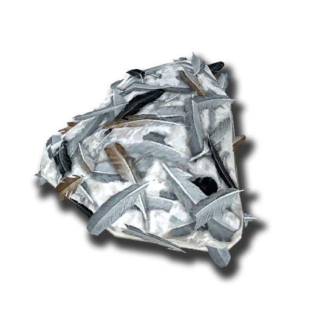

# Decorations

**Categories:** Interactable Objects · **Source:** [Fandom](https://thelongdark.fandom.com/wiki/Decorations)

**Contents**

- [Limitations](#limitations)
- [Craftable Decorations](#craftable-decorations)
- [Anywhere](#anywhere)
- [Work Bench](#work-bench)
- [Furniture Workbench](#furniture-workbench)
- [Lootable Decorations](#lootable-decorations)
- [Destroyable Decorations](#destroyable-decorations)

_A [Safehouse](./Safehouse.md) before decorating_

_A Safehouse after being decorated_

**Decorations** is a section of the Backpack in the [Survival Menu](./Survival%20Menu.md) that contains all items that can be carried around and placed inside an interior as part of the [Safehouse Customization](./Safehouse%20Customization.md) feature. It was added as part of a free update for [Tales from the Far Territory](./Tales%20from%20the%20Far%20Territory.md) Part 6: Broken Silence.

## Limitations

Some Decorations have limitations on where they can be placed.

- Some items can only be placed on walls (mirrors, [First Aid Kit](./First%20Aid%20Kit.md), [Medicine Shelf](./Medicine%20Shelf.md)).
- Most items can only be placed on the floor or on top of other objects.
- Computer Monitors that contain [Buffer Memories](./Buffer%20Memories.md) cannot be picked up.
- All Decorations that can be carried have weight and a unique icon.
  - If these items are dropped on the ground, a [Safehouse Decoration Box](./Safehouse%20Decoration%20Box.md) is produced to contain them, with each box having 100.00 kg of space.
  - Very large furniture decorations created at a [Furniture Workbench](./Furniture%20Workbench.md) cannot be carried around (despite having weight) and can only be harvested to partially regain materials once they are created (or they can be outright destroyed as usual).

## Craftable Decorations

These Decorations can be [Crafted](./Crafting.md) with the aid of [Woodworking Tools](./Woodworking%20Tools.md) (except for [Bear Hide Rug](./Bear%20Hide%20Rug.md)).

### Anywhere

Recipe

Materials

Time

Weight

Crafted

 [Carved Bear Figurine](./Carved%20Bear%20Figurine.md)

1x  [Cedar Firewood](./Cedar%20Firewood.md)

4 Hours

0.25 kg / _(0.55 lb)_

Anywhere

 [Carved Cougar Figurine](./Carved%20Cougar%20Figurine.md)

1x  [Cedar Firewood](./Cedar%20Firewood.md)

4 Hours

0.25 kg / _(0.55 lb)_

Anywhere

 [Carved Wolf Figurine](./Carved%20Wolf%20Figurine.md)

1x  [Cedar Firewood](./Cedar%20Firewood.md)

4 Hours

0.25 kg / _(0.55 lb)_

Anywhere

 [Decorative End Table](./Decorative%20End%20Table.md)

6x  [Cedar Firewood](./Cedar%20Firewood.md)

5 Hours

2.00 kg / _(4.4 lb)_

Anywhere

 [Decorative Art](./Decorative%20Art.md)

2x  [Fir Firewood](./Fir%20Firewood.md) 1x  [Cedar Firewood](./Cedar%20Firewood.md) / 1x  [Reclaimed Wood](./Reclaimed%20Wood.md)

5 Hours

1.00 kg / _(2.2 lb)_

Anywhere

 [Decorative Art (2)](./Decorative%20Art%20%282%29.md)

2x  [Fir Firewood](./Fir%20Firewood.md) 1x  [Cedar Firewood](./Cedar%20Firewood.md) / 1x  [Reclaimed Wood](./Reclaimed%20Wood.md)

5 Hours

1.00 kg / _(2.2 lb)_

Anywhere

 [Furniture Workbench](./Furniture%20Workbench.md)

10x  [Cedar Firewood](./Cedar%20Firewood.md)

4 Hours

15.00 kg / _(33 lb)_

Anywhere

### Work Bench

Recipe

Materials

Time

Weight

Crafted

 [Bear Hide Rug](./Bear%20Hide%20Rug.md)

1x [Cured Deer Hide](./Cured%20Deer%20Hide.md) 1x [Cured Black Bear Hide](./Cured%20Black%20Bear%20Hide.md) / 2x [Cured Gut](./Cured%20Gut.md)

8 Hours

12.00 kg / _(26.4 lb)_

[Work Bench](./Work%20Bench.md)

### Furniture Workbench

Once crafted, the following Decorations crafted at a Furniture Workbench will be placed in a container in that Workbench (they can be placed your Safehouse by opening the Furniture Workbench and selecting them). They cannot be placed in the player's inventory despite having a weight class, and furniture with containers cannot be broken down to regain some of their resources once placed in the Safehouse.

Recipe

Materials

Time

Weight

Crafted

 [Bear Hide Bed](./Bear%20Hide%20Bed.md)

18x  [Fir Firewood](./Fir%20Firewood.md) 4x [Cured Gut](./Cured%20Gut.md) / 1x  [Cured Black Bear Hide](./Cured%20Black%20Bear%20Hide.md) / 16x  [Ptarmigan Down](./Ptarmigan%20Down.md)

24 Hours

10.00 kg / _(22 lb)_

[Furniture Workbench](./Furniture%20Workbench.md)

 [Coffee Table](./Coffee%20Table.md)

6x  [Fir Firewood](./Fir%20Firewood.md)

4 Hours

5.00 kg / _(11 lb)_

[Furniture Workbench](./Furniture%20Workbench.md)

 [Rustic End Table](./Rustic%20End%20Table.md)

6x  [Cedar Firewood](./Cedar%20Firewood.md) 2x  [Reclaimed Wood](./Reclaimed%20Wood.md)

6 Hours

20.00 kg / _(44 lb)_

[Furniture Workbench](./Furniture%20Workbench.md)

 [Round Table](./Round%20Table.md)

12x  [Fir Firewood](./Fir%20Firewood.md)

9 Hours

5.00 kg / _(11 lb)_

[Furniture Workbench](./Furniture%20Workbench.md)

 [Rustic Table](./Rustic%20Table.md)

10x  [Fir Firewood](./Fir%20Firewood.md)

8 Hours

8.00 kg / _(17.6 lb)_

[Furniture Workbench](./Furniture%20Workbench.md)

 [Square Table](./Square%20Table.md)

8x  [Fir Firewood](./Fir%20Firewood.md)

7 Hours

5.00 kg / _(11 lb)_

[Furniture Workbench](./Furniture%20Workbench.md)

\[Missing image: \[\[File:Rustic\_Chair\_icon.png\] [Rustic Chair](./Rustic%20Chair.md) / `icon.png\|link=`[`Rustic Chair`](./Rustic%20Chair.md)

29x29px\]\] link=Rustic Chair\|29x29px [Rustic Chair](./Rustic%20Chair.md)

 [Rustic Chair](./Rustic%20Chair.md) \]\]
