# Decorations

**Contents**

- [Limitations](#Limitations)
- [Craftable Decorations](#Craftable_Decorations)
- [Anywhere](#Anywhere)
- [Work Bench](#Work_Bench)
- [Furniture Workbench](#Furniture_Workbench)
- [Lootable Decorations](#Lootable_Decorations)
- [Destroyable Decorations](#Destroyable_Decorations)

<table class="gallery">
<colgroup>
<col style="width: 50%" />
<col style="width: 50%" />
</colgroup>
<tbody>
<tr>
<td><figure>

<figcaption>A <a href="./Safehouse.md" class="wikilink" title="Safehouse">Safehouse</a> before decorating</figcaption>
</figure></td>
<td><figure>

<figcaption>A Safehouse after being decorated</figcaption>
</figure></td>
</tr>
</tbody>
</table>

**Decorations** is a section of the Backpack in the <a href="./Survival%20Menu.md" class="wikilink" title="Survival Menu">Survival Menu</a> that contains all items that can be carried around and placed inside an interior as part of the <a href="./Safehouse%20Customization.md" class="wikilink" title="Safehouse Customization">Safehouse Customization</a> feature. It was added as part of a free update for <a href="./Tales%20from%20the%20Far%20Territory.md" class="wikilink" title="Tales from the Far Territory">Tales from the Far Territory</a> Part 6: Broken Silence.

## Limitations

Some Decorations have limitations on where they can be placed.

- Some items can only be placed on walls (mirrors, <a href="./First%20Aid%20Kit.md" class="wikilink" title="First Aid Kit">First Aid Kit</a>, <a href="./Medicine%20Shelf.md" class="wikilink" title="Medicine Shelf">Medicine Shelf</a>).
- Most items can only be placed on the floor or on top of other objects.
- Computer Monitors that contain <a href="./Buffer%20Memories.md" class="wikilink" title="Buffer Memories">Buffer Memories</a> cannot be picked up.
- All Decorations that can be carried have weight and a unique icon.
  - If these items are dropped on the ground, a <a href="./Safehouse%20Decoration%20Box.md" class="wikilink" title="Safehouse Decoration Box">Safehouse Decoration Box</a> is produced to contain them, with each box having 100.00 kg of space.
  - Very large furniture decorations created at a <a href="./Furniture%20Workbench.md" class="wikilink" title="Furniture Workbench">Furniture Workbench</a> cannot be carried around (despite having weight) and can only be harvested to partially regain materials once they are created (or they can be outright destroyed as usual).

## Craftable Decorations

These Decorations can be <a href="./Crafting.md" class="wikilink" title="Crafted">Crafted</a> with the aid of <a href="./Woodworking%20Tools.md" class="wikilink" title="Woodworking Tools">Woodworking Tools</a> (except for <a href="./Bear%20Hide%20Rug.md" class="wikilink" title="Bear Hide Rug">Bear Hide Rug</a>).

### Anywhere

<table>
<colgroup>
<col style="width: 20%" />
<col style="width: 20%" />
<col style="width: 20%" />
<col style="width: 20%" />
<col style="width: 20%" />
</colgroup>
<thead>
<tr>
<th>
Recipe
</th>
<th>
Materials
</th>
<th>
Time
</th>
<th>
Weight
</th>
<th>
Crafted
</th>
</tr>
</thead>
<tbody>
<tr>
<td>
 <a href="./Carved%20Bear%20Figurine.md" class="wikilink" title="Carved Bear Figurine">Carved Bear Figurine</a>
</td>
<td>
1x  <a href="./Cedar%20Firewood.md" class="wikilink" title="Cedar Firewood">Cedar Firewood</a>
</td>
<td>
4 Hours
</td>
<td>
0.25 kg 
(0.55 lb)
</td>
<td>
Anywhere
</td>
</tr>
<tr>
<td>
 <a href="./Carved%20Cougar%20Figurine.md" class="wikilink" title="Carved Cougar Figurine">Carved Cougar Figurine</a>
</td>
<td>
1x  <a href="./Cedar%20Firewood.md" class="wikilink" title="Cedar Firewood">Cedar Firewood</a>
</td>
<td>
4 Hours
</td>
<td>
0.25 kg 
(0.55 lb)
</td>
<td>
Anywhere
</td>
</tr>
<tr>
<td>
 <a href="./Carved%20Wolf%20Figurine.md" class="wikilink" title="Carved Wolf Figurine">Carved Wolf Figurine</a>
</td>
<td>
1x  <a href="./Cedar%20Firewood.md" class="wikilink" title="Cedar Firewood">Cedar Firewood</a>
</td>
<td>
4 Hours
</td>
<td>
0.25 kg 
(0.55 lb)
</td>
<td>
Anywhere
</td>
</tr>
<tr>
<td>
 <a href="./Decorative%20End%20Table.md" class="wikilink" title="Decorative End Table">Decorative End Table</a>
</td>
<td>
6x  <a href="./Cedar%20Firewood.md" class="wikilink" title="Cedar Firewood">Cedar Firewood</a>
</td>
<td>
5 Hours
</td>
<td>
2.00 kg 
(4.4 lb)
</td>
<td>
Anywhere
</td>
</tr>
<tr>
<td>
 <a href="./Decorative%20Art.md" class="wikilink" title="Decorative Art">Decorative Art</a>
</td>
<td>
2x  <a href="./Fir%20Firewood.md" class="wikilink" title="Fir Firewood">Fir Firewood</a> 1x  <a href="./Cedar%20Firewood.md" class="wikilink" title="Cedar Firewood">Cedar Firewood</a>

1x  <a href="./Reclaimed%20Wood.md" class="wikilink" title="Reclaimed Wood">Reclaimed Wood</a>
</td>
<td>
5 Hours
</td>
<td>
1.00 kg 
(2.2 lb)
</td>
<td>
Anywhere
</td>
</tr>
<tr>
<td>
 <a href="./Decorative%20Art%20%282%29.md" class="wikilink" title="Decorative Art (2)">Decorative Art (2)</a>
</td>
<td>
2x  <a href="./Fir%20Firewood.md" class="wikilink" title="Fir Firewood">Fir Firewood</a> 1x  <a href="./Cedar%20Firewood.md" class="wikilink" title="Cedar Firewood">Cedar Firewood</a>

1x  <a href="./Reclaimed%20Wood.md" class="wikilink" title="Reclaimed Wood">Reclaimed Wood</a>
</td>
<td>
5 Hours
</td>
<td>
1.00 kg 
(2.2 lb)
</td>
<td>
Anywhere
</td>
</tr>
<tr>
<td>
 <a href="./Furniture%20Workbench.md" class="wikilink" title="Furniture Workbench">Furniture Workbench</a>
</td>
<td>
10x  <a href="./Cedar%20Firewood.md" class="wikilink" title="Cedar Firewood">Cedar Firewood</a>
</td>
<td>
4 Hours
</td>
<td>
15.00 kg 
(33 lb)
</td>
<td>
Anywhere
</td>
</tr>
</tbody>
</table>

### Work Bench

<table>
<colgroup>
<col style="width: 20%" />
<col style="width: 20%" />
<col style="width: 20%" />
<col style="width: 20%" />
<col style="width: 20%" />
</colgroup>
<thead>
<tr>
<th>
Recipe
</th>
<th>
Materials
</th>
<th>
Time
</th>
<th>
Weight
</th>
<th>
Crafted
</th>
</tr>
</thead>
<tbody>
<tr>
<td>
 <a href="./Bear%20Hide%20Rug.md" class="wikilink" title="Bear Hide Rug">Bear Hide Rug</a>
</td>
<td>
1x <a href="./Cured%20Deer%20Hide.md" class="wikilink" title="Cured Deer Hide">Cured Deer Hide</a> 1x <a href="./Cured%20Black%20Bear%20Hide.md" class="wikilink" title="Cured Black Bear Hide">Cured Black Bear Hide</a>

2x <a href="./Cured%20Gut.md" class="wikilink" title="Cured Gut">Cured Gut</a>
</td>
<td>
8 Hours
</td>
<td>
12.00 kg 
(26.4 lb)
</td>
<td>
<a href="./Work%20Bench.md" class="wikilink" title="Work Bench">Work Bench</a>
</td>
</tr>
</tbody>
</table>

### Furniture Workbench

Once crafted, the following Decorations crafted at a Furniture Workbench will be placed in a container in that Workbench (they can be placed your Safehouse by opening the Furniture Workbench and selecting them). They cannot be placed in the player's inventory despite having a weight class, and furniture with containers cannot be broken down to regain some of their resources once placed in the Safehouse.

<table>
<colgroup>
<col style="width: 20%" />
<col style="width: 20%" />
<col style="width: 20%" />
<col style="width: 20%" />
<col style="width: 20%" />
</colgroup>
<thead>
<tr>
<th>
Recipe
</th>
<th>
Materials
</th>
<th>
Time
</th>
<th>
Weight
</th>
<th>
Crafted
</th>
</tr>
</thead>
<tbody>
<tr>
<td>
 <a href="./Bear%20Hide%20Bed.md" class="wikilink" title="Bear Hide Bed">Bear Hide Bed</a>
</td>
<td>
18x  <a href="./Fir%20Firewood.md" class="wikilink" title="Fir Firewood">Fir Firewood</a> 4x <a href="./Cured%20Gut.md" class="wikilink" title="Cured Gut">Cured Gut</a>

1x  <a href="./Cured%20Black%20Bear%20Hide.md" class="wikilink" title="Cured Black Bear Hide">Cured Black Bear Hide</a>

16x  <a href="./Ptarmigan%20Down.md" class="wikilink" title="Ptarmigan Down">Ptarmigan Down</a>
</td>
<td>
24 Hours
</td>
<td>
10.00 kg 
(22 lb)
</td>
<td>
<a href="./Furniture%20Workbench.md" class="wikilink" title="Furniture Workbench">Furniture Workbench</a>
</td>
</tr>
<tr>
<td>
 <a href="./Coffee%20Table.md" class="wikilink" title="Coffee Table">Coffee Table</a>
</td>
<td>
6x  <a href="./Fir%20Firewood.md" class="wikilink" title="Fir Firewood">Fir Firewood</a>
</td>
<td>
4 Hours
</td>
<td>
5.00 kg 
(11 lb)
</td>
<td>
<a href="./Furniture%20Workbench.md" class="wikilink" title="Furniture Workbench">Furniture Workbench</a>
</td>
</tr>
<tr>
<td>
 <a href="./Rustic%20End%20Table.md" class="wikilink" title="Rustic End Table">Rustic End Table</a>
</td>
<td>
6x  <a href="./Cedar%20Firewood.md" class="wikilink" title="Cedar Firewood">Cedar Firewood</a> 2x  <a href="./Reclaimed%20Wood.md" class="wikilink" title="Reclaimed Wood">Reclaimed Wood</a>
</td>
<td>
6 Hours
</td>
<td>
20.00 kg 
(44 lb)
</td>
<td>
<a href="./Furniture%20Workbench.md" class="wikilink" title="Furniture Workbench">Furniture Workbench</a>
</td>
</tr>
<tr>
<td>
 <a href="./Round%20Table.md" class="wikilink" title="Round Table">Round Table</a>
</td>
<td>
12x  <a href="./Fir%20Firewood.md" class="wikilink" title="Fir Firewood">Fir Firewood</a>
</td>
<td>
9 Hours
</td>
<td>
5.00 kg 
(11 lb)
</td>
<td>
<a href="./Furniture%20Workbench.md" class="wikilink" title="Furniture Workbench">Furniture Workbench</a>
</td>
</tr>
<tr>
<td>
 <a href="./Rustic%20Table.md" class="wikilink" title="Rustic Table">Rustic Table</a>
</td>
<td>
10x  <a href="./Fir%20Firewood.md" class="wikilink" title="Fir Firewood">Fir Firewood</a>
</td>
<td>
8 Hours
</td>
<td>
8.00 kg 
(17.6 lb)
</td>
<td>
<a href="./Furniture%20Workbench.md" class="wikilink" title="Furniture Workbench">Furniture Workbench</a>
</td>
</tr>
<tr>
<td>
 <a href="./Square%20Table.md" class="wikilink" title="Square Table">Square Table</a>
</td>
<td>
8x  <a href="./Fir%20Firewood.md" class="wikilink" title="Fir Firewood">Fir Firewood</a>
</td>
<td>
7 Hours
</td>
<td>
5.00 kg 
(11 lb)
</td>
<td>
<a href="./Furniture%20Workbench.md" class="wikilink" title="Furniture Workbench">Furniture Workbench</a>
</td>
</tr>
<tr>
<td>
[Missing image: [[File:Rustic_Chair_icon.png] <a href="./Rustic%20Chair.md" class="wikilink" title="Rustic Chair">Rustic Chair</a>

<code>icon.png|link=</code><code> </code><a href="./Rustic%20Chair.md" class="wikilink" title="Rustic Chair"><code>Rustic Chair</code></a>
</td>
<td>
29x29px]] link=Rustic Chair|29x29px <a href="./Rustic%20Chair.md" class="wikilink" title="Rustic Chair">Rustic Chair</a>
</td>
<td>
 <a href="./Rustic%20Chair.md" class="wikilink" title="Rustic Chair">Rustic Chair</a> ]]

The following Decorations are automatically placed into the player's inventory once crafted.

<table>
<colgroup>
<col style="width: 20%" />
<col style="width: 20%" />
<col style="width: 20%" />
<col style="width: 20%" />
<col style="width: 20%" />
</colgroup>
<thead>
<tr>
<th>
Recipe
</th>
<th>
Materials
</th>
<th>
Time
</th>
<th>
Weight
</th>
<th>
Crafted
</th>
</tr>
</thead>
<tbody>
<tr>
<td>
 <a href="./Framed%20Hockey%20Jersey.md" class="wikilink" title="Framed Hockey Jersey">Framed Hockey Jersey</a>
</td>
<td>
2x  <a href="./Fir%20Firewood.md" class="wikilink" title="Fir Firewood">Fir Firewood</a> 1x  <a href="./Scrap%20Metal.md" class="wikilink" title="Scrap Metal">Scrap Metal</a>

1x  <a href="./Hockey%20Jersey.md" class="wikilink" title="Hockey Jersey">Hockey Jersey</a>
</td>
<td>
4 Hours
</td>
<td>
2.00 kg 
(4.4 lb)
</td>
<td>
<a href="./Furniture%20Workbench.md" class="wikilink" title="Furniture Workbench">Furniture Workbench</a>
</td>
</tr>
<tr>
<td>
 <a href="./Framed%20Photo.md" class="wikilink" title="Framed Photo">Framed Photo</a>
</td>
<td>
1x  <a href="./Fir%20Firewood.md" class="wikilink" title="Fir Firewood">Fir Firewood</a> 1x  <a href="./Camera.md" class="wikilink" title="Camera">Camera</a> Photo
</td>
<td>
2 Hours
</td>
<td>
0.25 kg 
(0.55 lb)
</td>
<td>
<a href="./Furniture%20Workbench.md" class="wikilink" title="Furniture Workbench">Furniture Workbench</a>
</td>
</tr>
<tr>
<td>
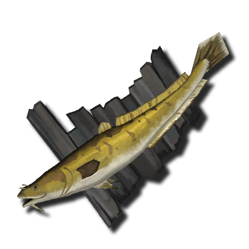 <a href="./Mounted%20Burbot.md" class="wikilink" title="Mounted Burbot">Mounted Burbot</a>
</td>
<td>
1x  <a href="./Fir%20Firewood.md" class="wikilink" title="Fir Firewood">Fir Firewood</a> 1x  <a href="./Burbot%20%28Raw%29.md" class="wikilink" title="Burbot (Raw)">Burbot (Raw)</a>
</td>
<td>
4 Hours
</td>
<td>
0.50 kg 
(1.1 lb)
</td>
<td>
<a href="./Furniture%20Workbench.md" class="wikilink" title="Furniture Workbench">Furniture Workbench</a>
</td>
</tr>
<tr>
<td>
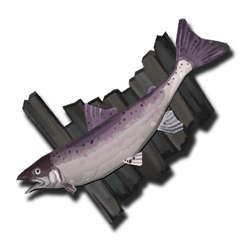 <a href="./Mounted%20Coho%20Salmon.md" class="wikilink" title="Mounted Coho Salmon">Mounted Coho Salmon</a>
</td>
<td>
1x  <a href="./Fir%20Firewood.md" class="wikilink" title="Fir Firewood">Fir Firewood</a> 1x  <a href="./Coho%20Salmon%20%28Raw%29.md" class="wikilink" title="Coho Salmon (Raw)">Coho Salmon (Raw)</a>
</td>
<td>
4 Hours
</td>
<td>
1.00 kg 
(2.2 lb)
</td>
<td>
<a href="./Furniture%20Workbench.md" class="wikilink" title="Furniture Workbench">Furniture Workbench</a>
</td>
</tr>
<tr>
<td>
 <a href="./Mounted%20Goldeye.md" class="wikilink" title="Mounted Goldeye">Mounted Goldeye</a>
</td>
<td>
1x  <a href="./Fir%20Firewood.md" class="wikilink" title="Fir Firewood">Fir Firewood</a> 1x  <a href="./Goldeye%20%28Raw%29.md" class="wikilink" title="Goldeye (Raw)">Goldeye (Raw)</a>
</td>
<td>
4 Hours
</td>
<td>
0.50 kg 
(1.1 lb)
</td>
<td>
<a href="./Furniture%20Workbench.md" class="wikilink" title="Furniture Workbench">Furniture Workbench</a>
</td>
</tr>
<tr>
<td>
 <a href="./Mounted%20Lake%20Whitefish.md" class="wikilink" title="Mounted Lake Whitefish">Mounted Lake Whitefish</a>
</td>
<td>
1x  <a href="./Fir%20Firewood.md" class="wikilink" title="Fir Firewood">Fir Firewood</a> 1x  <a href="./Lake%20Whitefish%20%28Raw%29.md" class="wikilink" title="Lake Whitefish (Raw)">Lake Whitefish (Raw)</a>
</td>
<td>
4 Hours
</td>
<td>
0.50 kg 
(1.1 lb)
</td>
<td>
<a href="./Furniture%20Workbench.md" class="wikilink" title="Furniture Workbench">Furniture Workbench</a>
</td>
</tr>
<tr>
<td>
 <a href="./Mounted%20Rainbow%20Trout.md" class="wikilink" title="Mounted Rainbow Trout">Mounted Rainbow Trout</a>
</td>
<td>
1x  <a href="./Fir%20Firewood.md" class="wikilink" title="Fir Firewood">Fir Firewood</a> 1x  <a href="./Rainbow%20Trout%20%28Raw%29.md" class="wikilink" title="Rainbow Trout (Raw)">Rainbow Trout (Raw)</a>
</td>
<td>
4 Hours
</td>
<td>
0.50 kg 
(1.1 lb)
</td>
<td>
<a href="./Furniture%20Workbench.md" class="wikilink" title="Furniture Workbench">Furniture Workbench</a>
</td>
</tr>
<tr>
<td>
 <a href="./Mounted%20Red%20Irish%20Lord.md" class="wikilink" title="Mounted Red Irish Lord">Mounted Red Irish Lord</a>
</td>
<td>
1x  <a href="./Fir%20Firewood.md" class="wikilink" title="Fir Firewood">Fir Firewood</a> 1x  <a href="./Red%20Irish%20Lord%20%28Raw%29.md" class="wikilink" title="Red Irish Lord (Raw)">Red Irish Lord (Raw)</a>
</td>
<td>
4 Hours
</td>
<td>
0.50 kg 
(1.1 lb)
</td>
<td>
<a href="./Furniture%20Workbench.md" class="wikilink" title="Furniture Workbench">Furniture Workbench</a>
</td>
</tr>
<tr>
<td>
 <a href="./Mounted%20Rockfish.md" class="wikilink" title="Mounted Rockfish">Mounted Rockfish</a>
</td>
<td>
1x  <a href="./Fir%20Firewood.md" class="wikilink" title="Fir Firewood">Fir Firewood</a> 1x  <a href="./Rockfish%20%28Raw%29.md" class="wikilink" title="Rockfish (Raw)">Rockfish (Raw)</a>
</td>
<td>
4 Hours
</td>
<td>
0.50 kg 
(1.1 lb)
</td>
<td>
<a href="./Furniture%20Workbench.md" class="wikilink" title="Furniture Workbench">Furniture Workbench</a>
</td>
</tr>
<tr>
<td>
 <a href="./Mounted%20Smallmouth%20Bass.md" class="wikilink" title="Mounted Smallmouth Bass">Mounted Smallmouth Bass</a>
</td>
<td>
1x  <a href="./Fir%20Firewood.md" class="wikilink" title="Fir Firewood">Fir Firewood</a> 1x  <a href="./Smallmouth%20Bass%20%28Raw%29.md" class="wikilink" title="Smallmouth Bass (Raw)">Smallmouth Bass (Raw)</a>
</td>
<td>
4 Hours
</td>
<td>
0.50 kg 
(1.1 lb)
</td>
<td>
<a href="./Furniture%20Workbench.md" class="wikilink" title="Furniture Workbench">Furniture Workbench</a>
</td>
</tr>
<tr>
<td>
 <a href="./Rustic%20Stool.md" class="wikilink" title="Rustic Stool">Rustic Stool</a>
</td>
<td>
4x  <a href="./Fir%20Firewood.md" class="wikilink" title="Fir Firewood">Fir Firewood</a>
</td>
<td>
2 Hours
</td>
<td>
2.00 kg 
(4.4 lb)
</td>
<td>
<a href="./Furniture%20Workbench.md" class="wikilink" title="Furniture Workbench">Furniture Workbench</a>
</td>
</tr>
</tbody>
</table>
<h2 id="Lootable_Decorations">Lootable Decorations</h2>

The following Decorations cannot be crafted, but are already present within many interiors. They can be moved as normal while in Customization Mode, but can also be placed inside the player's backpack and carried around between <a href="./Safehouse.md" class="wikilink" title="safehouses">safehouses</a>.

<ul>
<li>The option to take or destroy these items appears when examined.
<ul>
<li>When taken, this type of Decoration has a unique icon and weight, cannot be harvested for materials, and is placed in the Decorations section of the Backpack inventory.</li>
<li>When destroyed, they are permanently removed from the interior. Caution is advised when doing this, as destroying these Decorations means they cannot be crafted/taken from another location to be placed into another interior.</li>
<li>Lootable Decorations cannot be destroyed in the player's Inventory or in a <a href="./Safehouse%20Decoration%20Box.md" class="wikilink" title="Safehouse Decoration Box">Safehouse Decoration Box</a>. They must be placed in a Saferoom before the option appears.</li>
</ul></li>
<li>There can be multiple versions of an item with the same name, but with different weights and models.</li>
<li>Some of these items display a different name when examined in Customization Mode (ex <a href="./Backpack.md" class="wikilink" title="Backpack">Backpack</a> is "Back Pack" or <a href="./Metal%20Lamp.md" class="wikilink" title="Metal Lamp">Metal Lamp</a> is "Lamp").</li>
<li>Fish Mounts are different from the player crafted versions and are found in cabins.</li>
<li>Carrying multiple Decorations adds up quickly. The heaviest Decorations are 5.00kg, while the lightest tend to be 0.05kg. Using a <a href="./Travois.md" class="wikilink" title="Travois">Travois</a> can be helpful for transporting large amounts of heavy Decorations.</li>
</ul>
<table>
<colgroup>
<col style="width: 25%" />
<col style="width: 25%" />
<col style="width: 25%" />
<col style="width: 25%" />
</colgroup>
<thead>
<tr>
<th>
Icon
</th>
<th>
Name
</th>
<th>
Weight
</th>
<th>
Location Found
</th>
</tr>
</thead>
<tbody>
<tr>
<td>
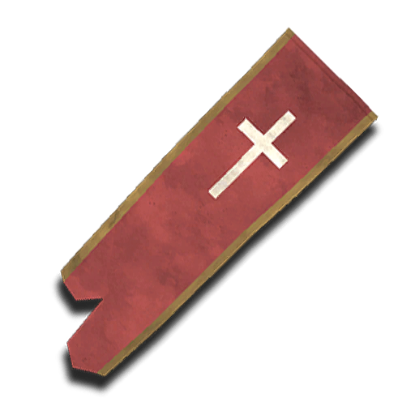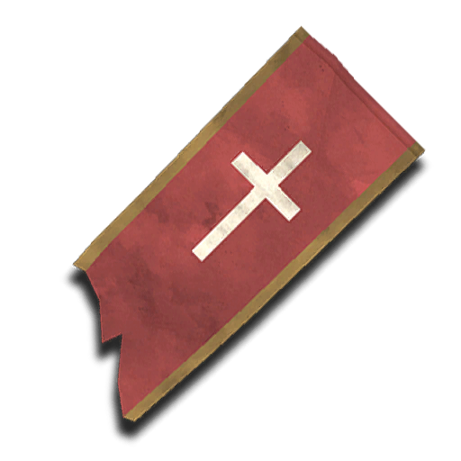
</td>
<td>
Banner
</td>
<td>
5.00 kg 
(11 lb)
</td>
<td>
<a href="./St.%20Christopher%27s%20Church.md" class="wikilink" title="St. Christopher&#39;s Church">St. Christopher's Church</a>, <a href="./Pleasant%20Valley%20Church.md" class="wikilink" title="Pleasant Valley Church">Pleasant Valley Church</a>
</td>
</tr>
<tr>
<td><figure>
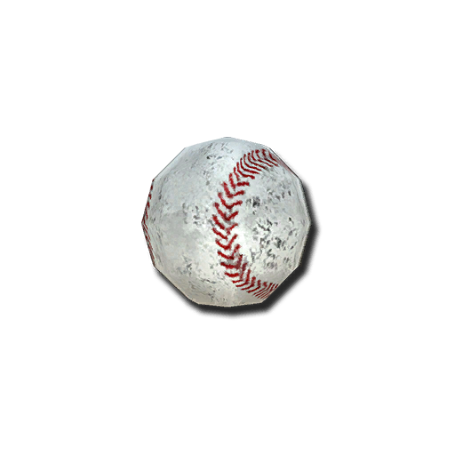
<figcaption>Baseball.png</figcaption>
</figure></td>
<td>
Baseball
</td>
<td>
0.05 kg 
(0.11 lb)
</td>
<td>
<a href="./Blackrock%20Prison.md" class="wikilink" title="Blackrock Prison">Blackrock Prison</a> Warden's Office, <a href="./Main%20Hangar.md" class="wikilink" title="Main Hangar">Main Hangar</a> office (where <a href="./Stained%20Paper.md" class="wikilink" title="Stained Paper">Stained Paper</a> is found)
</td>
</tr>
<tr>
<td><figure>

<figcaption>BaseballBat.png</figcaption>
</figure></td>
<td>
Baseball Bat
</td>
<td>
0.50 kg 
(1.1 lb)
</td>
<td>
<a href="./Blackrock%20Prison.md" class="wikilink" title="Blackrock Prison">Blackrock Prison</a> Warden's Office
</td>
</tr>
<tr>
<td><figure>

<figcaption>Basin_Decoration.png</figcaption>
</figure></td>
<td>
<a href="./Basin.md" class="wikilink" title="Basin">Basin</a>
</td>
<td>
2.00 kg 
(4.4 lb)
</td>
<td>
<a href="./Quonset%20Garage.md" class="wikilink" title="Quonset Garage">Quonset Garage</a>
</td>
</tr>
<tr>
<td>

</td>
<td>
Basket
</td>
<td>
0.25 kg 
(0.55 lb)
</td>
<td>
<a href="./Main%20Hangar.md" class="wikilink" title="Main Hangar">Main Hangar</a>, <a href="./Convenience%20Store.md" class="wikilink" title="Convenience Store">Convenience Store</a>, <a href="./Basement%20%28Sundered%20Pass%29.md" class="wikilink" title="Basement (Sundered Pass)">Basement (Sundered Pass)</a>
</td>
</tr>
<tr>
<td><figure>
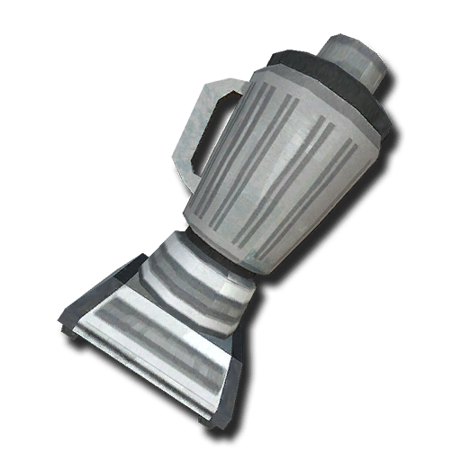
<figcaption>Blender.png</figcaption>
</figure></td>
<td>
Blender
</td>
<td>
0.25 kg 
(0.55 lb)
</td>
<td>
Trailers, <a href="./Paradise%20Meadows%20Farm.md" class="wikilink" title="Paradise Meadows Farm">Paradise Meadows Farm</a>, Houses
</td>
</tr>
<tr>
<td>
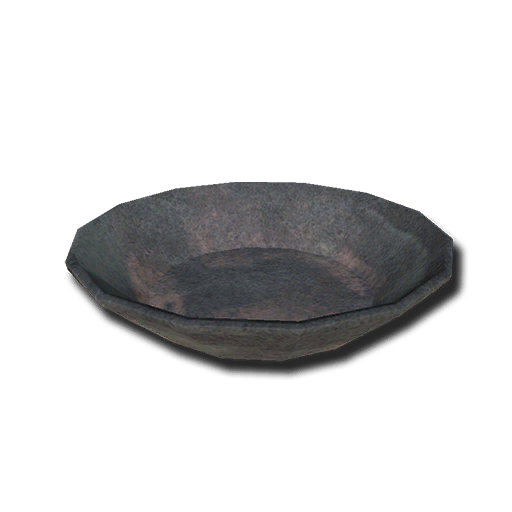
</td>
<td>
Bowl
</td>
<td>
0.05 kg 
(0.11 lb)
</td>
<td>
Houses, Trailers
</td>
</tr>
<tr>
<td>
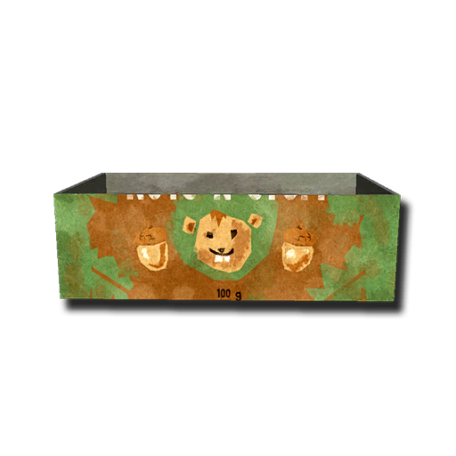
</td>
<td>
<a href="./Cardboard%20Box.md" class="wikilink" title="Box">Box</a>
</td>
<td>
0.10 kg 
(0.22 lb)
</td>
<td>
Houses, <a href="./Convenience%20Store.md" class="wikilink" title="Convenience Store">Convenience Store</a>, <a href="./Rural%20Store.md" class="wikilink" title="Rural Store">Rural Store</a>, Trailers
</td>
</tr>
<tr>
<td><figure>

<figcaption>MetalFileCabinetDrawerA2.png</figcaption>
</figure></td>
<td>
Broken Drawer
</td>
<td>
1.00 kg 
(2.2 lb)
</td>
<td>
Offices
</td>
</tr>
<tr>
<td>
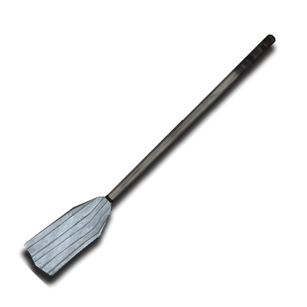
</td>
<td>
<a href="./Broom.md" class="wikilink" title="Broom">Broom</a>
</td>
<td>
0.20 kg 
(0.44 lb)
</td>
<td>
Houses, Industrial Areas
</td>
</tr>
<tr>
<td><figure>

<figcaption>MetalBucketA.png</figcaption>
</figure></td>
<td>
<a href="./Metal%20Pail.md" class="wikilink" title="Bucket">Bucket</a>
</td>
<td>
1.00 kg 
(2.2 lb)
</td>
<td>
Houses, Industrial Areas
</td>
</tr>
<tr>
<td>
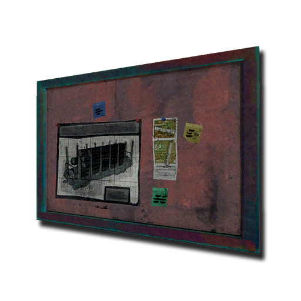
</td>
<td>
Bulletin Board
</td>
<td>
5.00 kg 
(11 lb)
</td>
<td>
Industrial Areas
</td>
</tr>
<tr>
<td>

</td>
<td>
Calendar
</td>
<td>
0.10 kg 
(0.22 lb)
</td>
<td>
Houses, Industrial Areas
</td>
</tr>
<tr>
<td><figure>

<figcaption>VistaCalendar.png</figcaption>
</figure></td>
<td>
Calendar
</td>
<td>
0.25 kg 
(0.55 lb)
</td>
<td>
Houses, Industrial Areas
</td>
</tr>
<tr>
<td><figure>

<figcaption>Trolley_A.png</figcaption>
</figure></td>
<td>
Cart
</td>
<td>
5.00 kg 
(11 lb)
</td>
<td>
<a href="./Idle%20Camp.md" class="wikilink" title="Idle Camp">Idle Camp</a> mess hall
</td>
</tr>
<tr>
<td><figure>

<figcaption>StereoCassetteTape.png</figcaption>
</figure></td>
<td>
Cassete
</td>
<td>
0.10 kg 
(0.22 lb)
</td>
<td>
<a href="./Blackrock%20Prison.md" class="wikilink" title="Blackrock Prison">Blackrock Prison</a> Warden's Office, <a href="./Cabin.md" class="wikilink" title="Cabin">Cabin</a>, <a href="./Carter%20Hydro%20Dam.md" class="wikilink" title="Carter Hydro Dam">Carter Hydro Dam</a>
</td>
</tr>
<tr>
<td>

</td>
<td>
Chair
</td>
<td>
4.00 kg 
(8.8 lb)
</td>
<td>
<a href="./Main%20Hangar.md" class="wikilink" title="Main Hangar">Main Hangar</a>, <a href="./Community%20Hall.md" class="wikilink" title="Community Hall">Community Hall</a>, <a href="./Blackrock%20Prison.md" class="wikilink" title="Blackrock Prison">Blackrock Prison</a> Offices/Infirmary
</td>
</tr>
<tr>
<td>
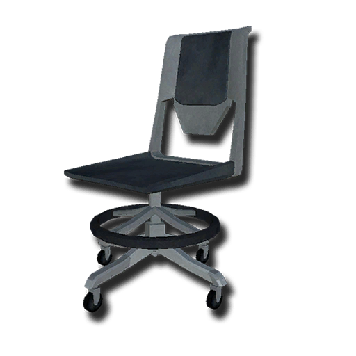
</td>
<td>
Chair
</td>
<td>
5.00 kg 
(11 lb)
</td>
<td>
Houses, <a href="./Hunting%20Lodge.md" class="wikilink" title="Hunting Lodge">Hunting Lodge</a>, Metal chair <a href="./Blackrock%20Prison.md" class="wikilink" title="Blackrock Prison">Blackrock Prison</a> (Infirmary),
</td>
</tr>
<tr>
<td><figure>

<figcaption>WallClock.png</figcaption>
</figure></td>
<td>
Clock
</td>
<td>
1.00 kg 
(2.2 lb)
</td>
<td>
Houses
</td>
</tr>
<tr>
<td>
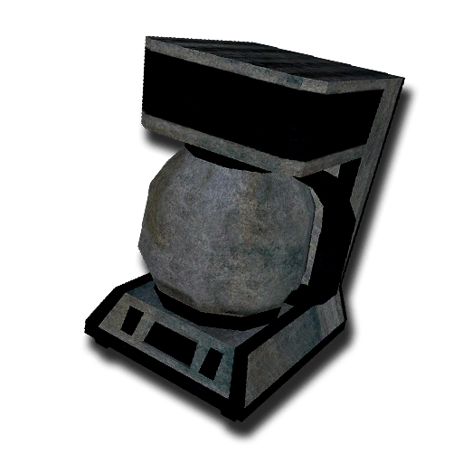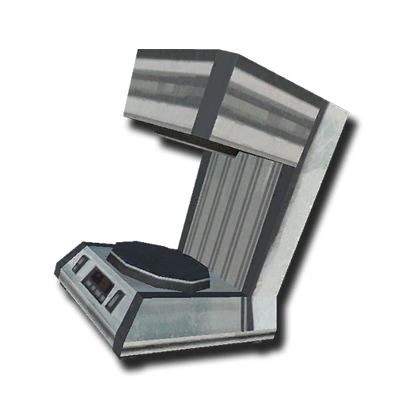
</td>
<td>
Coffee Machine
</td>
<td>
0.50 kg 
(1.1 lb)
</td>
<td>
Kitchens, Trailers, Cabins
</td>
</tr>
<tr>
<td>

</td>
<td>
Computer
</td>
<td>
5.00 kg 
(11 lb)
</td>
<td>
Industrial Areas
</td>
</tr>
<tr>
<td><figure>

<figcaption>Traffic_Cone_A.png</figcaption>
</figure></td>
<td>
Cone
</td>
<td>
0.25 kg 
(0.55 lb)
</td>
<td>
<a href="./Main%20Hangar.md" class="wikilink" title="Main Hangar">Main Hangar</a> (2 different cone models but display the same Backpack icon)
</td>
</tr>
<tr>
<td>
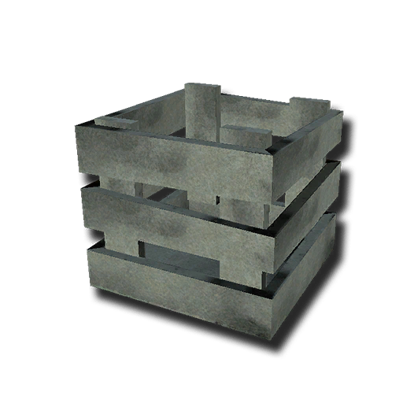
</td>
<td>
<a href="./Crate.md" class="wikilink" title="Crate">Crate</a>
</td>
<td>
0.30 kg 
(0.66 lb)
</td>
<td>
Industrial Areas
</td>
</tr>
<tr>
<td><figure>
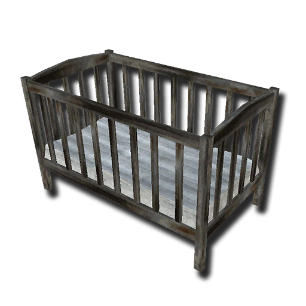
<figcaption>BabyCrib.png</figcaption>
</figure></td>
<td>
Crib
</td>
<td>
5.00 kg 
(11 lb)
</td>
<td>
<a href="./Milton%20House.md" class="wikilink" title="Milton House">Milton House</a> (house close to Grey Mother's leading to <a href="./Radio%20Tower.md" class="wikilink" title="Radio Tower">Radio Tower</a>)
</td>
</tr>
<tr>
<td>
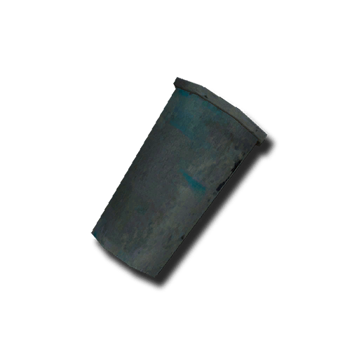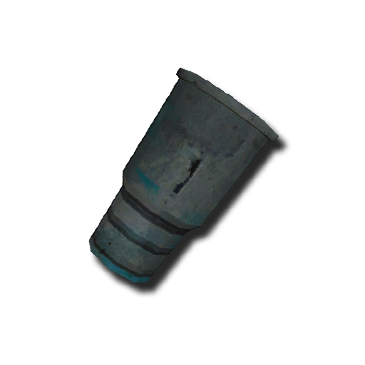
</td>
<td>
Cup
</td>
<td>
0.05 kg 
(0.11 lb)
</td>
<td>
Houses, <a href="./Convenience%20Store.md" class="wikilink" title="Convenience Store">Convenience Store</a>
</td>
</tr>
<tr>
<td><figure>

<figcaption>PaperCupA.png</figcaption>
</figure></td>
<td>
Cup
</td>
<td>
0.10 kg 
(0.22 lb)
</td>
<td>
<a href="./Concentrator.md" class="wikilink" title="Concentrator">Concentrator</a>, <a href="./Control%20Tower.md" class="wikilink" title="Control Tower">Control Tower</a>
</td>
</tr>
<tr>
<td><figure>

<figcaption>CuttingBoardA.png</figcaption>
</figure></td>
<td>
Cutting Board
</td>
<td>
0.10 kg 
(0.22 lb)
</td>
<td>
House Kitchens
</td>
</tr>
<tr>
<td><figure>

<figcaption>CuttingBoardB.png</figcaption>
</figure></td>
<td>
Cutting Board
</td>
<td>
0.25 kg 
(0.55 lb)
</td>
<td>
House Kitchens
</td>
</tr>
<tr>
<td><figure>

<figcaption>DeerMount.png</figcaption>
</figure></td>
<td>
Deer Mount
</td>
<td>
5.00 kg 
(11 lb)
</td>
<td>
<a href="./Hunting%20Lodge.md" class="wikilink" title="Hunting Lodge">Hunting Lodge</a>, Hunting <a href="./Prepper%20Cache.md" class="wikilink" title="Prepper Cache">Prepper Cache</a>, Places with animal trophies
</td>
</tr>
<tr>
<td><figure>

<figcaption>ComputerFloppy.png</figcaption>
</figure></td>
<td>
Disk
</td>
<td>
0.02 kg 
(0.044 lb)
</td>
<td>
Near Computers, <a href="./Maintenance%20Yard.md" class="wikilink" title="Maintenance Yard">Maintenance Yard</a>, <a href="./Carter%20Hydro%20Dam.md" class="wikilink" title="Carter Hydro Dam">Carter Hydro Dam</a>
</td>
</tr>
<tr>
<td><figure>
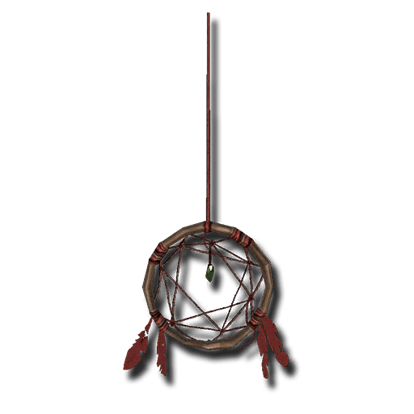
<figcaption>DreamCatcher.png</figcaption>
</figure></td>
<td>
Dream Catcher
</td>
<td>
0.10 kg 
(0.22 lb)
</td>
<td>
<a href="./Camp%20Office.md" class="wikilink" title="Camp Office">Camp Office</a>, <a href="./Mindful%20Cabin.md" class="wikilink" title="Mindful Cabin">Mindful Cabin</a>, <a href="./Lake%20Cabins.md" class="wikilink" title="Lake Cabins">Lake Cabins</a>, Cabin under <a href="./Abandoned%20Lookout.md" class="wikilink" title="Abandoned Lookout">Abandoned Lookout</a>
</td>
</tr>
<tr>
<td>

</td>
<td>
Festive Lights
</td>
<td>
0.25 kg 
(0.55 lb)
</td>
<td>
<a href="./Hangar%20Basement.md" class="wikilink" title="Hangar Basement">Hangar Basement</a>, <a href="./Community%20Hall.md" class="wikilink" title="Community Hall">Community Hall</a>, <a href="./Carter%20Hydro%20Dam.md" class="wikilink" title="Carter Hydro Dam">Carter Hydro Dam</a> (office stairwell), <a href="./Hunting%20Lodge.md" class="wikilink" title="Hunting Lodge">Hunting Lodge</a> (<a href="./Festive%20Sweater.md" class="wikilink" title="Festive Sweater">Festive Sweater</a> is usually nearby)
</td>
</tr>
<tr>
<td>
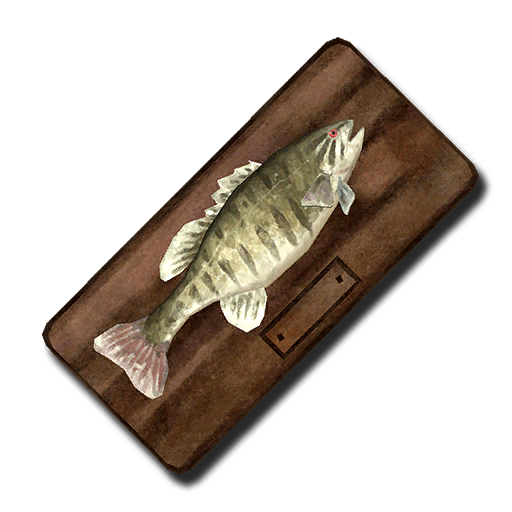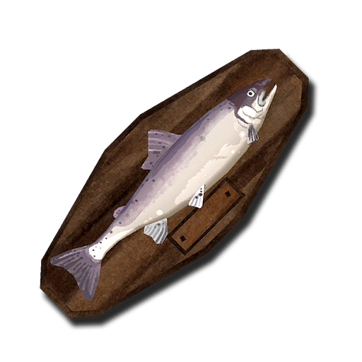
</td>
<td>
Fish Mount
</td>
<td>
0.25 kg 
(0.55 lb)
</td>
<td>
Cabins, <a href="./Hunting%20Lodge.md" class="wikilink" title="Hunting Lodge">Hunting Lodge</a>, <a href="./Maintenance%20Yard.md" class="wikilink" title="Maintenance Yard">Maintenance Yard</a>
</td>
</tr>
<tr>
<td>
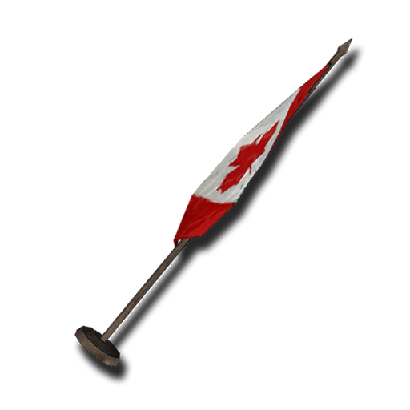
</td>
<td>
Flag
</td>
<td>
0.25 kg 
(0.55 lb)
</td>
<td>
<a href="./Milton%20Post%20Office.md" class="wikilink" title="Milton Post Office">Milton Post Office</a>, <a href="./Concentrator.md" class="wikilink" title="Concentrator">Concentrator</a> (7th Floor Offices)

Large flags on the <a href="./Maintenance%20Yard.md" class="wikilink" title="Maintenance Yard">Maintenance Yard</a> Shed ceiling (can be reached in <a href="./Safehouse%20Customization.md" class="wikilink" title="Safe House Customization">Safe House Customization</a> with a plank), <a href="./Carter%20Hydro%20Dam.md" class="wikilink" title="Carter Hydro Dam">Carter Hydro Dam</a> Turbine Room (can be reached in <a href="./Safehouse%20Customization.md" class="wikilink" title="Safe House Customization">Safe House Customization</a> with various stacked items, flag keeps "swaying" property when placed in new locations)

Small table flag in <a href="./Blackrock%20Prison.md" class="wikilink" title="Blackrock Prison">Blackrock Prison</a> Warden's office
</td>
</tr>
<tr>
<td>
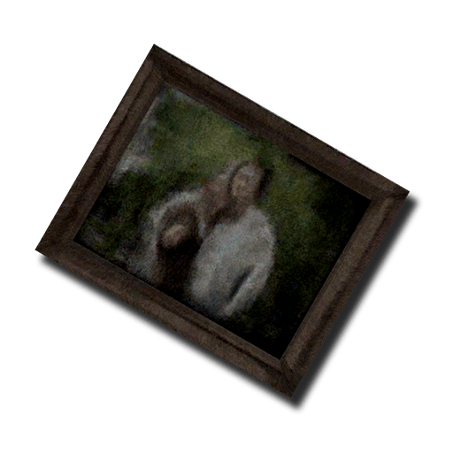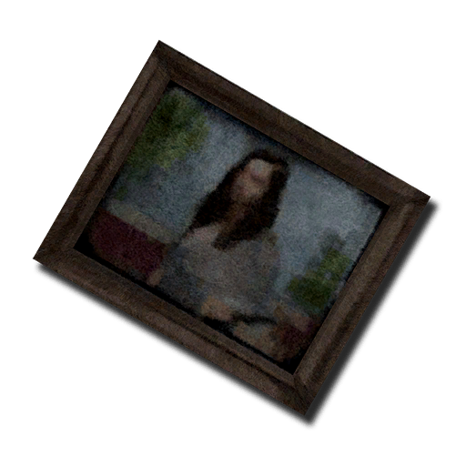
</td>
<td>
Frame
</td>
<td>
0.15 kg 
(0.33 lb)
</td>
<td>
Houses
</td>
</tr>
<tr>
<td>
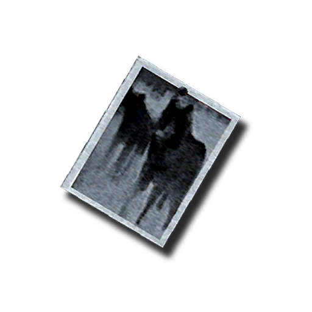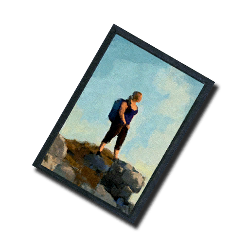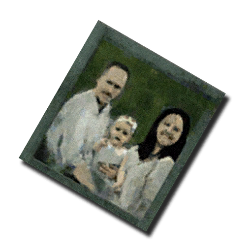
</td>
<td>
Frame (Table)
</td>
<td>
0.25 kg 
(0.55 lb)
</td>
<td>
Houses (these are table picture frames)
</td>
</tr>
<tr>
<td>
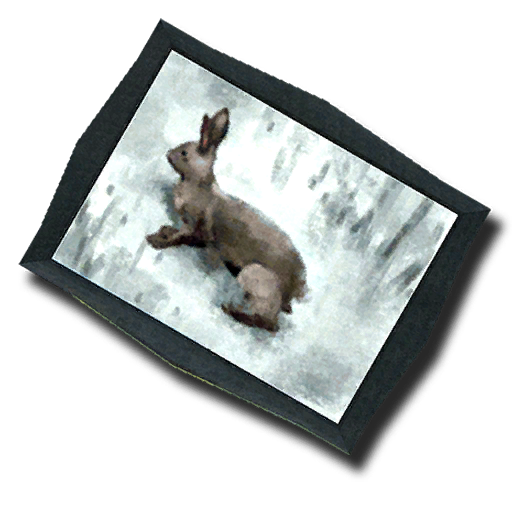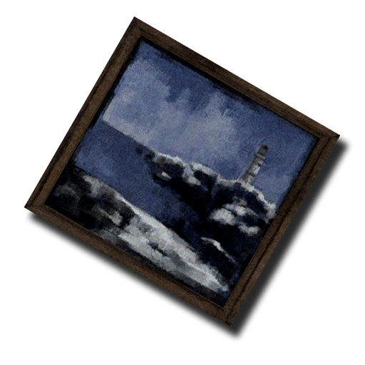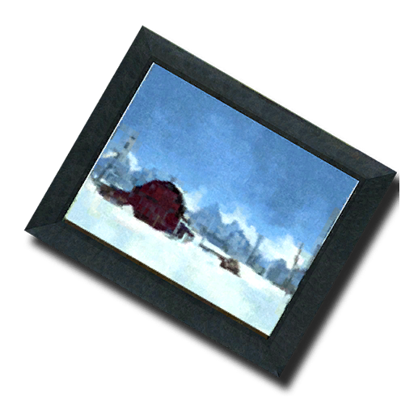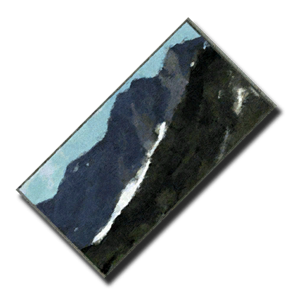
</td>
<td>
Frame
</td>
<td>
0.25 kg 
(0.55 lb)
</td>
<td>
Houses
</td>
</tr>
<tr>
<td>
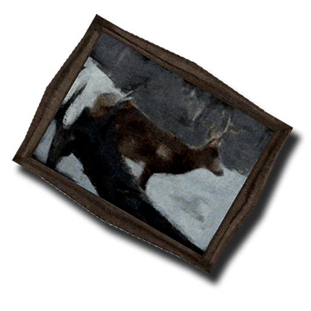
</td>
<td>
Frame (Frame 2)
</td>
<td>
0.25 kg 
(0.55 lb)
</td>
<td>
Houses
</td>
</tr>
<tr>
<td><figure>

<figcaption>PictureFrameWelcomeSign.png</figcaption>
</figure></td>
<td>
Frame
</td>
<td>
0.25 kg 
(0.55 lb)
</td>
<td>
<a href="./Camp%20Office.md" class="wikilink" title="Camp Office">Camp Office</a> welcome sign
</td>
</tr>
<tr>
<td>
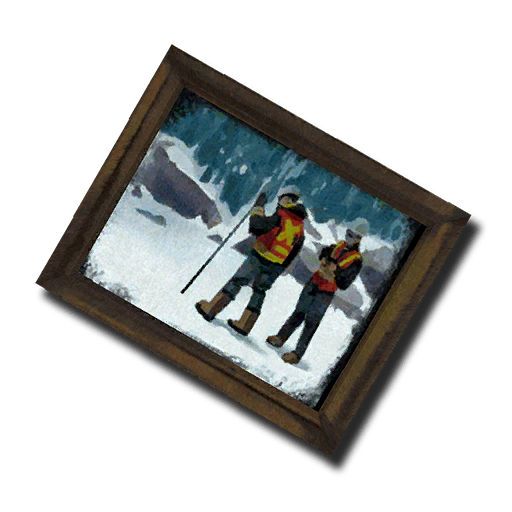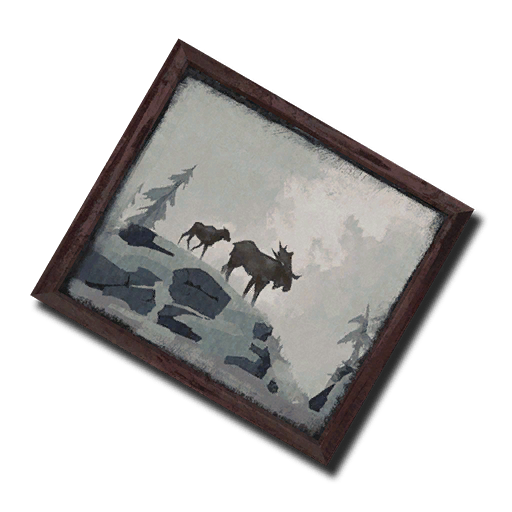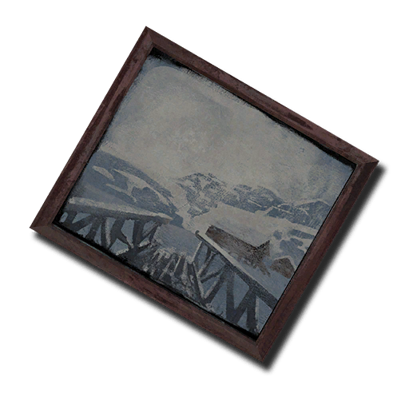
</td>
<td>
Frame (FT)
</td>
<td>
0.25 kg 
(0.55 lb)
</td>
<td>
These are found in houses/buildings in the Far Territory. <a href="./Vacant%20Depot.md" class="wikilink" title="Vacant Depot">Vacant Depot</a>, <a href="./Idle%20Camp.md" class="wikilink" title="Idle Camp">Idle Camp</a>, <a href="./Last%20Lonely%20House.md" class="wikilink" title="Last Lonely House">Last Lonely House</a>, etc
</td>
</tr>
<tr>
<td>
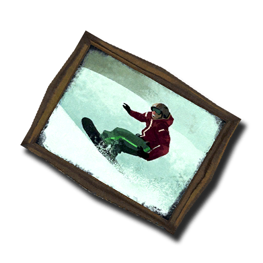
</td>
<td>
Frame (FT)
</td>
<td>
0.25 kg 
(0.55 lb)
</td>
<td>
These are found in houses/buildings in the Far Territory. <a href="./Vacant%20Depot.md" class="wikilink" title="Vacant Depot">Vacant Depot</a>, <a href="./Idle%20Camp.md" class="wikilink" title="Idle Camp">Idle Camp</a>, <a href="./Last%20Lonely%20House.md" class="wikilink" title="Last Lonely House">Last Lonely House</a>, etc
</td>
</tr>
<tr>
<td>
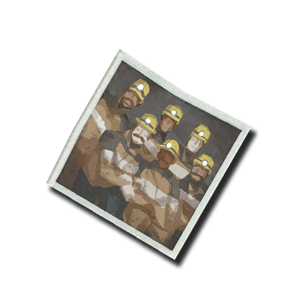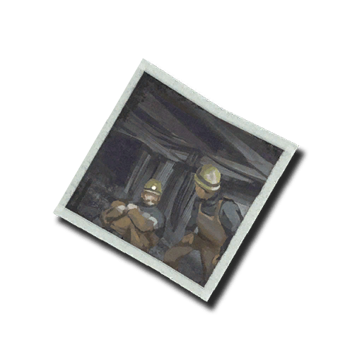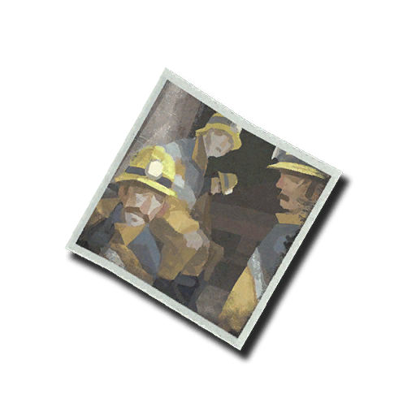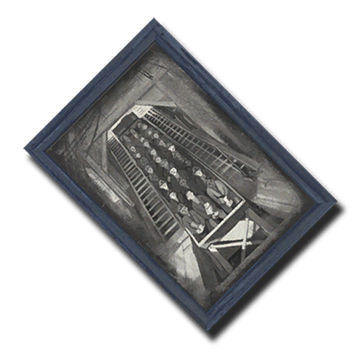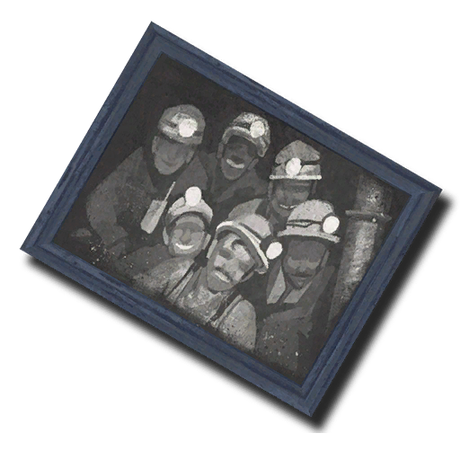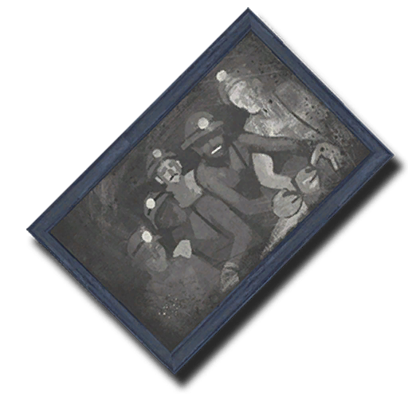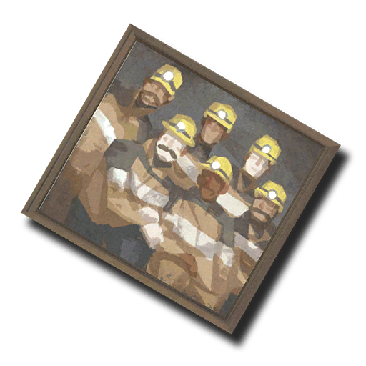
</td>
<td>
Frame (Miner)
</td>
<td>
0.25 kg 
(0.55 lb)
</td>
<td>
<a href="./Vacant%20Depot.md" class="wikilink" title="Vacant Depot">Vacant Depot</a>, <a href="./Idle%20Camp.md" class="wikilink" title="Idle Camp">Idle Camp</a>, <a href="./Concentrator.md" class="wikilink" title="Concentrator">Concentrator</a> Offices
</td>
</tr>
<tr>
<td><figure>

<figcaption>DeskGlobe.png</figcaption>
</figure></td>
<td>
Globe
</td>
<td>
1.00 kg 
(2.2 lb)
</td>
<td>
<a href="./Paradise%20Meadows%20Farm.md" class="wikilink" title="Paradise Meadows Farm">Paradise Meadows Farm</a>, <a href="./Blackrock%20Prison.md" class="wikilink" title="Blackrock Prison">Blackrock Prison</a> Warden's Office, <a href="./Main%20Hangar.md" class="wikilink" title="Main Hangar">Main Hangar</a>, <a href="./Bunker%20Alpha.md" class="wikilink" title="Bunker Alpha">Bunker Alpha</a>
</td>
</tr>
<tr>
<td><figure>

<figcaption>HockeyStickA.png</figcaption>
</figure></td>
<td>
Hockey Stick
</td>
<td>
0.25 kg 
(0.55 lb)
</td>
<td>
<a href="./Last%20Resort%20Cannery.md" class="wikilink" title="Last Resort Cannery">Last Resort Cannery</a> Trailer, <a href="./Island%20Cottage.md" class="wikilink" title="Island Cottage">Island Cottage</a>, <a href="./Basement%20%28Sundered%20Pass%29.md" class="wikilink" title="Basement (Sundered Pass)">Basement (Sundered Pass)</a>
</td>
</tr>
<tr>
<td><figure>
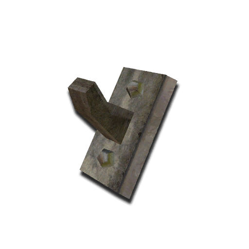
<figcaption>WallHook.png</figcaption>
</figure></td>
<td>
Hook
</td>
<td>
0.10 kg 
(0.22 lb)
</td>
<td>
Houses
</td>
</tr>
<tr>
<td><figure>
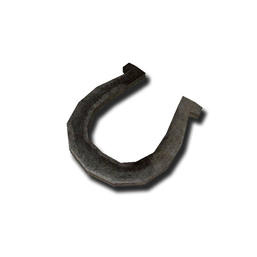
<figcaption>Horseshoe.png</figcaption>
</figure></td>
<td>
Horseshoe
</td>
<td>
0.10 kg 
(0.22 lb)
</td>
<td>
<a href="./Hunting%20Lodge.md" class="wikilink" title="Hunting Lodge">Hunting Lodge</a> Basement, <a href="./Blackrock%20Prison.md" class="wikilink" title="Blackrock Prison">Blackrock Prison</a> Warden's Office
</td>
</tr>
<tr>
<td>

</td>
<td>
Kettle
</td>
<td>
0.25 kg 
(0.55 lb)
</td>
<td>
<a href="./Last%20Resort%20Cannery.md" class="wikilink" title="Last Resort Cannery">Last Resort Cannery</a> Trailer, <a href="./Station%20Bunkhouse.md" class="wikilink" title="Station Bunkhouse">Station Bunkhouse</a>, <a href="./Pensive%20Lookout.md" class="wikilink" title="Pensive Lookout">Pensive Lookout</a>
</td>
</tr>
<tr>
<td><figure>

<figcaption>ComputerKeyboard.png</figcaption>
</figure></td>
<td>
Keyboard
</td>
<td>
0.20 kg 
(0.44 lb)
</td>
<td>
Near Computers
</td>
</tr>
<tr>
<td><figure>

<figcaption>DialKnob.png</figcaption>
</figure></td>
<td>
Knob
</td>
<td>
0.25 kg 
(0.55 lb)
</td>
<td>
<a href="./Concentrator.md" class="wikilink" title="Concentrator">Concentrator</a> (6th Floor, to the right of where the Woodworking Tools spawn in a machine), <a href="./Conveyor%20Room.md" class="wikilink" title="Conveyor Room">Conveyor Room</a> near the entrance to Langston Mine
</td>
</tr>
<tr>
<td>

</td>
<td>
Lamp
</td>
<td>
0.25 kg 
(0.55 lb)
</td>
<td>
Green lamp found in <a href="./Blackrock%20Prison.md" class="wikilink" title="Blackrock Prison">Blackrock Prison</a> Warden's Office Signal Void bunkers, Blackrock Prison (Infirmary), <a href="./Main%20Hangar.md" class="wikilink" title="Main Hangar">Main Hangar</a>
</td>
</tr>
<tr>
<td>
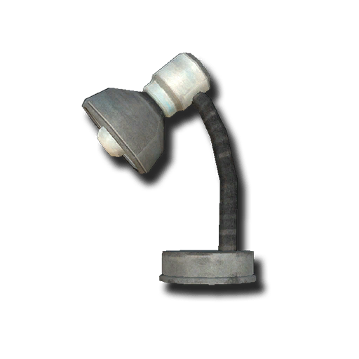
</td>
<td>
Lamp
</td>
<td>
1.00 kg 
(2.2 lb)
</td>
<td>
Houses
</td>
</tr>
<tr>
<td>

</td>
<td>
Lamp
</td>
<td>
2.00 kg 
(4.4 lb)
</td>
<td>
Houses
</td>
</tr>
<tr>
<td>

</td>
<td>
<a href="./Metal%20Lamp.md" class="wikilink" title="Lamp">Lamp</a>
</td>
<td>
5.00 kg 
(11 lb)
</td>
<td>
Houses
</td>
</tr>
<tr>
<td><figure>
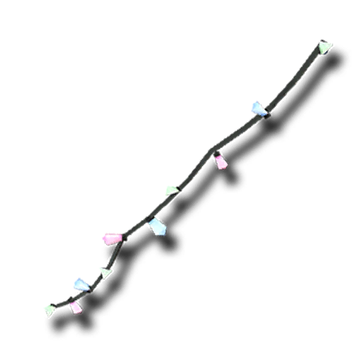
<figcaption>LightChristmas_A.png</figcaption>
</figure></td>
<td>
Light
</td>
<td>
0.25 kg 
(0.55 lb)
</td>
<td>
<a href="./Camp%20Office.md" class="wikilink" title="Camp Office">Camp Office</a>, <a href="./Cannery%20Worker%20Residences.md" class="wikilink" title="Cannery Worker Residences">Cannery Worker Residences</a>, <a href="./Justy%27s%20Hovel.md" class="wikilink" title="Justy&#39;s Hovel">Justy's Hovel</a>
</td>
</tr>
<tr>
<td>

</td>
<td>
Lid (Paintcan)
</td>
<td>
0.25 kg 
(0.55 lb)
</td>
<td>
Sheds, Industrial Areas
</td>
</tr>
<tr>
<td><figure>

<figcaption>Lab_Microscope.png</figcaption>
</figure></td>
<td>
Microscope
</td>
<td>
0.25 kg 
(0.55 lb)
</td>
<td>
<a href="./Blackrock%20Prison.md" class="wikilink" title="Blackrock Prison">Blackrock Prison</a> (Infirmary), <a href="./Bunker%20Alpha.md" class="wikilink" title="Bunker Alpha">Bunker Alpha</a>, <a href="./Bunker%20Beta.md" class="wikilink" title="Bunker Beta">Bunker Beta</a>, <a href="./Bunker%20Gamma.md" class="wikilink" title="Bunker Gamma">Bunker Gamma</a>, <a href="./Bunker%20Omega.md" class="wikilink" title="Bunker Omega">Bunker Omega</a>
</td>
</tr>
<tr>
<td>
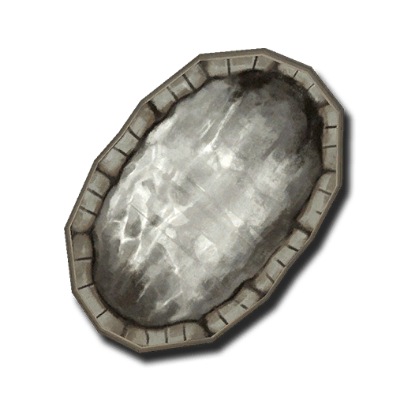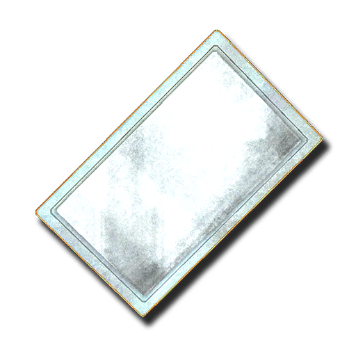
</td>
<td>
Mirror
</td>
<td>
3.00 kg 
(6.6 lb)
</td>
<td>
<a href="./Hunting%20Lodge.md" class="wikilink" title="Hunting Lodge">Hunting Lodge</a>, <a href="./Vacant%20Depot.md" class="wikilink" title="Vacant Depot">Vacant Depot</a>, <a href="./Bunker%20Omega.md" class="wikilink" title="Bunker Omega">Bunker Omega</a>, <a href="./Foreman%27s%20Retreat.md" class="wikilink" title="Foreman&#39;s Retreat">Foreman's Retreat</a>
</td>
</tr>
<tr>
<td>

</td>
<td>
Monitor
</td>
<td>
4.00 kg 
(8.8 lb)
</td>
<td>
Industrial Areas
</td>
</tr>
<tr>
<td><figure>

<figcaption>MooseMount_A.png</figcaption>
</figure></td>
<td>
Moose Mount
</td>
<td>
5.00 kg 
(11 lb)
</td>
<td>
<a href="./Community%20Hall.md" class="wikilink" title="Community Hall">Community Hall</a>
</td>
</tr>
<tr>
<td><figure>

<figcaption>ComputerMouse.png</figcaption>
</figure></td>
<td>
Mouse
</td>
<td>
0.05 kg 
(0.11 lb)
</td>
<td>
Near Computers
</td>
</tr>
<tr>
<td>
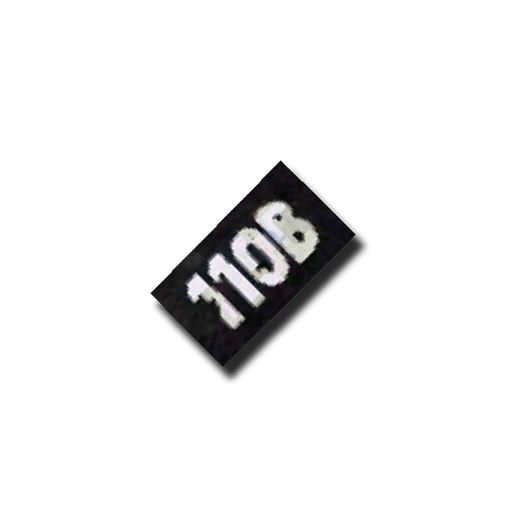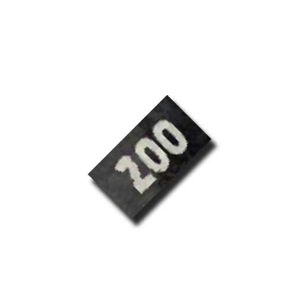
</td>
<td>
Number
</td>
<td>
0.25 kg 
(0.55 lb)
</td>
<td>
<a href="./Blackrock%20Prison.md" class="wikilink" title="Blackrock Prison">Blackrock Prison</a> (inside the prison)
</td>
</tr>
<tr>
<td><figure>

<figcaption>ToasterOven.png</figcaption>
</figure></td>
<td>
<a href="./Toaster.md" class="wikilink" title="Oven">Oven</a>
</td>
<td>
1.00 kg 
(2.2 lb)
</td>
<td>
Kitchens
</td>
</tr>
<tr>
<td><figure>

<figcaption>MicrowaveOven.png</figcaption>
</figure></td>
<td>
<a href="./Microwave.md" class="wikilink" title="Oven">Oven</a>
</td>
<td>
5.00 kg 
(11 lb)
</td>
<td>
<a href="./Milton%20House.md" class="wikilink" title="Milton House">Milton House</a> (only one microwave can be picked up)
</td>
</tr>
<tr>
<td>

</td>
<td>
Paintcan
</td>
<td>
0.25 kg 
(0.55 lb)
</td>
<td>
Sheds, Industrial Areas
</td>
</tr>
<tr>
<td><figure>

<figcaption>PaintBrush.png</figcaption>
</figure></td>
<td>
Paintbrush
</td>
<td>
0.10 kg 
(0.22 lb)
</td>
<td>
Sheds, Industrial Areas
</td>
</tr>
<tr>
<td>

</td>
<td>
Phone
</td>
<td>
0.25 kg 
(0.55 lb)
</td>
<td>
Wall Phones - Industrial areas Office Phone - Offices
</td>
</tr>
<tr>
<td><figure>

<figcaption>Pillow_Decoration.png</figcaption>
</figure></td>
<td>
Pillow
</td>
<td>
0.15 kg 
(0.33 lb)
</td>
<td>
Trailers
</td>
</tr>
<tr>
<td><figure>

<figcaption>PitcherA.png</figcaption>
</figure></td>
<td>
Pitcher
</td>
<td>
0.25 kg 
(0.55 lb)
</td>
<td>
Kitchens
</td>
</tr>
<tr>
<td>

</td>
<td>
Plant
</td>
<td>
5.00 kg 
(11 lb) 1.00 kg 
(2.2 lb)
</td>
<td>
Houses
</td>
</tr>
<tr>
<td><figure>

<figcaption>MountainPosterDeco.png</figcaption>
</figure></td>
<td>
Poster
</td>
<td>
0.05 kg 
(0.11 lb)
</td>
<td>
Houses
</td>
</tr>
<tr>
<td>

</td>
<td>
Poster
</td>
<td>
0.25 kg 
(0.55 lb)
</td>
<td>
Houses
</td>
</tr>
<tr>
<td><figure>

<figcaption>CoatRackB.png</figcaption>
</figure></td>
<td>
Rack
</td>
<td>
0.20 kg 
(0.44 lb)
</td>
<td>
Houses
</td>
</tr>
<tr>
<td>

</td>
<td>
Rack
</td>
<td>
0.30 kg 
(0.66 lb)
</td>
<td>
Houses
</td>
</tr>
<tr>
<td>

</td>
<td>
Rack
</td>
<td>
0.50 kg 
(1.1 lb)
</td>
<td>
Houses. Gun Rack - <a href="./Forestry%20Lookout.md" class="wikilink" title="Forestry Lookout">Forestry Lookout</a>, <a href="./Pensive%20Lookout.md" class="wikilink" title="Pensive Lookout">Pensive Lookout</a>, <a href="./Abandoned%20Lookout.md" class="wikilink" title="Abandoned Lookout">Abandoned Lookout</a>, <a href="./Trapper%27s%20Homestead.md" class="wikilink" title="Trapper&#39;s Homestead">Trapper's Homestead</a>, <a href="./Hunting%20Lodge.md" class="wikilink" title="Hunting Lodge">Hunting Lodge</a>, <a href="./Foreman%27s%20Retreat.md" class="wikilink" title="Foreman&#39;s Retreat">Foreman's Retreat</a>
</td>
</tr>
<tr>
<td><figure>

<figcaption>GunRackDouble.png</figcaption>
</figure></td>
<td>
Rack
</td>
<td>
0.75 kg 
(1.65 lb)
</td>
<td>
Hunting Prepper Cache, <a href="./Last%20Lonely%20House.md" class="wikilink" title="Last Lonely House">Last Lonely House</a>, <a href="./Milton%20House%20%28Grey%20Mother%27s%29.md" class="wikilink" title="Milton House (Grey Mother&#39;s)">Milton House (Grey Mother's)</a>, <a href="./Last%20Resort%20Cannery.md" class="wikilink" title="Last Resort Cannery">Last Resort Cannery</a> (trailer)
</td>
</tr>
<tr>
<td>

</td>
<td>
Radio
</td>
<td>
0.10 kg 
(0.22 lb)
</td>
<td>
House Bedrooms, <a href="./Bunker%20Alpha.md" class="wikilink" title="Bunker Alpha">Bunker Alpha</a> <a href="./Blackrock%20Prison.md" class="wikilink" title="Blackrock Prison">Blackrock Prison</a> (room with <a href="./Note%20%28Survival%202%29.md" class="wikilink" title="Note (Survival 2)">Note (Survival 2)</a> closest to the cells), <a href="./Control%20Tower.md" class="wikilink" title="Control Tower">Control Tower</a>
</td>
</tr>
<tr>
<td><figure>

<figcaption>Ico_GearItem_RadioA.png</figcaption>
</figure></td>
<td>
<a href="./Radio.md" class="wikilink" title="Radio">Radio</a>
</td>
<td>
2.00 kg 
(4.4 lb)
</td>
<td>
Found in various buildings
</td>
</tr>
<tr>
<td><figure>

<figcaption>RakeA.png</figcaption>
</figure></td>
<td>
Rake
</td>
<td>
0.25 kg 
(0.55 lb)
</td>
<td>
<a href="./Basement%20%28Sundered%20Pass%29.md" class="wikilink" title="Basement (Sundered Pass)">Basement (Sundered Pass)</a>, <a href="./Maintenance%20Yard.md" class="wikilink" title="Maintenance Yard">Maintenance Yard</a>
</td>
</tr>
<tr>
<td>

</td>
<td>
Rug
</td>
<td>
1.00 kg 
(2.2 lb)
</td>
<td>
Houses, Industrial Areas
</td>
</tr>
<tr>
<td>

</td>
<td>
Rug
</td>
<td>
2.00 kg 
(4.4 lb)
</td>
<td>
Houses, Industrial Areas
</td>
</tr>
<tr>
<td>

</td>
<td>
Rug
</td>
<td>
5.00 kg 
(11 lb)
</td>
<td>
Houses, Industrial Areas
</td>
</tr>
<tr>
<td><figure>

<figcaption>ToyRockingHorse.png</figcaption>
</figure></td>
<td>
Rocking Horse
</td>
<td>
3.00 kg 
(6.6 lb)
</td>
<td>
<a href="./Milton%20House.md" class="wikilink" title="Milton House">Milton House</a> (house close to Grey Mother's leading to <a href="./Radio%20Tower.md" class="wikilink" title="Radio Tower">Radio Tower</a>)
</td>
</tr>
<tr>
<td><figure>

<figcaption>GardenBoxShelf_A.png</figcaption>
</figure></td>
<td>
Shelf (Corner)
</td>
<td>
5.00 kg 
(11 lb)
</td>
<td>
<a href="./Idle%20Camp.md" class="wikilink" title="Idle Camp">Idle Camp</a> mess hall kitchen, <a href="./Island%20Cottage.md" class="wikilink" title="Island Cottage">Island Cottage</a>
</td>
</tr>
<tr>
<td>

</td>
<td>
Shelf
</td>
<td>
2.00 kg 
(4.4 lb)
</td>
<td>
Houses
</td>
</tr>
<tr>
<td><figure>

<figcaption>BoneStagSkullC.png</figcaption>
</figure></td>
<td>
Skull
</td>
<td>
0.25 kg 
(0.55 lb)
</td>
<td>
<a href="./Hunting%20Lodge.md" class="wikilink" title="Hunting Lodge">Hunting Lodge</a>, Hunting <a href="./Prepper%20Cache.md" class="wikilink" title="Prepper Cache">Prepper Cache</a>, <a href="./Camp%20Office.md" class="wikilink" title="Camp Office">Camp Office</a>, Found on Mounts in places with animal trophies
</td>
</tr>
<tr>
<td>

</td>
<td>
Skull
</td>
<td>
0.25 kg 
(0.55 lb)
</td>
<td>
Hunting <a href="./Prepper%20Cache.md" class="wikilink" title="Prepper Cache">Prepper Cache</a>
</td>
</tr>
<tr>
<td>

</td>
<td>
Sign (Terminal)
</td>
<td>
0.10 kg 
(0.22 lb)
</td>
<td>
<a href="./Terminal.md" class="wikilink" title="Terminal">Terminal</a>
</td>
</tr>
<tr>
<td>

</td>
<td>
Sign (Depot)
</td>
<td>
0.25 kg 
(0.55 lb)
</td>
<td>
<a href="./Vacant%20Depot.md" class="wikilink" title="Vacant Depot">Vacant Depot</a> (currently cannot take second one as it is outside)
</td>
</tr>
<tr>
<td>

</td>
<td>
Sign (Steam)
</td>
<td>
0.25 kg 
(0.55 lb)
</td>
<td>
<a href="./Steam%20Tunnels.md" class="wikilink" title="Steam Tunnels">Steam Tunnels</a> (currently cannot take these)
</td>
</tr>
<tr>
<td>

</td>
<td>
Sign (Small)
</td>
<td>
0.25 kg 
(0.55 lb)
</td>
<td>
Industrial Areas
</td>
</tr>
<tr>
<td>

</td>
<td>
Sign (Mine)
</td>
<td>
0.25 kg 
(0.55 lb)
</td>
<td>
Industrial Mine areas (Many of these are from the <a href="./Langston%20Mine.md" class="wikilink" title="Langston Mine">Langston Mine</a>, <a href="./Last%20Prospect.md" class="wikilink" title="Last Prospect">Last Prospect</a>, and <a href="./Cinder%20Hills%20Coal%20Mine.md" class="wikilink" title="Cinder Hills Coal Mine">Cinder Hills Coal Mine</a> middle level, which you cannot take)
</td>
</tr>
<tr>
<td>

</td>
<td>
Sign (Prison)
</td>
<td>
0.25 kg 
(0.55 lb)
</td>
<td>
<a href="./Blackrock%20Prison.md" class="wikilink" title="Blackrock Prison">Blackrock Prison</a> and Infirmary
</td>
</tr>
<tr>
<td>

</td>
<td>
Sign (Store)
</td>
<td>
0.25 kg 
(0.55 lb)
</td>
<td>
<a href="./Convenience%20Store.md" class="wikilink" title="Convenience Store">Convenience Store</a>
</td>
</tr>
<tr>
<td>

</td>
<td>
Sign (Store)
</td>
<td>
5.00 kg 
(11 lb)
</td>
<td>
<a href="./Convenience%20Store.md" class="wikilink" title="Convenience Store">Convenience Store</a>
</td>
</tr>
<tr>
<td>

</td>
<td>
Sign (Industrial)
</td>
<td>
0.25 kg 
(0.55 lb)
</td>
<td>
Industrial Areas, <a href="./Carter%20Hydro%20Dam.md" class="wikilink" title="Carter Hydro Dam">Carter Hydro Dam</a>, <a href="./Concentrator.md" class="wikilink" title="Concentrator">Concentrator</a>, <a href="./Conveyor%20Room.md" class="wikilink" title="Conveyor Room">Conveyor Room</a>, <a href="./Headframe%20Building.md" class="wikilink" title="Headframe Building">Headframe Building</a>, <a href="./Maintenance%20Yard.md" class="wikilink" title="Maintenance Yard">Maintenance Yard</a>
</td>
</tr>
<tr>
<td>

</td>
<td>
Sign (Refuge)
</td>
<td>
0.25 kg 
(0.55 lb)
</td>
<td>
<a href="./Placid%20Notch.md" class="wikilink" title="Placid Notch">Placid Notch</a>, <a href="./Final%20Refuge.md" class="wikilink" title="Final Refuge">Final Refuge</a>, <a href="./Lotte%27s%20Rest.md" class="wikilink" title="Lotte&#39;s Rest">Lotte's Rest</a> (currently cannot take lettered signs)
</td>
</tr>
<tr>
<td>

</td>
<td>
Sign (Poster)
</td>
<td>
0.25 kg 
(0.55 lb)
</td>
<td>
<a href="./Maintenance%20Yard.md" class="wikilink" title="Maintenance Yard">Maintenance Yard</a>, <a href="./Terminal.md" class="wikilink" title="Terminal">Terminal</a>, <a href="./Main%20Hangar.md" class="wikilink" title="Main Hangar">Main Hangar</a>, <a href="./Carter%20Hydro%20Dam.md" class="wikilink" title="Carter Hydro Dam">Carter Hydro Dam</a>
</td>
</tr>
<tr>
<td><figure>

<figcaption>WetFloorSign.png</figcaption>
</figure></td>
<td>
Sign (Wet)
</td>
<td>
0.25 kg 
(0.55 lb)
</td>
<td>
Industrial/Commercial Bathrooms
</td>
</tr>
<tr>
<td><figure>

<figcaption>SoapA.png</figcaption>
</figure></td>
<td>
Soap
</td>
<td>
0.25 kg 
(0.55 lb)
</td>
<td>
<a href="./Trapper%27s%20Homestead.md" class="wikilink" title="Trapper&#39;s Homestead">Trapper's Homestead</a>, Bathrooms, <a href="./Bunker%20Omega.md" class="wikilink" title="Bunker Omega">Bunker Omega</a>
</td>
</tr>
<tr>
<td><figure>

<figcaption>StereoSpeaker.png</figcaption>
</figure></td>
<td>
Speaker
</td>
<td>
0.25 kg 
(0.55 lb)
</td>
<td>
<a href="./Idle%20Camp.md" class="wikilink" title="Idle Camp">Idle Camp</a>, <a href="./Community%20Hall.md" class="wikilink" title="Community Hall">Community Hall</a>, <a href="./Main%20Hangar.md" class="wikilink" title="Main Hangar">Main Hangar</a>
</td>
</tr>
<tr>
<td><figure>

<figcaption>Electric_Stovetop.png</figcaption>
</figure></td>
<td>
Stove
</td>
<td>
3.00 kg 
(6.6 lb)
</td>
<td>
Trailers, <a href="./Paradise%20Meadows%20Farm.md" class="wikilink" title="Paradise Meadows Farm">Paradise Meadows Farm</a>, <a href="./Last%20Resort%20Cannery.md" class="wikilink" title="Last Resort Cannery">Last Resort Cannery</a> Trailer
</td>
</tr>
<tr>
<td>

</td>
<td>
<a href="./Suitcase.md" class="wikilink" title="Suitcase">Suitcase</a>
</td>
<td>
0.25 kg 
(0.55 lb)
</td>
<td>
<a href="./Terminal.md" class="wikilink" title="Terminal">Terminal</a>, <a href="./Concentrator.md" class="wikilink" title="Concentrator">Concentrator</a> (Offices), occasionally near bathrooms in houses
</td>
</tr>
<tr>
<td><figure>

<figcaption>ToyTeddyBearA.png</figcaption>
</figure></td>
<td>
Teddy Bear
</td>
<td>
0.25 kg 
(0.55 lb)
</td>
<td>
<a href="./Milton%20House.md" class="wikilink" title="Milton House">Milton House</a> (house close to Grey Mother's leading to <a href="./Radio%20Tower.md" class="wikilink" title="Radio Tower">Radio Tower</a>), <a href="./Main%20Hangar.md" class="wikilink" title="Main Hangar">Main Hangar</a>, <a href="./Cabin%20%28Sundered%20Pass%29.md" class="wikilink" title="Cabin (Sundered Pass)">Cabin (Sundered Pass)</a>, <a href="./Bunker%20Omega.md" class="wikilink" title="Bunker Omega">Bunker Omega</a>, <a href="./Basement%20%28Sundered%20Pass%29.md" class="wikilink" title="Basement (Sundered Pass)">Basement (Sundered Pass)</a>
</td>
</tr>
<tr>
<td>

</td>
<td>
Television
</td>
<td>
5.00 kg 
(11 lb)
</td>
<td>
Homes, Industrial areas
</td>
</tr>
<tr>
<td><figure>

<figcaption>TimeCardPunchClock.png</figcaption>
</figure></td>
<td>
Time Clock
</td>
<td>
5.00 kg 
(11 lb)
</td>
<td>
Industrial Areas
</td>
</tr>
<tr>
<td>

</td>
<td>
Tire
</td>
<td>
5.00 kg 
(11 lb)
</td>
<td>
<a href="./Quonset%20Garage.md" class="wikilink" title="Quonset Garage">Quonset Garage</a>, <a href="./Maintenance%20Yard.md" class="wikilink" title="Maintenance Yard">Maintenance Yard</a>, <a href="./Main%20Hangar.md" class="wikilink" title="Main Hangar">Main Hangar</a>, <a href="./Weather%20Station.md" class="wikilink" title="Weather Station">Weather Station</a>
</td>
</tr>
<tr>
<td><figure>

<figcaption>ToiletSeat_A.png</figcaption>
</figure></td>
<td>
Toilet Seat
</td>
<td>
0.25 kg 
(0.55 lb)
</td>
<td>
<a href="./Idle%20Camp.md" class="wikilink" title="Idle Camp">Idle Camp</a>
</td>
</tr>
<tr>
<td><figure>

<figcaption>ToyTractor.png</figcaption>
</figure></td>
<td>
Tractor
</td>
<td>
0.25 kg 
(0.55 lb)
</td>
<td>
<a href="./Milton%20House.md" class="wikilink" title="Milton House">Milton House</a> (house close to Grey Mother's leading to <a href="./Radio%20Tower.md" class="wikilink" title="Radio Tower">Radio Tower</a>)
</td>
</tr>
<tr>
<td>

</td>
<td>
Trophy
</td>
<td>
0.25 kg 
(0.55 lb)
</td>
<td>
<a href="./Milton%20House%20%28Grey%20Mother%27s%29.md" class="wikilink" title="Milton House (Grey Mother&#39;s)">Milton House (Grey Mother's)</a>, <a href="./Paradise%20Meadows%20Farm.md" class="wikilink" title="Paradise Meadows Farm">Paradise Meadows Farm</a>, <a href="./Blackrock%20Prison.md" class="wikilink" title="Blackrock Prison">Blackrock Prison</a> Warden's Office, <a href="./Carter%20Hydro%20Dam.md" class="wikilink" title="Carter Hydro Dam">Carter Hydro Dam</a> (admin office)
</td>
</tr>
<tr>
<td><figure>

<figcaption>WagonWheelB.png</figcaption>
</figure></td>
<td>
Wheel
</td>
<td>
2.00 kg 
(4.4 lb)
</td>
<td>
<a href="./Hunting%20Lodge.md" class="wikilink" title="Hunting Lodge">Hunting Lodge</a>, <a href="./Camp%20Office.md" class="wikilink" title="Camp Office">Camp Office</a>
</td>
</tr>
<tr>
<td><figure>

<figcaption>Ico_GearItem_WagonWheelA.png</figcaption>
</figure></td>
<td>
Wheel
</td>
<td>
4.00 kg 
(8.8 lb)
</td>
<td>
<a href="./Hunting%20Lodge.md" class="wikilink" title="Hunting Lodge">Hunting Lodge</a>, <a href="./Camp%20Office.md" class="wikilink" title="Camp Office">Camp Office</a>, <a href="./Headframe%20Building.md" class="wikilink" title="Headframe Building">Headframe Building</a>
</td>
</tr>
<tr>
<td>

</td>
<td>
Wooden Spoon
</td>
<td>
1.00 kg 
(2.2 lb)
</td>
<td>
Kitchens
</td>
</tr>
<tr>
<td>

</td>
<td>
Unobtainable
</td>
<td></td>
<td>
These are icons of items currently outside of customization areas but can technically be picked up
</td>
</tr>
<tr>
<td>

</td>
<td>
Unknown
</td>
<td></td>
<td>
These items are in the game files but many either do not exist or cannot be pick up inside Customization zones.
</td>
</tr>
<tr>
<td><figure>

<figcaption>CashRegisterBank.png</figcaption>
</figure></td>
<td>
Cash Machine
</td>
<td>
5.00 kg 
(11 lb)
</td>
<td>
Cash Machine has been removed from <a href="./Milton%20Credit%20Union.md" class="wikilink" title="Milton Credit Union">Milton Credit Union</a>
</td>
</tr>
<tr>
<td><figure>

<figcaption>BoneHumanSkullA.png</figcaption>
</figure></td>
<td>
Skull
</td>
<td>
0.25 kg 
(0.55 lb)
</td>
<td>
Skull has been removed from <a href="./Bunker%20Omega.md" class="wikilink" title="Bunker Omega">Bunker Omega</a> (<a href="./Dr.%20R%C3%BCdiger.md" class="wikilink" title="Dr. Rüdiger">Dr. Rüdiger</a>'s skull is now a skeleton that can be destroyed)
</td>
</tr>
</tbody>
</table>
<h2 id="Destroyable_Decorations">Destroyable Decorations</h2>

The following items are found in some interiors and can be moved around in Customization Mode, but cannot be placed into the player's inventory. This makes them specific only to the interior they are found in.

<ul>
<li>Moderately large/very large objects (large pipes, <a href="./Vehicle.md" class="wikilink" title="Vehicles">Vehicles</a>, whale bones in <a href="./Hibernia%20Processing.md" class="wikilink" title="Hibernia Processing">Hibernia Processing</a>, girders, live wires) cannot be destroyed.</li>
<li>If the option to destroy large highlighted items is present, this will permanently remove them from the interior. Caution is advised when doing this, as destroyed items cannot be returned.</li>
<li>90% destroyable items are Containers or Harvestable Interactable Objects, and are not listed here due to having their own dedicated pages.
<ul>
<li>Destroying Harvestable items is faster than harvesting them, but the player does not gain resources.</li>
<li>Larger <a href="./Crate.md" class="wikilink" title="Crates">Crates</a> and <a href="./Cardboard%20Box.md" class="wikilink" title="Cardboard Boxes">Cardboard Boxes</a> are destroyed rather than picked up as Lootable Decorative items.</li>
<li>Most items take 12-30 minutes to destroy, with the largest items taking the most time to destroy.</li>
<li>Unsearched containers or containers that have items stored inside cannot be destroyed, and produce an error message. They must be searched/cleared out before they can be destroyed.
<ul>
<li><a href="./Frozen%20Corpse.md" class="wikilink" title="Frozen Corpses">Frozen Corpses</a> and <a href="./Corpse.md" class="wikilink" title="Corpses">Corpses</a> are the only container that cannot be destroyed, but rather "Respectfully Removed." A candle icon will display as the Corpse is removed over time.</li>
</ul></li>
</ul></li>
</ul>
<table>
<colgroup>
<col style="width: 33%" />
<col style="width: 33%" />
<col style="width: 33%" />
</colgroup>
<thead>
<tr>
<th></th>
<th>
Name
</th>
<th>
Location
</th>
</tr>
</thead>
<tbody>
<tr>
<td><figure>
[Missing image: Bandsaw.jpg]
<figcaption>Bandsaw.jpg</figcaption>
</figure></td>
<td>
Bandsaw
</td>
<td>
<a href="./Bunker%20Omega.md" class="wikilink" title="Bunker Omega">Bunker Omega</a>
</td>
</tr>
<tr>
<td><figure>
[Missing image: Metal_Barrel.jpg]
<figcaption>Metal_Barrel.jpg</figcaption>
</figure></td>
<td>
Barrel (Metal)
</td>
<td>
Industrial Areas
</td>
</tr>
<tr>
<td><figure>
[Missing image: Bin.jpg]
<figcaption>Bin.jpg</figcaption>
</figure></td>
<td>
Bin
</td>
<td>
<a href="./Idle%20Camp.md" class="wikilink" title="Idle Camp">Idle Camp</a>, <a href="./Last%20Lonely%20House.md" class="wikilink" title="Last Lonely House">Last Lonely House</a>, <a href="./Cabin%20%28Sundered%20Pass%29.md" class="wikilink" title="Cabin (Sundered Pass)">Cabin (Sundered Pass)</a>
</td>
</tr>
<tr>
<td><figure>
[Missing image: Blackboard.jpg]
<figcaption>Blackboard.jpg</figcaption>
</figure></td>
<td>
Blackboard
</td>
<td>
<a href="./Signal%20Void.md" class="wikilink" title="Signal Void">Signal Void</a> bunkers, <a href="./Station%20Bunkhouse.md" class="wikilink" title="Station Bunkhouse">Station Bunkhouse</a>
</td>
</tr>
<tr>
<td>

</td>
<td>
Blinds
</td>
<td>
House/cabin/kitchen/office windows
</td>
</tr>
<tr>
<td><figure>

<figcaption>BulletinBoardD.png</figcaption>
</figure></td>
<td>
Board
</td>
<td>
<a href="./Pensive%20Lookout.md" class="wikilink" title="Pensive Lookout">Pensive Lookout</a>
</td>
</tr>
<tr>
<td><figure>
[Missing image: Brick.jpg]
<figcaption>Brick.jpg</figcaption>
</figure></td>
<td>
Brick
</td>
<td>
<a href="./Hibernia%20Processing.md" class="wikilink" title="Hibernia Processing">Hibernia Processing</a>, <a href="./Concentrator.md" class="wikilink" title="Concentrator">Concentrator</a>
</td>
</tr>
<tr>
<td><figure>
[Missing image: Bricks.jpg]
<figcaption>Bricks.jpg</figcaption>
</figure></td>
<td>
Bricks
</td>
<td>
<a href="./Hibernia%20Processing.md" class="wikilink" title="Hibernia Processing">Hibernia Processing</a>, <a href="./Concentrator.md" class="wikilink" title="Concentrator">Concentrator</a>, <a href="./Last%20Resort%20Cannery.md" class="wikilink" title="Last Resort Cannery">Last Resort Cannery</a>
</td>
</tr>
<tr>
<td><figure>
[Missing image: Candy_Machine.jpg]
<figcaption>Candy_Machine.jpg</figcaption>
</figure></td>
<td>
Candy Machine
</td>
<td>
<a href="./Milton%20Post%20Office.md" class="wikilink" title="Milton Post Office">Milton Post Office</a>, <a href="./Convenience%20Store.md" class="wikilink" title="Convenience Store">Convenience Store</a>, <a href="./Milton%20Credit%20Union.md" class="wikilink" title="Milton Credit Union">Milton Credit Union</a>
</td>
</tr>
<tr>
<td><figure>
[Missing image: Canister.jpg]
<figcaption>Canister.jpg</figcaption>
</figure></td>
<td>
Canister (Garbage Can)
</td>
<td>
Bathrooms, <a href="./Terminal.md" class="wikilink" title="Terminal">Terminal</a>, <a href="./Milton%20Credit%20Union.md" class="wikilink" title="Milton Credit Union">Milton Credit Union</a>, <a href="./Milton%20Post%20Office.md" class="wikilink" title="Milton Post Office">Milton Post Office</a>, <a href="./Last%20Resort%20Cannery.md" class="wikilink" title="Last Resort Cannery">Last Resort Cannery</a> Trailer
</td>
</tr>
<tr>
<td><figure>
[Missing image: Case.jpg]
<figcaption>Case.jpg</figcaption>
</figure></td>
<td>
Case
</td>
<td>
<a href="./Convenience%20Store.md" class="wikilink" title="Convenience Store">Convenience Store</a>
</td>
</tr>
<tr>
<td><figure>
[Missing image: Cash_Machine.jpg]
<figcaption>Cash_Machine.jpg</figcaption>
</figure></td>
<td>
Cash Machine (ATM)
</td>
<td>
<a href="./Terminal.md" class="wikilink" title="Terminal">Terminal</a>, <a href="./Rural%20Store.md" class="wikilink" title="Rural Store">Rural Store</a>, <a href="./Convenience%20Store.md" class="wikilink" title="Convenience Store">Convenience Store</a>, <a href="./Milton%20Credit%20Union.md" class="wikilink" title="Milton Credit Union">Milton Credit Union</a>, <a href="./Concentrator.md" class="wikilink" title="Concentrator">Concentrator</a> Offices
</td>
</tr>
<tr>
<td><figure>
[Missing image: Clipboard.jpg]
<figcaption>Clipboard.jpg</figcaption>
</figure></td>
<td>
Clipboard
</td>
<td>
Industrial Areas
</td>
</tr>
<tr>
<td></td>
<td>
Clock (Grandfather)
</td>
<td>
<a href="./Milton%20House%20%28Grey%20Mother%27s%29.md" class="wikilink" title="Milton House (Grey Mother&#39;s)">Milton House (Grey Mother's)</a>, <a href="./Hunting%20Lodge.md" class="wikilink" title="Hunting Lodge">Hunting Lodge</a>
</td>
</tr>
<tr>
<td><figure>
[Missing image: Coat_Stand.jpg]
<figcaption>Coat_Stand.jpg</figcaption>
</figure></td>
<td>
Coat Stand
</td>
<td>
<a href="./Blackrock%20Prison.md" class="wikilink" title="Blackrock Prison">Blackrock Prison</a> Warden's Office, <a href="./Main%20Hangar.md" class="wikilink" title="Main Hangar">Main Hangar</a>
</td>
</tr>
<tr>
<td></td>
<td>
Counter
</td>
<td>
<a href="./Hunting%20Lodge.md" class="wikilink" title="Hunting Lodge">Hunting Lodge</a>, <a href="./Carter%20Hydro%20Dam.md" class="wikilink" title="Carter Hydro Dam">Carter Hydro Dam</a>
</td>
</tr>
<tr>
<td>

</td>
<td>
Curtain (Curtain/Towel rack)
</td>
<td>
Bathrooms
</td>
</tr>
<tr>
<td><figure>
[Missing image: Cups.jpg]
<figcaption>Cups.jpg</figcaption>
</figure></td>
<td>
Cups
</td>
<td>
<a href="./Convenience%20Store.md" class="wikilink" title="Convenience Store">Convenience Store</a>
</td>
</tr>
<tr>
<td><figure>
[Missing image: Debris.jpg]
<figcaption>Debris.jpg</figcaption>
</figure></td>
<td>
Debris
</td>
<td>
Rubble - <a href="./Concentrator.md" class="wikilink" title="Concentrator">Concentrator</a>, <a href="./Blackrock%20Prison.md" class="wikilink" title="Blackrock Prison">Blackrock Prison</a> (inside prison) Ceiling Tiles - <a href="./Convenience%20Store.md" class="wikilink" title="Convenience Store">Convenience Store</a>, <a href="./Milton%20Credit%20Union.md" class="wikilink" title="Milton Credit Union">Milton Credit Union</a>
</td>
</tr>
<tr>
<td><figure>
[Missing image: Door_destroyable.jpg]
<figcaption>Door_destroyable.jpg</figcaption>
</figure></td>
<td>
Door
</td>
<td>
<a href="./Hibernia%20Processing.md" class="wikilink" title="Hibernia Processing">Hibernia Processing</a>, <a href="./Concentrator.md" class="wikilink" title="Concentrator">Concentrator</a>
</td>
</tr>
<tr>
<td><figure>

<figcaption>PictureFrameLong.png</figcaption>
</figure></td>
<td>
Frame
</td>
<td>
<a href="./Vacant%20Depot.md" class="wikilink" title="Vacant Depot">Vacant Depot</a>
</td>
</tr>
<tr>
<td><figure>
[Missing image: Fire_Poker.jpg]
<figcaption>Fire_Poker.jpg</figcaption>
</figure></td>
<td>
Fire Poker
</td>
<td>
<a href="./Mindful%20Cabin.md" class="wikilink" title="Mindful Cabin">Mindful Cabin</a>, <a href="./Cabin%20%28Sundered%20Pass%29.md" class="wikilink" title="Cabin (Sundered Pass)">Cabin (Sundered Pass)</a>, <a href="./Island%20Cottage.md" class="wikilink" title="Island Cottage">Island Cottage</a>
</td>
</tr>
<tr>
<td><figure>
[Missing image: Hand_Truck.jpg]
<figcaption>Hand_Truck.jpg</figcaption>
</figure></td>
<td>
Hand Truck
</td>
<td>
Industrial Areas
</td>
</tr>
<tr>
<td><figure>
[Missing image: Hand_Truck_2.jpg]
<figcaption>Hand_Truck_2.jpg</figcaption>
</figure></td>
<td>
Hand Truck
</td>
<td>
Industrial Areas
</td>
</tr>
<tr>
<td><figure>
[Missing image: Lamp_broken.jpg]
<figcaption>Lamp_broken.jpg</figcaption>
</figure></td>
<td>
Lamp (Broken)
</td>
<td></td>
</tr>
<tr>
<td>

</td>
<td>
Light
</td>
<td></td>
</tr>
<tr>
<td><figure>
[Missing image: Light_Rack.jpg]
<figcaption>Light_Rack.jpg</figcaption>
</figure></td>
<td>
Light
</td>
<td>
<a href="./Paradise%20Meadows%20Farm.md" class="wikilink" title="Paradise Meadows Farm">Paradise Meadows Farm</a>
</td>
</tr>
<tr>
<td></td>
<td>
Hangar
</td>
<td>
Homes
</td>
</tr>
<tr>
<td><figure>
[Missing image: Glasses.jpg]
<figcaption>Glasses.jpg</figcaption>
</figure></td>
<td>
Glasses
</td>
<td>
<a href="./Concentrator.md" class="wikilink" title="Concentrator">Concentrator</a> Office, <a href="./Island%20Cottage.md" class="wikilink" title="Island Cottage">Island Cottage</a>
</td>
</tr>
<tr>
<td></td>
<td>
Map
</td>
<td>
<a href="./Pensive%20Lookout.md" class="wikilink" title="Pensive Lookout">Pensive Lookout</a> (map of Coastal Highway on the Board)
</td>
</tr>
<tr>
<td><figure>
[Missing image: Metal_Sheet.jpg]
<figcaption>Metal_Sheet.jpg</figcaption>
</figure></td>
<td>
Metal (Sheet)
</td>
<td>
Industrial Areas
</td>
</tr>
<tr>
<td>

</td>
<td>
Mirror (Broken)
</td>
<td>
Bathrooms (most mirrors like this are shattered)
</td>
</tr>
<tr>
<td><figure>
[Missing image: Mount.jpg]
<figcaption>Mount.jpg</figcaption>
</figure></td>
<td>
Mount
</td>
<td>
<a href="./Hunting%20Lodge.md" class="wikilink" title="Hunting Lodge">Hunting Lodge</a>, Hunting <a href="./Prepper%20Cache.md" class="wikilink" title="Prepper Cache">Prepper Cache</a>, Places with animal trophies
</td>
</tr>
<tr>
<td><figure>
[Missing image: Organ.jpg]
<figcaption>Organ.jpg</figcaption>
</figure></td>
<td>
Organ
</td>
<td>
<a href="./St.%20Christopher%27s%20Church.md" class="wikilink" title="St. Christopher&#39;s Church">St. Christopher's Church</a>, <a href="./Pleasant%20Valley%20Church.md" class="wikilink" title="Pleasant Valley Church">Pleasant Valley Church</a>
</td>
</tr>
<tr>
<td>

</td>
<td>
Plate
</td>
<td>
Kitchens
</td>
</tr>
<tr>
<td></td>
<td>
Podium
</td>
<td>
<a href="./St.%20Christopher%27s%20Church.md" class="wikilink" title="St. Christopher&#39;s Church">St. Christopher's Church</a>, <a href="./Pleasant%20Valley%20Church.md" class="wikilink" title="Pleasant Valley Church">Pleasant Valley Church</a>, <a href="./Community%20Hall.md" class="wikilink" title="Community Hall">Community Hall</a>
</td>
</tr>
<tr>
<td></td>
<td>
Piano
</td>
<td>
<a href="./Community%20Hall.md" class="wikilink" title="Community Hall">Community Hall</a>
</td>
</tr>
<tr>
<td><figure>
[Missing image: Pipes.jpg]
<figcaption>Pipes.jpg</figcaption>
</figure></td>
<td>
Pipe (Bundle)
</td>
<td>
Industrial Areas
</td>
</tr>
<tr>
<td></td>
<td>
Rack
</td>
<td>
Houses
</td>
</tr>
<tr>
<td><figure>
[Missing image: Slush_Machine.jpg]
<figcaption>Slush_Machine.jpg</figcaption>
</figure></td>
<td>
Slush Machine
</td>
<td>
<a href="./Convenience%20Store.md" class="wikilink" title="Convenience Store">Convenience Store</a>
</td>
</tr>
<tr>
<td><figure>
[Missing image: Soda_Machine.jpg]
<figcaption>Soda_Machine.jpg</figcaption>
</figure></td>
<td>
Soda Machine
</td>
<td>
<a href="./Convenience%20Store.md" class="wikilink" title="Convenience Store">Convenience Store</a>
</td>
</tr>
<tr>
<td><figure>
[Missing image: Stereo.jpg]
<figcaption>Stereo.jpg</figcaption>
</figure></td>
<td>
Stereo
</td>
<td>
Near Speakers, <a href="./Paradise%20Meadows%20Farm.md" class="wikilink" title="Paradise Meadows Farm">Paradise Meadows Farm</a>
</td>
</tr>
<tr>
<td><figure>
[Missing image: Storage.jpg]
<figcaption>Storage.jpg</figcaption>
</figure></td>
<td>
Storage
</td>
<td>
Offices
</td>
</tr>
<tr>
<td><figure>
[Missing image: Tank.jpg]
<figcaption>Tank.jpg</figcaption>
</figure></td>
<td>
Tank
</td>
<td>
Industrial Areas
</td>
</tr>
<tr>
<td><figure>
[Missing image: Tire_Rack.jpg]
<figcaption>Tire_Rack.jpg</figcaption>
</figure></td>
<td>
Tire Rack
</td>
<td>
<a href="./Quonset%20Garage.md" class="wikilink" title="Quonset Garage">Quonset Garage</a>, <a href="./Maintenance%20Yard.md" class="wikilink" title="Maintenance Yard">Maintenance Yard</a>, <a href="./Main%20Hangar.md" class="wikilink" title="Main Hangar">Main Hangar</a>
</td>
</tr>
<tr>
<td><figure>
[Missing image: Tray.jpg]
<figcaption>Tray.jpg</figcaption>
</figure></td>
<td>
Tray
</td>
<td>
<a href="./Idle%20Camp.md" class="wikilink" title="Idle Camp">Idle Camp</a>
</td>
</tr>
<tr>
<td><figure>
[Missing image: Traffic_Cone.jpg]
<figcaption>Traffic_Cone.jpg</figcaption>
</figure></td>
<td>
Cone (stand)
</td>
<td>
<a href="./Main%20Hangar.md" class="wikilink" title="Main Hangar">Main Hangar</a>
</td>
</tr>
<tr>
<td><figure>
[Missing image: Trough.jpg]
<figcaption>Trough.jpg</figcaption>
</figure></td>
<td>
Trough
</td>
<td>
Industrial Areas, <a href="./Maintenance%20Yard.md" class="wikilink" title="Maintenance Yard">Maintenance Yard</a>, <a href="./Hunting%20Lodge.md" class="wikilink" title="Hunting Lodge">Hunting Lodge</a>, <a href="./Mindful%20Cabin.md" class="wikilink" title="Mindful Cabin">Mindful Cabin</a>
</td>
</tr>
<tr>
<td><figure>
[Missing image: Vending_Machine.jpg]
<figcaption>Vending_Machine.jpg</figcaption>
</figure></td>
<td>
Vending Machine
</td>
<td>
<a href="./Milton%20Park.md" class="wikilink" title="Milton Park">Milton Park</a>, <a href="./Convenience%20Store.md" class="wikilink" title="Convenience Store">Convenience Store</a>, <a href="./Concentrator.md" class="wikilink" title="Concentrator">Concentrator</a> Offices, <a href="./Terminal.md" class="wikilink" title="Terminal">Terminal</a>
</td>
</tr>
<tr>
<td><figure>
[Missing image: Wheelbarrow.jpg]
<figcaption>Wheelbarrow.jpg</figcaption>
</figure></td>
<td>
Wheelbarrow
</td>
<td>
Sheds, Industrial Buildings
</td>
</tr>
</tbody>
</table>

<strong>Lua execution error in Module:Navbox function navbox</strong> <a href="ru:%D0%9C%D0%B5%D0%B1%D0%B5%D0%BB%D1%8C_%D0%B8_%D0%B4%D0%B5%D0%BA%D0%BE%D1%80" class="wikilink" title="ru:Мебель и декор">ru:Мебель и декор</a>
</td>
<td></td>
<td></td>
</tr>
</tbody>
</table>

