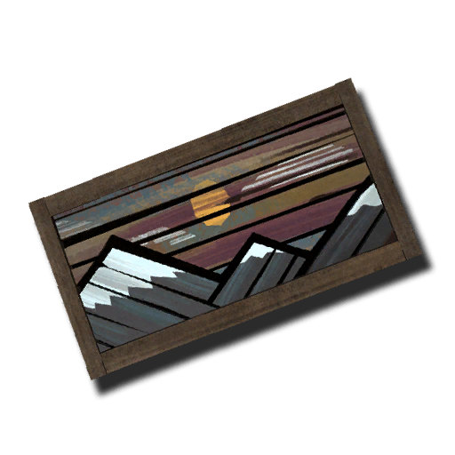

# Decorative Art

**Categories:** Interactable Objects · **Source:** [Fandom](https://thelongdark.fandom.com/wiki/Decorative_Art)

**Decorative Art**

_Decorative\_Art\_icon.png_

**Release:** [TFTFT Part 6 Broken Silence](./The%20Long%20Dark%20%E2%80%94%20Changelog.md#2.33)

**Values**

**Weight:** 1.00 kg (2.2 lbs)

**Actions**

**Backpack:** Drop, Place

The **Decorative Art** is a [Decorations](./Decorations.md) item that can be [Crafted](./Crafting.md) as part of the [Safehouse Customization](./Safehouse%20Customization.md) feature.

## Overview

A moderately sized portrait of scraped together wood painted and shaped in the image of a series of mountains with a rising sun, Decorative Art can be crafted anywhere by the player, but requires [Woodworking Tools](./Woodworking%20Tools.md).

Once crafted, the item is automatically placed into the player's inventory. It can only be placed on walls when in Customization Mode. It can later be picked up and placed back into the player's inventory or destroyed (yielding no resources).

## Crafting

**Decorative Art**

| Property | Details |
| --- | --- |
|  | 240 minutes (4 hour 0 minutes) |
| **Requirements** |  |
| Facility | \[\[File:Anywhere icon.png |
| Tool |  |
| **Materials** |  |
| Item | [Fir Firewood](./Fir%20Firewood.md) |
| Quantity | 2 |
|  | [Cedar Firewood](./Cedar%20Firewood.md) |
|  | 1 |
|  | [Reclaimed Wood](./Reclaimed%20Wood.md) |
|  | 1 |

## Update History
