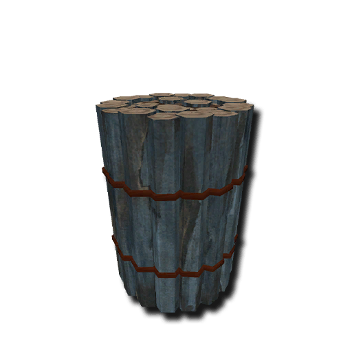

# Decorative End Table

**Categories:** Interactable Objects · **Source:** [Fandom](https://thelongdark.fandom.com/wiki/Decorative_End_Table)

**Decorative End Table**

| Property | Details |
| --- | --- |
|  |  / _Decorative\_End\_Table\_icon.png_ |
| Release | [TFTFT Part 6 Broken Silence](./The%20Long%20Dark%20%E2%80%94%20Changelog.md#2.33) |
| **Values** |  |
| Weight | 2.00 kg (4.4 lbs) |
| **Actions** |  |
| Backpack | Drop, Place |

The **Decorative End Table** is a [Decorations](./Decorations.md) item that can be [Crafted](./Crafting.md) as part of the [Safehouse Customization](./Safehouse%20Customization.md) feature.

## Overview

A series of logs bound together to make a table, Decorative End Table can be crafted anywhere by the player, but requires [Woodworking Tools](./Woodworking%20Tools.md).

Once crafted, the item is automatically placed into the player's inventory. It can only be placed on the floor or flat surfaces when in Customization Mode. It can later be picked up and placed back into the player's inventory or destroyed (yielding no resources).

## Crafting

**Decorative End Table**

| Property | Details |
| --- | --- |
|  | - |
|  | - |
|  | 240 minutes (4 hour 0 minutes) |
| **Requirements** |  |
| Facility | \[\[File:Anywhere icon.png |
| Tool | **Template:iconlink** |
| **Materials** |  |
| **Template:iconlink plain** |  |
| Item | [Cedar Firewood](./Cedar%20Firewood.md) |
| Quantity | 6 |

## Update History
