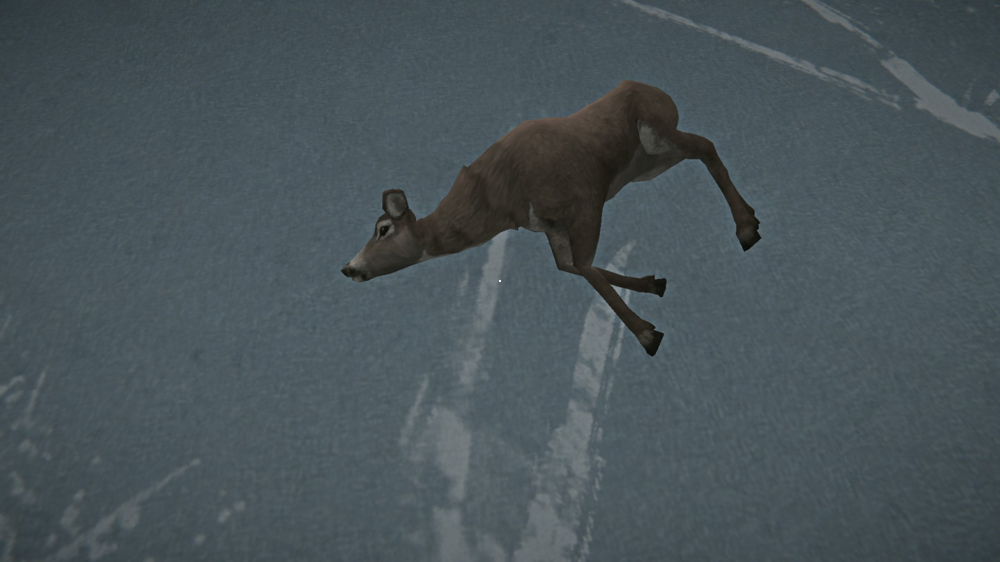
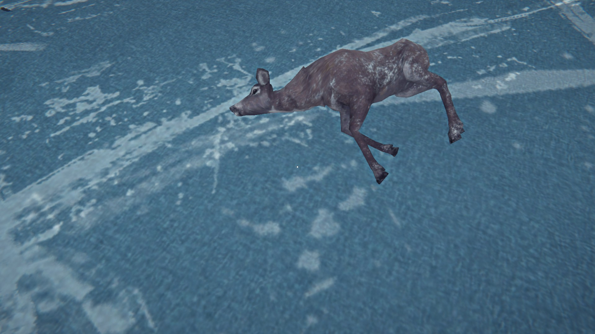
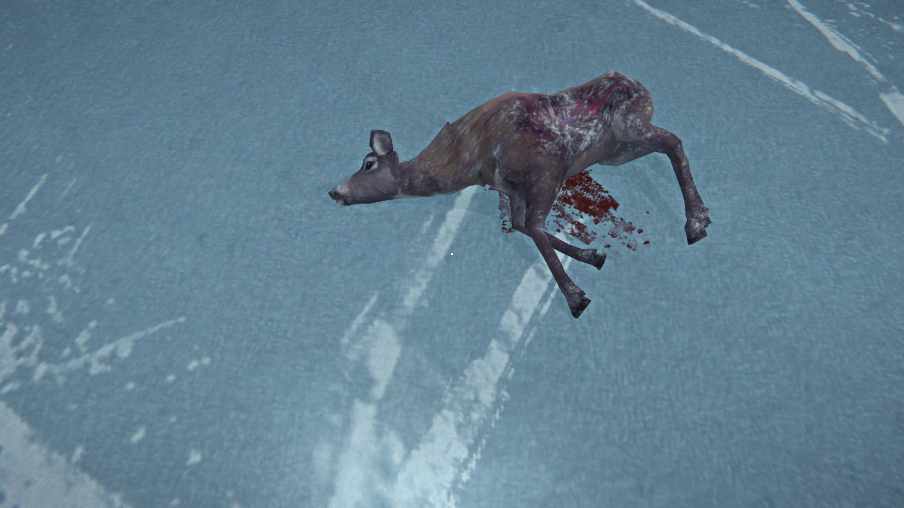

# Deer Carcass

**Categories:** Interactable Objects, Story items · **Source:** [Fandom](https://thelongdark.fandom.com/wiki/Deer_Carcass)

**Deer Carcass**

| Property | Details |
| --- | --- |
|  | [A Fresh Ravaged Deer](../assets/A_Fresh_Ravaged_Deer.jpg) |
| **General** |  |
| Item Type | Item |
| Wintermute | Yes |

A **Deer Carcass** is a harvestable object found after [Hunting](./Hunting.md) a [Deer](./Deer.md). They can occasionally be found as ravaged carcasses dispersed across [Great Bear Island](./Great%20Bear%20Island.md), or can be left after Deer are hunted by [Wolves](./Wolf.md). [Crows](./Crow.md) will fly around a Deer Carcass and always drop 3-5 [Crow Feathers](./Crow%20Feather.md) around the carcass at any time.

## Drops

Depending on whether the player hunted a [Deer](./Deer.md) or a Doe, a fresh deer carcass contains between 8.00 and 12.50 kg of raw meat, two pieces of [animal fat](./Animal%20Fat.md) as well as two fresh [guts](./Fresh%20Gut.md) and one fresh [Deer Hide](./Fresh%20Deer%20Hide.md). The type of deer only influences the meat amount but doesn't change the materials drop. Carcasses can be harvested barehanded or with a variety of tools, each changing the time it will take to harvest the drop.

A carcass can be either untouched or ravaged. An untouched carcass has not been harvested by the player nor eaten by a wolf. Once the player harvests something from the carcass, no matter how little, it will become ravaged. Carcasses found in the wild will spawn already ravaged while the deer hunted by wolves will start as untouched but will become ravaged very soon after the kill once the wolf begins the feeding animation. A fresh untouched carcass cannot be harvested barehanded; only ravaged carcasses can be.

Carcasses will slowly freeze, increasing the time needed for the player to harvest its contents. Meat left on the carcass decays quickly, regardless of the carcass freezing. Starting a fire near a frozen carcass will thaw it, making it faster to harvest by increments. Harvesting tools include the Hacksaw, the Hatchet, the Hunting Knife, the Improvised Knife, the Improvised Hatchet, the Cougar Knife and the Survival Knife. Each has a different harvesting time, influenced by the [Carcass Harvesting](./Carcass%20Harvesting.md) skill and how frozen the carcass is.

A carcass can also be quartered into bags of meat to be taken elsewhere for harvesting. The quarters are heavier due to the inclusion of parts not otherwise used, but this does make for easier transport and less time at the site. Frozen carcasses are more difficult to quarter.

Buck and Doe carcasses contain slightly differing amounts of meat upon their corpses, with Bucks having slightly higher amounts of raw Venison.

|  | Item | Quantity | Rarity |
| --- | --- | --- | --- |
| [Venison (Raw) icon](../assets/Venison_%28Raw%29_icon.png) | [Venison (Raw)](./Venison%20%28Raw%29.md) | 8 - 12.5 | Always[^1] |
| [Deer Quarter icon](../assets/Deer_Quarter_icon.png) | [Deer Quarter](./Deer%20Quarter.md) | 5 | Always[^2] |
| [Fresh Deer Hide icon](../assets/Fresh_Deer_Hide_icon.png) | [Fresh Deer Hide](./Fresh%20Deer%20Hide.md) | 1 | Always |
| [Missing image: Gut\_icon.png]; _Gut\_icon.png_ | [Fresh Gut](./Fresh%20Gut.md) | 2 | Always |

## Spawn Locations

Deer Carcasses are often found placed across [Great Bear Island](./Great%20Bear%20Island.md), being present in almost every [Region](./Region.md). They appear on the map with a specific icon; they share an icon with deer carcasses hunted by the player or by wolves, making it sometimes tricky to identify. They have the advantage of most often not being patrolled by wolves like a carcass the predators just hunted would be and they can be harvested at any point in the game regardless of Carcass Harvesting skill level. That makes them a useful source of food and materials early on, especially in [Interloper](./Interloper.md) and [Misery](./Misery.md) where tools and weapons are acquired later than in other difficulties.

## Gallery

## Notes

---

[^1]: If carcass is harvested
[^2]: If carcass is quartered.
