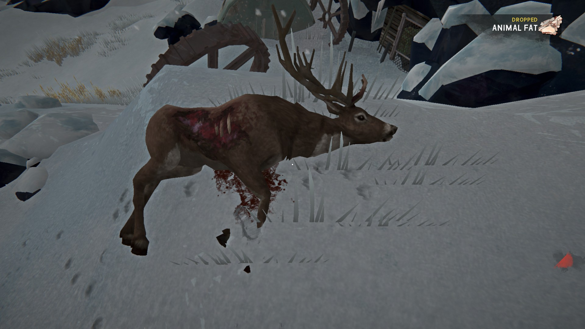
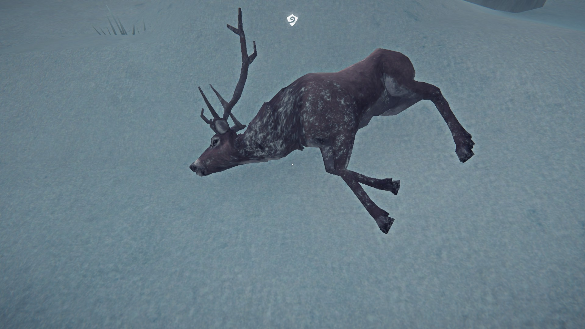
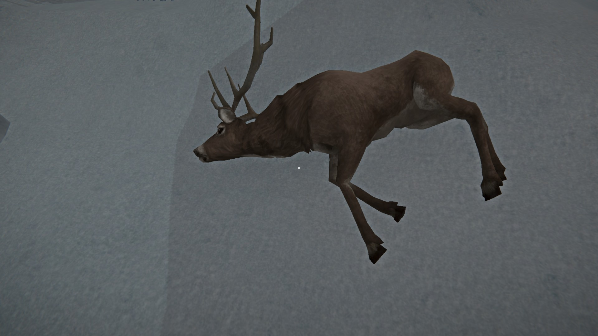
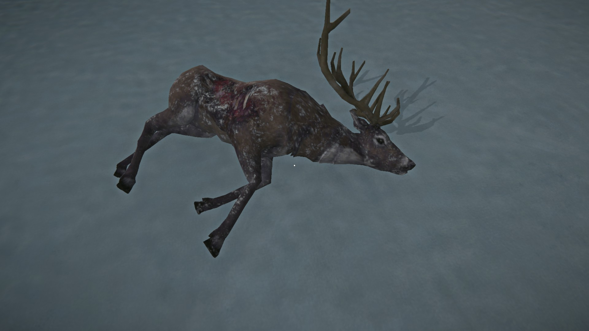
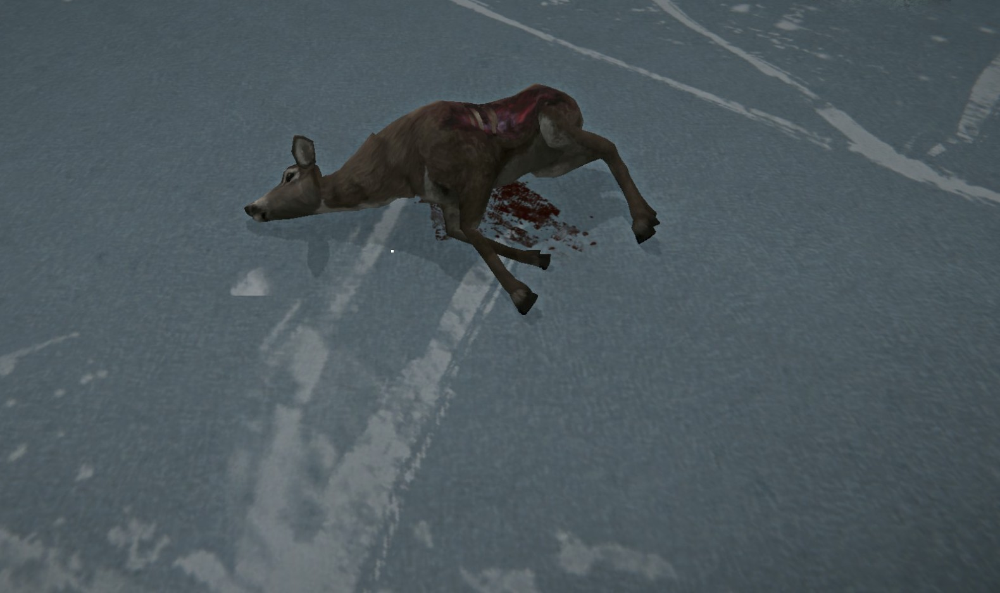

# Deer Carcass

**Categories:** Interactable Objects, Story items · **Source:** [Fandom](https://thelongdark.fandom.com/wiki/Deer_Carcass)

**Deer Carcass**

| Property | Details |
| --- | --- |
|  |  / _A\_Fresh\_Ravaged\_Deer.jpg_ |
| **General** |  |
| Item Type | Item |

|  | Item / Quantity / Rarity |
|  / _Venison\_(Raw)\_icon.png_ | [Venison (Raw)](./Venison%20%28Raw%29.md) / 8 - 12.5 / Always[¹](#fn1) |
|  / _Deer\_Quarter\_icon.png_ | [Deer Quarter](./Deer%20Quarter.md) / 5 / Always[²](#fn2) |
|  / _Fresh\_Deer\_Hide\_icon.png_ | [Fresh Deer Hide](./Fresh%20Deer%20Hide.md) / 1 / Always |
| \[Missing image: Gut\_icon.png\] / _Gut\_icon.png_ | [Fresh Gut](./Fresh%20Gut.md) / 2 / Always |
|  |  |
|  / _An untouched frozen deer._ |  / _A fresh ravaged deer._ /  / _A fresh untouched deer._ /  / _A frozen ravaged deer._ |
|  / _A fresh untouched doe._ |  / _A fresh ravaged doe._ /  / _A frozen untouched doe._ /  / _A frozen ravaged doe._ |

## Notes

---

1. If carcass is harvested[↩︎](#fnref1)
2. If carcass is quartered.[↩︎](#fnref2)
