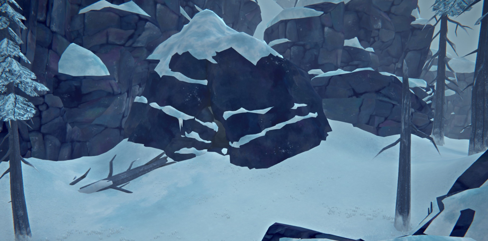
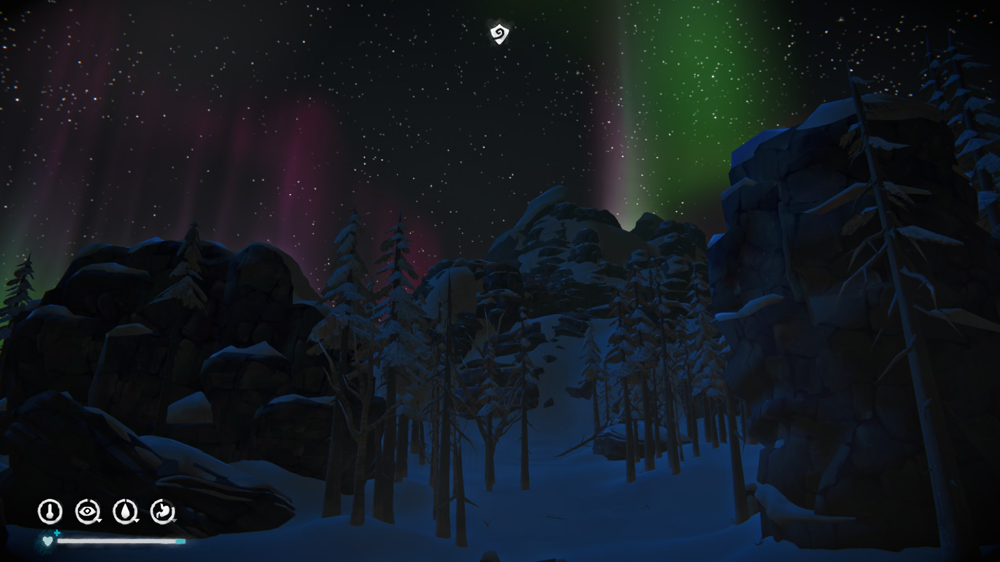
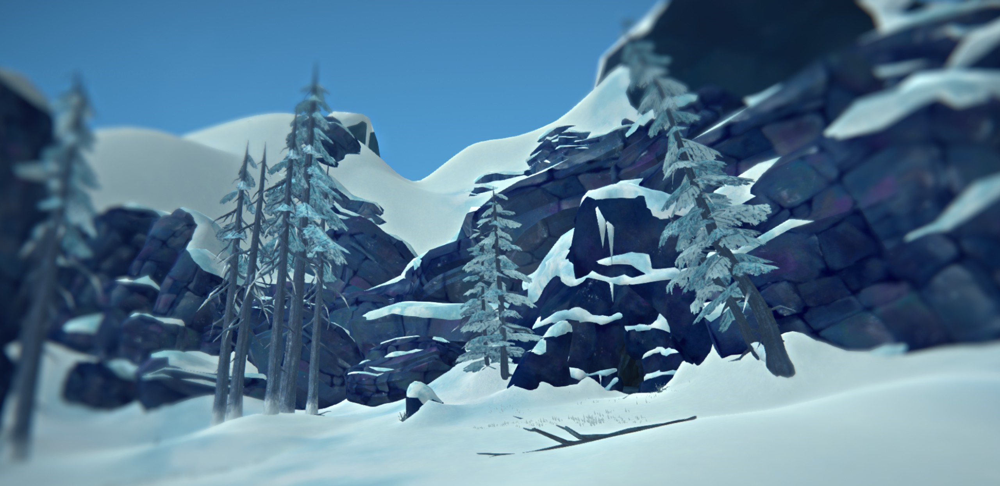
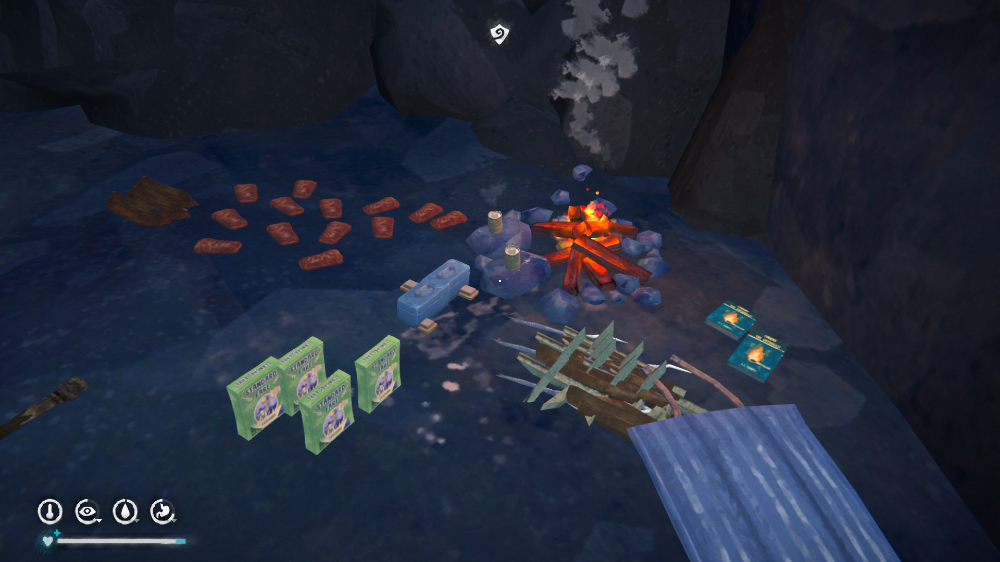

# Deer Clearing

**Categories:** Indoor locations, Locations, Locations in Timberwolf Mountain, Outdoor locations · **Source:** [Fandom](https://thelongdark.fandom.com/wiki/Deer_Clearing)

**Deer Clearing**

| Property | Details |
| --- | --- |
|  | [Deer Clearing](../assets/Deer_Clearing.jpg) |
| **Location** |  |
|  | [Deer Clearing Location](../assets/Deer_Clearing_Location.png) |
| Region | [Timberwolf Mountain](./Timberwolf%20Mountain.md)\|- |
| Type | Outdoors\|- |

## Overview

Two caves are present at Deer Clearing: the [Ash Canyon](./Ash%20Canyon.md) transition cave is in the south, which is a winding cavern with many dead ends. This cave can provide shelter from the elements. The other cave is shallow and may yield containers with loot, including a [Hatchet](./Hatchet.md), [Dog Food](./Dog%20Food.md), and [Cedar Firewood](./Cedar%20Firewood.md).

Two [Green Birch Saplings](./Green%20Birch%20Sapling.md) as well as some [Rose Hips](./Rose%20Hip.md) can be found in front of these caves. True to its name, 0-8 [Deer](./Deer.md) may be found in the area. A possible [bear](./Bear.md) can occasionally patrol a nearby area. [Wolves](./Wolf.md) that patrol nearby may come near the area to hunt Deer, providing free meat opportunities. Wood limbs and [sticks](./Stick.md) are abundant.

Opposite of the caves there are two plane [Cargo Containers](./Cargo%20Container.md).

_Container 1:_ in the open ground.

- Upper door: [whetstones](./Whetstone.md), [firearm cleaning kits](./Firearm%20Cleaning%20Kit.md) and [simple tools](./Simple%20Tools.md)
  - In Interloper contains: 1-2 [Cloth](./Cloth.md)and 1-3 [Scrap Metal](./Scrap%20Metal.md)
- Lower door: [Cured Leather](./Cured%20Leather.md) and [cured rabbit pelts](./Cured%20Rabbit%20Pelt.md)
  - In Interloper contains: 2-3 [Tomato Soup](./Tomato%20Soup.md)

_Container 2:_ atop a rocky hill. This container does not spawn on Interloper mode.

- Upper door: [sports socks](./Sports%20Socks.md), [wool socks](./Wool%20Socks.md), [jeans](./Jeans.md), [Leather Shoes](./Leather%20Shoes.md) and [Cargo Pants](./Cargo%20Pants.md)

- Lower door: [Combat Boots](./Combat%20Boots.md), [work boots](./Work%20Boots.md), [running shoes](./Running%20Shoes.md), [Trail Boots](./Trail%20Boots.md), [wool socks](./Wool%20Socks.md) and [sports socks](./Sports%20Socks.md)

If the player places a [climbing rope](./Mountaineering%20Rope.md) at the spot on the level of Eric's Falls, the player can descend to the [Engine](./Engine%20%28East%29.md) area. Placing a rope here will significantly decrease the time needed to get from the [Mountaineer's Hut](./Mountaineer%27s%20Hut.md) to the [Summit](./Summit.md), since the player will no longer have to walk all the way around through Deer Clearing.

## Gallery

