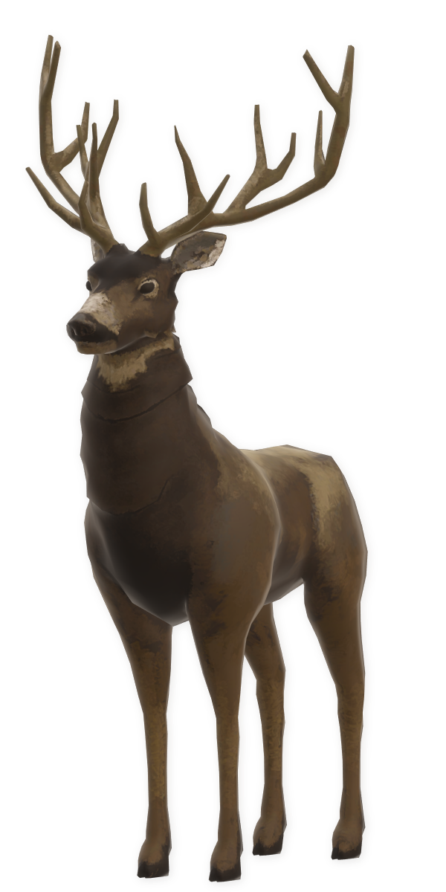
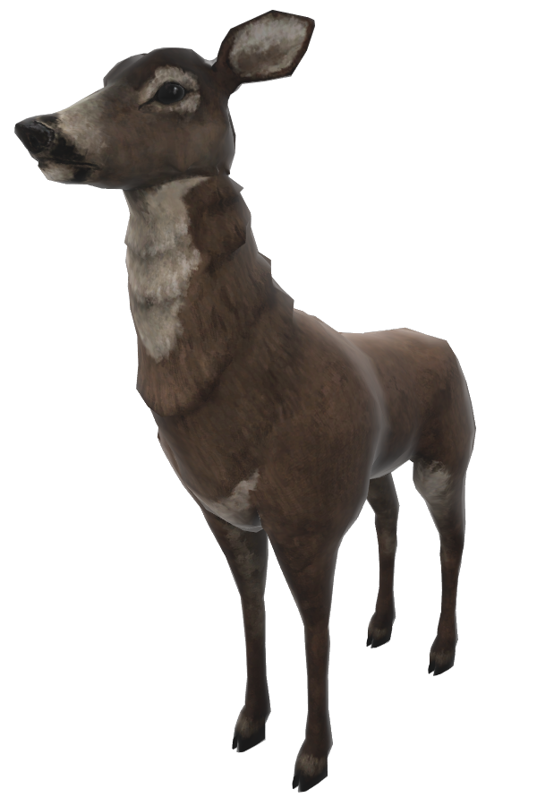
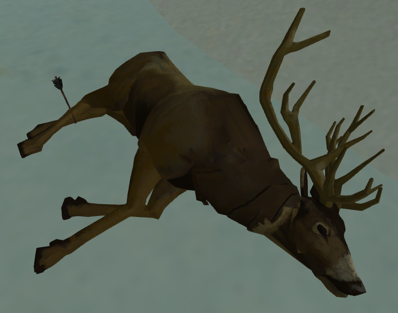
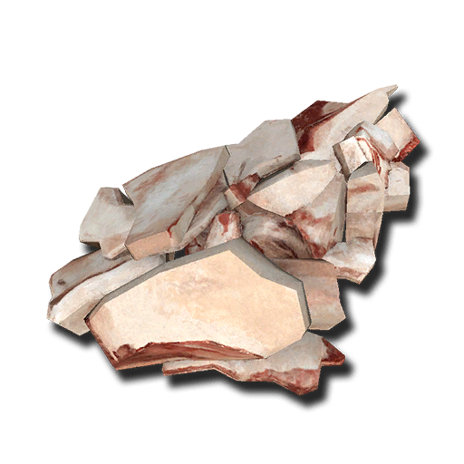

# Deer

**Contents**

- [Overview](#Overview)
- [Drops](#Drops)
- [Behaviour](#Behaviour)
- [Food for wolves](#Food_for_wolves)
- [Wildlife Interaction](#Wildlife_Interaction)
- [Herding](#Herding)
- [Hunting](#Hunting)
- [Critical hits](#Critical_hits)
- [Bleeding wounds](#Bleeding_wounds)
- [Bleed Out](#Bleed_Out)
- [Strategies](#Strategies)
- [Trivia](#Trivia)
- [Gallery](#Gallery)
- [Update history](#Update_history)

<table class="infobox">
<caption>Deer</caption>
<colgroup>
<col style="width: 33%" />
<col style="width: 33%" />
<col style="width: 33%" />
</colgroup>
<tbody>
<tr>
<td colspan="2">
[[File:

<table class="gallery">
<colgroup>
<col style="width: 50%" />
<col style="width: 50%" />
</colgroup>
<tbody>
<tr>
<th><figure>

<figcaption>Stag</figcaption>
</figure></th>
<td><figure>

<figcaption>Doe</figcaption>
</figure></td>
</tr>
</tbody>
</table></td>
<td>
250px]]
</td>
</tr>
<tr>
<td colspan="2">
<strong>Basic Information</strong>
</td>
<td></td>
</tr>
<tr>
<td>
Release
</td>
<td>
<a href="./The%20Long%20Dark%20%E2%80%94%20Changelog.md#0.01" class="wikilink" title="12 June 2014">12 June 2014</a>
</td>
<td></td>
</tr>
<tr>
<td>
Role
</td>
<td>
Prey
</td>
<td></td>
</tr>
<tr>
<td colspan="2">
<strong>Physical Information</strong>
</td>
<td></td>
</tr>
<tr>
<td>
Color
</td>
<td>
Brown
</td>
<td></td>
</tr>
<tr>
<td>
Size
</td>
<td>
Medium
</td>
<td></td>
</tr>
</tbody>
</table>

  
*For the unique stag found in the <a href="./Episode%203%20-%20Crossroads%20Elegy.md" class="wikilink" title="Episode 3">Episode 3</a> mission <a href="./Tall%20Tales.md" class="wikilink" title="Tall Tales">Tall Tales</a>, see <a href="./Ghost%20Stag.md" class="wikilink" title="Ghost Stag">Ghost Stag</a>.*

**Template:quote2** **Deer** are medium sized grazers in *<a href="./The%20Long%20Dark.md" class="wikilink" title="The Long Dark">The Long Dark</a>*. They are a valuable resource, offering the potential for substantial amounts of meat and materials for relatively little risk.

## Overview

Deer are timid wanderers that can be found in all main regions, as well as in some transition zones. They spend much of their time meandering through the snow but will bound away whenever they detect the slightest hint of danger.

<a href="./Wolf.md" class="wikilink" title="Wolves">Wolves</a> are the main predator of deer and will stalk and chase them down on sight. Acquiring a deer for yourself may require stealing a fresh kill from a hungry wolf, particularly early in a the game. Another option is to search for the ravaged deer carcasses that spawn in all major <a href="./Region.md" class="wikilink" title="regions">regions</a>, which will have <a href="./Crow.md" class="wikilink" title="Crows">Crows</a> circling overhead. These carcasses do not have much meat on them, but do have one hide and two guts, making them a good source of clothing in the early game.

Deer are a great source of food, typically yielding more than 9kg of nutritious <a href="./Venison%20%28Raw%29.md" class="wikilink" title="meat">meat</a>. Additionally <a href="./Deerskin%20Boots.md" class="wikilink" title="Deerskin Boots">Deerskin Boots</a> and <a href="./Deerskin%20Pants.md" class="wikilink" title="Deerskin Pants">Deerskin Pants</a> can be crafted from <a href="./Cured%20Deer%20Hide.md" class="wikilink" title="Cured Deer Hide">Cured Deer Hide</a> and their <a href="./Cured%20Gut.md" class="wikilink" title="Cured Gut">Cured Gut</a> may be employed in constructing several useful items.

Oddly, the player's sprint ability is actually sufficient to almost keep pace with a running deer. This is most useful for keeping them in sight during bleedout from a gunshot or arrow wound, as it is not currently possible to take down prey with close-quarters attacks.

Most Interloper players will want to harvest five deer carcasses soon after they get a <a href="./Hacksaw.md" class="wikilink" title="Hacksaw">Hacksaw</a>, in order to make the deerskin pants and boots, as these are the easiest pieces of animal clothing to make. The guts are also useful for making a <a href="./Survival%20Bow.md" class="wikilink" title="Survival Bow">Survival Bow</a>, which is the only sustainable ranged weapon in Interloper, along with <a href="./Snare.md" class="wikilink" title="Snares">Snares</a>, which make catching rabbits much easier.

## Drops

Deer carcass A fresh <a href="./Deer%20Carcass.md" class="wikilink" title="Deer Carcass">Deer Carcass</a> contains between 8.00 and 10.00 kg of raw meat, as well as two guts and one Deer Hide. Carcasses will slowly freeze, increasing the time needed for the player to harvest its contents. Meat left on the carcass decays quickly, regardless of the carcass freezing. Starting a fire near a frozen carcass will thaw it.

A carcass can also be quartered into bags of meat to be taken elsewhere for harvesting. The quarters are heavier due to the inclusion of parts not otherwise used, but this does make for easier transport and less time at the site. Frozen carcasses are more difficult to quarter.

Stag and Doe carcasses contain slightly differing amounts of meat upon their corpses, with Stags generall having higher amounts of raw Venison.

<table>
<colgroup>
<col style="width: 25%" />
<col style="width: 25%" />
<col style="width: 25%" />
<col style="width: 25%" />
</colgroup>
<thead>
<tr>
<th></th>
<th>
Item
</th>
<th>
Quantity
</th>
<th>
Rarity
</th>
</tr>
</thead>
<tbody>
<tr>
<td><figure>

<figcaption>Venison_(Raw)_icon.png</figcaption>
</figure></td>
<td>
<a href="./Venison%20%28Raw%29.md" class="wikilink" title="Venison (Raw)">Venison (Raw)</a>
</td>
<td>
8 - 12.5
</td>
<td>
Always<a href="#fn1" class="footnote-ref" id="fnref1" role="doc-noteref">1</a>
</td>
</tr>
<tr>
<td><figure>

<figcaption>Deer_Quarter_icon.png</figcaption>
</figure></td>
<td>
<a href="./Deer%20Quarter.md" class="wikilink" title="Deer Quarter">Deer Quarter</a>
</td>
<td>
5
</td>
<td>
Always<a href="#fn2" class="footnote-ref" id="fnref2" role="doc-noteref">2</a>
</td>
</tr>
<tr>
<td><figure>

<figcaption>Fresh_Deer_Hide_icon.png</figcaption>
</figure></td>
<td>
<a href="./Fresh%20Deer%20Hide.md" class="wikilink" title="Fresh Deer Hide">Fresh Deer Hide</a>
</td>
<td>
1
</td>
<td>
Always
</td>
</tr>
<tr>
<td><figure>
[Missing image: Gut_icon.png]
<figcaption>Gut_icon.png</figcaption>
</figure></td>
<td>
<a href="./Fresh%20Gut.md" class="wikilink" title="Fresh Gut">Fresh Gut</a>
</td>
<td>
2
</td>
<td>
Always
</td>
</tr>
<tr>
<td></td>
<td></td>
<td></td>
<td></td>
</tr>
</tbody>
</table>
<section id="footnotes" class="footnotes footnotes-end-of-document" role="doc-endnotes">

<ol>
<li id="fn1">If carcass is harvested<a href="#fnref1" class="footnote-back" role="doc-backlink">↩︎</a></li>
<li id="fn2">If carcass is quartered.<a href="#fnref2" class="footnote-back" role="doc-backlink">↩︎</a></li>
</ol>
</section>

Animal Fat is produced automatically when harvesting raw meat. It cannot be harvested separately and does not appear when Harvesting a Carcass.

<table>
<colgroup>
<col style="width: 25%" />
<col style="width: 25%" />
<col style="width: 25%" />
<col style="width: 25%" />
</colgroup>
<thead>
<tr>
<th></th>
<th>
Item
</th>
<th>
Quantity
</th>
<th>
Rarity
</th>
</tr>
</thead>
<tbody>
<tr>
<td><figure>

<figcaption>Animal_Fat_icon.png</figcaption>
</figure></td>
<td>
<a href="./Animal%20Fat.md" class="wikilink" title="Animal Fat">Animal Fat</a>
</td>
<td>
0.20 kg per meat
</td>
<td>
Always
</td>
</tr>
</tbody>
</table>

## Behaviour

Deer have two paces: walking and fleeing. Typically they stick to a defined area, wandering about randomly within its invisible borders. Occasionally, a wandering deer will pause and bow its head as if to graze. They will sprint away a short distance if they detect a nearby predator or person but will still try to return to their designated area. If they are spooked a second time, they tend to run much farther. Occasionally deer will double back while running and may actually run right at the player without turning away.

Instinctively herd animals, deer are usually seen in groups of up to five, and gravitate back to their fellows after being chased.

### Food for wolves

If a wolf detects a deer, it will start stalking it in a manner similar to when it detects the player. If the deer manages to outrun the wolf or break line of sight for some time, the wolf will give up and return to it's original hunting grounds. However, if the wolf gets close enough to the deer, it will start relentlessly chasing it down until the deer dies. If a wolf gives chase in this way, other wolves are encouraged to also chase the same deer. This can result in the deer actually being killed by a wolf different from the one that started chasing it. Only the killing wolf will feed, all others will resume patrols.

Carefully driving deer towards wolves can act as a distraction to briefly clear an area of the predators. Alternatively, the player may attempt to drive away or kill a wolf feeding on a recently downed deer, thereby allowing the player to harvest most of the carcass(es) while conserving ammunition.

## Wildlife Interaction

- Other Deer will generally stay close to one another in a herd as high as 2-4 Deer, but will run away if another Deer is startled/attacked. The surviving Deer eventually return to grazing.
- <a href="./Wolf.md" class="wikilink" title="Wolf">Wolf</a>, <a href="./Timberwolf.md" class="wikilink" title="Timberwolf">Timberwolf</a>, <a href="./Poisoned%20Wolf.md" class="wikilink" title="Poisoned Wolf">Poisoned Wolf</a> will stalk and eat a Deer if they get the chance. A fleeing Wolf will also scare a Deer away.
- <a href="./Bear.md" class="wikilink" title="Bear">Bear</a> and <a href="./Cougar.md" class="wikilink" title="Cougar">Cougar</a>, will not attack a Deer, but Deer always run away when one is nearby.
- <a href="./Moose.md" class="wikilink" title="Moose">Moose</a> and Deer ignore each other.
- <a href="./Deer.md" class="wikilink" title="Deer">Deer</a> will ignore Ptarmigan and <a href="./Rabbit.md" class="wikilink" title="Rabbit">Rabbit</a>, and vice versa.
- Darkwalker: Deer always fly away in fear if the Darkwalker gets too close to them. <a href="./Toxic%20Fog.md" class="wikilink" title="Toxic Fog">Toxic Fog</a> will eventually kill all animals if it builds up enough.
- The Player: Deer will always run off if they detect the player. If a Deer is shot by the player, they will begin bleeding and will run non-stop to get away from the player before eventually dropping dead. While running, they will often erratically run around in circles in their terrorized wounded state, making tracking them harder.

The only possible interaction with deer is to scare them. They run away from most everything. Once the player is close enough to be detected by the deer, it will run. Hearing gunshots and shooting an arrow into the snow near them is also sufficient to get them to bolt. Crouching and remaining still will lower the range at which the player is detected. Remaining still and crouched when within a nearby deer's field of vision also reduce the chance of being detected.

### Herding

Deer may be driven along by repeatedly scaring them. They tend to run directly away, so positioning yourself opposite them from where you would like them to go is often sufficient to steer them properly.

## <a href="./Hunting.md" class="wikilink" title="Hunting">Hunting</a>

It is possible to kill a deer with one shot, though this is a function of scoring a "critical hit". Deer not critically shot will typically run, dripping blood, until they die. It may be noted that while the <a href="./Hunting%20Rifle.md" class="wikilink" title="Hunting Rifle">Hunting Rifle</a> may cause more critical hits and is therefore more likely to drop a deer immediately, the Survival Bow does cause significantly faster bleedouts, which reduce the length of chasing and tracking.

### Critical hits

Critical hits cause the animal to instantly die after being hit by a shot. The following table contains the critical hit chance based on the location that was shot on the animal.

<table style="width:100%;">
<colgroup>
<col style="width: 14%" />
<col style="width: 14%" />
<col style="width: 14%" />
<col style="width: 14%" />
<col style="width: 14%" />
<col style="width: 14%" />
<col style="width: 14%" />
</colgroup>
<thead>
<tr>
<th colspan="2">
Weapon
</th>
<th colspan="5">
Critical Hit Chance
</th>
</tr>
</thead>
<tbody>
<tr>
<td>
Head
</td>
<td>
Neck
</td>
<td>
Torso
</td>
<td>
Hips
</td>
<td>
Limb
</td>
<td></td>
<td></td>
</tr>
<tr>
<td><figure>

<figcaption>Hunting_Rifle_icon.png</figcaption>
</figure></td>
<td>
<a href="./Hunting%20Rifle.md" class="wikilink" title="Hunting Rifle">Hunting Rifle</a>
</td>
<td rowspan="4">
Guaranteed
</td>
<td rowspan="3">
50%
</td>
<td rowspan="3">
40%
</td>
<td rowspan="3">
25%
</td>
<td rowspan="3">
10%
</td>
</tr>
<tr>
<td><figure>

<figcaption>Distress_Pistol_icon.png</figcaption>
</figure></td>
<td>
<a href="./Distress%20Pistol.md" class="wikilink" title="Distress Pistol">Distress Pistol</a>
</td>
</tr>
<tr>
<td><figure>

<figcaption>Survival_Bow_icon.png</figcaption>
</figure></td>
<td>
<a href="./Survival%20Bow.md" class="wikilink" title="Survival Bow">Survival Bow</a>
</td>
</tr>
<tr>
<td><figure>

<figcaption>Revolver_icon.png</figcaption>
</figure></td>
<td>
<a href="./Revolver.md" class="wikilink" title="Revolver">Revolver</a>
</td>
<td>
25%
</td>
<td>
20%
</td>
<td>
13%
</td>
<td>
5%
</td>
</tr>
</tbody>
</table>

### Bleeding wounds

Wounded deer running away All shots cause bleeding wounds. Deer will bleed out according to which area they were shot in. Bleeding wounds do not stack. That is, multiple shots to the same area will not make it bleed out any faster. Shooting a deer in an area that bleeds faster than a previous wound will cause it to bleed out as if the faster wound were caused first.

### Bleed Out

<table style="width:100%;">
<colgroup>
<col style="width: 14%" />
<col style="width: 14%" />
<col style="width: 14%" />
<col style="width: 14%" />
<col style="width: 14%" />
<col style="width: 14%" />
<col style="width: 14%" />
</colgroup>
<thead>
<tr>
<th colspan="2">
Weapon
</th>
<th colspan="5">
Bleed Out
</th>
</tr>
</thead>
<tbody>
<tr>
<td>
Head
</td>
<td>
Neck
</td>
<td>
Torso
</td>
<td>
Hips
</td>
<td>
Limb
</td>
<td></td>
<td></td>
</tr>
<tr>
<td><figure>

<figcaption>Hunting_Rifle_icon.png</figcaption>
</figure></td>
<td>
<a href="./Hunting%20Rifle.md" class="wikilink" title="Hunting Rifle">Hunting Rifle</a>
</td>
<td>
Instant
</td>
<td>
15 min
</td>
<td>
45 min
</td>
<td>
60 min
</td>
<td>
240 min
</td>
</tr>
<tr>
<td><figure>

<figcaption>Survival_Bow_icon.png</figcaption>
</figure></td>
<td>
<a href="./Survival%20Bow.md" class="wikilink" title="Survival Bow">Survival Bow</a>
</td>
<td>
Instant
</td>
<td>
10 min
</td>
<td>
22 min
</td>
<td>
40 min
</td>
<td>
120 min
</td>
</tr>
<tr>
<td><figure>

<figcaption>Revolver_icon.png</figcaption>
</figure></td>
<td>
<a href="./Revolver.md" class="wikilink" title="Revolver">Revolver</a>
</td>
<td>
Instant
</td>
<td>
20 min
</td>
<td>
60 min
</td>
<td>
80 min
</td>
<td>
320 min
</td>
</tr>
<tr>
<td><figure>

<figcaption>Distress_Pistol_icon.png</figcaption>
</figure></td>
<td>
<a href="./Distress%20Pistol.md" class="wikilink" title="Distress Pistol">Distress Pistol</a>
</td>
<td>
Instant
</td>
<td>
8 min
</td>
<td>
15 min
</td>
<td>
30 min
</td>
<td>
80 min
</td>
</tr>
</tbody>
</table>

### Strategies

The simplest strategy for killing deer is to herd them toward wolves. Wolves always kill deer once they catch them, so no long tracking is required. Once a wolf kills the deer, the decision must be made how to deal with the wolf. Scaring it away with fire or a thrown torch or stone is possible, though the latter two options may not work. Another option is simply waiting for it to eat its fill and coming back for the leftovers. The downside to waiting is that there will be little meat left once the wolf has finished its meal.

Yet another option is to kill the wolf with a ranged weapon while it is distracted or provoke it to attack and fatally injure it.

- Crouching allows one to travel with less chance of being detected, so crouching, combined with positioning oneself in the path of a walking deer and not moving, can provide opportunities for ambush for a single close range shot at a deer's head. Sprint to keep animal in sight if it flees with a bleeding wound. If the player loses track before the animal dies, the blood trail may help relocate it. Otherwise, the player may have to search the area the deer was running towards if too much time has passed.
- Longer range shooting is also quite possible once one learns how properly to aim. Deer movement is rather simple while walking and therefore predictable before they bolt.
- Flushing deer to run can also be used counter-intuitively to get them to run towards the player, allowing for close range shots. Fleeing deer occasionally double back, especially if their paths are blocked by terrain. A dynamic shot may then be taken on the deer as it charges toward or immediately after as it is moving away. Broadside attempts may be difficult to time correctly, but are also possible.

## Trivia

- The Deer appears to be based off the [White-Tailed Deer](https://en.wikipedia.org/wiki/White-tailed_deer) (***Odocoileus virginianus***), a common North American Cervidae. They are not to be confused with Elk or Caribou, a much larger but different species of Cervidae.

## Gallery

<table class="gallery">
<colgroup>
<col style="width: 25%" />
<col style="width: 25%" />
<col style="width: 25%" />
<col style="width: 25%" />
</colgroup>
<tbody>
<tr>
<td><figure>

<figcaption>Old deer model (v.113)</figcaption>
</figure></td>
<td><figure>
[Missing image: Deer_Running.jpg]
<figcaption>v.113 deer running</figcaption>
</figure></td>
<td><figure>
[Missing image: Wolf_feeding_on_deer.jpg]
<figcaption>Wolf feeding on a Deer</figcaption>
</figure></td>
<td><figure>
[Missing image: Steam_Deer_Badge.png]
<figcaption>Steam Badge</figcaption>
</figure></td>
</tr>
</tbody>
</table>

## Update history

- UPDATE **5 December 2022 (<a href="./The%20Long%20Dark%20%E2%80%94%20Changelog.md#2.03" class="wikilink" title="Update">Update</a>):**
  - Added Does to the game.

<!-- -->

- HOTFIX **22 January 2020 (<a href="./The%20Long%20Dark%20%E2%80%94%20Changelog.md#1.72" class="wikilink" title="Update">Update</a>):**
  - \[General\] Fixed a crash that could occur if a Stag or Rabbit was removed from the world, while being chased by a Predator.

<!-- -->

- HOTFIX **20 January 2020 (<a href="./The%20Long%20Dark%20%E2%80%94%20Changelog.md#1.71" class="wikilink" title="Update">Update</a>):**
  - \[Hunted\] Updated Deer carcass placement.
  - \[AI\] Stags now animate correctly after being felled by a Wolf.
  - \[AI\] Polished Stag and Wolf animations and transitions.
  - \[Gameplay\] Stags now check for collision when falling after death, to avoid falling into objects.

<!-- -->

- UPDATE **19 December 2018 (<a href="./The%20Long%20Dark%20%E2%80%94%20Changelog.md#1.42" class="wikilink" title="Update">Update</a>):**
  - \[WINTERMUTE\] Removed deer carcass from the Survival Bowl sequence in Episode One that could cause a crash.

<!-- -->

- UPDATE **17 December 2018 (<a href="./The%20Long%20Dark%20%E2%80%94%20Changelog.md#1.41" class="wikilink" title="Update">Update</a>):**
  - \[WINTERMUTE\] Fixed deer carcass disappearing when loading an autosave
  - \[Survival Mode\] Prevented deer from fleeing to inaccessible areas in the Ravine transition

<!-- -->

- UPDATE **14 June 2018 (<a href="./The%20Long%20Dark%20%E2%80%94%20Changelog.md#1.33" class="wikilink" title="Update">Update</a>):**
  - \[Wintermute\] Fixed deer carcass disappearing at the opening of Episode One if Player interacts with, saves, then reloads game.

<!-- -->

- UPDATE **7 December 2017 (<a href="./The%20Long%20Dark%20%E2%80%94%20Changelog.md#1.16" class="wikilink" title="Update">Update</a>):**
  - \[Both\] Reduced Deer carcass quartering time to 60 minutes, to improve balance against Bear and Moose quartering times.

<!-- -->

- UPDATE **16 December 2015 (<a href="./The%20Long%20Dark%20%E2%80%94%20Early%20Access%20Changelog.md#0.298" class="wikilink" title="Update">Update</a>):**
  - Updated Stag model and animations, including carcasses.

<!-- -->

- HOTFIX **16 October 2015 (<a href="./The%20Long%20Dark%20%E2%80%94%20Early%20Access%20Changelog.md#0.280" class="wikilink" title="Update">Update</a>):**
  - Made deer corpses in Desolation Point cave start unfrozen, and made corpses thaw when inside caves.

<!-- -->

- HOTFIX **30 October 2014 (<a href="./The%20Long%20Dark%20%E2%80%94%20Early%20Access%20Changelog.md#0.152" class="wikilink" title="Update">Update</a>):**
  - The Stag is more sensitive to the player's presence.
  - All wildlife spawns are now more dynamic, and will change over the course of a game. Wolves, Deer, and Rabbits all refresh on different intervals, reflecting their relative mobility and travel/migration patterns.

<!-- -->

- HOTFIX **2 October 2014 (<a href="./The%20Long%20Dark%20%E2%80%94%20Early%20Access%20Changelog.md#0.137" class="wikilink" title="Update">Update</a>):**
  - Fix issue with deer sometimes "following" the player

<!-- -->

- HOTFIX **2 October 2014 (<a href="./The%20Long%20Dark%20%E2%80%94%20Early%20Access%20Changelog.md#0.136" class="wikilink" title="Update">Update</a>):**
  - Wolves no longer run from deer.

<!-- -->

- HOTFIX **22 August 2014 (<a href="./The%20Long%20Dark%20%E2%80%94%20Early%20Access%20Changelog.md#0.094" class="wikilink" title="Update">Update</a>):**
  - Wolves will now stop to feed on fresh Deer kill. The amount of meat that can be retrieved from a carcass is affected by how long a Wolf feeds on it.

<!-- -->

- HOTFIX **5 August 2014 (<a href="./The%20Long%20Dark%20%E2%80%94%20Early%20Access%20Changelog.md#0.076" class="wikilink" title="Update">Update</a>):**
  - Alpha Sandbox Updated to v.076 to fix issue with stags not animating.

<!-- -->

- HOTFIX **9 July 2014 (<a href="./The%20Long%20Dark%20%E2%80%94%20Early%20Access%20Changelog.md#0.05" class="wikilink" title="Update">Update</a>):**
  - Updated all Wolf spawn regions, and added new Wolf and Deer spawn regions to the world.
  - Randomized all Corpses (Deer and Human) in Lake Region, apart from a few that remain for environmental storytelling purposes.
  - Added a new Raw Material type: Leather. Leather is required to repair boots. It can be harvested from existing boots, or from Deer.

<!-- -->

- UPDATE **12 June 2014 (<a href="./The%20Long%20Dark%20%E2%80%94%20Early%20Access%20Changelog.md#0.01" class="wikilink" title="Update">Update</a>):**
  - Added to game

**Lua execution error in Module:Navbox function navbox** <a href="es:Ciervo" class="wikilink" title="es:Ciervo">es:Ciervo</a> <a href="ru:%D0%9E%D0%BB%D0%B5%D0%BD%D1%8C" class="wikilink" title="ru:Олень">ru:Олень</a>

## Notes

