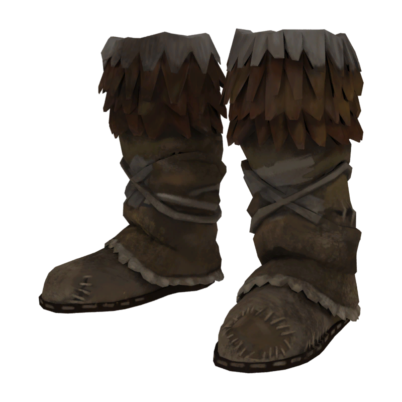

# Deerskin Boots

**Categories:** Clothing, Craftable clothing, Pages with update history, Story items · **Source:** [Fandom](https://thelongdark.fandom.com/wiki/Deerskin_Boots)

**Deerskin Boots**

_Deerskin\_Boots\_icon.png_

**General**

**Item Type:** Clothing

**Clothing Slot:** Outer feet

**Statistics**

**Weight:** 2.00 kg(4.4 lbs)

**Warmth bonus:** 2.5 °C(4.5 °F)

**Windproof bonus:** 2.0 °C(3.6 °F)

**Waterproof bonus:** 50%

**Protection:** 7%

**Mobility:** -5%

**Harvest:** 1 × [Cured Deer Hide](./Cured%20Deer%20Hide.md) / 110 minutes

**Repair:** 1 × [Cured Deer Hide](./Cured%20Deer%20Hide.md), / 1 × [Cured Gut](./Cured%20Gut.md) / 90 minutes / 30% condition

> “**Supple and tough. Allows great balance of mobility and warmth. Also, stylish.**”
>
> — In-game description

**Deerskin Boots** are a type of craftable [Clothing](./Clothing.md) in _[The Long Dark](./The%20Long%20Dark.md)_.

## General information

Deerskin boots are among the best boots available. [Insulated Boots](./Insulated%20Boots.md) and [Ski Boots](./Ski%20Boots.md) offer more warmth and windchill, but have higher mobility penalty and weight.

Deerskin boots are comparable to the rare [Mukluks](./Mukluks.md), which are 0.5kg lighter but offer slightly less protection and less waterproof (Deerskin/Insulated Boots 50% vs. Mukluks 40%). The primary advantage of Deerskin Boots possess over Mukluks is their reliability in acquisition: they can be crafted in all game modes (including [Interloper](./Interloper.md)), and do not require [Leather](./Cured%20Leather.md) for repairs.

_Clothing model icon_

_Clothing model icon damaged_

## Crafting

**Deerskin Boots**

1200 minutes (20 hour 0 minutes)

[Cured Gut](./Cured%20Gut.md)

4

**Requirements**

**Item:** [Cured Deer Hide](./Cured%20Deer%20Hide.md)

**Quantity:** 2

## Update history

- UPDATE **17 December 2014 ([Update](./The%20Long%20Dark%20%E2%80%94%20Early%20Access%20Changelog.md#0.181)):**
  - Added to game
