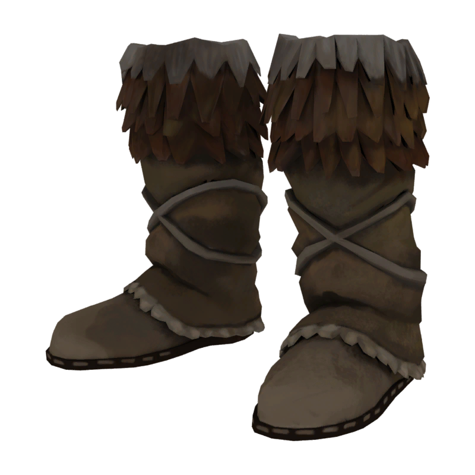

# Deerskin Boots

<table class="infobox">
<caption>Deerskin Boots</caption>
<colgroup>
<col style="width: 50%" />
<col style="width: 50%" />
</colgroup>
<tbody>
<tr>
<td colspan="2"><figure>

<figcaption>Deerskin_Boots_icon.png</figcaption>
</figure></td>
</tr>
<tr>
<td colspan="2" class="section">
<strong>General</strong>
</td>
</tr>
<tr>
<td>
Item Type
</td>
<td>
Clothing|-
</td>
</tr>
<tr>
<td>
Clothing Slot
</td>
<td>
Outer feet
</td>
</tr>
<tr>
<td colspan="2" class="section">
<strong>Statistics</strong>
</td>
</tr>
<tr>
<td>
Weight
</td>
<td>
2.00 kg(4.4 lbs)
</td>
</tr>
<tr>
<td>
Warmth bonus
</td>
<td>
2.5 °C(4.5 °F)
</td>
</tr>
<tr>
<td>
Windproof bonus
</td>
<td>
2.0 °C(3.6 °F)
</td>
</tr>
<tr>
<td>
Waterproof bonus
</td>
<td>
50%
</td>
</tr>
<tr>
<td>
Protection
</td>
<td>
7%
</td>
</tr>
<tr>
<td>
Mobility
</td>
<td>
-5%
</td>
</tr>
<tr>
<td>
Harvest
</td>
<td>
1 × <a href="./Cured%20Deer%20Hide.md" class="wikilink" title="Cured Deer Hide">Cured Deer Hide</a> 
110 minutes
</td>
</tr>
<tr>
<td>
Repair
</td>
<td>
1 × <a href="./Cured%20Deer%20Hide.md" class="wikilink" title="Cured Deer Hide">Cured Deer Hide</a>, 
1 × <a href="./Cured%20Gut.md" class="wikilink" title="Cured Gut">Cured Gut</a> 
90 minutes 
30% condition
</td>
</tr>
</tbody>
</table>

<table>
<colgroup>
<col style="width: 33%" />
<col style="width: 33%" />
<col style="width: 33%" />
</colgroup>
<tbody>
<tr>
<td style="vertical-align: top; font-size: 3em; color: #5d5980; padding-right: 10px">
“
</td>
<td>
Supple and tough. Allows great balance of mobility and warmth. Also, stylish.

&#10;

In-game description

</td>
<td style="vertical-align: bottom; font-size: 3em; color: #5d5980; padding-left: 10px">
”
</td>
</tr>
</tbody>
</table>

**Deerskin Boots** are a type of craftable <a href="./Clothing.md" class="wikilink" title="Clothing">Clothing</a> in *<a href="./The%20Long%20Dark.md" class="wikilink" title="The Long Dark">The Long Dark</a>*.

## General information

Deerskin boots are among the best boots available. <a href="./Insulated%20Boots.md" class="wikilink" title="Insulated Boots">Insulated Boots</a> and <a href="./Ski%20Boots.md" class="wikilink" title="Ski Boots">Ski Boots</a> offer more warmth and windchill, but have higher mobility penalty and weight.

Deerskin boots are comparable to the rare <a href="./Mukluks.md" class="wikilink" title="Mukluks">Mukluks</a>, which are 0.5kg lighter but offer slightly less protection and less waterproof (Deerskin/Insulated Boots 50% vs. Mukluks 40%). The primary advantage of Deerskin Boots possess over Mukluks is their reliability in acquisition: they can be crafted in all game modes (including <a href="./Interloper.md" class="wikilink" title="Interloper">Interloper</a>), and do not require <a href="./Cured%20Leather.md" class="wikilink" title="Leather">Leather</a> for repairs.

<table class="gallery">
<colgroup>
<col style="width: 50%" />
<col style="width: 50%" />
</colgroup>
<tbody>
<tr>
<td><figure>

<figcaption>Clothing model icon</figcaption>
</figure></td>
<td><figure>

<figcaption>Clothing model icon damaged</figcaption>
</figure></td>
</tr>
</tbody>
</table>

## Crafting

<table class="infobox">
<caption>Deerskin Boots</caption>
<tbody>
<tr>
<td colspan="2">
-
</td>
</tr>
<tr>
<td colspan="2">
-
</td>
</tr>
<tr>
<td colspan="2">
1200 minutes (20 hour 0 minutes)
</td>
</tr>
<tr>
<td colspan="2" class="section">
<strong>Requirements</strong>
</td>
</tr>
<tr>
<td>
Facility
</td>
<td>
<strong>Template:iconlink</strong>
</td>
</tr>
<tr>
<td>
Tool
</td>
<td>
<strong>Template:iconlink</strong>
</td>
</tr>
<tr>
<td colspan="2" class="section">
<strong>Materials</strong>
</td>
</tr>
<tr>
<td colspan="2" class="section">
<strong>Template:iconlink plain</strong>
</td>
</tr>
<tr>
<td>
Item
</td>
<td>
<a href="./Cured%20Deer%20Hide.md" class="wikilink" title="Cured Deer Hide">Cured Deer Hide</a>
</td>
</tr>
<tr>
<td>
Quantity
</td>
<td>
2
</td>
</tr>
<tr>
<td colspan="2" class="section">
<strong>Template:iconlink plain</strong>
</td>
</tr>
<tr>
<td colspan="2">
<a href="./Cured%20Gut.md" class="wikilink" title="Cured Gut">Cured Gut</a>
</td>
</tr>
<tr>
<td colspan="2">
4
</td>
</tr>
</tbody>
</table>

## Update history

- UPDATE **17 December 2014 (<a href="./The%20Long%20Dark%20%E2%80%94%20Early%20Access%20Changelog.md#0.181" class="wikilink" title="Update">Update</a>):**
  - Added to game

**Lua execution error in Module:Navbox function navbox** <a href="ru:%D0%9E%D0%B1%D1%83%D0%B2%D1%8C_%D0%B8%D0%B7_%D0%BE%D0%BB%D0%B5%D0%BD%D1%8C%D0%B5%D0%B9_%D0%BA%D0%BE%D0%B6%D0%B8" class="wikilink" title="ru:Обувь из оленьей кожи">ru:Обувь из оленьей кожи</a> <a href="es:Botas_de_piel_de_ciervo" class="wikilink" title="es:Botas de piel de ciervo">es:Botas de piel de ciervo</a>

