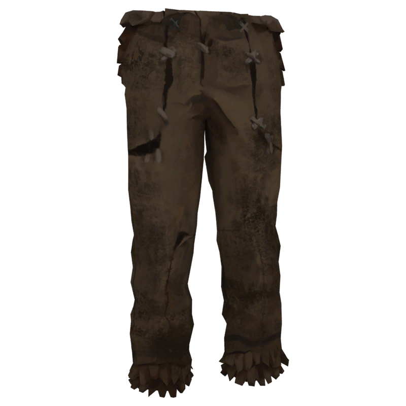

# Deerskin Pants

**Contents**

- [Overview](#Overview)
- [Strategy](#Strategy)
- [Crafting](#Crafting)
- [Gallery](#Gallery)
- [Game history](#Game_history)

<table class="infobox">
<caption>Deerskin Pants</caption>
<colgroup>
<col style="width: 50%" />
<col style="width: 50%" />
</colgroup>
<tbody>
<tr>
<td colspan="2"><figure>

<figcaption>Deerskin_Pants_icon.png</figcaption>
</figure></td>
</tr>
<tr>
<td colspan="2" class="section">
<strong>General</strong>
</td>
</tr>
<tr>
<td>
Item Type
</td>
<td>
Clothing|-
</td>
</tr>
<tr>
<td>
Clothing Slot
</td>
<td>
Outer legs
</td>
</tr>
<tr>
<td colspan="2" class="section">
<strong>Statistics</strong>
</td>
</tr>
<tr>
<td>
Weight
</td>
<td>
2.00 kg(4.4 lbs)
</td>
</tr>
<tr>
<td>
Warmth bonus
</td>
<td>
2.0 °C(3.6 °F)
</td>
</tr>
<tr>
<td>
Windproof bonus
</td>
<td>
2.0 °C(3.6 °F)
</td>
</tr>
<tr>
<td>
Waterproof bonus
</td>
<td>
60%
</td>
</tr>
<tr>
<td>
Protection
</td>
<td>
10%
</td>
</tr>
<tr>
<td>
Mobility
</td>
<td>
-5%
</td>
</tr>
<tr>
<td>
Harvest
</td>
<td>
1 × <a href="./Cured%20Deer%20Hide.md" class="wikilink" title="Cured Deer Hide">Cured Deer Hide</a> 
30 minutes
</td>
</tr>
<tr>
<td>
Repair
</td>
<td>
1 × <a href="./Cured%20Deer%20Hide.md" class="wikilink" title="Cured Deer Hide">Cured Deer Hide</a>, 
1 × <a href="./Cured%20Gut.md" class="wikilink" title="Cured Gut">Cured Gut</a> 
100 minutes 
30% condition
</td>
</tr>
</tbody>
</table>

<table>
<colgroup>
<col style="width: 33%" />
<col style="width: 33%" />
<col style="width: 33%" />
</colgroup>
<tbody>
<tr>
<td style="vertical-align: top; font-size: 3em; color: #5d5980; padding-right: 10px">
“
</td>
<td>
Warm, supple, and tough. Offers a great combination of mobility and warmth. Wear these to feel like the Mad Max of the North.

&#10;

In-game description

</td>
<td style="vertical-align: bottom; font-size: 3em; color: #5d5980; padding-left: 10px">
”
</td>
</tr>
</tbody>
</table>

**Deerskin Pants** are a type of craftable <a href="./Clothing.md" class="wikilink" title="Clothing">Clothing</a> made from <a href="./Cured%20Deer%20Hide.md" class="wikilink" title="Cured Deer Hide">Cured Deer Hide</a> and <a href="./Cured%20Gut.md" class="wikilink" title="Cured Gut">Cured Gut</a>.

## Overview

Deerskin Pants are less warm compared to <a href="./Deerskin%20Boots.md" class="wikilink" title="Deerskin Boots">Deerskin Boots</a>, yet require more materials to craft. However, in an early <a href="./Interloper.md" class="wikilink" title="Interloper">Interloper</a> game when the player has only a single pair of <a href="./Jeans.md" class="wikilink" title="Jeans">Jeans</a>, crafting the deerskin pants may be slightly preferable because they can be *added* onto the player's existing outfit (two slots for outer legs), whereas using the Deerskin Boots would require swapping out whatever boots the player is already wearing.

They offer the highest protection, water- and windproofing bonuses of all available outer legwear and are only surpassed by the rare <a href="./Snow%20Pants.md" class="wikilink" title="Snow Pants">Snow Pants</a> and the hard to obtain <a href="./Wolfskin%20Pants.md" class="wikilink" title="Wolfskin Pants">Wolfskin Pants</a> in terms of warmth. They are, however, also second only to Wolfskin Pants in terms of weight, and are tied for both the worst warmth-to-weight ratio and mobility penalty.

## Strategy

Deerskin pants are an excellent outer layer if combined with lighter pants that focus on warmth bonus or warmth-to-weight ratio. Wearing two pairs of deerskin pants is possible but will add up to significant mobility reduction and encumbrance.

Since they can be repaired with deer hides instead of cloth they are arguably one of the best choice for late game leg clothing, alongside Wolfskin Pants.

They are possible to obtain reliably and relatively early in the game by harvesting <a href="./Deer%20Carcass.md" class="wikilink" title="Deer Carcasses">Deer Carcasses</a> that can be found at several locations in all <a href="./Region.md" class="wikilink" title="region">regions</a> or obtained by actively <a href="./Hunting.md" class="wikilink" title="hunting">hunting</a>.

## Crafting

<table class="infobox">
<caption>Deerskin Pants</caption>
<tbody>
<tr>
<td colspan="2">
-
</td>
</tr>
<tr>
<td colspan="2">
-
</td>
</tr>
<tr>
<td colspan="2">
1200 minutes (20 hour 0 minutes)
</td>
</tr>
<tr>
<td colspan="2" class="section">
<strong>Requirements</strong>
</td>
</tr>
<tr>
<td>
Facility
</td>
<td>
<strong>Template:iconlink</strong>
</td>
</tr>
<tr>
<td>
Tool
</td>
<td>
<strong>Template:iconlink</strong>
</td>
</tr>
<tr>
<td colspan="2" class="section">
<strong>Materials</strong>
</td>
</tr>
<tr>
<td colspan="2" class="section">
<strong>Template:iconlink plain</strong>
</td>
</tr>
<tr>
<td>
Item
</td>
<td>
<a href="./Cured%20Deer%20Hide.md" class="wikilink" title="Cured Deer Hide">Cured Deer Hide</a>
</td>
</tr>
<tr>
<td>
Quantity
</td>
<td>
3
</td>
</tr>
<tr>
<td colspan="2" class="section">
<strong>Template:iconlink plain</strong>
</td>
</tr>
<tr>
<td colspan="2">
<a href="./Cured%20Gut.md" class="wikilink" title="Cured Gut">Cured Gut</a>
</td>
</tr>
<tr>
<td colspan="2">
4
</td>
</tr>
</tbody>
</table>

## Gallery

<table class="gallery">
<colgroup>
<col style="width: 33%" />
<col style="width: 33%" />
<col style="width: 33%" />
</colgroup>
<tbody>
<tr>
<td><figure>

<figcaption>Clothing model icon</figcaption>
</figure></td>
<td><figure>

<figcaption>Clothing model icon damaged</figcaption>
</figure></td>
<td><figure>
[Missing image: Deerskin_pants_(historical).png]
<figcaption>Old model.</figcaption>
</figure></td>
</tr>
</tbody>
</table>

## Game history

- UPDATE **22 May 2015 (<a href="./The%20Long%20Dark%20%E2%80%94%20Changelog.md#0.233" class="wikilink" title="Update">Update</a>):**
  - Added to game.

**Lua execution error in Module:Navbox function navbox** <a href="ru:%D0%A8%D1%82%D0%B0%D0%BD%D1%8B_%D0%B8%D0%B7_%D0%BE%D0%BB%D0%B5%D0%BD%D1%8C%D0%B5%D0%B9_%D0%BA%D0%BE%D0%B6%D0%B8" class="wikilink" title="ru:Штаны из оленьей кожи">ru:Штаны из оленьей кожи</a>

