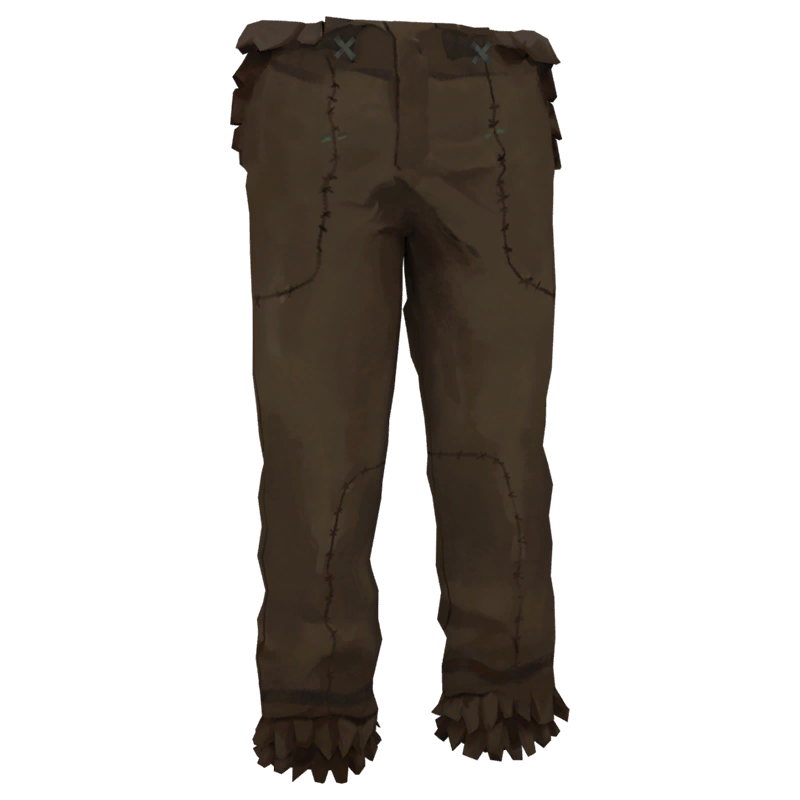

# Deerskin Pants

**Categories:** Clothing, Craftable clothing, Pages with update history, Story items · **Source:** [Fandom](https://thelongdark.fandom.com/wiki/Deerskin_Pants)

**Contents**

- [Overview](#overview)
- [Strategy](#strategy)
- [Crafting](#crafting)
- [Gallery](#gallery)
- [Game history](#game-history)

**Deerskin Pants**

[Deerskin Pants icon](../assets/Deerskin_Pants_icon.png)

**General**

**Item Type:** Clothing

**Clothing Slot:** Outer legs

**Statistics**

**Weight:** [Weight icon](../assets/Weight_icon.png)2.00 kg(4.4 lbs)

**Warmth bonus:** [Temp icon](../assets/Temp_icon.png)2.0 °C(3.6 °F)

**Windproof bonus:** [Windproofness icon](../assets/Windproofness_icon.png)2.0 °C(3.6 °F)

**Waterproof bonus:** [Waterproofness icon](../assets/Waterproofness_icon.png)60%

**Protection:** [Protection icon](../assets/Protection_icon.png)10%

**Mobility:** [Mobility icon](../assets/Mobility_icon.png)-5%

**Harvest:** 1 × [Cured Deer Hide](./Cured%20Deer%20Hide.md) 30 minutes

**Repair:** 1 × [Cured Deer Hide](./Cured%20Deer%20Hide.md), 1 × [Cured Gut](./Cured%20Gut.md) 100 minutes 30% condition

> “**Warm, supple, and tough. Offers a great combination of mobility and warmth. Wear these to feel like the Mad Max of the North.**”
>
> — In-game description

**Deerskin Pants** are a type of craftable [Clothing](./Clothing.md) made from [Cured Deer Hide](./Cured%20Deer%20Hide.md) and [Cured Gut](./Cured%20Gut.md).

## Overview

Deerskin Pants are less warm compared to [Deerskin Boots](./Deerskin%20Boots.md), yet require more materials to craft. However, in an early [Interloper](./Interloper.md) game when the player has only a single pair of [Jeans](./Jeans.md), crafting the deerskin pants may be slightly preferable because they can be _added_ onto the player's existing outfit (two slots for outer legs), whereas using the Deerskin Boots would require swapping out whatever boots the player is already wearing.

They offer the highest protection, water- and windproofing bonuses of all available outer legwear and are only surpassed by the rare [Snow Pants](./Snow%20Pants.md) and the hard to obtain [Wolfskin Pants](./Wolfskin%20Pants.md) in terms of warmth. They are, however, also second only to Wolfskin Pants in terms of weight, and are tied for both the worst warmth-to-weight ratio and mobility penalty.

## Strategy

Deerskin pants are an excellent outer layer if combined with lighter pants that focus on warmth bonus or warmth-to-weight ratio. Wearing two pairs of deerskin pants is possible but will add up to significant mobility reduction and encumbrance.

Since they can be repaired with deer hides instead of cloth they are arguably one of the best choice for late game leg clothing, alongside Wolfskin Pants.

They are possible to obtain reliably and relatively early in the game by harvesting [Deer Carcasses](./Deer%20Carcass.md) that can be found at several locations in all [regions](./Region.md) or obtained by actively [hunting](./Hunting.md).

## Crafting

**Deerskin Pants**

1200 minutes (20 hour 0 minutes)

[Cured Gut](./Cured%20Gut.md)

4

**Requirements**

**Item:** [Cured Deer Hide](./Cured%20Deer%20Hide.md)

**Quantity:** 3

## Gallery

## Game history

- UPDATE **22 May 2015 ([Update](./The%20Long%20Dark%20%E2%80%94%20Changelog.md#0.233)):**
  - Added to game.
