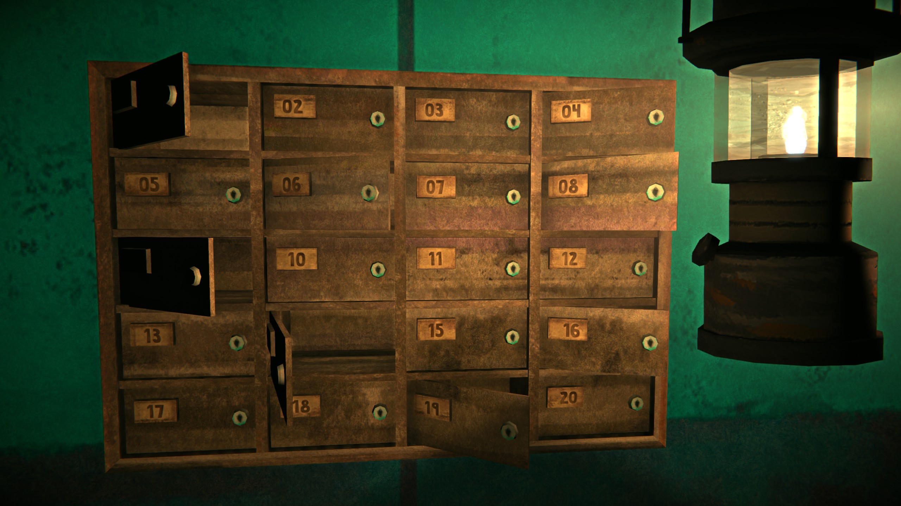

# Deposit Box

**Deposit Box**

| Property | Details |
| --- | --- |
|  |  / *Deposit\_Box.jpg* |
| Story item | Yes |
| **Container** |  |
| Capacity | 5.00 kg(11 lbs) |

A **Deposit Box** is a storage object found only inside the vault of the [Milton Credit Union](./Milton%20Credit%20Union.md) in the [Mountain Town](./Mountain%20Town.md) region. 8 of the 20 Boxes are already open and cannot be looted, but the remaining 12 Boxes often contain a low chance to yield low value items, even [Cash](./Cash.md).

In [Wintermute](./Wintermute.md), some Deposit Boxes are locked and require keys to open ([Milton Safety Deposit Box Keys](./Milton%20Safety%20Deposit%20Box%20Keys.md)). **Lua execution error in Module:Navbox function navbox**
