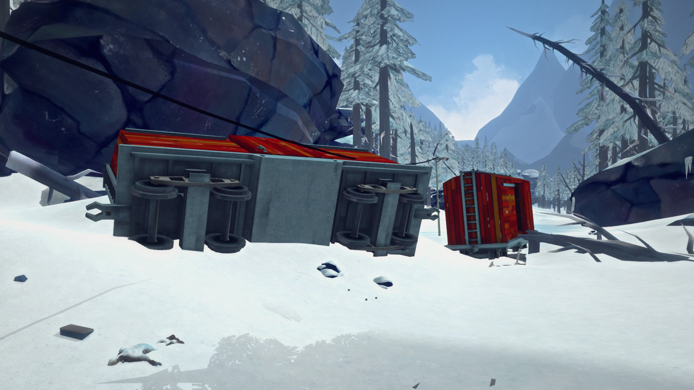

# Derailment

**Derailment**

| Property | Details |
| --- | --- |
|  |  / *Derailment\_2.jpg* |
| **Location** |  |
|  |  / *Derailment\_Location.png* |
| Region | [Mystery Lake](./Mystery%20Lake%20%28region%29.md)\|- |
| Description | A small train wreck |
| **General** |  |
| Type | Landmark\|- |
