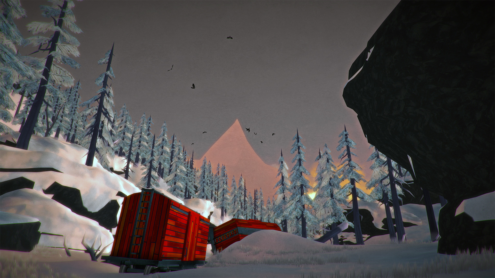

# Derailment

**Categories:** Landmarks, Locations, Locations in Mystery Lake, Outdoor locations, Sheltered locations · **Source:** [Fandom](https://thelongdark.fandom.com/wiki/Derailment)

**Derailment**

[Derailment 2](../assets/Derailment_2.jpg)

**Location**

[Derailment Location](../assets/Derailment_Location.png)

**Region:** [Mystery Lake](./Mystery%20Lake%20%28region%29.md)

**Description:** A small train wreck

**General**

**Type:** Landmark

## Overview

The Derailment consists of a small train wreck near the center of the [Mystery Lake](./Mystery%20Lake%20%28region%29.md) region. Two [wolves](./Wolf.md) may be encountered nearby. Inside of the train car, there is a chance of finding a corpse, a metal container, a backpack, and, in rare instances, a [Hunting Rifle](./Hunting%20Rifle.md) or an [Heavy Hammer](./Heavy%20Hammer.md).

Beside the wreck, a [Deer Carcass](./Deer%20Carcass.md) can be found, along with a [First Aid Kit](./First%20Aid%20Kit.md), and some [flares](./Flare.md).

To enter the car with the open door, you must walk up the fallen tree. You cannot enter the train car that is on its side.

## Gallery

