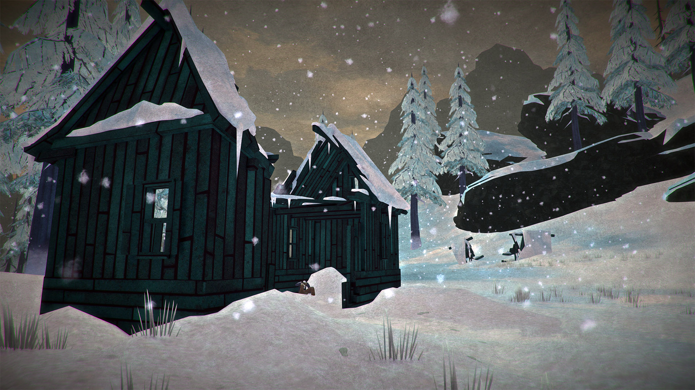
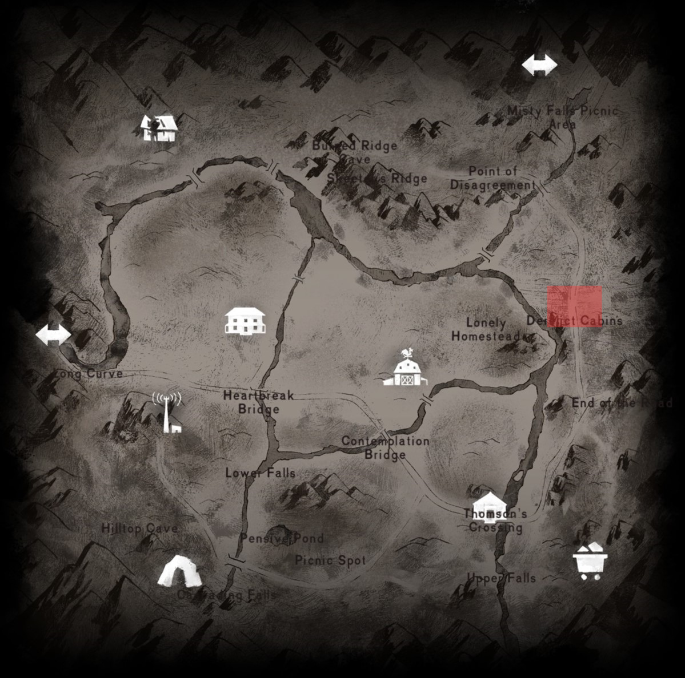

# Derelict Cabins

**Derelict Cabins**

| Property | Details |
| --- | --- |
|  |  / *Derelict\_Cabins.jpg* |
| **Location** |  |
|  |  / *Derelict\_Cabins\_Location.png* |
| Region | [Pleasant Valley](./Pleasant%20Valley.md)\|- |
| Description | Several burnt-out cabins |
| **General** |  |
| Type | Outdoors\|- |
