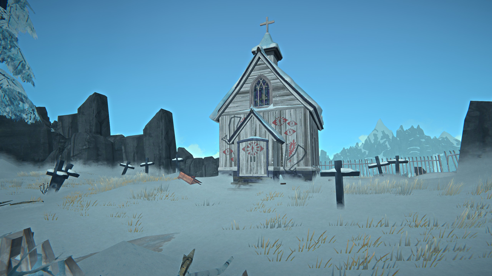

# Desecrated Church

**Categories:** DLC Content, Indoor locations, Locations, Locations in Port Remnant · **Source:** [Fandom](https://thelongdark.fandom.com/wiki/Desecrated_Church)

_Seal\_icon.png_

**DLC-Exclusive content.** / This content requires the [Iron Road](./Iron%20Road.md) addon to be installed before it can be seen or used in regular gameplay.

\[\[File: /  / _Outside_ /  / _Inside_ /  / _Inside_

250px\]\]

_Outside_

_Inside_

_Inside_

**Location**

_Desecrated\_Church\_Location.png_

Region

[Port Remnant](./Port%20Remnant.md)\|-

Location

**Description:** A church ruined by strange whale based graffiti.

**General**
