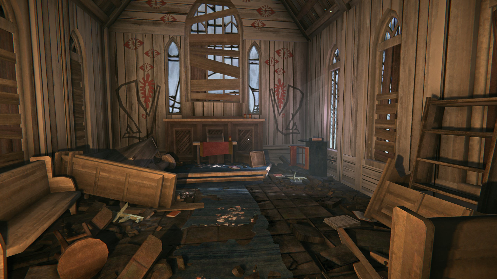
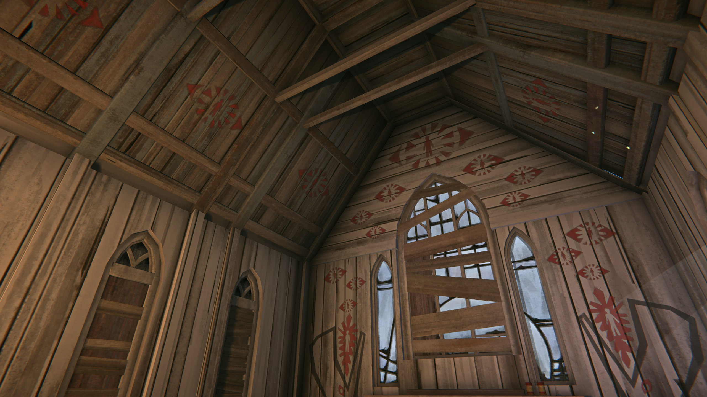
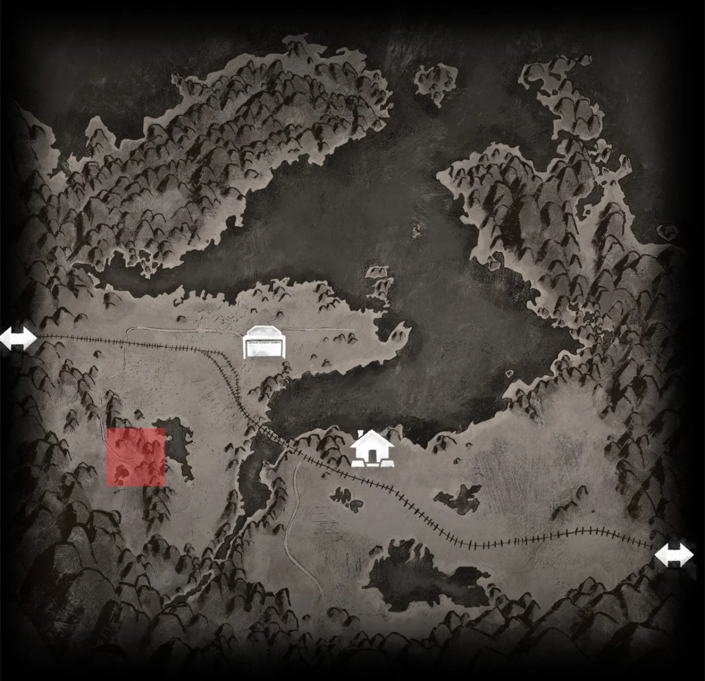

# Desecrated Church

**Categories:** DLC Content, Indoor locations, Locations, Locations in Port Remnant · **Source:** [Fandom](https://thelongdark.fandom.com/wiki/Desecrated_Church)

_Seal\_icon.png_

**DLC-Exclusive content.** / This content requires the [Iron Road](./Iron%20Road.md) addon to be installed before it can be seen or used in regular gameplay.

 / **Desecrated Church** / \[\[File: /  / _Outside_ /  / _Inside_ /  / _Inside_ / 250px\]\] / **Location** /  / _Desecrated\_Church\_Location.png_ / Region / [Port Remnant](./Port%20Remnant.md)\\|- / Location / **Description:** A church ruined by strange whale based graffiti. / **General** / Has an interior\ **Desecrated Church** is a location in [Port Remnant](./Port%20Remnant.md).

## Overview

Located on the cliff to the southwest of the map. It can be seen from the field below it, but the road leading to the church is blocked via a landslide. The only path up to the church is revealed by the [Map (Church)](./Map%20%28Church%29.md); a small cave system located to the eastern section of the map leading up to the cliffside.

The outside of the church is tagged with strange whale based graffiti, with human figures emanating a strange aura around them or being eaten by whales. A [Mountaineering Rope](./Mountaineering%20Rope.md) can be found in a wheelbarrow in front of the church.

The inside of the church is a mess. Various pews have been torn apart and scattered to the sides, the flooring ripped up in many places, and the walls and even inside roof filled with even more whale based graffiti.
