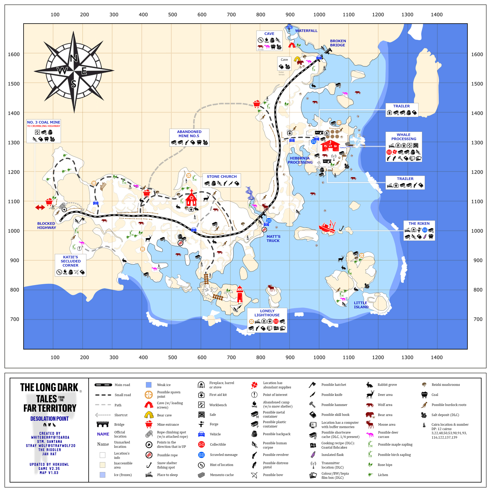
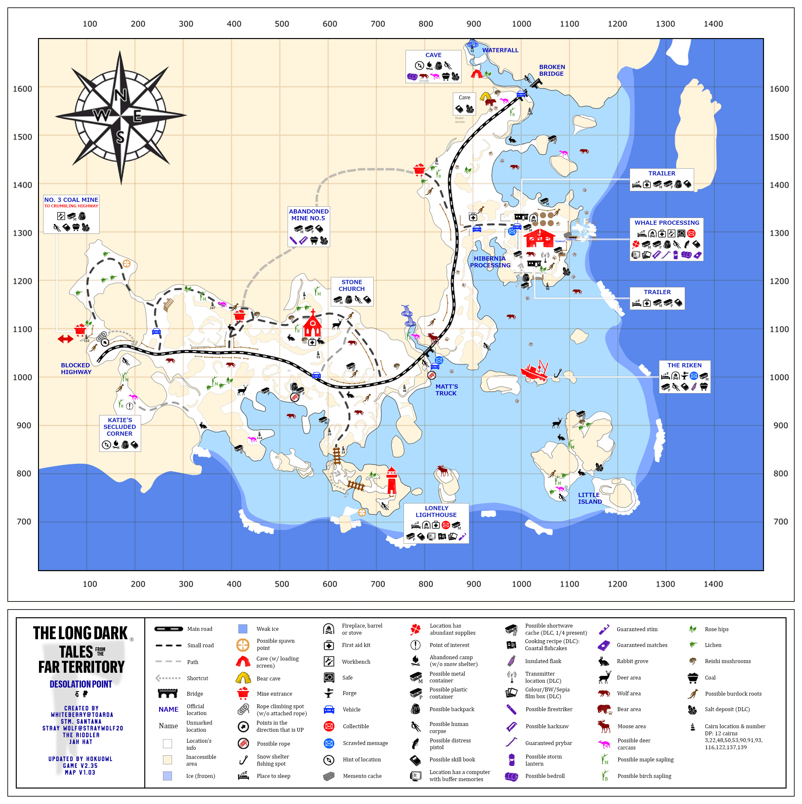
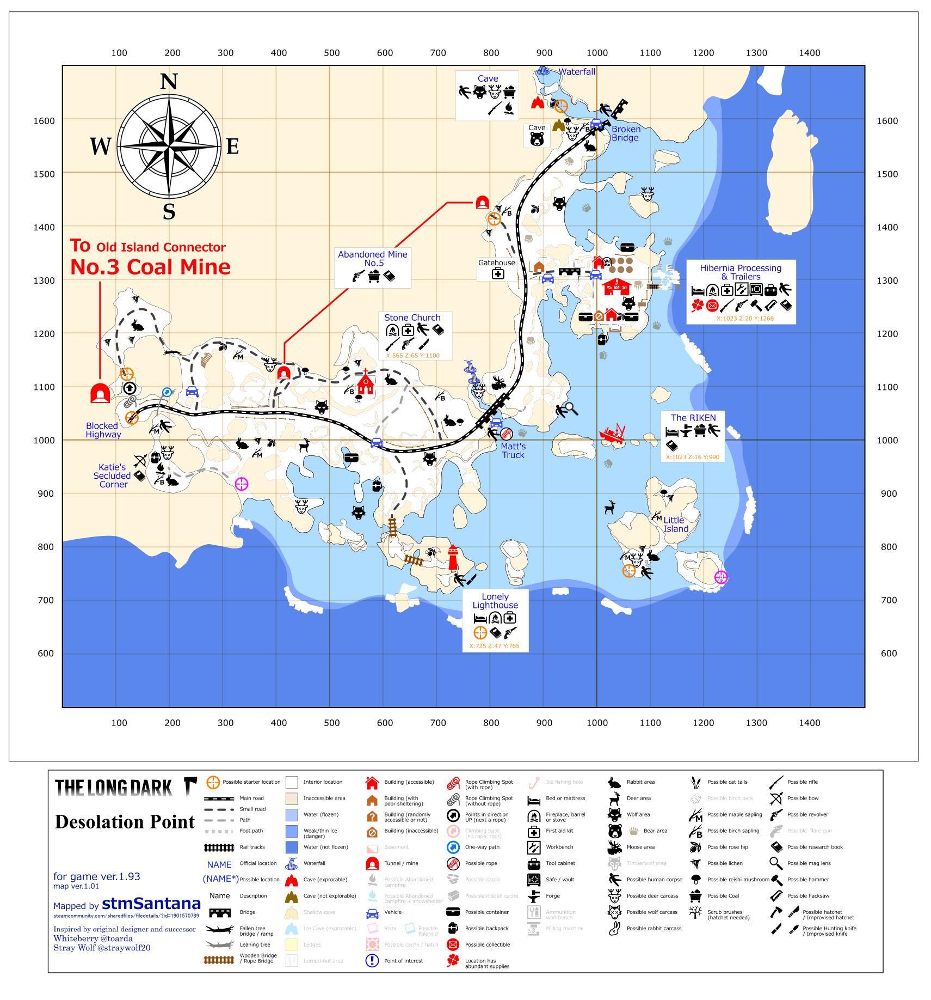
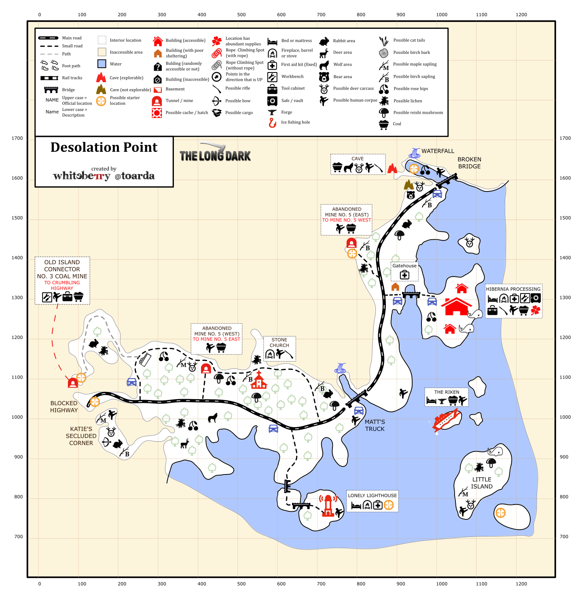
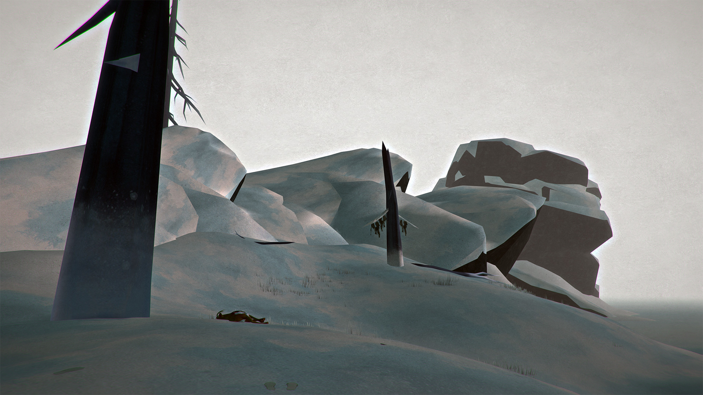
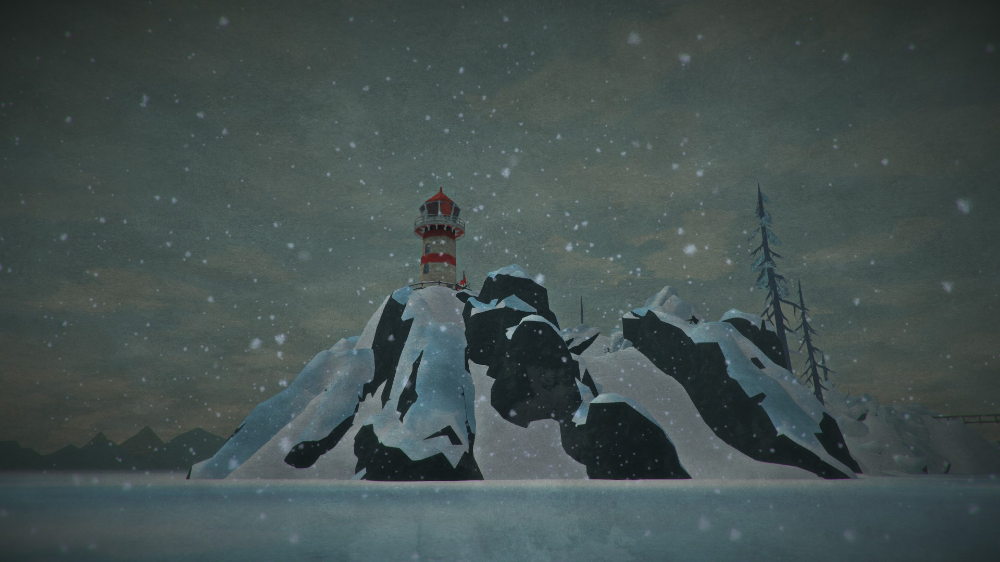
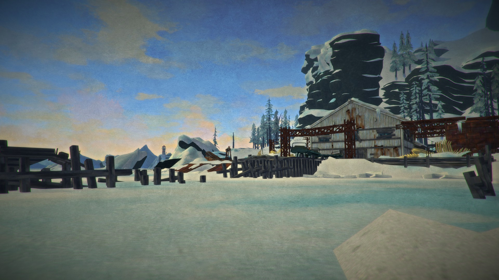
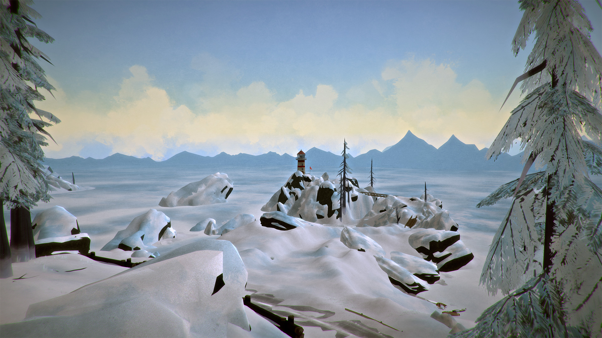
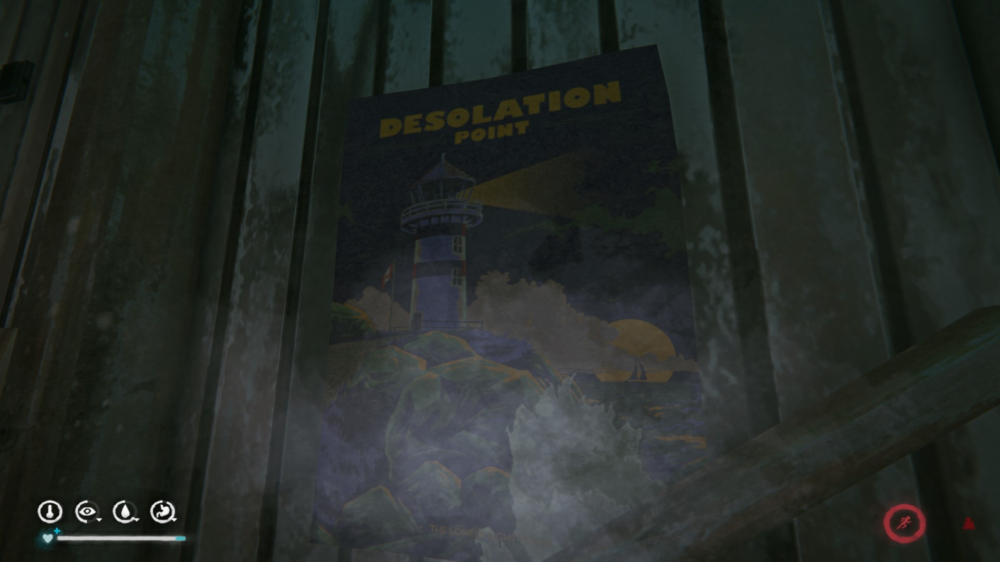
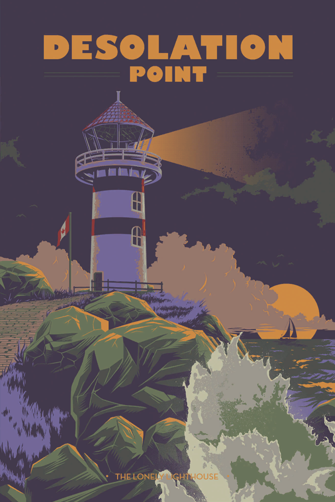

# Desolation Point

**Categories:** Regions · **Source:** [Fandom](https://thelongdark.fandom.com/wiki/Desolation_Point)

**Contents**

- [Overview](#overview)
- [Locations](#locations-1)
- [Wildlife management](#wildlife-management)
- [Survivability](#survivability)
- [Food sources](#food-sources)
- [Crafting](#crafting)
- [Location](#location)
- [Safe houses](#safe-houses)
- [Lonely Lighthouse](#lonely-lighthouse)
- [Hibernia Processing](#hibernia-processing)
- [The Riken](#the-riken)
- [Gallery](#gallery)
- [Maps](#maps)
- [Locations](#locations-1)
- [Miscellaneous](#miscellaneous)

**Desolation Point**

| Property | Details |
| --- | --- |
|  | [Desolation Point's Lonely Lighthouse.](../assets/Desolation_Point_title_card.png) |
| **Location on [Great Bear Island](./Great%20Bear%20Island.md)** |  |
|  | [Desolation Point Location](../assets/Desolation_Point_Location.png) |
|  | [Desolation point map](../assets/Desolation_point_map.png) |
| **Details** |  |
| Description | A desolate coastal region with the remnants of an old whaling industry. |
| Connecting Regions | [Coastal Highway](./Coastal%20Highway.md) (via [Old Island Connector](./Crumbling%20Highway.md)) |
| Difficulty | Intermediate |
| Interloper Region Spawn | Yes |
| Locations | 12 |
| Hazards and Survivability | Lots of shelter and moderate weather, but prey game is limited and there is abundant hostile wildlife. |
| Cougar Spawn? | No |
| Date Added | Sept 2015 |

> “**For intermediate players. Several key shelters, plenty of hostile wildlife, and harsh weather conditions to be found around these remnants of a once-thriving whaling industry.**”
>
> — - In game description

**Desolation Point** is 4th [Region](./Region.md) released for _[The Long Dark](./The%20Long%20Dark.md)_.

## Overview

Desolation Point is described as a stretch of coastal highway pockmarked with the abandoned remnants of a formerly thriving whaling industry. It can be found by going to the end of the [Coastal Highway](./Coastal%20Highway.md), passing through the Commuter's Lament, and continuing onward through [Crumbling Highway](./Crumbling%20Highway.md) and No. 3 Coal Mine.

Desolation Point is one of the smallest regions in the game: walking from the end of the [Abandoned Mine](./No.%203%20Coal%20Mine.md) to [Broken Bridge](./Broken%20Bridge%20%28Desolation%20Point%20location%29.md) takes roughly 7-8 minutes in real time. Despite this, it has 16 locations to discover including the connector mine (named "No. 3 Coal Mine") with Crumbling Highway. The region's small size can be useful in poor weather, as it is much harder to get lost here than in a more open region such as [Pleasant Valley](./Pleasant%20Valley.md) or [Forsaken Airfield](./Forsaken%20Airfield.md), and shelter is rarely far away.

Desolation Point has a [explorable cave](./Cave%20%28Desolation%20Point%20location%29.md) that might be inhabited by a wolf.

## Locations

There are 12 named locations within Desolation Point, including:

- [Abandoned Mine No. 5](./Abandoned%20Mine%20No.%205.md) (2 entrances)
- [Blocked Highway](./Blocked%20Highway.md)
- [Broken Bridge (Desolation Point location)](./Broken%20Bridge%20%28Desolation%20Point%20location%29.md)
- [Hibernia Processing](./Hibernia%20Processing.md)
- [Katie's Secluded Corner](./Katie%27s%20Secluded%20Corner.md)
- [Little Island](./Little%20Island.md)

- [Lonely Lighthouse](./Lonely%20Lighthouse.md)
- [Matt's Truck](./Matt%27s%20Truck.md)
- [Stone Church](./Stone%20Church.md)
- [The Riken](./The%20Riken.md)
- [Waterfall](./Waterfall.md)
- To No. 3 Coal Mine (Region Transition to [No. 3 Coal Mine](./No.%203%20Coal%20Mine.md))

There are also a 3 indoor locations that are tracked in the [Journal](./Journal.md).

- A single [Cave](./Cave%20%28Desolation%20Point%20location%29.md) located close to the Waterfall.
- The inside of the Hibernia Processing is known as Whale Processing.
- A single Trailer at Hibernia Processing.

## Wildlife management

There is an abundance of hostile wildlife in this region; 1 bear and 5-8 wolves patrol within this small and snaking stretch of coastal land. While firearm resources, bow resources, and non-predator fauna spawns may be limited, there are often many crafting resources and sometimes a fair number of medical supplies, depending on the difficulty level. This, in turn, can allow the player to win more wolf struggles and reserve rifle ammunition for bears.

For players who own the [Tales from the Far Territory](./Tales%20from%20the%20Far%20Territory.md) DLC, this is one of the few regions that doesn't have a [cougar](./Cougar.md) spawn.

## Survivability

Although Desolation Point is listed as a moderate difficulty region to survive in, largely due to its predator density, with good planning, surviving here long-term is very much possible.

### Food sources

One challenge that may arise with living in Desolation Point long-term is the relative lack of game, especially on Stalker and Interloper where [Intestinal Parasites](./Intestinal%20Parasites.md) are a concern. While there are a number of [Rabbit](./Rabbit.md) groves scattered throughout the map, along with a possible [Moose](./Moose.md) spawn near [Matt's Truck](./Matt%27s%20Truck.md) and a few ravaged [Deer Carcasses](./Deer%20Carcass.md), living deer aren't so easy to find. Only 2-4 [Deer](./Deer.md) spawn in the region, and they are found near [Little Island](./Little%20Island.md) and the frozen bay west of the [Lonely Lighthouse](./Lonely%20Lighthouse.md). The region's food sources are further limited by its lack of [Cat Tail](./Cat%20Tail.md). Ice fishing using [Ice Fishing holes](./Ice%20Fishing.md#free-form-ice-fishing-holes) is possible along almost the entire coastal area, with locations like [The Riken](./The%20Riken.md) and [Hibernia Processing](./Hibernia%20Processing.md) providing plenty of shelter within the immediate area of suitable ice.

A good long-term strategy for food is to set out as many [Snares](./Snare.md) as possible to catch rabbits, and to make ice fishing holes near bases. [Fishing Lures](./Fishing%20Lure%20%28Wire%20Bundle%29.md) and [Fishing Tip-Ups](./Fishing%20Tip-Up.md) can help automate the fishing process, and there are sometimes fish and animal carcasses that wash ashore and can be recovered by [beachcombing](./Beachcombing.md). With a bit of careful planning, players should be able to acquire plenty of food to avoid starvation, even on Interloper difficulty.

With the release of [Tales from the Far Territory](./Tales%20from%20the%20Far%20Territory.md), Desolation Point has become home to several [salt deposits](./Salt%20Deposit.md), which can be useful to help [preserve the fish](./Cured%20Fish.md) and [predator meat](./Cured%20Meat.md), providing for ideal travel food and eliminating any risk of [Intestinal Parasites](./Intestinal%20Parasites.md). The one challenge is that the [Woodworking Tools](./Woodworking%20Tools.md) required to build the [Furniture Workbench](./Furniture%20Workbench.md) and [Meat Curing Box](./Meat%20Curing%20Box.md) can't be found anywhere close to the region.

### Crafting

With [Hibernia Processing](./Hibernia%20Processing.md) offering enormous amounts of harvestable materials, the mines offering lots of [Coal](./Coal.md), and the [Forge](./Forge.md) in [The Riken](./The%20Riken.md). maintaining and replacing tools should not be too difficult in Desolation Point. Hibernia also offers a [Work Bench](./Work%20Bench.md), and extra supplies for crafting and repair (such as saplings and harvestable clothes) can wash ashore and be found via [Beachcombing](./Beachcombing.md). Overall, the region is good for players who intend to do a lot of crafting.

### Location

One of Desolation Point's most notable features is its isolated location on the far east of [Great Bear Island](./Great%20Bear%20Island.md). While this may not be a concern for players who like to stay put in one area, it can be more problematic for players who prefer to travel around the island and lead a more nomadic lifestyle. As a point of reference, travelling from the [Misanthrope's Homestead](./Misanthrope%27s%20Homestead.md) or [Quonset Garage](./Quonset%20Garage.md) in neighbouring [Coastal Highway](./Coastal%20Highway.md) takes about 15 minutes in real-time, or about three in-game hours.

## Safe houses

Key shelters in Desolation Point include:

### [Lonely Lighthouse](./Lonely%20Lighthouse.md)

The lighthouse has a bed, a potbelly stove, plenty of storage and an amazing view of most of the region, weather permitting. This can be helpful spotting wolves in the immediate area.

Two walking bridges connect the lighthouse to the main access road. There is also a rear path through a broken fence behind the lighthouse (use caution), that provides a shortcut to the Riken and the Hibernia processing plant. A number of wolves may patrol the entry road or along the ice below.

### [Hibernia Processing](./Hibernia%20Processing.md)

Hibernia Processing features large amounts of reclaimed wood, metal, and numerous trailers with beds. Plenty of storage is available, and a workbench and fire barrel are located downstairs. Many key tools can be found there: including the [Hunting Rifle](./Hunting%20Rifle.md), [Heavy Hammer](./Heavy%20Hammer.md), and [Hacksaw](./Hacksaw.md). Multiple wolves and a bear can be close by, often just outside the the compound's perimeter fence.

### [The Riken](./The%20Riken.md)

The Riken is a beached ship that features a [Forge](./Forge.md), which can be used for cooking and metalworking if fueled with [Coal](./Coal.md). It can be very cold without high quality [Clothing](./Clothing.md), but its rooms and upper decks contain beds, storage, fuel, coal and items which can be broken down into [Scrap Metal](./Scrap%20Metal.md). Several green Wooden Crates can be found in the ship's belly, and when broken may contain useful items.

A key function of The Riken is that once industrially produced tools are depleted ([Hunting Knives](./Hunting%20Knife.md), [Hatchets](./Hatchet.md), and Bullets), its Forge can be used to craft makeshift versions with [Scrap Metal](./Scrap%20Metal.md), [Cloth](./Cloth.md), and [Coal](./Coal.md) (the [Improvised Hatchet](./Improvised%20Hatchet.md), [Improvised Knife](./Improvised%20Knife.md), and [Arrowhead](./Arrowhead.md)). The Riken's Forge is one of only four in the game; the others are in the barn of the [Old Spence Family Homestead](./Old%20Spence%20Family%20Homestead.md) in [Forlorn Muskeg](./Forlorn%20Muskeg.md), at [Maintenance Yard](./Maintenance%20Yard.md) in [Broken Railroad](./Broken%20Railroad.md), and, with the [Tales from the Far Territory](./Tales%20from%20the%20Far%20Territory.md) expansion, in the basement of the [Main Hangar](./Main%20Hangar.md) in [Forsaken Airfield](./Forsaken%20Airfield.md).

The ship's uppermost deck can serve as a vantage point to look for and/or hunt [Wolves](./Wolf.md), [Deer](./Deer.md), or a [Bear](./Bear.md) that wander nearby. Also, [Hibernia Processing](./Hibernia%20Processing.md) for scavenging and [Little Island](./Little%20Island.md) to hunt rabbits and collect firewood are close by.

## Gallery

### Maps

### Locations

### Miscellaneous

[ru:Зона запустения](https://ru.wikipedia.org/wiki/%D0%97%D0%BE%D0%BD%D0%B0_%D0%B7%D0%B0%D0%BF%D1%83%D1%81%D1%82%D0%B5%D0%BD%D0%B8%D1%8F)

[es:Paraje desolado](https://es.wikipedia.org/wiki/Paraje_desolado) [fr:Site de Désolation](https://fr.wikipedia.org/wiki/Site_de_D%C3%A9solation)
