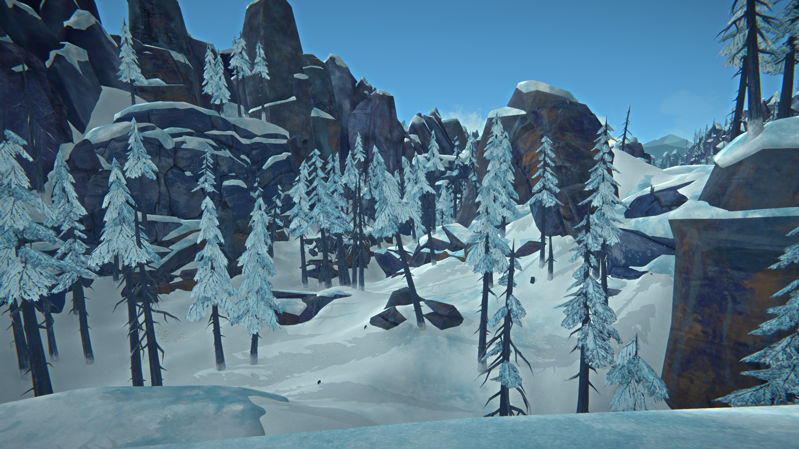
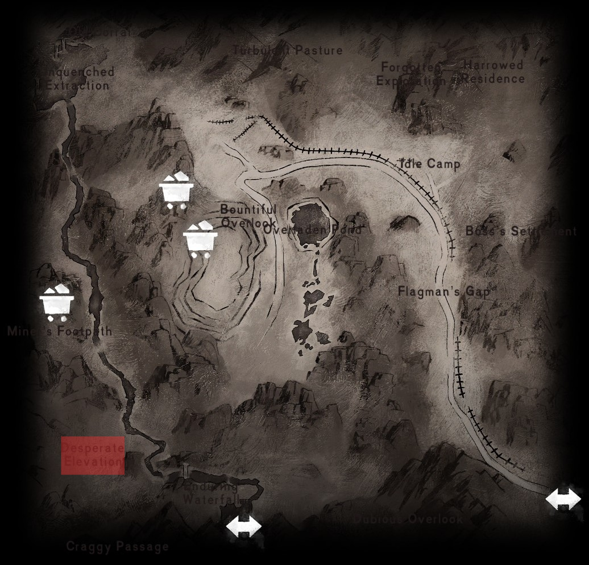
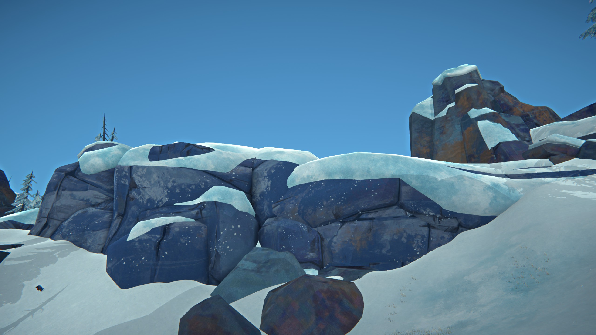

# Desperate Elevation

**Desperate Elevation**

| Property | Details |
| --- | --- |
|  |  / *Desperate\_Elevation.jpg* |
| **Location** |  |
|  |  / *Desperate\_Elevation\_Location.png* |
| Region | [Zone of Contamination](./Zone%20of%20Contamination.md)\|- |
| **General** |  |
|  | Has no shelter\|} **Desperate Elevation** is a location found near [Smoker's Cave](./Smoker%27s%20Cave.md) and is a large hill overlooking much of the southwestern most section of the map. A small hill is nearby that can be climbed up onto the overlook. There are no items to loot nor any plants to forage. [Poisoned Wolves](./Poisoned%20Wolf.md) and a [Bear](./Bear.md) can often be found nearby, so the hill can be used as a great overlook for [Hunting](./Hunting.md). *Desperate Elevation is at the top left of this hill.* **Lua execution error in Module:Navbox function navbox** |
