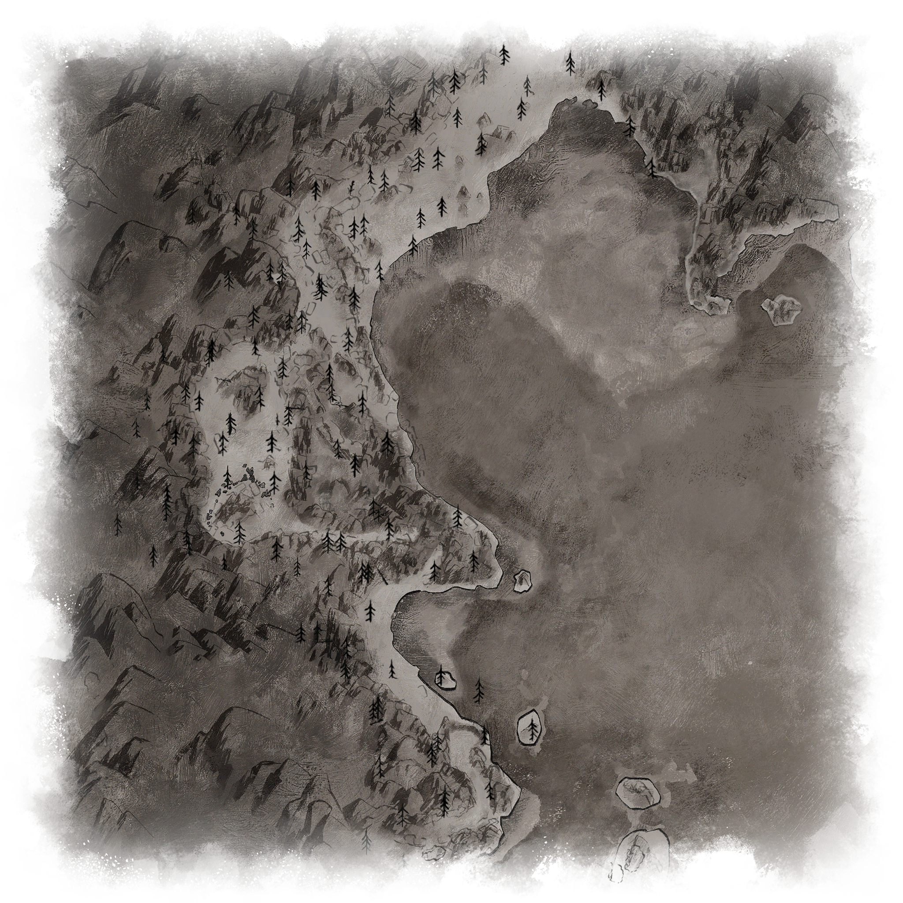

# Desperation Bay

<table>
<colgroup>
<col style="width: 33%" />
<col style="width: 33%" />
<col style="width: 33%" />
</colgroup>
<tbody>
<tr>
<td width="40px"><figure>

<figcaption>2120907963_TLD-Wintermute-v2.png.de8a285930f6a8f5ad9cf5878754cf5b.png</figcaption>
</figure></td>
<td>
<strong>Wintermute-Exclusive content.</strong> 

This content only appears in <a href="./Wintermute.md" class="wikilink" title="Wintermute">Wintermute</a>.

</td>
<td>
|}

<table class="infobox">
<caption>Desperation Bay</caption>
<colgroup>
<col style="width: 50%" />
<col style="width: 50%" />
</colgroup>
<tbody>
<tr>
<td colspan="2"><figure>

<figcaption>No_picture.png</figcaption>
</figure></td>
</tr>
<tr>
<td colspan="2" class="section">
<strong>Location on <a href="./Great%20Bear%20Island.md" class="wikilink" title="Great Bear Island">Great Bear Island</a></strong>
</td>
</tr>
<tr>
<td colspan="2"><figure>

<figcaption>No_picture.png</figcaption>
</figure></td>
</tr>
<tr>
<td colspan="2"><figure>

<figcaption>Desperation_Bay_In-Game_Map.png</figcaption>
</figure></td>
</tr>
<tr>
<td colspan="2" class="section">
<strong>Details</strong>
</td>
</tr>
<tr>
<td>
Description
</td>
<td>
A remote coastline near the ends of the Earth.
</td>
</tr>
<tr>
<td>
Connecting Regions
</td>
<td>
<a href="./Perseverance%20Mills.md" class="wikilink" title="Perseverance Mills">Perseverance Mills</a>
</td>
</tr>
<tr>
<td>
Date Added
</td>
<td>
31 March 2026
</td>
</tr>
</tbody>
</table>

<strong>Desperation Bay</strong> is a <a href="./Wintermute.md" class="wikilink" title="Wintermute">Wintermute</a>-exclusive region, which consists of a coastline and bay near the town of <a href="./Perseverance%20Mills.md" class="wikilink" title="Perseverance Mills">Perseverance Mills</a>, to which it connects.

<h2 id="Overview">Overview</h2>

A rugged coastline to the north of Perseverance Mills. It consists of a small strip of land butting up against the ocean much like Desolation Point. There are a few cabins scattered throughout the coastline but the main attractions are the lighthouse to the South and the Fukkatsu Maru an ice locked Japanese cargo ship to the North.

<h2 id="Locations">Locations</h2>

The region has very few named locations:

<ul>
<li>A Lighthouse</li>
<li>Desolate Grove</li>
<li><a href="./Fukkatsu%20Maru.md" class="wikilink" title="Fukkatsu Maru">Fukkatsu Maru</a></li>
<li>Some cabins and two boathouses at Desolate Grove</li>
<li>Heckler's Cabin</li>
<li>Untended Shoreline</li>
<li>Vacated Outlook</li>
<li>A small cave north of Desolate Grove</li>
</ul>

<strong>Lua execution error in Module:Navbox function navbox</strong>
</td>
</tr>
</tbody>
</table>

