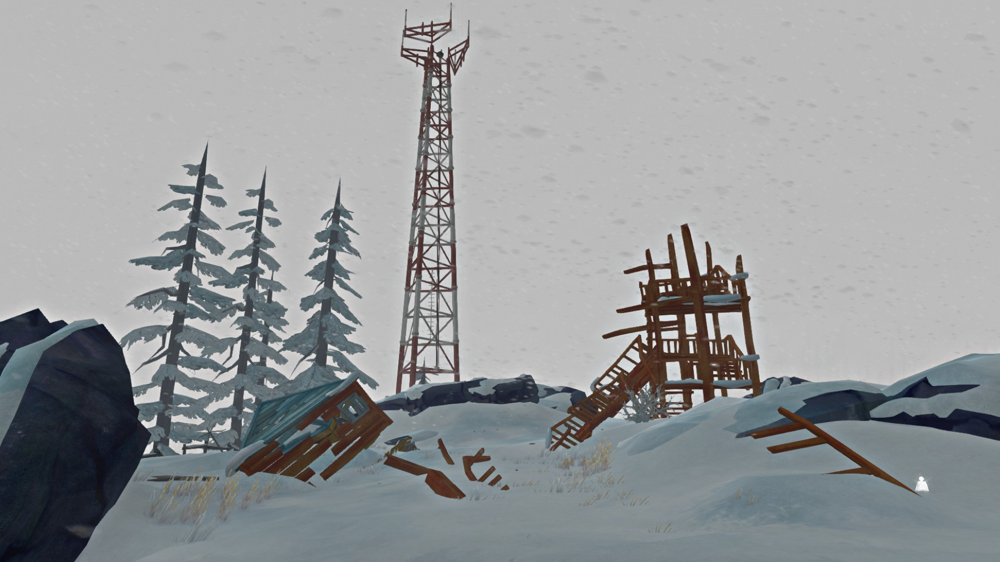

# Destroyed Lookout

**Destroyed Lookout**

| Property | Details |
| --- | --- |
|  |  / *destroyed\_lookout.jpg* |
| **Location** |  |
|  |  / *Destroyed\_Lookout\_Location.png* |
| Region | [Mystery Lake](./Mystery%20Lake%20%28region%29.md)\|- |
| **General** |  |
| Type | Landmark\|- |
