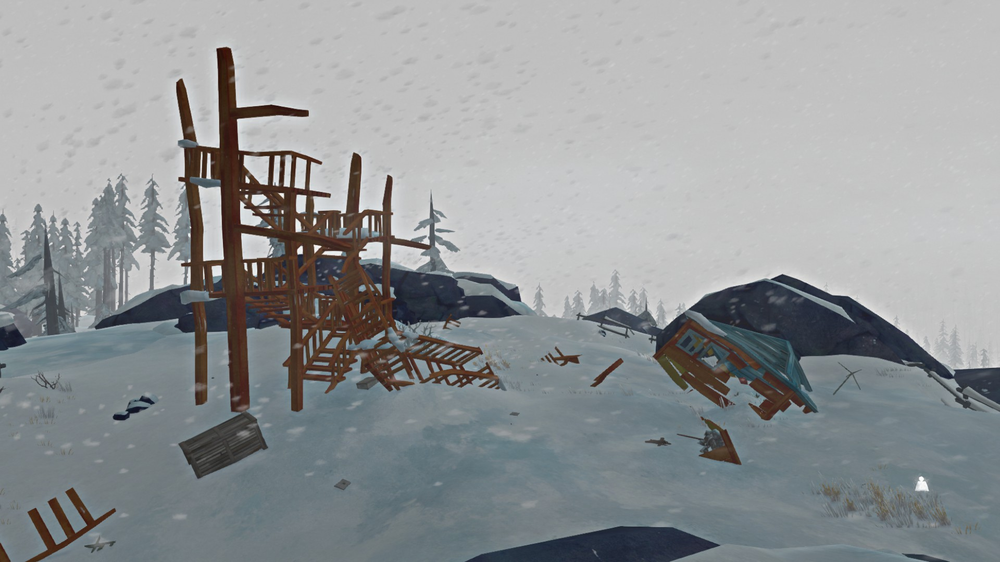
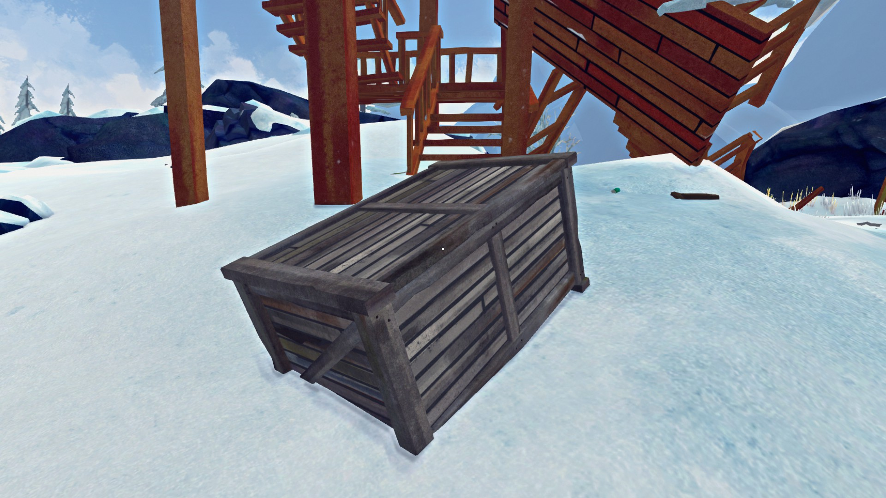
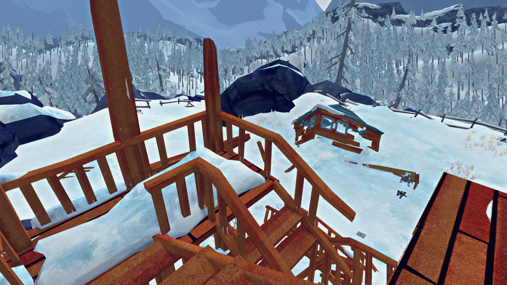
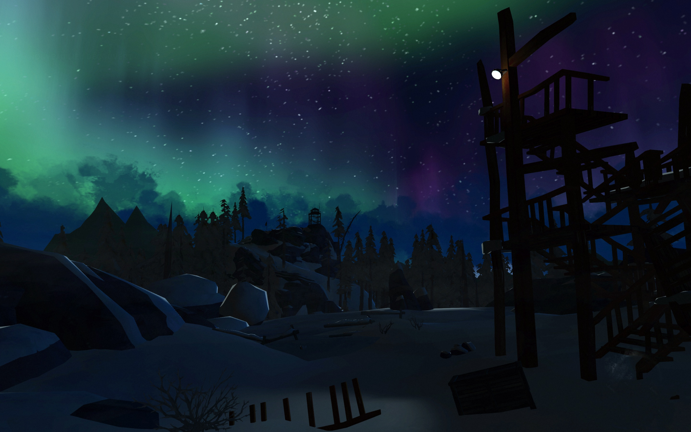
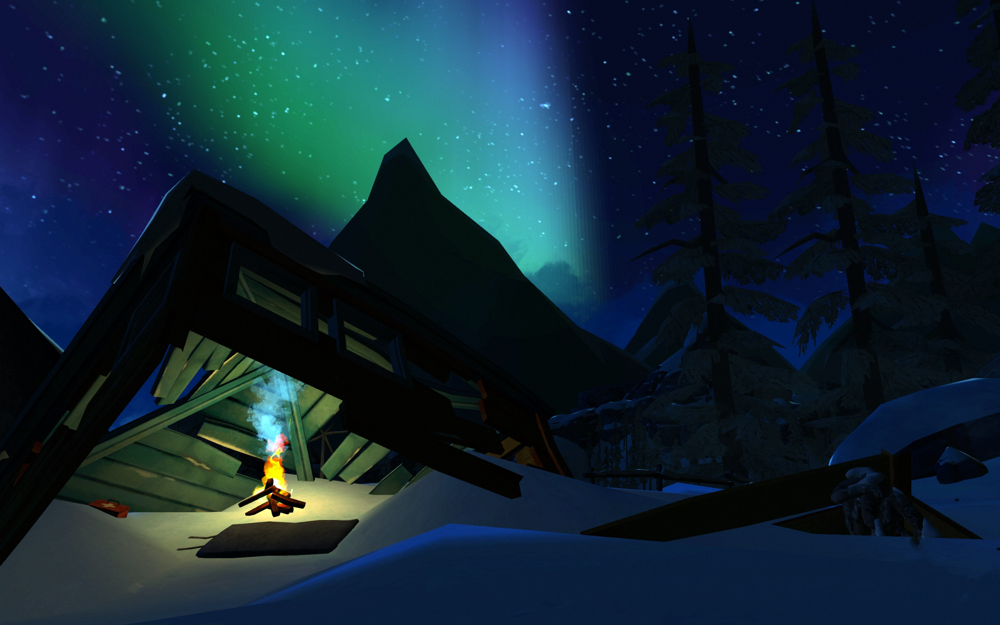

# Destroyed Lookout

**Categories:** Landmarks, Locations, Locations in Mystery Lake, Lookout towers, Outdoor locations · **Source:** [Fandom](https://thelongdark.fandom.com/wiki/Destroyed_Lookout)

**Destroyed Lookout**

| Property | Details |
| --- | --- |
| | [Destroyed lookout](../assets/Destroyed_lookout.jpg) |
| **Location** | |
| | [Destroyed Lookout Location](../assets/Destroyed_Lookout_Location.png) |
| Region | [Mystery Lake](./Mystery%20Lake%20%28region%29.md) |
| Description | A fallen fire lookout tower |
| **General** | |
| Type | Landmark |
| | Has no shelter |

**Destroyed Lookout** is the ruins of a fire tower located in [Mystery Lake](./Mystery%20Lake%20%28region%29.md).

## Overview

Destroyed Lookout sits on a hill to the north-east of the [Unnamed Pond](./Unnamed%20Pond.md), and south of [Clearcut](./Clearcut.md) (a trail leads to the lookout from the bottom of the hill. The entrance to the path sits beside a small billboard sign).

The tower sits in two pieces next to a radio mast woth no interior at this location. A [First Aid Kit](./First%20Aid%20Kit.md) lies inside the smashed living quarter, and a [Supply Bin](./Supply%20Bin.md) and a [Metal Container](./Metal%20Container.md) lie at the base of the supports. A [Frozen Corpse](./Frozen%20Corpse.md) is often found huddled near the remnants of the living quarters, and it is possible for a [Hunting Rifle](./Hunting%20Rifle.md) to spawn next to him.

A [Rope Climbing](./Rope%20Climbing.md) for deploying a [Mountaineering Rope](./Mountaineering%20Rope.md) is next to the cliff. The [Forestry Lookout](./Forestry%20Lookout.md) can be seen on an adjacent hill.

## Game History

The [Forestry Lookout](./Forestry%20Lookout.md) once stood in the space the Destroyed Lookout and radio mast now occupies, before it was moved to an adjacent hill, between Destroyed Lookout and the [Derailment](./Derailment.md).

## Gallery

_A [Frozen Corpse](./Frozen%20Corpse.md) with a [Hunting Rifle](./Hunting%20Rifle.md) in the ruins_

