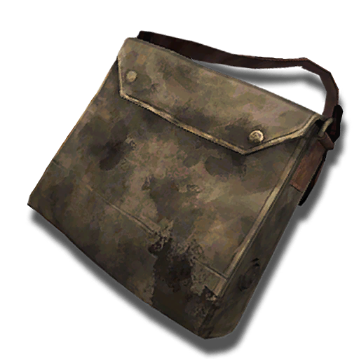

# Detonators

<table class="infobox">
<caption>Detonators</caption>
<colgroup>
<col style="width: 50%" />
<col style="width: 50%" />
</colgroup>
<tbody>
<tr>
<td colspan="2"><figure>

<figcaption>Detonators_icon.png</figcaption>
</figure></td>
</tr>
<tr>
<td>
Release
</td>
<td>
<a href="./The%20Long%20Dark%20%E2%80%94%20Changelog.md#1.95" class="wikilink" title="6 October 2021">6 October 2021</a>
</td>
</tr>
<tr>
<td>
Wintermute
</td>
<td>
<a href="./Episode%204%20-%20Fury%2C%20Then%20Silence.md" class="wikilink" title="Episode 4">Episode 4</a> - <a href="./The%20Detonators.md" class="wikilink" title="The Detonators">The Detonators</a>
</td>
</tr>
<tr>
<td colspan="2" class="section">
<strong>Properties</strong>
</td>
</tr>
<tr>
<td>
Item type
</td>
<td>
<a href="./Collectibles.md" class="wikilink" title="Collectibles">Collectibles</a>|-
</td>
</tr>
<tr>
<td>
Stackable
</td>
<td>
No
</td>
</tr>
<tr>
<td>
Examine
</td>
<td>
A satchel full of old blasting caps. Miners use them to detonate dynamite in controlled explosions.
</td>
</tr>
<tr>
<td colspan="2" class="section">
<strong>Values</strong>
</td>
</tr>
<tr>
<td>
Weight
</td>
<td>
0.00 kg (0 lbs)
</td>
</tr>
<tr>
<td colspan="2" class="section">
<strong>Actions</strong>
</td>
</tr>
<tr>
<td>
Backpack
</td>
<td>
Examine
</td>
</tr>
<tr>
<td colspan="2" class="section">
<strong>Advanced data</strong>
</td>
</tr>
<tr>
<td>
Item key
</td>
<td>
GAMEPLAY_Detonator
</td>
</tr>
</tbody>
</table>

**Detonators** are <a href="./Collectibles.md" class="wikilink" title="Collectible">Collectible</a> items found in <a href="./Episode%204%20-%20Fury%2C%20Then%20Silence.md" class="wikilink" title="Episode 4">Episode 4</a> of the <a href="./Wintermute.md" class="wikilink" title="Wintermute">Wintermute</a> story mode during the mission <a href="./The%20Detonators.md" class="wikilink" title="The Detonators">The Detonators</a>.

During the course of the mission, <a href="./Will%20Mackenzie.md" class="wikilink" title="Will Mackenzie">Will Mackenzie</a> journeys to the <a href="./Last%20Prospect.md" class="wikilink" title="Last Prospect">Last Prospect</a> mines above <a href="./Blackrock%20Prison.md" class="wikilink" title="Blackrock Federal Penitentiary">Blackrock Federal Penitentiary</a>, and retrieves the detonators for <a href="./Mathis.md" class="wikilink" title="Mathis">Mathis</a>.

## Update history

- UPDATE **6 October 2021 (<a href="./The%20Long%20Dark%20%E2%80%94%20Changelog.md#1.95" class="wikilink" title="Update">Update</a>):**
  - Added to game.

**Lua execution error in Module:Navbox function navbox**

<a href="ru:%D0%94%D0%B5%D1%82%D0%BE%D0%BD%D0%B0%D1%82%D0%BE%D1%80%D1%8B" class="wikilink" title="ru:Детонаторы">ru:Детонаторы</a>

