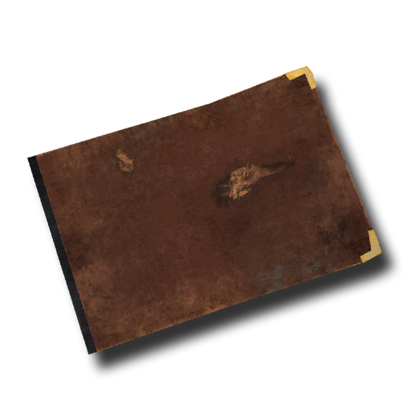

# Diary

<table class="infobox">
<caption>Diary</caption>
<colgroup>
<col style="width: 50%" />
<col style="width: 50%" />
</colgroup>
<tbody>
<tr>
<td colspan="2"><figure>

<figcaption>Diary_icon.png</figcaption>
</figure></td>
</tr>
<tr>
<td>
Release
</td>
<td>
<a href="./The%20Long%20Dark%20%E2%80%94%20Changelog.md#2.52" class="wikilink" title="31 March 2026">31 March 2026</a>
</td>
</tr>
<tr>
<td>
Wintermute
</td>
<td>
<a href="./Episode%205%20-%20The%20Light%20At%20The%20End%20Of%20All%20Things.md" class="wikilink" title="Episode 5: The Light At The End Of All Things">Episode 5: The Light At The End Of All Things</a>
</td>
</tr>
<tr>
<td colspan="2" class="section">
<strong>Properties</strong>
</td>
</tr>
<tr>
<td>
Item type
</td>
<td>
<a href="./Collectibles.md" class="wikilink" title="Collectibles">Collectibles</a>|-
</td>
</tr>
<tr>
<td>
Stackable
</td>
<td>
No
</td>
</tr>
<tr>
<td>
Examine
</td>
<td>
A notebook pertaining to someone sheltering at Cooper's
</td>
</tr>
<tr>
<td colspan="2" class="section">
<strong>Values</strong>
</td>
</tr>
<tr>
<td>
Weight
</td>
<td>
0.00 kg (0 lbs)
</td>
</tr>
<tr>
<td colspan="2" class="section">
<strong>Actions</strong>
</td>
</tr>
<tr>
<td>
Backpack
</td>
<td>
Examine
</td>
</tr>
<tr>
<td>
On ground
</td>
<td>
Take It, Read Text, Leave It
</td>
</tr>
</tbody>
</table>

**Diary** is a <a href="./Collectibles.md" class="wikilink" title="Collectibles">Collectibles</a> found in <a href="./Episode%205%20-%20The%20Light%20At%20The%20End%20Of%20All%20Things.md" class="wikilink" title="Episode 5">Episode 5</a> of the <a href="./Wintermute.md" class="wikilink" title="Wintermute">Wintermute</a> story. It is found inside <a href="./Cooper%27s%20Blind.md" class="wikilink" title="Cooper&#39;s Blind">Cooper's Blind</a> during the main mission <a href="./Perseverance.md" class="wikilink" title="Perseverance">Perseverance</a>, on the top floor on a mattress near some bedrolls.

## Transcript

The following text is transcribed from **Diary**

\[last entry\]

Another sleepless night trying not to hear old Joseph snoring and Carol muttering in her sleep. I can't wait for all of this to be over so I can finally sleep in my bed. And read at night with a normal electric lamp. And crank the heating up to the max. Or even better, go for a weekend on the mainland. I'm so sick of this quarantine. It's scary to think we're on our own, cut off from the rest of the world.

I'll admit, at least it's mildly entertaining to try and decipher what Carol is rambling about. She must have pretty vivid dreams. I wish she stopped obsessing over the waterfall noise though, it makes me want to pee.

How can she even hear the waterfall from here? Now that I think of it, it's true that for a couple of nights, when it's really quiet outside, I have been noticing an unusual hum.\
It's not just the sea. Though it sometimes does sound like waves.\
Waves beneath the ice. Something deep, like it's barely there. I wonder what's up with that.

## Update history

\* UPDATE **31 March 2026 (<a href="./The%20Long%20Dark%20%E2%80%94%20Changelog.md#2.52" class="wikilink" title="Update">Update</a>):**

- - Added to game.

**Lua execution error in Module:Navbox function navbox**

