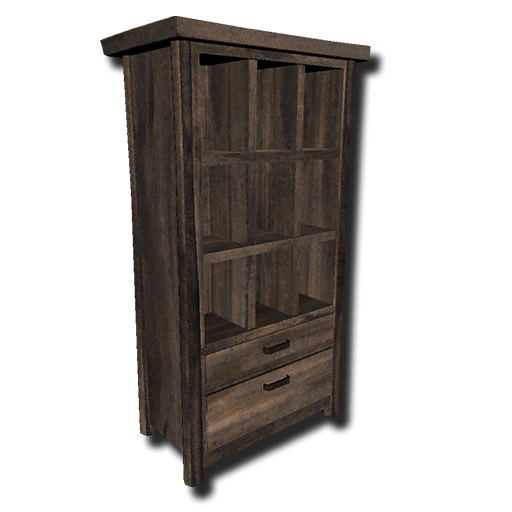

# Display Shelf

<table class="infobox">
<caption>Display Shelf</caption>
<colgroup>
<col style="width: 50%" />
<col style="width: 50%" />
</colgroup>
<tbody>
<tr>
<td colspan="2"><figure>

<figcaption>Display_Shelf_icon.png</figcaption>
</figure></td>
</tr>
<tr>
<td>
Release
</td>
<td>
<a href="./The%20Long%20Dark%20%E2%80%94%20Changelog.md#2.33" class="wikilink" title="TFTFT Part 6 Broken Silence">TFTFT Part 6 Broken Silence</a>
</td>
</tr>
<tr>
<td colspan="2" class="section">
<strong>Values</strong>
</td>
</tr>
<tr>
<td>
Weight
</td>
<td>
20.00 kg (44 lbs)
</td>
</tr>
<tr>
<td colspan="2" class="section">
<strong>Actions</strong>
</td>
</tr>
<tr>
<td>
Backpack
</td>
<td>
Drop, Place
</td>
</tr>
</tbody>
</table>

The **Display Shelf** is a <a href="./Decorations.md" class="wikilink" title="Decorations">Decorations</a> item that can be <a href="./Crafting.md" class="wikilink" title="Crafted">Crafted</a> as part of the <a href="./Safehouse%20Customization.md" class="wikilink" title="Safehouse Customization">Safehouse Customization</a> feature.

## Overview

It can be crafted at a <a href="./Furniture%20Workbench.md" class="wikilink" title="Furniture Workbench">Furniture Workbench</a>, but requires <a href="./Woodworking%20Tools.md" class="wikilink" title="Woodworking Tools">Woodworking Tools</a>.

While the preview image shows nine cubbies, the final product actually has only six. The two drawers can hold up to 10 kg each.

## Crafting

<table class="infobox">
<caption>Display Shelf</caption>
<tbody>
<tr>
<td colspan="2">
-
</td>
</tr>
<tr>
<td colspan="2">
-
</td>
</tr>
<tr>
<td colspan="2">
600 minutes (10 hour 0 minutes)
</td>
</tr>
<tr>
<td colspan="2" class="section">
<strong>Requirements</strong>
</td>
</tr>
<tr>
<td>
Facility
</td>
<td>
<strong>Template:iconlink</strong>
</td>
</tr>
<tr>
<td>
Tool
</td>
<td>
<strong>Template:iconlink</strong>
</td>
</tr>
<tr>
<td colspan="2" class="section">
<strong>Materials</strong>
</td>
</tr>
<tr>
<td colspan="2" class="section">
<strong>Template:iconlink plain</strong>
</td>
</tr>
<tr>
<td>
Item
</td>
<td>
<a href="./Fir%20Firewood.md" class="wikilink" title="Fir Firewood">Fir Firewood</a>
</td>
</tr>
<tr>
<td>
Quantity
</td>
<td>
12
</td>
</tr>
<tr>
<td colspan="2" class="section">
<strong>Template:iconlink plain</strong>
</td>
</tr>
<tr>
<td colspan="2">
<a href="./Reclaimed%20Wood.md" class="wikilink" title="Reclaimed Wood">Reclaimed Wood</a>
</td>
</tr>
<tr>
<td colspan="2">
4
</td>
</tr>
</tbody>
</table>

## Update History

**Template:update historyLua execution error in Module:Navbox function navbox** <a href="ru:%D0%A1%D1%82%D0%B5%D0%BB%D0%BB%D0%B0%D0%B6" class="wikilink" title="ru:Стеллаж">ru:Стеллаж</a>

