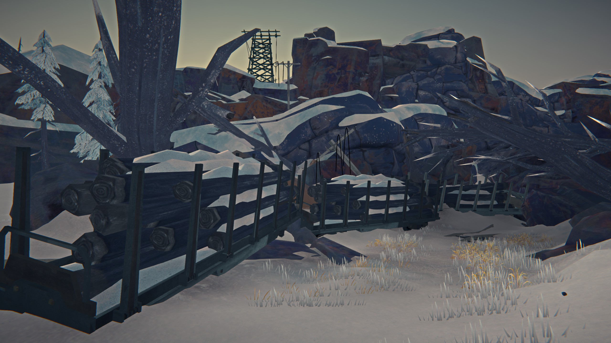

# Distempered Flatcars

**Distempered Flatcars**

| Property | Details |
| --- | --- |
|  |  / *Distempered\_Flatcars\_.jpg* |
| **Location** |  |
|  |  / *Distempered\_Flatcars\_Location.png* |
| Region | [Transfer Pass](./Transfer%20Pass.md)\|- |
| Description | several derailed flatcars loaded with logs. |
| **General** |  |
| Type | Landmark\|- |
