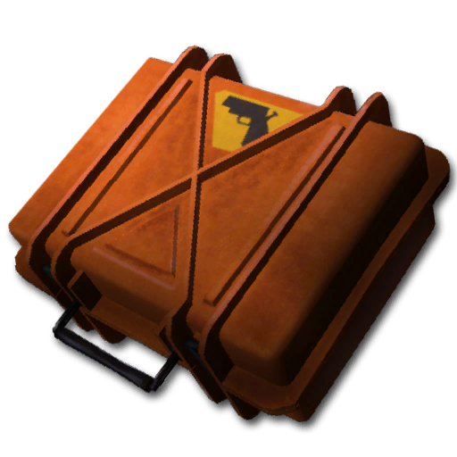

# Distress Pistol Kit

**Categories:** Story items, Tools, Wintermute · **Source:** [Fandom](https://thelongdark.fandom.com/wiki/Distress_Pistol_Kit)

| Column 1 | Column 2 | Column 3 |
| --- | --- | --- |

|  / _Distress\_Pistol\_Kit\_icon.png_ |  |  |
| **General** |  |  |
| Item Type | Tool\|- |  |
| Weight | 5.00 kg(11 lbs) |  |
| “ | __Useful for getting someone's attention in an emergency. Fires Distress Pistol Shells.__ / In-game Description | ” |
| “ | __The distress pistol kit is heavy, but I'd hate to end up in an emergency situation without it.__ / Mackenzie's Description | ” |
