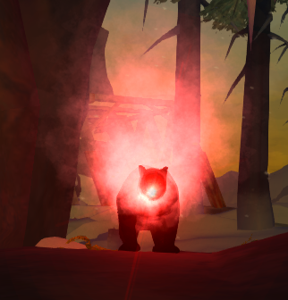

# Distress Pistol

**Categories:** Pages with update history, Tools · **Source:** [Fandom](https://thelongdark.fandom.com/wiki/Distress_Pistol)

**Contents**

- [Overview](#overview)
- [Use](#use)
- [Animals](#animals)
- [Critical hits](#critical-hits)
- [Bleeding wounds](#bleeding-wounds)
- [Locations](#locations)
- [Ash Canyon](#ash-canyon)
- [Bleak Inlet](#bleak-inlet)
- [Blackrock](#blackrock)
- [Coastal Highway](#coastal-highway)
- [Desolation Point](#desolation-point)
- [Forsaken Airfield (TFTFT Only)](#forsaken-airfield-tftft-only)
- [Keeper's Pass North](#keepers-pass-north)
- [Mystery Lake](#mystery-lake)
- [Mountain Town](#mountain-town)
- [Pleasant Valley](#pleasant-valley)
- [Timberwolf Mountain](#timberwolf-mountain)
- [Zone of Contamination (TFTFT Only)](#zone-of-contamination-tftft-only)
- [Challenges](#challenges)
- [Wintermute](#wintermute)
- [Trivia](#trivia)
- [Gallery](#gallery)
- [Update history](#update-history)

**Distress Pistol**

[Distress Pistol icon](../assets/Distress_Pistol_icon.png)

**Release:** [16 December 2015](./The%20Long%20Dark%20%E2%80%94%20Changelog.md#0.298)

**Wintermute:** yes

**Renewable:** Yes ([Beachcombing](./Beachcombing.md))

**Properties**

**Item type:** [Tools](./Tools.md)

**Stackable:** No

**Examine:** A device used to launch an emergency beacon into the air. Fires Flare Shells.

**Values**

**Weight:** 0.40 kg (0.88 lbs)

> “**Distress Pistol rounds can be an effective deterrent against hostile wildlife. They are the only thing that can reliably deter a charging Bear.**”
>
> — [Load Screen](./Load%20Screen.md) Description

The **Distress Pistol** (often called a **"Flare Gun"**) is a single-shot weapon in _The Long Dark_.

## Overview

The Distress Pistol is a break action, single-shot weapon which fires [Flare Shells](./Flare%20Shell.md) (not conventional [Flares](./Flare.md), or [Marine Flares](./Marine%20Flare.md)) as glowing red balls of light. Similar to the [Revolver](./Revolver.md), Distress Pistols serve primarily as defensive weapons since their report upon firing will frighten all nearby [Wildlife](./Wildlife.md): notably including [Bear](./Bear.md) and [Moose](./Moose.md) (the only item to deter both charging animals guaranteed, assuming a direct hit). Wildlife struck by a round will either die immediately, or bleed to death over the following hours (Moose and Cougar being the exceptions since they don't bleed). Unlike all other animals, the [Cougar](./Cougar.md) seems to have no fear of Distress Pistol shots.

Rounds from the Distress Pistol are accurate but follow a heavy arcing trajectory, similar to that of thrown [Stones](./Stone.md) (and greater than [Simple Arrows](./Simple%20Arrow.md) from the [Survival Bow](./Survival%20Bow.md)); this, along with the Distress Pistol's effectiveness at scaring nearly all Wildlife, makes landing hits with the weapon challenging, especially from long distances or while animals are moving.

Rounds fired from the Distress Pistol produce large amounts of red light and burn for 20 minutes (in-game), during which [Wolves](./Wolf.md) and [Timberwolves](./Timberwolf.md) will be unable to approach the round's landing site. Unlike Revolvers or Hunting Rifles, spent Flare Shells casings cannot be collected and reused to make more Flare Shells, as they do not appear at the player's feet once ejected from the Distress Pistol. Flare Shells cannot be crafted at an [Ammunition Work Bench](./Ammunition%20Work%20Bench.md).

Single Flare Shells may be found rarely inside of containers on Pilgrim, Voyageur and Stalker modes.

## Use

The Distress Pistol is a weapon can be equipped from the Radial Menu, the Weapon Hotkey ("2") or directly from the Inventory. While equipped: Aim ("RMB") and fire ("LMB"). Reload with "R", and "H" to Holster (By default). The weapon is single-shot and holds only one round, so it must be reloaded manually each time it is fired.

The Distress Pistol has unique 2 reloading animations after firing: the normal reload wherin a shell is ejected, the Pistol is closed, and pressing "R" starts a reload, and a second animation wherin the Pistol is reloaded halfway through its firing animation by simply pressing "R" after the Shell is ejected, thus loading a Shell early and shortening reloading times.

Launched rounds fire at a low velocity and arc heavily before impacting a solid surface. Rounds hitting hard surfaces at an oblique angle may glance or bounce before coming to rest. Flares which hit surfaces, especially soft targets at perpendicular angles stick in place. Rounds burn brightly for 20 game minutes and emits localized smoke but may not be retrieved or used to start [fires](./Campfire.md). Wolves and Timberwolves will avoid the immediate proximity of a rounds burning (~15m) (the same behavior as with dropped/thrown emergency Flare, Marine Flare, Torch and Campfires). Spent rounds remain visible even after they have burnt out.

In [Wintermute](./Wintermute.md): [Episode 3](./Episode%203%20-%20Crossroads%20Elegy.md) during the mission [Coming Storm](./Coming%20Storm.md), firing a Distress Pistol close enough to a [Crash Survivor](./Crash%20Survivor.md)'s location (their circle on the map) will result in them responding with a Distress Pistol shot of their own into the air, allowing [Astrid](./Astrid%20Greenwood.md) to find their location more easily.

Neither the Distress Pistol nor Flare Shells can be repaired or crafted respectively.

## Animals

Animals within earshot (~30 meters) of the report flee immediately, with the exception of the Cougar which has no fear of the Distress Pistol. Additional animals within visual of the impact site will also flee. The one exception is during the Aurora: if the shell doesn't hit, animals will continue their charge even after shooting the distress pistol.

Distress Pistol rounds which hit an animal will almost always kill. Either immediately (on a critical hit), or shortly after from [blood loss](./Blood%20Loss.md) (except [Moose](./Moose.md) and [Cougar](./Cougar.md) which cannot bleed out and cannot be critically hit with a Distress Pistol). While the animal is bleeding the burning round will remain attached to the fleeing animal for several in-game minutes, trailing smoke and glowing bright red.

### Critical hits

Critical hits cause the animal to instantly die after being hit by a shot. The following table contains the critical hit chance based on the location that was shot on the animal.

| Wildlife — Head | Wildlife — Neck | Critical Hit Chance — Torso | Critical Hit Chance — Hips | Critical Hit Chance — Limb | Critical Hit Chance | Critical Hit Chance |
| --- | --- | --- | --- | --- | --- | --- |
| [Deer icon](../assets/Deer_icon.png) | [Deer](./Deer.md) | Guaranteed | 50% | 40% | 25% | 10% |
| [Wolf icon](../assets/Wolf_icon.png) | [Wolf](./Wolf.md) | Guaranteed | Guaranteed | 33% | 10% | 10% |
| [Bear icon](../assets/Bear_icon.png) | [Bear](./Bear.md) | 60% | 90% | Guaranteed | Guaranteed | Guaranteed |

### Bleeding wounds

[Wildlife](./Wildlife.md) take a specific amount of time to bleed out, as follows:

| Wildlife — Head | Wildlife — Neck | Bleed Out — Torso | Bleed Out — Hips | Bleed Out — Limb | Bleed Out | Bleed Out |
| --- | --- | --- | --- | --- | --- | --- |
| [Deer icon](../assets/Deer_icon.png) | [Deer](./Deer.md) | Instant | 8 min | 15 min | 30 min | 80 min |
| [Wolf icon](../assets/Wolf_icon.png) | [Wolf](./Wolf.md) | Instant | 12 min | 30 min | 35 min | 40 min |
| [Bear icon](../assets/Bear_icon.png) | [Bear](./Bear.md) | 30 min | 45 min | 50 min | 140 min | 140 min |

## Locations

Distress Pistols are typically found inside orange [Emergency Kit](./Emergency%20Kit.md) cases accompanied by up to 8 Flare Shells but may be found caseless, next to a [corpse](./Frozen%20Corpse.md). (As it is in [Desolation Point](./Desolation%20Point.md)) The Distress Pistol can also be found in a stockpiler's type of prepper cache on any difficulty other than Interloper/Misery.

The possible spawn locations include:

### [Ash Canyon](./Ash%20Canyon.md)

- On a ledge south of [Anglers Den](./Angler%27s%20Den.md). This ledge is _unreachable_ from the river level, requiring an approach from above by crossing [Runway Bridge](./Runaway%20Bridge.md), into the meadow area, and near the rope up to [High Meadow](./High%20Meadow.md)

Note: not guaranteed to spawn, disabled on Interloper/Misery

### [Bleak Inlet](./Bleak%20Inlet.md)

Spawns in 1 of 3 locations listed below:

- Atop the [Pensive Lookout](./Pensive%20Lookout.md)
- At the end of the [Cannery Pier](./Cannery%20Pier.md), next to a [corpse](./Frozen%20Corpse.md)
- In a case inside the break room behind the main building (the one with the rope up) in the [Last Resort Cannery](./Last%20Resort%20Cannery.md). This case is always _empty_

Note: only second and third spawn is present on Interloper/Misery, not guaranteed to spawn

### [Blackrock](./Blackrock.md)

- Next to a corpse at Last Prospect vista

Note: not guaranteed to spawn, disabled on Interloper/Misery

### [Coastal Highway](./Coastal%20Highway.md)

Spawns in 1 of 4 locations listed below:

- Next to a corpse in [Silent Clearing](./Silent%20Clearing.md)
- In a backpack leaning against a canoe on [Misanthropes Island](./Misanthrope%27s%20Homestead.md), on the side nearest to the [Waterfront Cottages](./Waterfront%20Cottages.md)
- In a case inside the fishing hut south of Fishing camp
- Atop the Abandoned Lookout

Note: disabled on Interloper/Misery

### [Desolation Point](./Desolation%20Point.md)

- Under a bunkbed on the second floor of [Hibernia Processing](./Hibernia%20Processing.md). Note this pistol spawns without a case or Flare Shells, but some may be found on a nearby shelf

Note: not guaranteed to spawn

### [Forsaken Airfield](./Forsaken%20Airfield.md) (TFTFT Only)

Spawns in 1 of 2 locations listed below:

- At the top of the [Control Tower](./Control%20Tower.md)
- Next to a corpse at [Final Approach](./Final%20Approach.md)

Note: guaranteed spawn

### [Keeper's Pass North](./Keeper%27s%20Pass%20North.md)

- In a case at an unnamed cave below [builder's bridge](./Builder%27s%20Bridge.md) at river level. A rope at one end of the road is used to get down

Note: guaranteed spawn

### [Mystery Lake](./Mystery%20Lake%20%28region%29.md)

- In a case atop the [Forestry Lookout](./Forestry%20Lookout.md)

Note: not guaranteed to spawn, disabled on Interloper/Misery

### [Mountain Town](./Mountain%20Town.md)

Spawns in 1 of 4 locations listed below:

- Near the cave at [Mackenzie's Crashed Plane](./Mackenzie%27s%20Crashed%20Plane.md)
- In the cave at the bottom of the climbing area on the path to Mystery Lake
- On top of the [Prison Transport Bus](./Crashed%20Prison%20Transport%20Bus.md)
- On the dash of the truck at the bottom of the waterfall in Milton basin.

Second spawn: In the bathtub inside [Milton House (Grey Mother's)](./Milton%20House%20%28Grey%20Mother%27s%29.md) (not guaranteed to spawn)

Note: only bathtub spawn is present on Interloper/Misery

### [Pleasant Valley](./Pleasant%20Valley.md)

- In a case inside the basement of the [Pleasant Valley Farmstead](./Pleasant%20Valley%20Farmstead.md), on a desk
- In a case inside the [Signal Hill](./Signal%20Hill.md) Control Hut, on the shelf next to the door
- In a case inside Pleasant Valley Outbuildings barn, second floor on the metal shelf
- In a case located at the tail of crashed plane, where player can find a survivor in Episode 3 of Wintermute

Note: not guaranteed to spawn, only third spawn is present on Interloper/Misery

### [Timberwolf Mountain](./Timberwolf%20Mountain.md)

- In a case next to a [corpse](./Frozen%20Corpse.md) in the upper area of the [Tail Section](./Tail%20Section.md) of the crashed cargo plane, atop the [Summit](./Summit.md) (contains 3 flare shells)

Note: not guaranteed to spawn

### [Zone of Contamination](./Zone%20of%20Contamination.md) (TFTFT Only)

Spawns in 1 of 2 locations listed below:

- In a case on scaffolders in Forgotten Exploration tunnel
- In a case, hidden at the west wall in the cavern with scaffolders in Forgotten Exploration tunnel

Note: guaranteed spawn

Interloper/Misery extra spawn:

- In a case inside the locked container office on the 3rd floor of Langston Mine

Note: guaranteed spawn, other difficulties have rifle spawn instead of distress pistol in Langston Mine

### **[Challenges](./Challenge.md)**

- In [The Hunted, Part One](./The%20Hunted%2C%20Part%20One.md), there is a case in the [basement](./Skeeter%27s%20Ridge.md) near where that scenario begins
- In [Hopeless Rescue](./Hopeless%20Rescue.md), all Distress Pistol and Flare Shell spawns are disabled except for the case inside the Tail Section of Timberwolf Mountain

### [**Wintermute**](./Wintermute.md)

- In [Episode 1](./Episode%201%20-%20Do%20Not%20Go%20Gentle.md) during the [first mission](./Memories.md) (inside the Hangar, before departure) [Will Mackenzie](./Will%20Mackenzie.md) may choose to load a Distress Pistol Case onto his floatplane; if he does, then it will be available on the ground near [Mackenzie's Crashed Plane](./Mackenzie%27s%20Crashed%20Plane.md) after [The Crash](./The%20Crash.md). Another second Distress Pistol with ammunition may be found by completing [Highway Robbery](./Highway%20Robbery.md)
- In [Episode 2](./Episode%202%20-%20Luminance%20Fugue.md) inside the [Carter Hydro Dam](./Carter%20Hydro%20Dam.md) a case is inside the first-floor bathroom
- In [Episode 3](./Episode%203%20-%20Crossroads%20Elegy.md) at the Crash Site, Astrid can find a distress pistol with 7 rounds in one of the sections. One may also be found in the hallway of the [Community Center](./Thomson%27s%20Crossing.md) after completing the Mission "[Fallen Star](./Fallen%20Star.md)"
- In [Episode 4](./Episode%204%20-%20Fury%2C%20Then%20Silence.md), if playing on lower difficulties a Distress Pistol will spawn in the gatehouse by the exit of the [Prison](./Blackrock%20Prison.md)

## Trivia

- When loaded and held, the Distress Pistol's firing hammer is cocked. This is the only indicator that the weapon is loaded (other than the lit icon in the corner, which is white when loaded, and grey when unloaded), since similar to the [Survival Bow](./Survival%20Bow.md), the Distress Pistol is single-shot and numerically displays carried but not loaded ammunition (unlike the [Revolver](./Revolver.md) and [Hunting Rifle](./Hunting%20Rifle.md)). Distress Pistols display their loaded ammunition in the Inventory menu. Because of this, caution should be taken to verify the Distress Pistol is loaded before entering dangerous situations.
  - One way to verify if the flare gun is loaded to look at the flare shell icon while the weapon his held. If the icon is a light grey in color, it is unloaded, if it is white, there is a shell loaded. This is also the same with the [Survival Bow](./Survival%20Bow.md), however it is less applicable because your character automatically "reloads" the bow after each shot.

- The [Hopeless Rescue](./Hopeless%20Rescue.md) Challenge requires the flare gun to complete its main objective.
- The flare round that is launched and glows is a model of the shell part of the ammunition that should have been left in the gun after firing. (Meaning the flare gun shouldn't be empty after firing, an empty shell should remain.)
- A bug was present (patch 1.72) between January 22nd and March 26th of 2020 which prevented Distress Pistol rounds from damaging animals in Survival and Wintermute. The result of this bug caused direct hits with the Distress Pistol to bounce harmlessly off animals and land on the ground, merely frightening them.
- The Distress Pistol closely resembles the real-life [Orion flare gun](https://en.wikipedia.org/wiki/Flare_gun).

## Gallery

## Update history

- UPDATE **16 December 2015 ([Update](./The%20Long%20Dark%20%E2%80%94%20Early%20Access%20Changelog.md#0.298)):**
  - Added to game.
