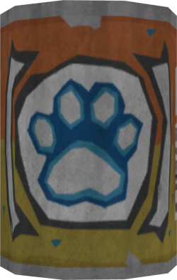

# Dog Food

**Contents**

- [Overview](#Overview)
- [Trivia](#Trivia)
- [Gallery](#Gallery)
- [Update history](#Update_history)

<table class="infobox">
<caption>Dog Food</caption>
<colgroup>
<col style="width: 33%" />
<col style="width: 33%" />
<col style="width: 33%" />
</colgroup>
<tbody>
<tr>
<td colspan="2">
[[File:

<table class="gallery">
<colgroup>
<col style="width: 50%" />
<col style="width: 50%" />
</colgroup>
<tbody>
<tr>
<th><figure>

<figcaption>Sealed</figcaption>
</figure></th>
<td><figure>

<figcaption>Opened</figcaption>
</figure></td>
</tr>
</tbody>
</table></td>
<td>
250px]]
</td>
</tr>
<tr>
<td>
Release
</td>
<td>
<a href="./The%20Long%20Dark%20%E2%80%94%20Changelog.md#0.117" class="wikilink" title="22 September 2014">22 September 2014</a>
</td>
<td></td>
</tr>
<tr>
<td>
Wintermute
</td>
<td>
No
</td>
<td></td>
</tr>
<tr>
<td>
Renewable
</td>
<td>
Yes (rare <a href="./Beachcombing.md" class="wikilink" title="Beachcombing">Beachcombing</a>)
</td>
<td></td>
</tr>
<tr>
<td colspan="2">
<strong>Properties</strong>
</td>
<td></td>
</tr>
<tr>
<td>
Item type
</td>
<td>
<a href="./Food%20And%20Drink.md" class="wikilink" title="Food And Drink">Food And Drink</a>|-
</td>
<td>
Equipable
</td>
</tr>
<tr>
<td>
Stackable
</td>
<td>
No
</td>
<td></td>
</tr>
<tr>
<td>
Examine
</td>
<td>
Can of wet dog food. Smells bad, but eating it is better than starving. Probably.
</td>
<td></td>
</tr>
<tr>
<td colspan="2">
<strong>Values</strong>
</td>
<td></td>
</tr>
<tr>
<td>
Calories
</td>
<td>
500 kcal
</td>
<td></td>
</tr>
<tr>
<td>
Hydration
</td>
<td>
5%
</td>
<td></td>
</tr>
<tr>
<td>
Weight
</td>
<td>
0.30 kg (0.66 lbs)
</td>
<td></td>
</tr>
<tr>
<td colspan="2">
<strong>Decay Rate</strong>
</td>
<td></td>
</tr>
<tr>
<td>
Inside
</td>
<td>
0.667% per day
</td>
<td></td>
</tr>
<tr>
<td>
Outside
</td>
<td>
0.167% per day
</td>
<td></td>
</tr>
<tr>
<td colspan="2">
<strong>Advanced data</strong>
</td>
<td></td>
</tr>
<tr>
<td>
Item key
</td>
<td>
GAMEPLAY_DogFood
</td>
<td></td>
</tr>
</tbody>
</table>

**Dog Food** is a packaged <a href="./Food%20And%20Drink.md" class="wikilink" title="food">food</a> item in *The Long Dark*.

## Overview

Consuming Dog Food restores a moderate amount of calories and small amount of hydration. *It cannot be warmed by a <a href="./Fire.md" class="wikilink" title="fire">fire</a>.*

Like other canned foods, Dog Food may be opened with a <a href="./Can%20Opener.md" class="wikilink" title="Can Opener">Can Opener</a> or <a href="./Tools.md" class="wikilink" title="bladed tool">bladed tool</a>, or smashed open (with no tool) but spilling some of it's contents. If opened with a tool a <a href="./Recycled%20Can.md" class="wikilink" title="Recycled Can">Recycled Can</a> is received after consuming the contents.

Dog Food is relatively common inside homes: usually in cupboards or on shelfs.

It has relatively high chance of causing <a href="./Food%20Poisoning.md" class="wikilink" title="Food Poisoning">Food Poisoning</a> at low condition, compared to other canned foods.

## Trivia

- A possible explanation for Dog Food having such a high food poisoning chance, is the variance between animal grade and human grade foods.
- The dog food is packaged as the product *Dog's Best Friend*.
- The side of the can lists "Ingredients: Turkey, Beef, Chicken, Water, Calcium, Vitamin A, Vitamin D, Vitamin K."
- Dog houses are occasionally found on the Island (like in <a href="./Coastal%20Townsite.md" class="wikilink" title="Coastal Townsite">Coastal Townsite</a>), but dogs are never found.

## Gallery

<table class="gallery">
<colgroup>
<col style="width: 100%" />
</colgroup>
<tbody>
<tr>
<td><figure>

<figcaption>old model</figcaption>
</figure></td>
</tr>
</tbody>
</table>

## Update history

- UPDATE **22 September 2014 (<a href="./The%20Long%20Dark%20%E2%80%94%20Early%20Access%20Changelog.md#0.117" class="wikilink" title="Update">Update</a>):**
  - Added to game.

**Lua execution error in Module:Navbox function navbox** <a href="ru:%D0%91%D0%B0%D0%BD%D0%BA%D0%B0_%D0%BA%D0%BE%D1%80%D0%BC%D0%B0_%D0%B4%D0%BB%D1%8F_%D1%81%D0%BE%D0%B1%D0%B0%D0%BA" class="wikilink" title="ru:Банка корма для собак">ru:Банка корма для собак</a> <a href="fr:Nourriture_pour_chien" class="wikilink" title="fr:Nourriture pour chien">fr:Nourriture pour chien</a>

