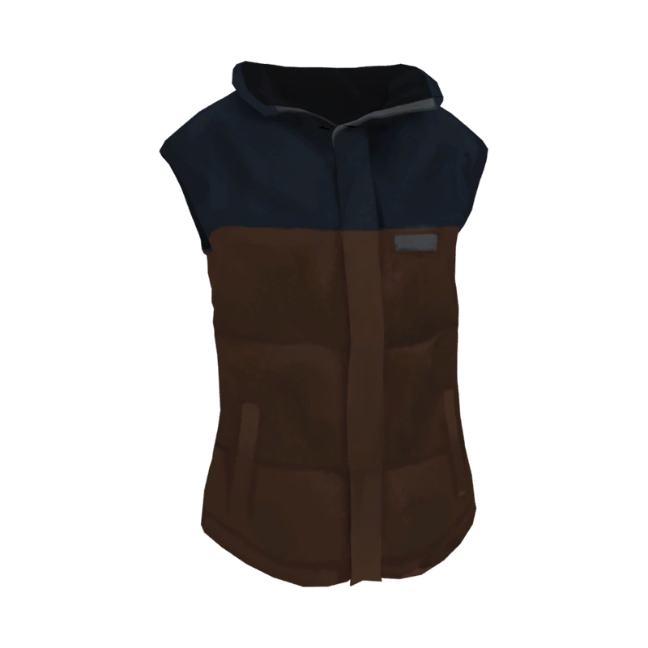
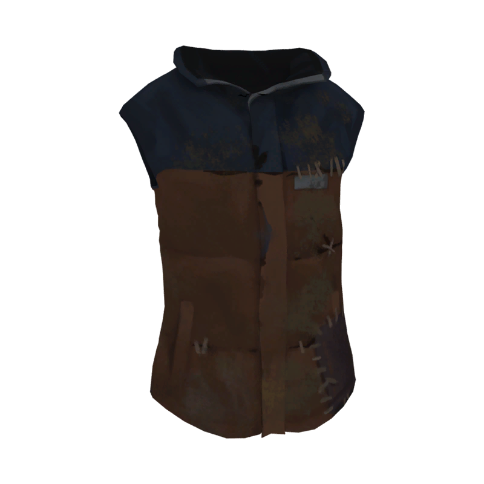

# Down Vest

<table class="infobox">
<caption>Down Vest</caption>
<colgroup>
<col style="width: 50%" />
<col style="width: 50%" />
</colgroup>
<tbody>
<tr>
<td colspan="2"><figure>

<figcaption>Down_Vest_icon.png</figcaption>
</figure></td>
</tr>
<tr>
<td colspan="2" class="section">
<strong>General</strong>
</td>
</tr>
<tr>
<td>
Item Type
</td>
<td>
Clothing|-
</td>
</tr>
<tr>
<td>
Clothing Slot
</td>
<td>
Outer torso
</td>
</tr>
<tr>
<td colspan="2" class="section">
<strong>Statistics</strong>
</td>
</tr>
<tr>
<td>
Weight
</td>
<td>
0.50 kg(1.1 lbs)
</td>
</tr>
<tr>
<td>
Warmth bonus
</td>
<td>
1.0 °C(1.8 °F)
</td>
</tr>
<tr>
<td>
Windproof bonus
</td>
<td>
1.0 °C(1.8 °F)
</td>
</tr>
<tr>
<td>
Waterproof bonus
</td>
<td>
10%
</td>
</tr>
<tr>
<td>
Protection
</td>
<td>
1%
</td>
</tr>
<tr>
<td>
Mobility
</td>
<td>
0%
</td>
</tr>
<tr>
<td>
Harvest
</td>
<td>
2 × <a href="./Cloth.md" class="wikilink" title="Cloth">Cloth</a> 
20 minutes
</td>
</tr>
<tr>
<td>
Repair
</td>
<td>
1 × <a href="./Cloth.md" class="wikilink" title="Cloth">Cloth</a> 
30 minutes 
25% condition
</td>
</tr>
</tbody>
</table>

<table>
<colgroup>
<col style="width: 33%" />
<col style="width: 33%" />
<col style="width: 33%" />
</colgroup>
<tbody>
<tr>
<td style="vertical-align: top; font-size: 3em; color: #5d5980; padding-right: 10px">
“
</td>
<td>
Down-filled top-layer that warms the core but leaves the arms exposed. Very light.

&#10;

In-game description

</td>
<td style="vertical-align: bottom; font-size: 3em; color: #5d5980; padding-left: 10px">
”
</td>
</tr>
</tbody>
</table>

The **Down Vest** is a type of <a href="./Clothing.md" class="wikilink" title="Clothing">Clothing</a> found in *<a href="./The%20Long%20Dark.md" class="wikilink" title="The Long Dark">The Long Dark</a>*.

## Overview

Only 1 Down Vest can be worn at a time, specifically in the inner torso jacket slot.

Commonly found in cabins and houses alike, the down vest is often something that players overlook, as it is not very warm, and there are many better outer-torso clothing items. just like most outer clothing items, it may be harvested for <a href="./Cloth.md" class="wikilink" title="Cloth">Cloth</a>, which may be used to repair clothing.

This is often a clothing item your survivor may start with.

## Gallery

<table class="gallery">
<colgroup>
<col style="width: 33%" />
<col style="width: 33%" />
<col style="width: 33%" />
</colgroup>
<tbody>
<tr>
<td><figure>

<figcaption>Old model.</figcaption>
</figure></td>
<td><figure>

<figcaption>Clothing model</figcaption>
</figure></td>
<td><figure>

<figcaption>Clothing model damaged</figcaption>
</figure></td>
</tr>
</tbody>
</table>

## Game History

The Down Vest was originally named Insulated Vest before it was changed.**Lua execution error in Module:Navbox function navbox** <a href="ru:%D0%96%D0%B8%D0%BB%D0%B5%D1%82-%D0%BF%D1%83%D1%85%D0%BE%D0%B2%D0%B8%D0%BA" class="wikilink" title="ru:Жилет-пуховик">ru:Жилет-пуховик</a>

