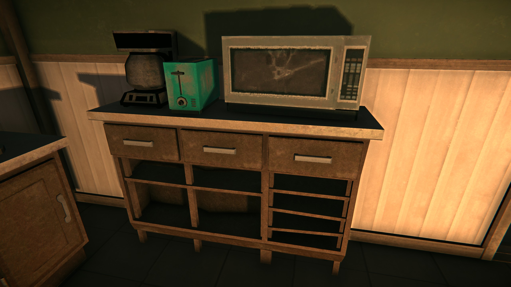
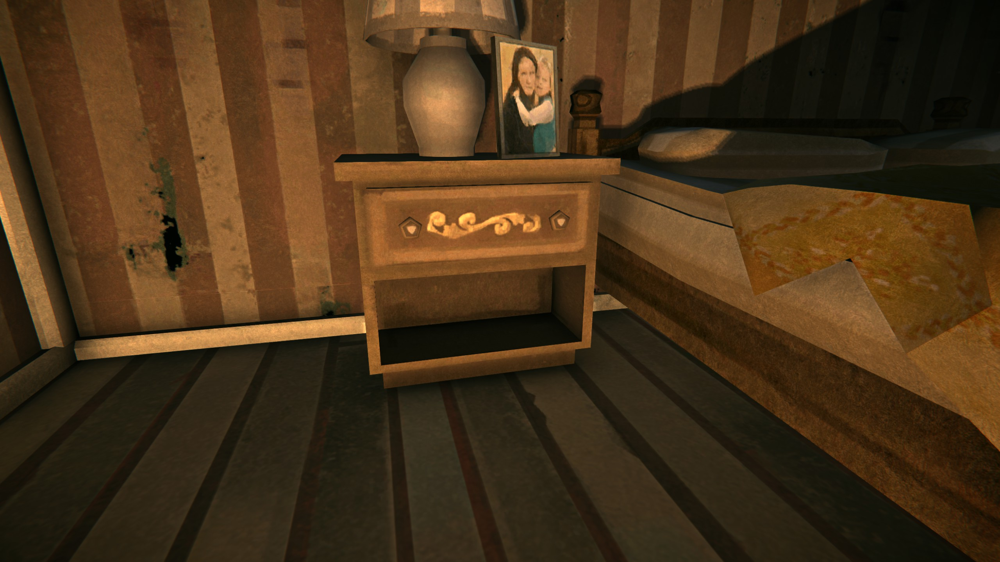
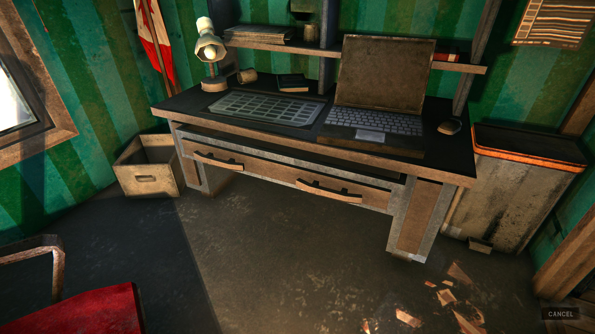
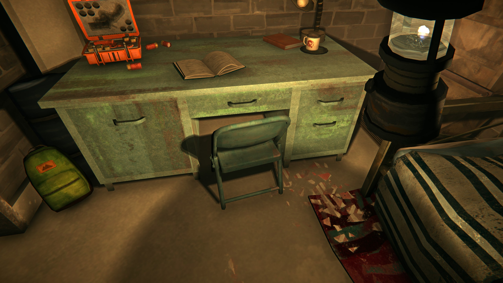
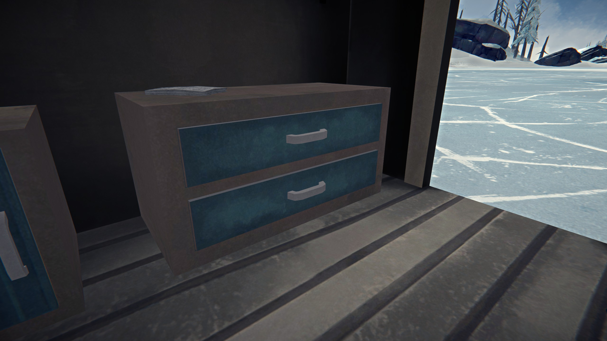
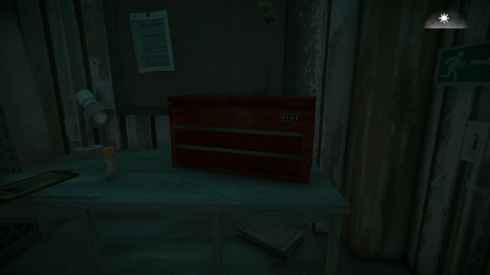
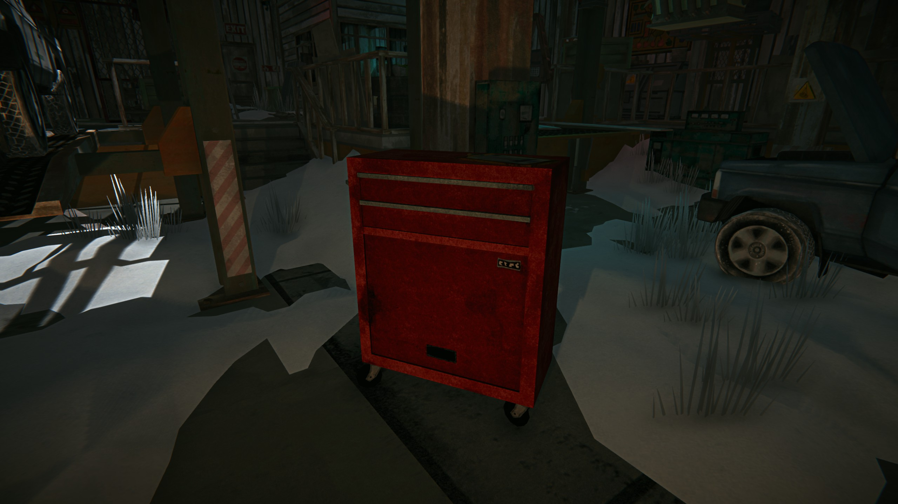
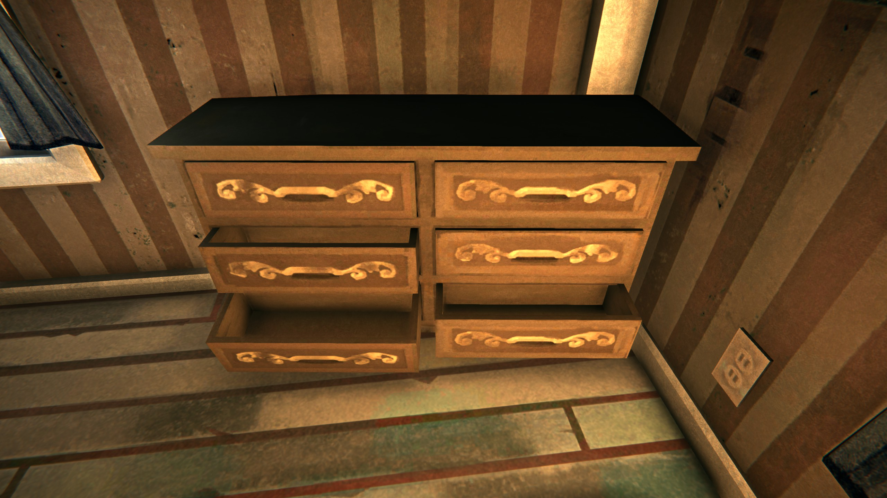
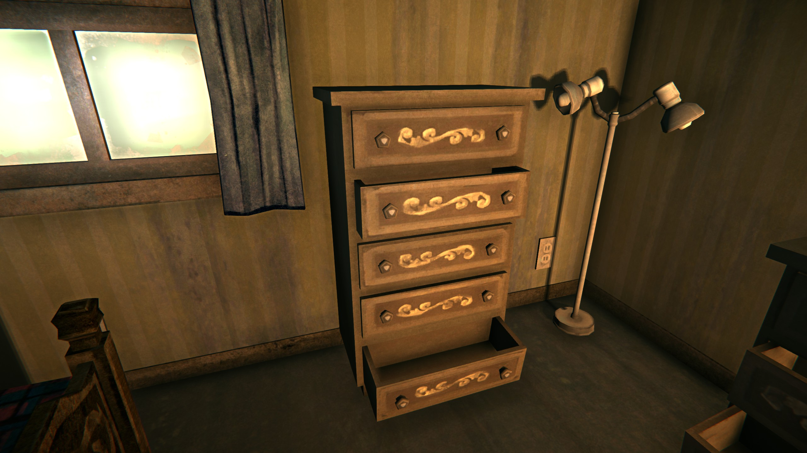

# Drawer

**Contents**

- [Food](#food)
- [Material](#material)
- [Trailer tables](#trailer-tables)
- [Work Benches](#work-benches)
- [Desks](#desks)
- [Fishing Hut](#fishing-hut)
- [Tools](#tools)
- [Small Toolbox](#small-toolbox)
- [Large Toolbox Cabinets](#large-toolbox-cabinets)
- [Clothing](#clothing)
- [Dressers](#dressers)
- [Vertical Dressers](#vertical-dressers)

**Drawer**

| Property | Details |
| --- | --- |
| \[\[File: / \| Column 1 \| Column 2 \| Column 3 \| Column 4 \| / \| --- \| --- \| --- \| --- \| / \|  / *Food* \|  / *Table* \|  / *Wide Table* \|  / *L Table* \| / \|  / *FH* \|  / *S Toolbox* \|  / *L Toolbox* \|  / *Clothing* \| / \|  / *Tall Clothing* \|  \|  \|  \| | 250px\]\] |
|  / *Food* |  / *Table* /  / *Wide Table* /  / *L Table* |
|  / *FH* |  / *S Toolbox* /  / *L Toolbox* /  / *Clothing* |
|  / *Tall Clothing* |  |
| Story item | Yes |

A **Drawer** is one possible type of storage container in the game that comes in many forms and can be found in every area in the game.

## Food

Food Drawers are found in some large kitchens next to [Cupboards](./Cupboard.md). They often yield [Food and Drink](./Food%20And%20Drink.md) items and have a storage capacity of 15.00kg.

## Material

### Trailer tables

Some Tables, most commonly found in Trailers, have one Drawer that can be searched. They often yield [Material](./Materials.md) items and have a storage capacity of 5.00kg.

### Work Benches

Blue [work benches](./Work%20Bench.md) have one Drawer that can be searched (in opposition to the white work benches that don't have any drawers). They often yield Material items and have a storage capacity of 5.00kg.

### Desks

Desks have four Drawers that can be searched. Two are large while two are small Drawers and have a storage capacity of 10.00kg and 5.00kg respectively. They often yield Material items.

### Fishing Hut

Fishing Huts contain two types of storage, one of which has two Drawers. They often yield Material items and have a storage capacity of 10.00kg.

## Tools

### Small Toolbox

The smaller red toolboxes have two small drawers. They often yield Materials and [Tools](./Tools.md) and have a storage capacity of 5.00kg. They can occasionally be found stacked on top of the large toolbox cabinets

### Large Toolbox Cabinets

The large red toolboxes has two small drawers and one large drawer. They often yield Materials and Tools. The small Drawers have a storage capacity of 5.00kg, while the large one is 20.00kg.

## Clothing

### Dressers

Dressers are found in many residential homes, in the bedroom. They have six drawers, but three are broken and cannot be searched. They often yield [Clothing](./Clothing.md) items and have a storage capacity of 5.00kg. Sometimes, loose spawn items can be found inside the open drawers.

### Vertical Dressers

Vertical Dressers are found in many residential homes, in the bedroom and occasionally the office. Two of the five drawers are open and cannot be searched. They often yield Clothing items and have a storage capacity of 5.00kg. **Lua execution error in Module:Navbox function navbox**
