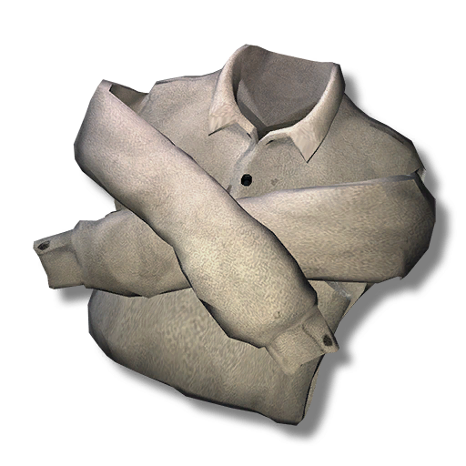
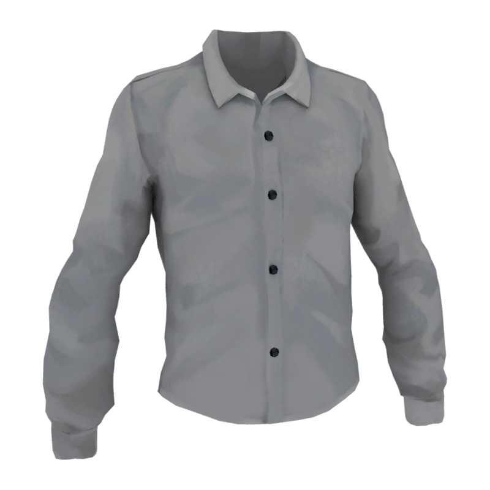
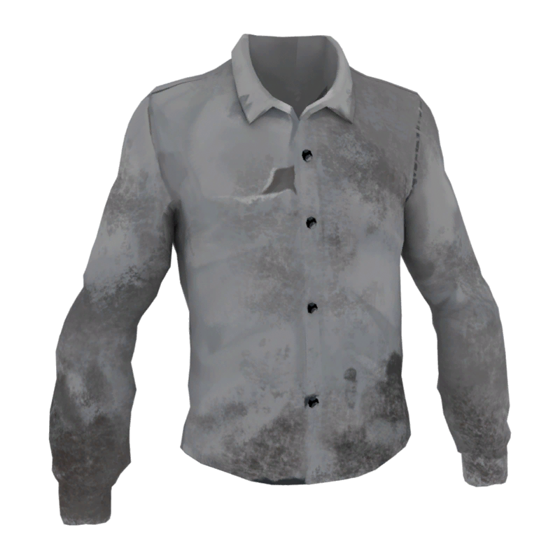

# Dress Shirt

**Dress Shirt**

| Property | Details |
| --- | --- |
|  |  / *Dress\_Shirt\_icon.png* |
| **General** |  |
| Item Type | Clothing\|- |
| Clothing Slot | Inner torso |
| **Statistics** |  |
| Weight | 0.25 kg(0.55 lbs) |
| Warmth bonus | 0.5 °C(0.9 °F) |
| Windproof bonus | 1.0 °C(1.8 °F) |
| Waterproof bonus | 0% |
| Protection | 0% |
| Mobility | 0% |
| Harvest | 1 × [Cloth](./Cloth.md) / 10 minutes |
| Repair | 1 × [Cloth](./Cloth.md) / 30 minutes / 35% condition |

> “**A simple cotton button-down shirt you'd wear to a boring office job. Good thing computers don't seem to work anymore!**”
>
> — In-game description

The **Dress Shirt** is a type of [clothing](./Clothing.md) in *[The Long Dark](./The%20Long%20Dark.md)*.

## Overview

A common starting item, the dress shirt is one of the worst clothing items in the game. The Dress Shirt only offers a little warmth and a small windproof bonus. While the windproof bonus does at least allow it to outclass the [T-Shirt](./T-Shirt.md#overview), if it is worn as an inner layer the windproof bonus will be lost, thus rendering the Dress Shirt to the exact stats of a T-Shirt. As a result, the Dress Shirt should be replaced and harvested for [Cloth](./Cloth.md) as soon as possible, as almost anything will be better.

The [Sweatshirt](./Sweatshirt.md) serves as a direct upgrade, offering all of the stats of a Dress Shirt alongside a slight waterproofing and protection bonus.

| Column 1 | Column 2 |
| --- | --- |
|  / *Clothing model* |  / *Clothing model damaged* |

## Update history

- UPDATE **19 December 2016 ([Update](./The%20Long%20Dark%20%E2%80%94%20Early%20Access%20Changelog.md#0.386)):**
  - Added to game

**Lua execution error in Module:Navbox function navbox** [ru:Сорочка](ru:%D0%A1%D0%BE%D1%80%D0%BE%D1%87%D0%BA%D0%B0)
