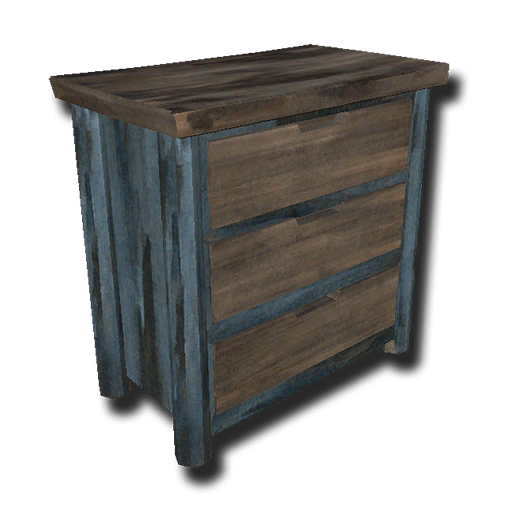

# Dresser

**Categories:** Interactable Objects · **Source:** [Fandom](https://thelongdark.fandom.com/wiki/Dresser)

**Contents**

- [Overview](#overview)
- [Harvesting](#harvesting)
- [Crafting](#crafting)
- [Update History](#update-history)

**Dresser**

_Dresser\_icon.png_

**Release:** [TFTFT Part 6 Broken Silence](./The%20Long%20Dark%20%E2%80%94%20Changelog.md#2.33)

**Values**

**Weight:** 25.00 kg (55 lbs)

**Actions**

**Backpack:** Drop, Place

The **Dresser** is a [Decorations](./Decorations.md) item that can be [Crafted](./Crafting.md) as part of the [Safehouse Customization](./Safehouse%20Customization.md) feature.

## Overview

A makeshift wooden dresser, a Dresser can be crafted at a [Furniture Workbench](./Furniture%20Workbench.md), but requires [Woodworking Tools](./Woodworking%20Tools.md). Each of the 3 drawers have a storage capacity of 10.00 kg, giving it a total of 30.00 kg of storage space.

Progress for Crafting this item will be stored in the Furniture Workbench's container inventory, rather than the player's inventory. Once crafted, the item can be automatically placed in the Safehouse. Canceling this prompt will force the item back into the Furniture Workbench's container inventory. The dresser can only be placed on a wide, clear space on the floor when in Customization Mode.

Despite having a Backpack carry weight value, the dresser cannot be picked up and placed back into the player's inventory once crafted, and so it cannot be carried from one base to another. The only option is to move or destroy it (destroying the dresser will yield no resources, so consider the material cost/time investment before creating this item).

## Harvesting

This item cannot be harvested.

## Crafting

**Dresser**

| Property | Details |
| --- | --- |
|  | 420 minutes (7 hour 0 minutes) |
| **Requirements** |  |
| Facility |  |
| Tool |  |
| **Materials** |  |
| Item | [Cedar Firewood](./Cedar%20Firewood.md) |
| Quantity | 10 |
|  | [Reclaimed Wood](./Reclaimed%20Wood.md) |
|  | 4 |

## Update History
