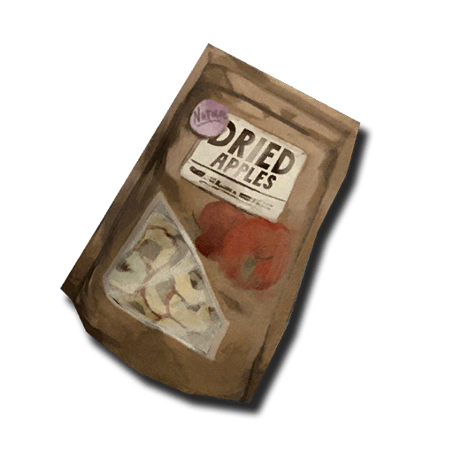
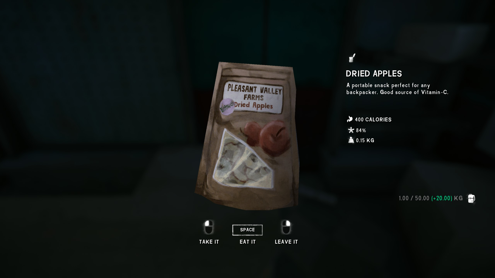

# Dried Apples

**Categories:** DLC Content, Food And Drink · **Source:** [Fandom](https://thelongdark.fandom.com/wiki/Dried_Apples)

**DLC-Exclusive content.** This content requires the [Tales from the Far Territory](./Tales%20from%20the%20Far%20Territory.md) addon to be installed before it can be seen or used in regular gameplay.

 **Dried Apples**  **Release:** [2 December 2024](./The%20Long%20Dark%20%E2%80%94%20Changelog.md#2.33) **Wintermute:** No **Renewable:** Yes ([Trader](./Trader.md) only) **Properties** **Item type:** [Food And Drink](./Food%20And%20Drink.md)\\|- **Stackable:** No **Examine:** A portable snack perfect for any backpacker. Good source of Vitamin-C. **Values** **Calories:** 400 kcal **Hydration:** 0% **[Vitamin C](./Scurvy.md):** Minor (4%) **Weight:** 0.15 kg (0.33 lbs) **Dried Apples** is a [Food And Drink](./Food%20And%20Drink.md) item in _[The Long Dark](./The%20Long%20Dark.md)_.

## Overview

Dried Apples can be consumed for up to 500 calories and weigh only 0.15 kg. It is only acquired when trading with the [Trader](./Trader.md).

Dried Apples cost the following when trading:

- 12  [Cedar Firewood](./Cedar%20Firewood.md)
- 2.00 L  [Water (Potable)](./Water%20%28Potable%29.md)

## Trivia

- The back of the bag lists "Ingredients\_Apples No Additives No Preservatives."
- The world model is different from the backpack icon, with the front of the package listing it originating from "[Pleasant Valley](./Pleasant%20Valley.md) Farms."

## Update history
