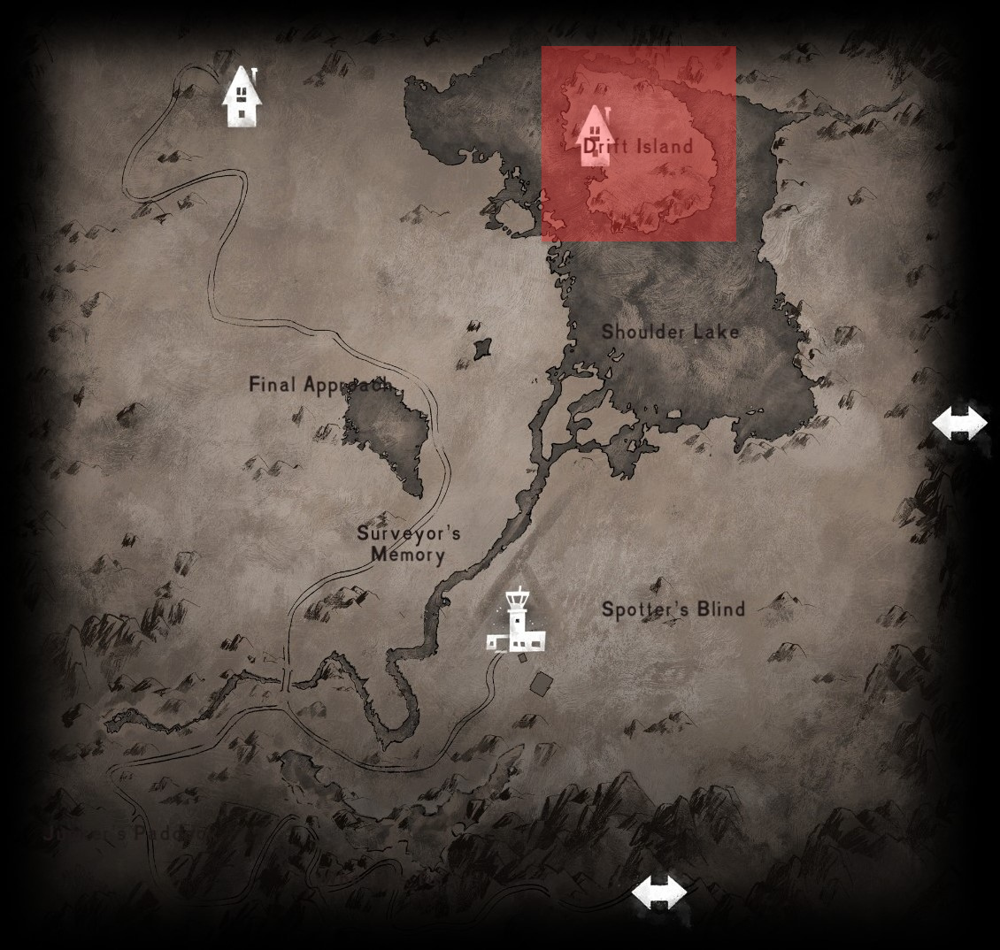

# Drift Island

**Categories:** Islands, Landmarks, Locations, Locations in Forsaken Airfield, Outdoor locations · **Source:** [Fandom](https://thelongdark.fandom.com/wiki/Drift_Island)

**Drift Island**

_Drift\_Island.png_

**Location**

_Drift\_Island\_Location.png_

**Region:** [Forsaken Airfield](./Forsaken%20Airfield.md)\|-

**Description:** A tall island in a lake.

**General**

**Type:** Landmark\|-
